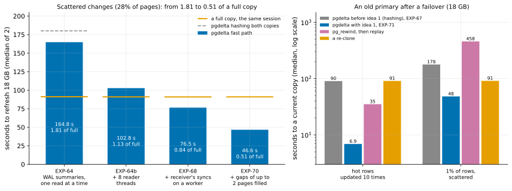
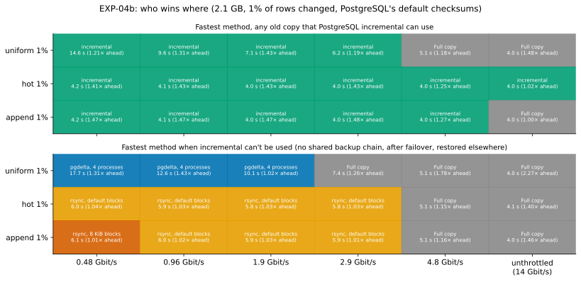

# pg-delta-backup

A CMU student project with Google's AlloyDB team: a tool that brings an older physical copy of a PostgreSQL cluster up to date by sending only the pages that changed, verifying every reused page by hash.

**Status, October 28, 2026:** the WAL-summary fast path (`--fast-path summaries`, opt-in; PostgreSQL 17.11+ with `summarize_wal` on) changes the HA picture beyond memory ([what the evidence says](docs/RESULTS.md)):
- **An 18 GB copy on 8 GB VMs:** local changes refreshed in 1.98 s against a full copy's 90.7 s ([EXP-64](docs/experiments/EXP-64-fast-path-beyond-memory.md)); scattered changes touching 28% of the pages in 46.6 s, 0.51 of a full copy ([EXP-70](docs/experiments/EXP-70-fill-gaps.md)).
- **An old primary after a failover:** 6.9 s against `pg_rewind`'s 35.1 s for hot rows, and 48.2 s against a re-clone's 91.1 s for scattered rows ([EXP-71](docs/experiments/EXP-71-idea-1-timed.md)).
- **Where its guard can't prove the old copy's lineage,** pgdelta hashes both copies as before, and the October 26 status below holds.



**Status, October 26, 2026:** see **[what the evidence says](docs/RESULTS.md)**, a one-page summary with its figures. In short:
- **v1** refreshes an old copy in place from the running server, in backup mode.
- **No wrong copy** in 14,000 randomized refreshes, from stopped and live sources (10,000 + 2,000 stopped, 1,000 + 1,000 live). A power loss mid-refresh left the copy blocked or complete in 16 of 16 resets.
- **Faster than the full copies at DR round trips**, with BBR on its socket. **As fast or faster than PostgreSQL's native incremental** there, even where its history exists.
- **On a busy primary** it costs the load no more than `pg_basebackup` at its default of one source worker per 4 CPUs (2 on 8 vCPUs, 4 on 16), and with BLAKE3 it is about 2.1× faster.
- **On AlloyDB Omni 17** it refreshes data directories correctly, stopped and live: 20 of 20 live refreshes under load. Omni's own `_mintxid` fork goes through the WAL like a page, and unlogged tables are copied as Omni's `pg_basebackup` copies them. Only PostgreSQL 17 and 18 are accepted; Omni 16 is refused.
- **Not a speed win for HA** beyond memory on capped disks (at best a tie). On Omni's Kubernetes operator an HA failover deletes the old copy's disk, so HA there would need the operator to keep and refresh it. **DR is pgdelta's case.**

The status below is October 24's, kept as it was.

**Status, October 24, 2026** (details in the [project log](docs/LOG.md))
- **Tool: v0 built** ([`pgdelta/`](pgdelta/README.md), [design](docs/DESIGN.md)).
  - It compares 8 KiB pages by keyed hash, sends only the ones that differ, and rebuilds and verifies a new copy before publishing it.
  - It hashes on worker processes (`--jobs`, default 4), building the new copy by copy-then-patch and verifying it in parallel.
- **Evidence** ([all experiments](docs/experiments/README.md), each with predictions recorded before running):
  - **Correct on ten tricky old copies,** including after failover, where skipping pages by LSN would have kept stale data ([EXP-03](docs/experiments/EXP-03-tricky-copies.md)). All 756 runs between two machines produced copies that passed `pg_verifybackup`, and every pgdelta and rsync copy was byte-identical to its source backup.
  - **Sends exactly the changed pages,** about 1% of the database for local changes ([EXP-01](docs/experiments/EXP-01-change-patterns.md), [EXP-02](docs/experiments/EXP-02-local-comparison.md)). On the wire, PostgreSQL's incremental backup sends slightly less, because staged methods must send a padded WAL segment.
  - **Worker processes cut its fixed cost by 2–3×** ([EXP-06](docs/experiments/EXP-06-engine-throughput.md)); threads didn't, because of Python's interpreter lock ([EXP-05](docs/experiments/EXP-05-parallel-hashing.md)).
  - **Between two cloud VMs** ([EXP-04](docs/experiments/EXP-04-network-sweep.md), [EXP-04b](docs/experiments/EXP-04b-default-checksums.md)), for 2.1 GB with 1% of rows changed:
    - PostgreSQL's incremental backup is the fastest delta method wherever it can be used. A full copy beats it only on the fastest links.
    - Where it can't, pgdelta is fastest only for scattered changes below about 2 Gbit/s, and rsync for local changes below about 3.9 Gbit/s.
    - A full copy wins on faster links.
  - **Why staged pgdelta can't win on fast links:** the local backup it starts from costs as much as a full copy ([EXP-07](docs/experiments/EXP-07-capture-speed.md)), and its own transfer is about as long again.
- **Target and decisions (October 23):** AlloyDB Omni's HA standby rebuild and DR re-seed. The old copy may be patched in place, TLS on the wire, no GPL code ([decisions](docs/DECISIONS.md#decisions-of-october-23-2026-t1-closed), [what Omni does today](docs/research/notes/alloydb-omni.md)). No sponsor questions are blocking.
- **New results (October 24)** ([EXP-08](docs/experiments/EXP-08-incumbent-tools.md), [EXP-09](docs/experiments/EXP-09-direct-read.md), [EXP-10](docs/experiments/EXP-10-write-path.md)), all pre-registered and independently rechecked:
  - **v1's path:** on a stopped source, reading its files directly and patching the old copy in place takes 2.7 s for local changes, against 3.1 s for a single-stream full copy on the fastest link: a ratio of 0.86, about 0.1 s inside the HA rule's 0.9, on one VM pair ([EXP-09](docs/experiments/EXP-09-direct-read.md)). T2 has since reversed this: out on fast links against a range-parallel copier built as a bound (below). Three things are still untested: reading a live source in backup mode (T8), data beyond RAM, where verification stops reading from the page cache (T9), and persistent disks.
  - **Incumbent tools:** `pg_probackup catchup` silently returned wrong data on two diverged old copies that pgdelta rebuilt correctly, in its staged mode from a stopped backup (a refresh from the live server is T8's to test). WAL-G's checked catch-up refuses them. `pg_rewind` repairs them when the old copy kept its WAL, apart from one system-catalog page on one of them, which is wrong data by the registered check; most likely it is the source's own later change, but that is unconfirmed.
  - **pgBackRest:** with a current backup in its repository, it sends fewer bytes for scattered changes, partly because pgbench's rows compress unusually well (T4 checks realistic data). So the pitch is "no repository needed". On restore time, with a backup taken just before, pgdelta's v1 path (on a stopped source) is faster than pgBackRest with zstd for local changes, and pgBackRest with zstd is faster for scattered changes below about 6–9 Gbit/s; pgBackRest's block incremental ties v1 for append on restore time, before 2 s or more of recovery that v1's stopped-source path didn't need.
- **The fastest durable full copy (T2, October 24)** ([EXP-11](docs/experiments/EXP-11-full-copy-baseline.md)), pre-registered, 468 runs, all verified, and rechecked independently (the corrections are listed in it). A parallel copier built as a bound (byte ranges over 8 streams, early write-back) made a durable 2.1 GB copy in 1.9 s on the fastest link. The released copiers tested were slower: one `pg_basebackup` stream 3.8–4.1 s, `pg_probackup catchup` with 4 or 8 threads, over SSH, 5.8–6.1 s.
  - **EXP-09's HA verdict reverses: out on fast links.** v1's path takes 1.64–1.65 times as long as the bound for local changes. With the destination's kernel write-back at Debian's default, it is faster than every released copier tested (0.77–0.81 of one stream, against EXP-09's 0.86); one `pg_basebackup` stream with write-back at 64 MiB on the destination beat it. By the registered rule, with v1 at 4 jobs, a faster hash (T5) and verifying while writing (T13) together can't reach EXP-09's line on these VMs; with v1 at 8 jobs the needed cut falls where the rule ranks them equal.
  - **On slower links, at 0.1 ms round-trip time, v1's path beats every copy measured:** below 6.5 Gbit/s for local changes and 5.0 for scattered ones. So v1 targets DR's slower links first; whether this holds at DR's latency is T12's.
  - **Conditions:** one VM pair with local NVMe, 2.1 GB in RAM, an idle source, 0.1 ms round-trip time, and v1 and the bound reading a stopped source; `pg_probackup` over SSH with a stand-in for a live primary's WAL, the others in clear. In this session v1 took 14–18% longer for local changes than in EXP-09 (8–17% for uniform), and one unthrottled `pg_basebackup` copy 22–30% longer (its single TCP stream measured 4–11% slower), so every ratio is within the session.
- **The slowdown of a busy source (T10a, October 24)** ([EXP-12](docs/experiments/EXP-12-source-slowdown.md)), pre-registered, 117 runs, 103 of them under a fixed-rate pgbench load on the source and 14 on the idle source, all verified, and rechecked independently (the corrections are listed in it). The owner's bar is "no worse than `pg_basebackup` under the same load".
  - **Every copy taken under load was correct,** for `pg_basebackup` and staged pgdelta: `pg_verifybackup`, recovery, the load's balance invariant and consistent cut, row counts, schema and `pg_amcheck`.
  - **One `pg_basebackup` stream cost the load nothing measurable** in lost work. Staged pgdelta lost 1.25–1.35 s of the load's work and stalled it for about a second, mostly in its local backup, which v1 removes: the stall falls in that backup's flush to disk, when the WAL's syncs slowed.
  - **v1's source side, measured by a proxy** (backup mode on the live server around v1's read of a stopped copy on the same disks, with no WAL streamed and none of the load's changes sent): with 4 hashing workers it slowed a source at 0.67 of its capacity more than `pg_basebackup` (0.05–0.07 s of work lost, the load's p95 latency at 69–132 ms during the copy); with 1 worker it didn't, in twice the time. At 0.33 of capacity, 4 workers met the bar. So v1 needs a cap on its source workers on busy primaries, and on fast links it now carries a caveat: by proxy at 4 source workers, it slows a busy primary more than `pg_basebackup` does.
  - **Conditions:** the load's client ran on the source and shared its CPUs, which makes both registered decisions (T5's move by R1 and the worker cap) and the results beside them fragile by the registered flags; v1 by proxy; the bar is `pg_basebackup`, not the fastest copy measured, whose slowdown waits for T8; one synthetic load, one VM pair with local NVMe, 2.1 GB in RAM, 0.1 ms round-trip time, blocks in a fixed order. The session shifted against EXP-11 (a larger copy), and this trial's capacity was 10.9% below the smoke run's, so the busy rate was 0.67 of it. The load's database grew during the session, with no drift in the load.
- **Next,** re-ranked by T10a's registered consequences: latency and transport on DR's links (T12, pre-registered as [EXP-13](docs/experiments/EXP-13-latency-transport.md), its harness built, reviewed and merged), then a faster hash (T5) and the source worker count by load (T10b), both now ahead of backup-mode reads on a live source (T8). See the [re-ranked queue](docs/DECISIONS.md#experiment-queue) and [what T10a settled](docs/DECISIONS.md#what-t10a-settled-october-24-2026).
- **Measurement harness: built.** Backup and restore checks, resource sampling, the HammerDB slowdown driver, and a two-VM network benchmark ([experiments/network/](experiments/network/README.md)).
- **Research: done.** [What already exists and where the gap is](docs/research/state-of-the-art.md).



## The problem and our niche

A destination already holds an older copy of a database cluster. `pg_basebackup` ignores it and re-sends everything.

Existing tools reuse the old copy only while a shared history holds:
- PostgreSQL 17+ incremental backup needs the old backup's manifest and unbroken WAL summaries.
- `pg_rewind` needs the old copy's WAL back to a failover.
- `pg_probackup catchup` and WAL-G catchup trust page LSNs and file times on the same timeline.
- pgBackRest verifies by hash, but only restores from its own repository.

Our niche is the copy whose history is lost: a standby whose WAL was recycled, an ex-primary after failover, a restored disk snapshot. We refresh it straight from the live server, verify every reused page by hash, and need no repository, manifest or shared timeline. Where PostgreSQL's own tools apply, we hand off to them.

**What we don't claim:** to be a backup system, to read less than native incremental when its prerequisites hold, or to beat a parallel full copy on a very fast LAN. The benchmark reports the link speed where the tool starts to win.

## Start here

1. [Research summary](docs/research/state-of-the-art.md): existing tools, correctness pitfalls, design implications.
2. [Experiments](docs/experiments/README.md): each one's question, predictions made before running, results and graphs.
   - [Decision ledger](docs/DECISIONS.md): every design decision graded by its evidence, and the experiments that would settle the gray areas.
3. [Design of pgdelta v0](docs/DESIGN.md) and [how to run it](pgdelta/README.md).
4. [Project log](docs/LOG.md): what was done, when, and why.
5. [Plan](docs/PLAN.md): workstreams, dependencies, schedule to the November 13 freeze.
6. [Specification](docs/SPEC.md): architecture, design decisions, correctness gates.
7. [Correctness contract](docs/CORRECTNESS.md): what "no data loss" means and how we test it.
8. [Questions for Ben and Sumaithri](docs/BEN-QUESTIONS.md): decisions taken, our assumptions, and non-blocking questions.
9. [References](docs/REFERENCES.md): curated reading list.
10. [Benchmark harness](benchmarks/README.md) and [native recovery suite](benchmarks/NATIVE.md).
11. [Validation log](docs/VALIDATION.md): what has actually been run.

Work items are GitHub issues #4 to #13. Older planning docs are in [docs/archive](docs/archive/).

## Run the tests and the benchmark runner

Python 3.10+:

```sh
python -m unittest discover -s tests -v
```

`benchmarks/benchmark.py` runs one method from the [method registry](benchmarks/methods.py): a full backup, native incremental plus reconstruction, or a staged rsync or pgdelta transfer from a fresh backup into a copy of an old one. It verifies the output with `pg_verifybackup` and writes a shared v3 JSON run record. It needs PostgreSQL 17 client utilities and a disposable test cluster; see [the benchmark plan](benchmarks/README.md#running-the-consolidated-cli) for the fixture and flags.

```sh
python benchmarks/benchmark.py --host 127.0.0.1 --port 5432 --user postgres --out benchmarks/runs
```

A successful run records `PASS_MANIFEST_ONLY`, not `PASS`: this runner has no restore gate. `network_bytes` is null for the native methods until network measurement exists; the staged methods fill it from their own transfer counters.
The native suite performs real restores; HammerDB supplies the larger workload.

`experiments/chunk_demo.py` is a toy model of the engine on synthetic bytes. It doesn't touch PostgreSQL or a network.
`experiments/change_patterns/` measures how many pages really change between two backups under different row-change patterns, and how that compares with PostgreSQL's own change tracker ([README](experiments/change_patterns/README.md)).

## Repository layout

```text
pgdelta/         The tool (v0): hash tree, protocol, sender, receiver
docs/            Plan, spec, design, log, correctness contract, sponsor questions, references
docs/experiments/ Experiment write-ups, curated data (data/) and figures (../figures/)
docs/research/   State-of-the-art research and its source notes
docs/references/ Open-licensed papers (others are linked in REFERENCES.md)
docs/specs/      Design and handoff records for the measurement harness
docs/archive/    Superseded planning documents
benchmarks/      Measurement harness, fixture, workloads and recorded evidence
experiments/     Tooling for each experiment (change patterns, tricky copies, network, incumbents)
analysis/        Scripts that turn raw results into the committed data and figures
infra/gcp/       Create, throttle and delete the two benchmark VMs; install the incumbent tools
tests/           Unit and contract tests
.github/         CI and issue/PR templates
```

## Language

v0 is Python: it plugs into the existing harness, and hashing runs as compiled code through `hashlib`.
EXP-02 showed hashing is the bottleneck. EXP-05 tests whether hashing on several threads is enough
before reaching for a compiled core (Rust).
C would only be needed for a PostgreSQL patch, which is out of scope.

## Contribution rules

Every issue has one owner, a reviewer, an artifact, and a falsifiable completion criterion.
Research ends in a short decision note, an experiment, or a PR, not only a reading list.
Do not use real customer data, commit credentials, or treat a successful hash check as proof of database recovery.
No open-source license is selected until the collaboration's ownership and contribution terms are confirmed.
