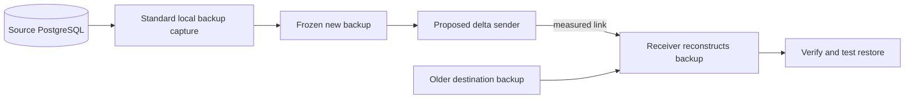

# Consolidated benchmark and tool choices

Sam's `benchmark-harness-v0.1` commit `ff8b85e` is preserved as a parent of the consolidation merge. Its full-backup CLI, Docker fixture, HammerDB scripts and tests are integrated with the native recovery suite. There is one shared backup implementation in `benchmarks/backup.py`.

## Two entry points, shared backup phases

| Entry point | Purpose | Uses |
|---|---|---|
| `python -m benchmarks.benchmark` | Run one registered backup method against an existing disposable fixture; retain logs and results | Shared capture, input verification, combination or transfer, final verification, timers and v3 backup record |
| `python -m benchmarks.native_baseline` | Create small isolated databases, run the randomized matrix, and test actual recovery | The same adapters and record, plus controlled fixtures, pgbench, restore oracles and negative controls |

Both paths default to plain format, streamed WAL, SHA256 manifests, a fast checkpoint and normal PostgreSQL synchronization. The CLI permits an explicit checksum/checkpoint choice, recorded with the run; comparisons must match those choices. Disabling file checksums (`NONE`) is rejected, and every listed basis file must have a checksum. PostgreSQL can otherwise accept a manifest without file checksums, which cannot detect same-size data corruption. `--format tar` is now rejected because this PG17 verification path expects an unpacked plain backup. The harness has no transfer engine of its own: the staged methods call rsync or the separately developed pgdelta tool.

Methods are registered in [`methods.py`](methods.py); `run_backup` looks them up by name, and the CLI, the native suite and the HammerDB driver take their `--method` choices from the registry. The original four are `pg_basebackup_full`, `pg_basebackup_incremental`, and the staged transfers `rsync_staged` and `pg_delta_staged` described below; the two live methods are documented immediately afterward. Incremental requires a complete immutable B0, verifies it as preparation, captures I1, verifies I1, combines B0+I1 with `--copy`, then verifies the resulting full package. A failing phase stops the pipeline. The native suite passes the actual B0 verification result obtained before workload launch; the standalone CLI performs that prerequisite itself. Chained incremental bases are outside this CLI's initial contract.

October 29 extension: two more methods, `pg_delta_live` and
`pg_delta_live_summaries`, refresh a prepared copy of B0 directly from live
PGDATA, with no staged full source capture. All three frontends accept them.
They require source-local file access and PostgreSQL tools on the execution
host. Their explicit `PASS_ENGINE_ONLY` verdict validates the engine receipt,
output identity and packaged WAL; it does not claim manifest verification or
restore. The native suite adds the exact-cutoff reference comparison. See
[LIVE.md](LIVE.md) for local, GCP and Docker/HammerDB commands and limits.

The CLI's result is `PASS_MANIFEST_ONLY` for native/staged methods or
`PASS_ENGINE_ONLY` for live methods, with `restore_tested: false`. That remains
true when a surrounding integration test subsequently restores the output:
the restore verdict is recorded separately. The native trial's outer `pass`
includes its documented logical recovery checks. Historical results without
an exact-cutoff verdict retain their original correctness scope.

## Shared result schema v3

Sam's original ten-field v0.1 record is extended deliberately, with contract tests. Version 2 separated manifest verification from restore; version 3 adds `transfer` and `transfer_stats` for methods that move bytes between a staged backup and an old copy. The two native methods produce exactly the v2 record plus those two keys set to null. All frontends retain the shared backup record. Native results embed it under `backup_result`; their outer record also contains workload and restore evidence. Existing convenience timing fields are derived from that shared result. Previously committed v1 and v2 evidence is historical and is not rewritten.

| Field | Meaning |
|---|---|
| `backup`, `verification` | Capture and final manifest/WAL verification outcomes; for staged methods `verification.output_check` records the output check below |
| `basis_verification` | Incremental prerequisite, outside refresh timing; the creation/storage of B0 must also be disclosed. The CLI also records here a basis that changed during the run (`FAIL_BASIS`, with `changes`) |
| `increment_verification`, `combination` | Incremental-only phases; null for full backup |
| `transfer`, `transfer_stats` | Staged-method transfer phase and its counters (tool, version, bytes each way, literal/matched data, untimed `preparation` phases); null for the native methods |
| Phase `exit_code`, `duration_seconds`, `error` | Execution outcome; timeout/missing executable is a failure, never a successful zero-time run |
| `backup_file_bytes`, `output_file_bytes` | Apparent captured and usable-output file lengths, including WAL/metadata; not network bytes. Null when the directory is missing or is itself a symlink |
| `method_seconds` | Wall time for capture and any input verification, reconstruction or transfer |
| `time_to_verified_seconds` | Wall time through final verification; null on failure |
| `integrity_verified`, `restore_tested`, `status` | Explicit distinction between manifest integrity and separately tested recovery |
| `network_bytes`, `unavailable_metrics` | `bytes_source_to_dest + bytes_dest_to_source` from `transfer_stats` when a method reports both; otherwise null plus reason until a transport observer exists. A filled value is the method's own count of its transfer stream, flagged under `unavailable_metrics.interface_bytes`; it is not an interface or packet measurement |

Each executed CLI phase also has a `resources` observation when Linux `/proc` is available, with a sibling `.resources.jsonl` sample series. The CLI sees its own backup/verification process tree, not the PostgreSQL server in a separate container or host. The native suite additionally samples its owned source server and records PostgreSQL cumulative-statistics deltas. The host-side [Compose resource observer](observe_docker.py) samples both Compose services during HammerDB experiments. These sources have different scopes and must not be merged into one wire-byte or device-I/O figure.

Timings include command launch and waiting. At the smoke database's short durations, orchestration overhead is material. These measurements are not a performance acceptance threshold. Execution logs and atomically published JSON survive failures; POSIX command timeouts kill the process group. The CLI refuses source/basis/output overlap, including symlink aliases. For every method that takes a basis, it also snapshots B before the run: path, type, mode, size, mtime, ctime, inode and device of every entry, without hashing contents. It compares the snapshot again afterwards. Any change fails the run as `FAIL_BASIS` (exit 4), whatever the method reported, and the first changes are listed in `basis_verification`. ctime is included because a write cannot set it back, so a same-size rewrite that restores mtime is still caught. Auth/TLS environment settings are preserved while implicit libpq routing settings are removed.

## Staged transfer methods and their timing

Both staged methods follow [SPEC section 2](../docs/SPEC.md): a fresh full `pg_basebackup` S is captured on the source side, and the output O is built from S and the old copy B without modifying B. O is first verified with `pg_verifybackup --manifest-path S/backup_manifest O`. That alone does not show that O matches S. PostgreSQL 17.11's tool skips `backup_manifest`, `postgresql.auto.conf`, `recovery.signal`, `standby.signal`, the `pg_wal` entries outside the backup's WAL range and empty directories. It also reads straight through an O that is a symlink to S or hard links into it.

So `run_backup` then runs the harness's output check, [`output_check.py`](output_check.py), for every method registered with `output_matches_capture`. The check runs under the method's `python` tool, wherever the method's commands run (inside the runner container for HammerDB). O must be a real directory, not a symlink, and must not overlap S or B. No entry of O may be the same file (device and inode) as an entry of S or B, have a second hard link, or be a symlink into S or B. O must also hold exactly S's relative paths and types, with byte-identical files (streamed in 1 MiB chunks) and identical symlink targets. Any difference fails the run as `FAIL_VERIFY`. The first differences are listed in `verification.error` and in full in `verification.output_check`. A transfer that leaves any of B's content in O, or publishes O as a link to S, therefore fails.

Status adds `FAIL_PREPARE` and `FAIL_TRANSFER` to the existing failure states, and unreadable transfer statistics count as `FAIL_TRANSFER`, so no sample is reported without byte counts.

- `rsync_staged` copies B to a new O, then runs `rsync --archive --checksum --no-whole-file --inplace --block-size=8192 --delete --stats S/ O/` and parses the `--stats` block, in GNU rsync 3.x or macOS openrsync layout. `--rsync` selects the executable and its version banner is recorded. rsync updates the old copy in place; the copy only keeps B reusable across trials.
- `pg_delta_staged` runs `python -m pgdelta local --source S --basis B --output O --stats-json FILE [--pg-controldata PATH]`, with FILE beside O, and reads `bytes_source_to_dest` and `bytes_dest_to_source` from it. The whole statistics object is retained under `transfer_stats.reported`. `--pgdelta` replaces the command prefix; `python -m pgdelta` needs the package importable from the working directory or `PYTHONPATH`.

| Phase | Record | Timing |
|---|---|---|
| Preparation: rsync version probe, copy B to O | `transfer_stats.preparation` | Outside `method_seconds` and `time_to_verified_seconds`, like B0 verification. The native suite and the HammerDB driver run it before the workload starts. Its duration is still recorded and must be disclosed |
| Staging capture of S | `backup` | Inside the timer; in a two-host deployment it runs on the source side, not across the link |
| Transfer S (and B) to O | `transfer` | Inside the timer |
| Verification of O against S's manifest | `verification` | `time_to_verified_seconds` only |
| Output check: O independent of S and B, and identical to S | `verification.output_check` | Outside both timers: it needs S next to O, which only the harness has. The native suite and the HammerDB driver end their measured windows before it runs; HammerDB also waits for the workload to exit first. Its duration is recorded |

The two staged methods are therefore not timed on the same terms. `rsync_staged`'s untimed preparation copies B into O, so its timer covers only rsync's in-place update. `pg_delta_staged` has no preparation and builds O from B and S inside its timed transfer, copying every reused page. Their `method_seconds` and `time_to_verified_seconds` are not a like-for-like comparison. `report_native` adds a "preparation + method seconds" column (`preparation_seconds + method_seconds`) for that; elsewhere, add the `transfer_stats.preparation` durations to `method_seconds`.

`method_seconds` is wall time from the start of capture to the end of the transfer, including the gap between them; `time_to_verified_seconds` adds verification. Every run so far keeps S, B and O on one host, so the byte counts are the tools' own transfer-stream counters, with no network crossed. rsync's are protocol-stream bytes for a local push (sent is source to destination) and exclude SSH/TCP framing. pgdelta's are whatever its statistics file reports. Neither replaces the independent link observer planned in [PLAN.md](../docs/PLAN.md#interfaces-to-agree-at-the-sync).

## Adding a method

Write a function in `methods.py` that takes the `Context` and runs its phases through `ctx.execute(stage, argv)`. It returns a dict with any of `backup`, `increment_verification`, `combination` and `transfer` (phase records), `transfer_stats` (a dict), `failure` (a status and exit code, or None) and `verify_manifest`. Then `register()` a `Method` naming it, whether it needs a basis, its capture directory (`increment`, `staging` or none), the tools it needs and any untimed `prepare` step. Set `output_matches_capture` when O must be an exact, independent copy of the capture, as for the staged methods; it requires the `python` tool. `run_backup` handles basis verification for methods that trust the basis, preparation, the timer, the final verification, the output check and the v3 record, so the three frontends need no edits. Only a new tool flag (as `--rsync` was) touches a frontend. Add stub-backed tests like `tests/test_methods.py`.

For a method without a PostgreSQL manifest, a `Method.verify(ctx, phases)`
callback replaces final `pg_verifybackup` and must use the explicit
`success_status='PASS_ENGINE_ONLY'`. This extends schema v3's status vocabulary
without changing its structural key set. Verification records identify
`kind`; live records carry `report.recovery_endpoint` for the native oracle.
`source_local=True` requires `Context.source_pgdata`; optional per-run worker
settings live in `Context.options`. Authentic engine evidence cannot be
reported as a manifest or restore pass. `source_provenance.code_sha256`
identifies actual Python sources, including exported uncommitted code.

## HammerDB and pgbench have different jobs

Our account-transfer fixture already uses PostgreSQL's existing **pgbench**, not a new load generator. pgbench supplies concurrency, fixed offered rates, random scheduling and transaction logs; our small SQL script supplies changes with an easily checked invariant. It is useful for deterministic recovery cases and measuring latency under a chosen load. [pgbench documentation](https://www.postgresql.org/docs/17/pgbench.html)

**HammerDB TPROC-C** supplies a richer order-processing schema, data generator and five transaction types. Reuse Sam's scripts for application-oriented performance experiments. TPROC-C is derived from TPC-C and has important driver differences; it is not an audited TPC-C result. It cannot replace a restore oracle. [HammerDB workload definition](https://www.hammerdb.com/docs/ch03s06.html)

Do not replace one with the other or treat their scores as interchangeable. pgbench TPS is not HammerDB new orders per minute (NOPM). Do not force pgbench's offered-rate percentages onto HammerDB's virtual-user-driven load without a separate calibration. Record warehouses, virtual users, all-warehouse behavior, rampup and measurement windows. Sam's scripts enable `pg_allwarehouse`; default home-warehouse sizing advice must be interpreted with that setting in mind. [HammerDB sizing guidance](https://www.hammerdb.com/docs/ch03s07.html)

The current exact-data restore checker is specific to the account-transfer fixture. Adding HammerDB to the recovery acceptance gate requires an expected-state export/checker covering its schema and a declared recovery point. Importing the scripts alone does not provide that guarantee. The full HammerDB performance matrix remains to be automated and rerun with retained raw evidence.

## Existing tools to reuse

| Tool | Decision and role |
|---|---|
| PostgreSQL `pg_basebackup`, `pg_combinebackup`, `pg_verifybackup` | Already used for capture, native incremental reconstruction and integrity/WAL validation. Our code orchestrates them. |
| pgbench | Already used for inexpensive controlled workloads and per-transaction observations. |
| HammerDB | Sam's schema builder and workload scripts retained for the larger application benchmark. Do not implement a new TPC-C-like generator. |
| Docker / Compose | Shared environment packaging and lifecycle; optional on a machine with matching tools installed. |
| [rsync](https://download.samba.org/pub/rsync/rsync.1) | Registered as `rsync_staged`: delta mode forced with `--no-whole-file` on frozen staged inputs, with basis-copy, transfer and verification work recorded separately. Do not synchronize changing live PGDATA and call it a valid backup. The SPEC's in-backup-mode rsync variant is not implemented. |
| [pgBackRest](https://pgbackrest.org/user-guide.html) | Later production-backup comparison; supports established backup/restore workflows. Keep its repository, compression and recovery semantics explicit. It is a comparison target, not the custom algorithm. |
| [sysstat](https://sysstat.github.io/) (`pidstat`, `iostat`) | Reuse process and device observations when implementing resource instrumentation; account for child/server processes and observer overhead. |
| Linux interface counters / packet capture | Count the designated backup link in both directions. Container-wide traffic may include workload traffic, and summing both endpoints double-counts the same bytes. Validate the observer before claiming savings. |
| [iperf3](https://software.es.net/iperf/) | Calibrate the test link before backup runs. It is not a measurement of bytes sent by the backup itself. |

We do not need Kubernetes, a custom scheduler, a monitoring dashboard, or a new backup manager for the first baseline. The project-specific layer is experiment coordination, consistent timing boundaries, independent recovery checks, and reproducible reports.

## Why Docker is useful, and its limits

A container packages the database/client dependencies and gives each run a separate process/filesystem environment. Compose defines how the fixture database and backup runner start and connect. This reduces teammate setup differences and makes disposable environments easy to recreate. Docker does not implement the benchmark or require GCP. Both Python entrypoints can run directly on Linux with matching PostgreSQL 17 binaries. [Docker container explanation](https://docs.docker.com/get-started/docker-concepts/the-basics/what-is-a-container/)

Both runner images now come from **one Dockerfile**: `--target cli` for the configurable runner and `--target native` for recovery smoke. Sam's separate `fixture/runner.Dockerfile` is retired. Compose's `runner` service uses the CLI target. PostgreSQL base images should be resolved to a digest before a measured experiment; record the built runtime identity and all software versions for the controlled baseline as well.

CPU/memory limits are limits, not exclusive reservations of physical hardware. Separate containers can still compete for the same CPU, cache, network and disk; separate Docker volumes do not imply separate disks. Docker Desktop also adds its VM environment. Final claims require a documented host, storage and topology, whether containers are used or not. [Docker resource controls](https://docs.docker.com/engine/containers/resource_constraints/)

No cloud provisioning is part of this consolidation. GCP can host the future controlled lab once the personal-billing issue and spending allowance are resolved.

## Completion still required

The combined code is a working integration foundation. It is not the completed baseline release: finish the HammerDB recovery oracle and workload coordination, matched no-backup windows, network/resource observers, calibrated scales and repeated controlled runs. See [BASELINE-GATE.md](BASELINE-GATE.md). Candidate optimization follows that release.

## Where to implement the proposed tool

This decision concerns the eventual delta algorithm, not the Python experiment runner. A binary or executable is simply a program that can be launched, such as `pg_basebackup`. That existing client is itself a separate executable built from PostgreSQL's source tree, so using PostgreSQL code and shipping a separate executable are not mutually exclusive.

| Choice | Meaning | Tradeoff |
|---|---|---|
| Standalone helper | A new command uses standard PostgreSQL backup interfaces, then selects and transfers reusable/new data. | Easy to compare and iterate without a custom database server; a staged implementation incurs capture, local disk and hashing costs. |
| Modify the PostgreSQL client | Change `pg_basebackup` or reuse its implementation. | Reuses existing client plumbing; filtering bytes after they crossed the measured link cannot save that transfer. |
| Modify PostgreSQL server/protocol | Add selection or transfer behavior where the server produces the backup. | Can avoid earlier work or transfer, but requires a custom server build and broader recovery/protocol testing. |

Engineering recommendation: first prototype a standalone helper against completed, immutable backups captured on the source side. Reuse standard capture/recovery tools and include staging costs in end-to-end results. Compare against full transfer and rsync before inventing new transport infrastructure. Revisit server integration if the measured bottleneck or agreed deployment target justifies it. This is a recommendation, not a finalized team decision.

This diagram is a proposed implementation, not a completed feature. Source-side placement matters: capturing a full backup across the same constrained link before deduplicating it would defeat the intended network savings. PostgreSQL's backup protocol handles the running database; ordinary synchronization of changing live PGDATA is not a substitute. See [pg_basebackup](https://www.postgresql.org/docs/17/app-pgbasebackup.html) and the [replication protocol](https://www.postgresql.org/docs/17/protocol-replication.html).

Self-review on October 9 covered shared phase order, failure propagation, timing boundaries, restore verdicts, basis/output isolation, packaging and CI evidence. It found and fixed the checksum-disabled integrity loophole above. Unit regression cases cover the CLI/shared API and imported bases; the real PostgreSQL CLI smoke also checks that an unchecksummed basis is rejected before capture. Active-cutoff correctness, transport accounting and controlled performance remain the explicit release gaps described above.
