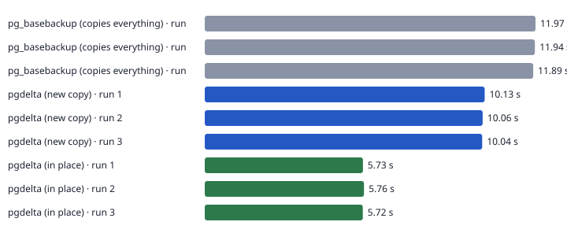
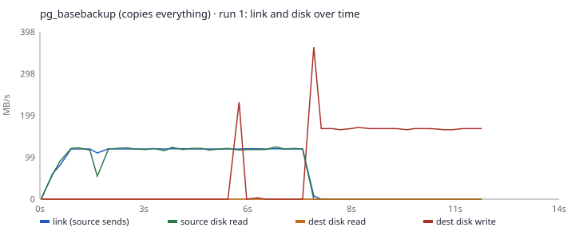
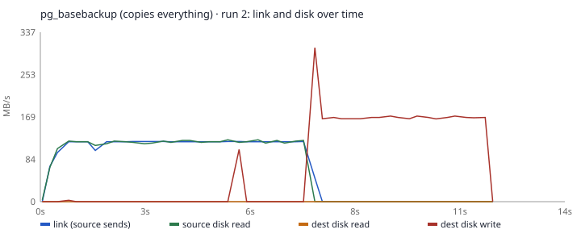
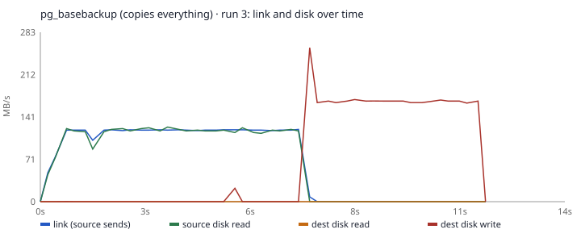
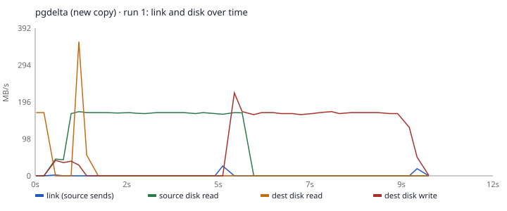
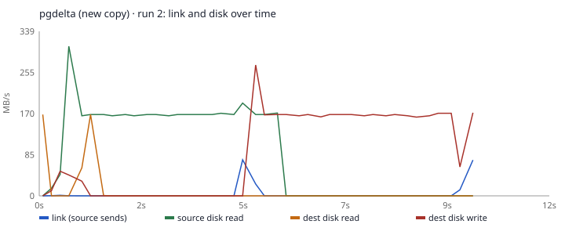
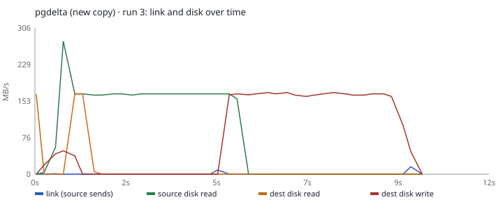
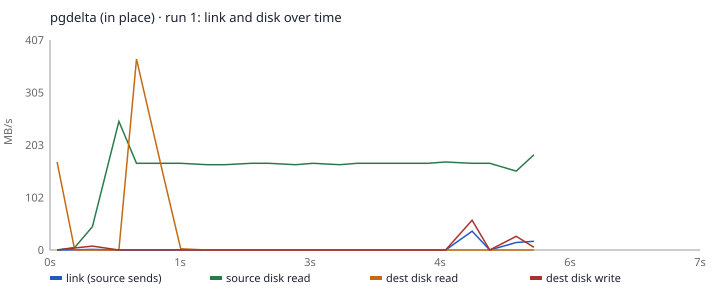
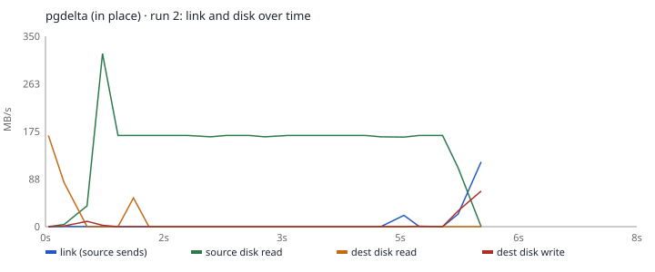
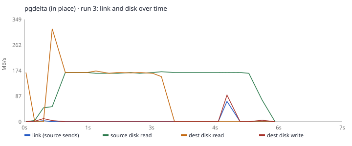

# Run cloud-resources-hot-20261120


**Where:** gcp. **Database:** pgbench scale 50 (1.5 GB on disk). **Change:** 1% of rows, hot. **Repeats:** 3.

**VMs:** two n2-standard-4 in us-central1-a, us-central1-b, each with a 50 GB pd-balanced data disk; Debian 13, PostgreSQL 17.12. **Link:** 1gbit. **Round trip:** 0.81 ms. VMs deleted: yes.

## Results

| Lane | Time | Sent | Of S's files | Pages sent | Pages reused | Copy check | vs pg_basebackup |
|---|---|---|---|---|---|---|---|
| pg_basebackup (copies everything) · run 1 | 11.97 s | 816.0 MB | 54.9% | – | – | match | 1.00× |
| pg_basebackup (copies everything) · run 2 | 11.94 s | 816.0 MB | 54.9% | – | – | match | 1.00× |
| pg_basebackup (copies everything) · run 3 | 11.89 s | 816.1 MB | 54.9% | – | – | match | 1.00× |
| pgdelta (new copy) · run 1 | 10.13 s | 33.1 MB | 2.2% | 4,029 | 97,594 | match | 0.85× |
| pgdelta (new copy) · run 2 | 10.06 s | 33.1 MB | 2.2% | 4,029 | 97,594 | match | 0.84× |
| pgdelta (new copy) · run 3 | 10.04 s | 33.1 MB | 2.2% | 4,029 | 97,594 | match | 0.84× |
| pgdelta (in place) · run 1 | 5.73 s | 33.1 MB | 2.2% | 4,029 | 97,594 | match | 0.48× |
| pgdelta (in place) · run 2 | 5.76 s | 33.1 MB | 2.2% | 4,029 | 97,594 | match | 0.48× |
| pgdelta (in place) · run 3 | 5.72 s | 33.1 MB | 2.2% | 4,029 | 97,594 | match | 0.48× |

Every lane is timed the same way: on the machine doing the work, from just before the command starts to just after it exits. Each pgdelta copy is started with PostgreSQL and its rows compared with the source's (the copy check).

`pg_basebackup` skips old WAL and temporary files, so it sends less than S's whole directory.



## Correctness

The refreshed copy was started; its rows and balance (5000000|350000) match the source (5000000|350000). pgdelta also checked every file against the source's digest.

## Link and disk over time

From the 0.1-second samplers on both VMs.











## Cost

Estimated before the run: about 7.0 minutes and $0.05 (approximate list prices for us-central1; a guide, not billing).

## Reproduce

```bash
python -m bench run --config benchmarks/evidence/2026-11-20-cloud-resources-hot/config.json
```

See [resource methodology and supporting evidence](README.md) for the memory sampler and reproduction instructions.
