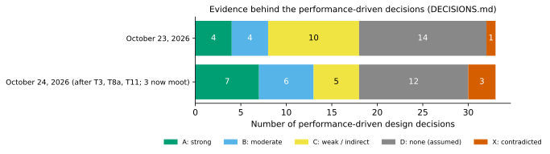
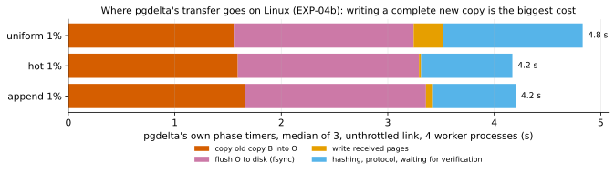

# Decision ledger

*Update, October 24, 2026 (later): test T2 ran ([EXP-11](experiments/EXP-11-full-copy-baseline.md)); see [What T2 settled](#what-t2-settled-october-24-2026). Rows it changes are marked in italics with the date, and the queue is re-ranked.*

*Update, October 24, 2026: tests T3, T8a and T11 ran ([EXP-08](experiments/EXP-08-incumbent-tools.md), [EXP-09](experiments/EXP-09-direct-read.md), [EXP-10](experiments/EXP-10-write-path.md)); see [What T3, T8a and T11 settled](#what-t3-t8a-and-t11-settled-october-24-2026). Rows they change are marked in italics with the date.*

*Update, night of October 23, 2026: the sponsor questions (T1) are closed by the owner's decisions, recorded in [Decisions of October 23](#decisions-of-october-23-2026-t1-closed). Rows they change are marked.*

*A review of pgdelta v0 and the proposed v1, 23 October 2026. Nothing was re-run for this review. It reads the committed experiments and rechecks their numbers from the CSV files in `docs/experiments/data/`. It also reads pgdelta's own phase timers from the cloud runs, now committed as [exp04-pgdelta-timers.csv](experiments/data/exp04-pgdelta-timers.csv) (see "Where pgdelta's time goes").*

This page lists every design decision in pgdelta v0 and the proposed v1. For each one it grades the evidence, says exactly what is still uncertain (the gray area), and names the test that would settle it. It answers three questions:

1. Is v0 the right direction, given the research?
2. Does v1 throw v0 away or build on it?
3. Is every performance decision backed by evidence, or are we adding things blindly?

**Sources:**
- the experiment write-ups EXP-01 to EXP-07 and EXP-04b, with their data in `docs/experiments/data/`;
- the design documents (DESIGN, SPEC, CORRECTNESS, PLAN, `pgdelta/README.md`, `docs/BEN-QUESTIONS.md`) and the receiver code;
- the research summary `docs/research/state-of-the-art.md` and its notes;
- pgdelta's per-phase timers from the cloud runs of EXP-04 and EXP-04b, taken from field `tool_reported.timings_seconds` of the raw run files and committed as [exp04-pgdelta-timers.csv](experiments/data/exp04-pgdelta-timers.csv) (all 252 pgdelta runs; task T0 below, done).

## Terms

- **PostgreSQL data directory (PGDATA).** The folder holding a database server's files. Tables are stored as files of 8 KiB **pages**.
- **Physical copy.** A byte-for-byte copy of that folder.
- **B, S, O.** B is the old copy at the destination. S is a fresh backup taken on the source machine (used only by v0). O is the new, verified copy pgdelta builds next to B.
- **Refresh.** Bringing an old copy up to date by sending only what changed.
- **WAL (write-ahead log).** The server's log of every change. Replaying it repairs a copy that was read while the server was running.
- **LSN.** A position in the WAL. Each page records the LSN of its last logged change.
- **Checkpoint, redo point.** A checkpoint flushes changes to disk. A copy's redo point is where replay would start for it.
- **Timeline.** A numbered branch of WAL history. A failover starts a new timeline.
- **Hint bits.** Small status flags PostgreSQL sets on pages when it reads them. They are not always logged in the WAL.
- **WAL summaries, native incremental backup.** PostgreSQL 17's record of which pages changed, and the backup type that uses it. Both need B to be a backup of the same server with its manifest, and summaries covering the whole gap.
- **Manifest (backup_manifest).** A list of a backup's files and checksums. `pg_verifybackup` checks a backup against it.
- **pg_rewind.** A PostgreSQL tool that repairs a former primary server using the WAL.
- **Catch-up tools.** `pg_probackup catchup` and WAL-G catchup. They refresh a stopped copy from a live server. They trust page LSNs and file timestamps, and they check that both copies come from the same server and history.
- **pgBackRest, repository, delta restore.** A backup tool that keeps backups in a separate store (the repository). Its `restore --delta` rebuilds a data directory from the repository, reusing files and blocks whose checksums still match.
- **Lineage-free copy.** An old copy with no usable history linking it to the source: a standby whose WAL was recycled, an ex-primary after failover, or a restored disk snapshot.
- **Hash, digest, fingerprint.** A short value computed from data; equal fingerprints mean equal data with overwhelming probability. A **keyed hash** mixes in a secret key, so nobody can craft two different pages with the same fingerprint.
- **Hash tree.** Pages (the leaves) grouped into 1 MiB **nodes**. The two sides compare node fingerprints first, and page fingerprints only inside nodes that differ.
- **Backup mode.** The `pg_backup_start` / `pg_backup_stop` calls. Files read from a running server between them become consistent after WAL replay.
- **Capture.** Taking S with `pg_basebackup` on the source.
- **Full copy.** Sending the whole database with `pg_basebackup` over the network. It is **durable** when it flushes to disk, which pg_basebackup does by default.
- **Crossover.** The link speed below which a method finishes faster than a full copy.
- **Page cache.** The operating system's in-memory cache of file data.
- **fsync.** Forcing written data from memory onto the disk.
- **In place.** Changing B itself, instead of writing a new O. An **undo journal** saves the bytes about to be overwritten, so a failed run can put B back.
- **Reflink (clone).** A filesystem feature (XFS, Btrfs, ZFS; not ext4) that makes a copy share the original's disk blocks until one of them changes.
- **Manifest checksums.** The per-file checksums pg_basebackup writes into its manifest. CRC32C is PostgreSQL's default; SHA-256 is much slower.
- **Engine changes A, B, C (EXP-06).** A: hashing on worker processes. B: copy-then-patch rebuild. C: pipelined verification.
- **Round-trip time (RTT).** How long a message takes to go and come back. All tests here ran at about 0.1 ms.
- **Egress cost.** What a cloud charges per byte sent between regions.
- **Source slowdown (degradation).** How much a refresh slows the live database it reads from. It is one of the sponsor's three metrics.
- **Pre-registration.** Writing predictions and decision rules down before running an experiment.
- **The Mac, the VMs.** EXP-02, 05 and 06 ran on one shared laptop with both ends local. EXP-04, 04b and 07 ran on two Google Cloud `n2-standard-8` VMs with local NVMe disks (ext4), on a link shaped from 0.1 Gbit/s to unthrottled (about 14 Gbit/s), with no added latency.

## How grades are assigned

| Grade | Meaning |
|---|---|
| **A** strong | Measured directly on the relevant platform, pre-registered or replicated, with robust results that favour the decision over the alternatives tested. For correctness: shown by experiments and tests. |
| **B** moderate | Measured, but on another platform (the Mac), with a small or borderline effect, a single run, or a value judgment in the last step. Or a sound correctness argument backed by tests. |
| **C** weak or indirect | Modelled, inferred from other measurements, measured only at small scale, or contradicted in part. |
| **D** none | Assumed, inherited as a default, or never varied. |
| **X** contradicted | The evidence goes against the decision as written. |
| **–** moot | Made irrelevant by a later decision (added October 24). Not counted in the scorecard. |

A grade judges the evidence, not the decision. A D can still be a good choice; it just hasn't been shown to be one. Where a decision has both a correctness side and a performance side, this ledger grades the two separately (for example D38 and D38p).

## Short answers

### 1. Is v0 the right direction?

**Partly. The way v0 decides what to reuse is right. The staged deployment is wrong for performance. And the way v0 writes the new copy is its largest remaining cost, which was never compared with anything else.** *October 23–24: compared in EXP-10; patching in place wins (D85), and the new-copy mode moves its fsync to a background thread and uses clones where it can (D86).*

**The verification core has grade-A support.** pgdelta compares keyed 128-bit fingerprints of every 8 KiB page on both hosts. It never lets page LSNs, timestamps or sizes skip a page unchecked, and it verifies every output byte against the source.
- EXP-01: 8 KiB units send 28.1% of the database for 1% uniform updates, against 52.1% for 64 KiB chunks.
- EXP-02: pgdelta sends exactly the page-level minimum, the same as rsync with 8 KiB blocks in 37 of 37 trials.
- EXP-03: correct on 10 of 10 tricky copies.

**What EXP-03 does and doesn't show.** Its comparison was a bare LSN threshold with no identity or timeline checks. That shortcut kept differing pages in 4 of 8 cases, but the harm varies a lot:
- **S2** held stale data: 2,371 pages after a failover.
- **S6** held 7,925 pages with invalid checksums. pgdelta's own checksum-version gate also catches this case.
- **S1 and S7** held harmless hint-bit differences.

Real catch-up tools check identity and timeline. By the research's tool table they would refuse S2 rather than corrupt it, but this was not run. So in the failover case pgdelta's measured edge is reuse (48% of pages sent instead of a full copy), not correctness. Against pg_rewind nothing has been measured. *October 24 (EXP-08): the catch-up tools and pg_rewind were run; `pg_probackup catchup` returned wrong data on two diverged copies that staged pgdelta rebuilt correctly, and WAL-G's checked catch-up refused them (see D01, D11).*

**How it compares with the frontier.** v0 matches the content-hash systems in the research: sqlite3_rsync's multi-level page hashes and Cassandra's Merkle-tree repair. But the research recommends a hybrid, and v0 implements only the half where hashes decide what is true. The other half uses WAL summaries, LSNs and cached trees to decide what to read first. The niche (copies with no usable history) rules out reading less, so "read everything on both sides" is a structural floor. Also, most comparable tools refresh the old copy in place. v0's rule that B is never modified traces to a placeholder answer of September 30 that the sponsor never confirmed.

**The staged deployment is contradicted for performance (grade X).** Taking S first costs as much as a whole full copy: median 3.98-4.04 s against 3.96-4.13 s (EXP-04b). It also uses more source CPU than the whole full copy.

**Writing O is the largest pgdelta-specific cost.** For local changes, the receiver's write phase takes 3.3-3.5 s of a 4.3-4.5 s transfer: copying B's bytes 1.5-1.7 s, then fsync about 1.7 s. rsync did the same work during the capture, where it was hidden. That, not the engine, explains most of rsync's lead for local changes.

**The niche is real but narrow.** See "Where pgdelta stands today" below. Against rsync, pgdelta's present value is keyed verification and safety, not bytes or speed.

### 2. Does v1 scrap v0 or build on it?

**v1 builds on v0's correctness core. Two big parts are conditional.**

**Keep**, because they're validated across about 670-740 pgdelta runs:
- keyed verification of every output byte;
- the hash tree and the position-by-position comparison;
- the framed protocol and its byte accounting (within 0.4% of the network counters);
- the identity gate as a policy;
- the placement and input checks, and the receipt;
- worker-process hashing;
- the test suite and the harness.

**Conditional:**
- **A complete new copy, with B never touched.** This depends on whether the sponsor needs B to survive a failed refresh. That has never been asked, and the in-place alternative was never measured. *Settled October 23 (O5): B may be patched in place; T3 (e) measures it. Measured October 23 (EXP-10 (e)): in place is v1's chosen default (D85).*
- **The custom engine itself.** The plan's "rsync gate" fired: the bytes are equal. Single process against single process, the two are about even for scattered changes. rsync was never run in parallel or with the same write strategy. Whether v1 keeps pgdelta's engine, or wraps rsync with pgdelta's verification and publish logic, waits on T1 and T6. *Settled October 23 (O7): no GPL code, so v1 keeps its own engine.*

**Replace:**
- **The source path.** Read PGDATA directly in backup mode, stream only the WAL actually written, emit a `backup_manifest` (v1 loses the "byte-identical to S" check), and apply PostgreSQL's backup exclusion list.
- **The destination write path,** today about 3.3 s of copying and flushing.
- **Possibly the hash,** if T5 or T10a show that source CPU matters.

**How the three proposals stand (all grade C):** *October 24: (2) is now B (EXP-09, on a stopped source); (1) and (3) are moot (O9), and their v1 equivalents, in place and clones, were measured in EXP-10.*

| Proposal | Verdict |
|---|---|
| (2) Read the source's files directly in backup mode | Removes a strongly measured 4.0 s capture. Its speed is inferred from a raw-read bound with no hashing, checkpoint or WAL, and its correctness under live writes is untested. Run the cheap T8a (half a day) before the 1-2 week build (T8). |
| (3) Prepare O during the capture, like rsync | Targets the largest measured cost, but only hides it under a capture, which v1 removes. In v1 the equivalents are reflinks, in-place patching with an undo journal, or early write-back. |
| (1) Start the session before the capture | Worth a few tenths of a second with today's write path. Once the write path is fixed it could reach about 1 s. Only helps while a capture exists. |

Build (1) and (3) only if staged mode survives as a product, for example to ship an existing nightly backup offsite. Suggested order: T1, T10a, T11, T8a, T2, T3, T6, then T8. *Superseded October 24 by the [re-ranked queue](#experiment-queue).*

### 3. Are we adding things blindly?

**The method is evidence-driven; the coverage isn't yet.**

**The process is good.** Predictions were written down first, failed predictions were reported, and independent reviews found real problems:
- the engine build: 4 major and 22 minor;
- the EXP-04/07 write-ups: 9 major and 22 minor;
- the EXP-04b recheck: 3 major and 9 minor;
- the fairness review: 2 major and 4 minor;
- the EXP-05 deadlock and the EXP-06 CPU-accounting bug.

**The coverage isn't.** *These counts are as of October 23. On October 24, after T3, T8a and T11, the 35 performance rows stand at 6 A, 6 B, 5 C, 12 D and 3 X, with 3 moot (see the scorecard).* This ledger counts 33 performance-driven decisions. That includes three performance halves split off from correctness decisions: the full new copy, where fsync happens, and re-read verification. Of the 33:
- 8 rest on moderate or strong evidence (4 A, 4 B);
- 10 on weak or indirect evidence;
- 14 on none;
- 1 is contradicted.

**The untested ones that matter:** *(the first two were measured in EXP-10 on October 23–24, copying ahead apart, which O9 dropped; D38p and D40p are now X)*
- building a complete new copy instead of patching in place, cloning or copying ahead;
- where fsync happens;
- re-reading O to verify it instead of hashing bytes as they are written;
- BLAKE2b instead of keyed BLAKE3;
- hashing every page instead of whole nodes;
- compression;
- cached hash trees;
- LSN or WAL-summary hints.

Three settings look harmless only because every test ran at 0.1 ms round-trip time: the file window, request batching and the high-churn fallback. The claimed niche is slow WAN links, where latency is high. Correctness is far better supported: 18 of 19 decisions are graded A or B.

**Three patterns explain the gaps:**

1. **Optimising in the wrong frame.** EXP-05 and EXP-06 were steered by laptop runs that left out the capture. Their modelled crossovers came out 2.6-5.3 times too high. Copy-then-patch showed a gain on the laptop but none in the Linux timers. The costs that dominate on the VMs surfaced late: the capture, writing and flushing a whole new O, and source CPU.
2. **Gates not followed through.** The plan's rsync gate fired, and the sponsor questions are still unsent. The harness used SHA-256 manifests with no recorded reason, so EXP-04's crossovers came out at only 48-80% of what EXP-04b later measured.
3. **Requirements and baselines missing.** Source slowdown under an active workload is a stated sponsor requirement and is unmeasured for every method. Also never run: pgBackRest delta restore, the catch-up tools, pg_rewind, parallel rsync, added latency, and data larger than RAM. *October 24: pgBackRest's delta restore, the catch-up tools and pg_rewind ran in EXP-08.*

## Decisions of October 23, 2026 (T1 closed)

Matt, the project owner, settled the open sponsor questions on October 23, working from the project brief and Google's public docs ([AlloyDB Omni notes](research/notes/alloydb-omni.md)). Nothing is left waiting on the sponsor. These are owner decisions, so they're listed here and not counted in the scorecard above. Each grade judges the evidence behind the decision, as elsewhere in this ledger.

| ID | Decision | Grade | Evidence | Changes |
|---|---|---|---|---|
| O1 | **Target AlloyDB Omni, in both cases where it re-copies a whole database today:** rebuilding a same-region HA standby, and re-seeding a cross-region DR secondary. We define the small, medium and large sizes ourselves. | B | After an unplanned failover the operator deletes the old primary and seeds a new standby with `pg_basebackup`, which can take hours. After a DR failover, Google's procedure tries a rewind and falls back to a full copy. | D01's niche |
| O2 | **pgdelta runs only when an old copy exists at the destination.** With none, use `pg_basebackup`. Whether Omni keeps an old disk is the integrator's choice. | B | The project brief targets a destination that already holds an older copy, and asks for documented fallback behaviour. | T1's first question |
| O3 | **A program on the source is allowed.** How Omni packages it (a sidecar, an extension) is the integrator's choice. | B | The brief requires that only changed chunks cross the network, which needs fingerprints computed on the source side. Omni supports sidecars with their own CPU limits, and Google's samples run a backup agent that way. | D04 |
| O4 | **Slowdown bar: no worse than `pg_basebackup` under the same load.** T10a measures two numbers, both fixed before it runs: the worst drop in throughput, and the total work lost over the refresh. | C | The brief's degradation metric compares against `pg_basebackup`, and Omni accepts `pg_basebackup`'s impact at every standby rebuild. The bar itself is a judgment. | D04, D81 |
| O5 | **B may be patched in place.** A failed refresh may leave B unusable, provided PostgreSQL refuses to start on it until a refresh completes. The fallback is to rerun pgdelta or take a full copy. The new-copy mode stays as an option for copies that must survive, such as an ex-primary that may hold unreplicated writes, when there is room for it. | B | No Omni rebuild path guarantees a usable copy after a failed run. `pg_basebackup` deletes its partial output; `pg_rewind` leaves its target "likely not in a state that can be recovered"; Omni's documented remedies (DBSE2414, DBSE1082) are delete-and-recopy or re-create. The exception: managed AlloyDB backs up an ex-primary before re-creating it. | D38, D38p, D39; T3 (e) needs no undo journal |
| O6 | **Encrypt the data stream (TLS).** | B | Omni recommends TLS for all connections and requires cert-manager. pgdelta's hash key and the changed pages cross the network. | D37 |
| O7 | **No GPL code; pgdelta is to be licensed Apache-2.0.** No LICENSE file is in the repository yet, because its other contributors' code is covered too. rsync stays a baseline, not a candidate engine. | B | Google's policy lists the GPL as restricted for products delivered to customers; rsync is GPLv3; Omni's database images don't include rsync. | D06; T6 keeps only its baseline arms |
| O8 | **Where the code lands is not our concern.** We build our own tool; Google integrates it if they want. | none needed | Owner decision. | none |
| O9 | **Drop T3's staged-only arms (f) and (g).** Decided while pre-registering T3, under rule 8. | B | Both only matter while a capture exists. v1 removes the capture (D10p is graded X), and no use for staged mode was identified. | T3; D26, D27, D57 and D61 are moot unless staged mode returns |

**How T1's prediction fared:**
- "A source program is allowed": **held** (O3).
- "B must survive a failed refresh": **failed** (O5). The rule written for this case fires: in-place patching becomes a candidate default, decided by T3 (e).
- "Lineage-free copies with no repository, over links of 10 Gbit/s or less, are a real case": **partly held.** Omni's HA rebuild runs over a same-region link that can exceed 10 Gbit/s, although persistent-disk throughput may cap it lower. Clusters with a BackupPlan do have a pgBackRest repository, but HA and DR seeding bypass it.

**Still open, none blocking:**
- How often the same old copy is refreshed without having been started. This decides whether a cached hash tree (D13) is worth building.
- Whether an old copy is reusable under Omni's transparent data encryption. Only if it shares the source's data keys.
- Whether Omni keeps a deleted instance's disk (the integrator's choice, O2).

**What changes in the queue:** T1 is done. T11, T8a and T3 run next, in that order. T3 (e) tests in-place patching with a startup block instead of an undo journal.

## What T3, T8a and T11 settled (October 24, 2026)

Three experiments ran on two new `n2-standard-8` VMs in `us-central1-a`: 552 timed runs and 48 correctness runs, all verified. Each write-up was rechecked independently against the raw data, EXP-10's XFS arm and write-back rerun in a second recheck, and the corrections are in them.

| Test | Experiment | What it settled |
|---|---|---|
| T8a (and v1's path) | [EXP-09](experiments/EXP-09-direct-read.md) | **Reading the source's files directly removes v0's local backup almost for free** (+0.14–0.25 s, on a stopped source). With in-place patching, **v1's path takes 2.7 s against a single-stream full copy's 3.1 s** for local changes on the fastest link (ratio 0.86, which meets the HA rule against today's copy, by about 0.1 s, on one VM pair, with caches dropped before each run but 2.1 GB small enough that the verification re-read came from the page cache). The registered expectation for T2's parallel copy (2.0–3.0 s) would reverse that; data beyond RAM (T9), persistent disks and a live source (T8) could too. **The bottleneck is now the destination's two passes over B,** fingerprinting it and re-reading it to verify. |
| T3 | [EXP-10](experiments/EXP-10-write-path.md) | **In place wins:** 1.6 s faster than v0's new copy, 0.6–0.9 s faster than a new copy with the fsync on a thread. **For copies that must survive,** the new-copy mode moves its fsync to a background thread and uses clones where the filesystem has reflinks (on XFS a new copy is within 0.19 s of in place for local changes, 0.33 s for uniform). Copy-then-patch and pipelined verification stay. |
| T11 | [EXP-08](experiments/EXP-08-incumbent-tools.md) | **`pg_probackup catchup` silently returned wrong data** on two diverged copies that pgdelta rebuilt correctly, though pgdelta ran in its staged mode from a stopped backup; a refresh from the live server is T8's to test. **WAL-G's checked catch-up refuses** any copy on another timeline. **`pg_rewind` repairs the diverged copies when B kept its WAL,** except one system-catalog page on S2c, which is wrong data by the registered check 3 (most likely the source's own later change, but unconfirmed). **pgBackRest with a current backup** sends fewer bytes for scattered changes, partly because pgbench's rows compress unusually well (T4 checks realistic data), so the pitch is "no repository needed". On restore time, by the registered rule (zstd, with a backup taken just before): pgdelta's v1 path is faster for local changes at every speed; pgBackRest is faster for scattered changes below about 6–9 Gbit/s. With block incremental (not in the rules) its restore ties pgdelta's v1 path for append and is about 4% slower for hot, and each restore then needed 2 s or more of recovery. |

**Rows updated:**
- D38p and D40p, v0's write path, are now contradicted (X), and superseded by D85 (in place by default) and D86 (the new-copy mode's fsync thread and clones).
- D54 is now strong (A). D53 is moderate (B): copy-then-patch ties gap-fill on ext4, and its advantage on XFS is inferred, since gap-fill wasn't run there.
- D58, direct reads, is moderate (B): measured on a stopped source only.
- D57, D61 and D27 are moot.
- D01 stays weak (C). Its positioning against each incumbent is now measured, but not from a live server: against the catch-up tools and pg_rewind in single runs at small scale with pgdelta staged, against pgBackRest with v1 reading a stopped source. D02's pg_rewind half is split off as D02b (C).

**The queue is re-ranked** by what each test now decides; see [Experiment queue](#experiment-queue). T2 comes first, because EXP-09's HA verdict depends on it.

## What T2 settled (October 24, 2026)

T2 ran as [EXP-11](experiments/EXP-11-full-copy-baseline.md) on two new `n2-standard-8` VMs in `us-central1-a`: 468 timed runs, every one verified, and every durable run passing the durability checks. It was pre-registered, with two independent reviews and a check of the revision before anything ran. The conditions behind every number here: one VM pair, local NVMe, 2.1 GB that fits in RAM, an idle source, 0.1 ms round-trip time. v1's path and the bound read a cleanly stopped source; the released copiers read a running one and pay backup mode (0.05 s here). The session is shifted against EXP-09's (v1 took 14–18% longer, one stream 22–30% longer unthrottled), so every comparison is within it.

| Question | What it settled |
|---|---|
| How fast can a durable full copy go? | **1.88 s unthrottled, with a copier built in the harness as a bound** (`parcopy8`: 64 MiB ranges over 8 streams, write-back every 8 MiB), 0.58 s above the disk's durable write floor. **The released copiers tested take twice as long or more:** one `pg_basebackup` stream 3.8–4.1 s, with `--sync-method` fsync or syncfs alike; `pg_probackup catchup -j 4` or `-j 8`, the only released parallel tool found, 5.8–6.1 s, slower than one stream, because it splits by file and flushes after the copy. Write-back on dest during the stream, a host setting, brings one stream to 2.6–2.9 s. |
| Where does one stream's time above link time go? | At 2 and 5 Gbit/s, to the final flush (1.33 of about 1.5 s). Unthrottled, half is the flush and half is the stream itself, which runs at about half the link rate. |
| Does EXP-09's HA verdict survive? | **No: Out on fast links.** v1's path at 4 jobs takes 1.64–1.65 times as long as the bound for local changes (1.45–1.47 at 8 jobs), with no robustness flag. **Qualifier:** it is faster than the released copiers tested: 0.77–0.78 of one stream with syncfs, 0.79–0.81 of the stream Omni runs today, about half of `pg_probackup`. **The cut for T5 and T13 is 1.40–1.42 s,** more than both can give together, so by the registered rule v1's design can't reach EXP-09's line against the bound on these VMs. |
| Where do v1's crossovers move? | Against the bound: 6.5 Gbit/s for local changes and 5.0 for uniform. Against every released copier tested: none; v1's path is faster at every speed measured, up to 13.5–14.5 Gbit/s. |

**Rows updated:**
- **D03** (don't claim to beat a parallel full copy on fast LANs) goes from B to **A**. By the grading table: it is now measured directly on the VMs, pre-registered, with 10 runs per deciding arm and no robustness flag, and the result favours the decision. Its crossover is measured against the fastest copy, and it carries rule (i)'s registered wording on released tools.
- **D78** (crossovers by log-log interpolation) stays A. Its gray area, "against a single-stream copy only", is closed.
- **D36** (one TCP stream) stays C. At 0.1 ms one stream carried 10.6–15.1 Gbit/s against 8 streams' 15.2–15.3, and v1's path took the same time at every speed for local changes. But latency and loss, its gray area, are still untested (T12).
- **D58** (direct reads) stays B. A second session measured the same stopped-source path; a live source is still untested (T8).
- **D85** (in place) stays A, replicated in a second session with every run verified.
- **D50** (4 workers) stays B. v1 at 8 jobs was compared end to end on Linux for the first time: 0.34–0.38 s faster, for about 1.4 times the CPU on each VM. Whether that CPU is affordable is the slowdown budget's question (T10a, T10b).
- **D35** (no compression): T2's zstd part moved to T4 before running, so T2 measured no compression.

The performance scorecard doesn't change: D36, D50, D58 and D85 keep their grades, and D03 is a positioning row.

**v1's positioning now:**
- **The HA case (same region, fast links).** On these VMs v1's path beats what Omni runs today and every released copier tested, with 27.6–29.2 MB on the wire for local changes against 2.1 GB. But a parallel copier built with the effort v1 takes beats it by about 1.2 s unthrottled, and the registered cut says T13 and T5 together can't close that. So the HA pitch is "faster than the released copiers tested", not "faster than any full copy", and only on a stopped source so far: a live v1 adds WAL streaming and recovery (T8).
- **DR (cross-region, slower links)** is v1's first target, by EXP-09's rule. Below about 6.5 Gbit/s for local changes and 5.0 for uniform, v1's path beats every copy measured, the bound included: at 2 Gbit/s, 3.1–3.2 s for local changes and 5.3 s for uniform, against the bound's 9.3 s. That was at 0.1 ms; DR's latency is T12's.
- **Released tools against a range-parallel copier.** D03 carries rule (i)'s wording: "the single stream represents the released parallel tools at this data shape, not a range-parallel copier". At this shape two heap files hold most of the bytes, so per-file tools gain nothing; at TB scale, with 1 GiB segments, they would gain more. That favours v1 here (T9).

**The queue is re-ranked** ([Experiment queue](#experiment-queue)):
- **T12 moves from 8th to 2nd.** With Out on fast links, v1 targets DR's slower links first, and those have 20–120 ms of round-trip time, which no test has touched. At 0.1 ms one TCP stream isn't window-limited, which hides what parallel streams gain at DR latency, for a full copy as for pgdelta. T12 decides whether today's protocol can make any WAN claim, for half a day and about 2 VM hours.
- **T5 and T13 move down, from a shared 4th to 6th and 7th.** This is the registered consequence: the cut is 1.40–1.42 s, more than both can give together, so neither changes the HA verdict on these VMs. T5 keeps its other reason, source CPU, and T10a's rule can still move it ahead of T8. T13 keeps its correctness question: which faults each kind of verification catches.
- **T9 moves from 5th to 4th.** T2's floor was set by dest's local NVMe (1.30 s for a durable 2.1 GB) and by the link. On a persistent disk both methods move 2.1 GB through a capped disk, so the ratio should move toward 1.0, and beyond RAM v1's re-read becomes a disk pass. It is the one queued test where T2's verdict could move.
- **T4 moves from 6th to 5th:** on DR's slower links bytes matter more, and it needs no cloud time.
- T10a stays first and T8 third; the rest keep their order.

## Where pgdelta stands today

The conditions behind every number in this section: one VM pair, 2.1 GB, 1% of rows changed, idle source, CRC32C manifests (EXP-04b), and no added latency. "Uniform" means changes scattered over the whole table; "local" means hot-spot and append changes.

| Compared with | Time | Bytes on the wire | Source CPU per run (VM-wide) |
|---|---|---|---|
| Single-stream full copy | pgdelta wins below 1.97 Gbit/s (uniform) and 2.45-2.47 (local). Against any faster full copy, these fall by at most about 20%, because the copy is already limited by the link there. | pgdelta 610 MB (uniform), 27.6-29.2 MB (local); full copy 2,102-2,112 MB | pgdelta 9.8-10.7 CPU-s; full copy 2.6 |
| rsync (8 KiB or default blocks) | pgdelta wins only for uniform changes between about 0.3 and 2 Gbit/s. It loses below 0.3 Gbit/s (60.5 vs 62.9 s at 0.1 Gbit/s, EXP-04) and for local changes at every speed. | The same within 0.3% | rsync 5.8-6.1 (local), 18.7-22.3 (uniform) |
| Native incremental | pgdelta loses in all 42 workload-by-speed cells | Incremental 15.7-17.4 MB for local changes | 0.2-1.1 |

On billed links, any delta method saves egress cost over a full copy. pgdelta's bytes tie rsync's, so its edge over rsync there is verification and safety, not cost.

*October 24 (T2, [EXP-11](experiments/EXP-11-full-copy-baseline.md), a later session shifted against these numbers): against the fastest durable full copy measured, a range-parallel copier built as a bound, v1's path (stopped source) crosses at 6.5 Gbit/s for local changes and 5.0 for uniform. Against one `pg_basebackup` stream and `pg_probackup catchup`, it is faster at every speed measured. See [What T2 settled](#what-t2-settled-october-24-2026).*

## Where pgdelta's time goes on the VMs

The EXP-04/04b summary tables keep only end-to-end times and one timer (`hash_basis_s`). pgdelta's statistics JSON for each run also records its internal phases, now in [exp04-pgdelta-timers.csv](experiments/data/exp04-pgdelta-timers.csv). Figure: `.venv/bin/python analysis/decisions.py`. Reading `pgdelta/receiver.py` shows what they mean:

- **Write phase (`rebuild`)**: time the receiver's main loop spends copying B's bytes, writing received pages, flushing each file, and publishing. It excludes waiting for the network.
- **Verifier time (`verify`)**: wall time of the thread that re-reads finished files. It shares the 4 worker processes with B's hashing.
- **Wait for verification (`verify_wait`)**: how long the main loop waited for that thread.

EXP-04b, unthrottled link, range over 3 runs per workload:

| Phase | 4 processes, local | 4 processes, uniform | 1 thread, local | 1 thread, uniform |
|---|---|---|---|---|
| Transfer, wall time (harness) | 4.30-4.48 s | 4.93-5.02 s | 9.14-9.31 s | 10.01-10.23 s |
| Hash S (source) | 1.11-1.17 | 1.12-1.14 | 3.96-4.05 | 3.98-3.99 |
| Hash B (destination, at the same time) | 1.26-1.29 | 1.27-1.31 | 4.12-4.21 | 4.34-4.35 |
| **Write phase** (main loop) | **3.28-3.50** | **3.47-3.54** | 3.06-3.15 | 3.40-3.53 |
| of which copying B's bytes | 1.54-1.71 | 1.55-1.61 | 1.40-1.44 | 1.22-1.24 |
| of which fsync | **1.66-1.72** | **1.69** | 1.62-1.68 | 1.63-1.64 |
| Verifier time (shares the pool with hash B) | 1.42-1.52 | 1.40-1.45 | 4.06-4.11 | 4.00-4.02 |
| Main loop waiting for verification | 0.11-0.22 | 0.09-0.10 | 4.06-4.11 | 4.00-4.02 |

The SHA-256 sweep (EXP-04) gives the same phase times within about 0.1 s. The 4-process engine uses copy-then-patch and pipelined verification; the 1-thread engine uses gap-fill and sequential verification.

What this shows:

- **Writing O is the longest phase.** It is about three quarters of the 4-process transfer for local changes. fsync alone (about 1.7 s, 38%) is the largest single item. Hashing is not the bottleneck on these VMs.
- **The flush has a tail.** One hot run at 5 Gbit/s took 5.87 s to flush instead of about 1.7 s, adding 4 s.
- **The copy and the flush could overlap.** The disks write about 1.6 GB/s with direct I/O, so flushing 2.1 GB needs about 1.3 s of device time. Today the two run one after the other, file by file, in one thread.
- **Fixing the write path moves the bottleneck.** The receiver's pool then has to hash B and re-read O (about 2.7-2.8 s of thread time). Pre-hashing B (proposal 1) becomes worth more at that point. *October 24 (EXP-09, EXP-10): the two passes overlap instead of adding up; in place took 2.36-2.38 s for local changes (2.85 s uniform), and its main loop then spends most of its time waiting: for the sender, and at the end for the verifier.*
- **rsync's local-change lead is mostly the write strategy.** Its full copy was written and flushed during the capture. Subtract pgdelta's copy and flush, and its remaining work (0.9-2.8 s, depending on how the pool's work overlaps) brackets rsync's 1.8-2.0 s.
- **Copy-then-patch shows no Linux gain over gap-fill.** The comparison is confounded, and its copy is 0.1-0.3 s slower even when both copy the same 2.1 GB. *October 24 (EXP-10 (a)): compared without the confound, the two tie within 0.04 s.*

These timers were committed by T0 on October 23 ([exp04-pgdelta-timers.csv](experiments/data/exp04-pgdelta-timers.csv)).

## Scorecard

*The counts in this section are as of October 23. The figure also shows the October 24 counts, read from the rows as they stand now.*

Counts by kind of decision. v1 proposals are counted under their kind. Five rows were added by this review: D10p, D38p, D40p, D41p, D69b.

| Kind | A | B | C | D | X | Total |
|---|---|---|---|---|---|---|
| Scope and positioning | 1 | 3 | 4 | 3 | 0 | 11 |
| Correctness and safety | 6 | 12 | 1 | 0 | 0 | 19 |
| Performance | 4 | 4 | 10 | 14 | 1 | 33 |
| Measurement and harness | 6 | 11 | 4 | 2 | 3 | 26 |
| **All** | **17** | **30** | **19** | **19** | **4** | **89** |

## The ledger

The tests T0 to T14, and T11b, are described in the queue further down.

### Scope and positioning

| ID | Decision | Grade | Evidence | Gray area | Test |
|---|---|---|---|---|---|
| D01 | Niche: refresh a lineage-free old copy from the live server, with no repository, verifying every reused page | C | No tool found that does this. The sponsor said most real backups aren't taken with pg_basebackup. A timeline-blind LSN shortcut keeps wrong pages, but real catch-up tools would refuse the failover case, so pgdelta's measured edge there is reuse (48% sent), not correctness. Same bytes as rsync; faster only for scattered changes at about 0.3-2 Gbit/s. *October 24 (EXP-08): against `pg_probackup catchup`, pgdelta has a correctness edge (it returned 928 + 167 missing rows on S2b and S2c, where staged pgdelta, rebuilding from a stopped backup, was correct; the live-server refresh is T8's to test); against WAL-G's checked catch-up, the edge is reuse (it refuses any copy on another timeline); against `pg_rewind`, pgdelta is the fallback when B lacks its WAL; against pgBackRest, the byte rule fired, partly on pgbench's compressibility (T4): "no repository needed", and on restore time pgBackRest is faster for scattered changes below about 6-9 Gbit/s. Grade stays C: against the catch-up tools and pg_rewind these are single runs at 200,000 rows with pgdelta staged; against pgBackRest, 3 repeats at 2.1 GB on one VM pair, with v1 reading a stopped source and a backup taken just before. The live-server refresh that defines the niche is T8's.* | How old real repository backups are, and the WAL replay that adds; live-source refresh (T8). | T8, T2, T11b |
| D02 | Hand off to native incremental where it applies (not built yet) | A | Incremental was the fastest delta method in all 42 cells (for example hot at 2 Gbit/s: 4.05 s vs pgdelta 8.33 s), even reading B0 cold. *October 24: on XFS, `pg_combinebackup --copy-file-range` took 1.02-1.16 s for local changes, 1.22-1.36 s for the whole incremental refresh (EXP-10); The pg_rewind half is split off as D02b (October 24).* | Selector rules untested. | none yet |
| D02b | (split from D02, October 24) Hand off to pg_rewind where B kept its WAL back to the fork | C (correctness); speed D | EXP-08: `pg_rewind` repaired S2 and S2b, and S2c on rows and amcheck, with one catalog page wrong by check 3 (most likely the source's own later change, unconfirmed). One run per scenario at 200,000 rows on one VM. | Its speed against pgdelta was never measured (hence D for that side); the selector. | none yet |
| D03 | Don't claim to beat a parallel full copy on fast LANs; report the crossover | A | No staged method beat a full copy unthrottled. Crossovers 1.97-2.47 Gbit/s; even a zero-overhead copy would lower them only about 20%. *October 24 (EXP-09): v1's path takes 0.86 of a single-stream copy unthrottled for local changes; against T2's registered 2.0-3.0 s parallel copy it would be 0.90-1.35.* *October 24 (T2, EXP-11; grade B to A: now measured directly on the VMs, pre-registered, 10 runs per deciding arm, no robustness flag): a range-parallel copier built as a bound made a durable copy in 1.88 s unthrottled, and v1's path (stopped source, 4 jobs) took 1.64-1.65 times as long for local changes, so EXP-09's HA verdict is Out on fast links. v1 crosses the bound at 6.5 Gbit/s (local) and 5.0 (uniform). It beats the released copiers tested at every speed measured (0.77-0.78 of the fastest unthrottled), and rule (i)'s registered wording applies: "the single stream represents the released parallel tools at this data shape, not a range-parallel copier". One VM pair, 2.1 GB in RAM, an idle source, a session shifted against EXP-09.* | ~~v1's standing~~ Measured by T2. Left: a live source (T8), persistent disks and beyond RAM (T9), DR latency (T12). | T8, T9, T12 |
| D04 | A program on each host; only digests and differing pages cross the link | B | Wire bytes 27.6-29.2 MB (local) and 610 MB (uniform), vs 2,102-2,112 MB. The transfer phase costs 4.9-6.4 source CPU-s, twice a whole full copy. | ~~Sponsor permission~~ allowed (O3). Slowdown never measured; its bar is now pg_basebackup's (O4). | T10a |
| D05 | Standalone tool, no PostgreSQL patch | C | Scope reasons; raw reads outside the server ran at 2.87 GB/s. | None for performance. | none |
| D06 | Build our own engine instead of using rsync | C | Same bytes. Single process vs single process, about even for scattered changes (23.13 vs 23.29 s at 0.5 Gbit/s). rsync's local-change lead comes mostly from writing its copy during the capture. The plan's rsync gate fired and was never closed. *Closed October 23 by O7: rsync is GPL, so it can't be the engine.* | Speed at equal parallelism and equal write strategy (now a baseline question only). | T6 |
| D08 | Scope: POSIX, PostgreSQL 17/18, plain format, no outside tablespaces; refuse everything else | C | Refusals tested; only 17.11 (and 17 to 18) exercised. | Whether this covers target deployments. | T1 |
| D37 | Unauthenticated, unencrypted TCP for now; SSH later | D | No evidence; deviates from SPEC s3. The key crosses the network in clear. | Encryption's throughput cost. *Superseded October 23 by O6: TLS required.* | T12 |
| D46 | No resume, no stall timeout | D | A restart costs seconds at 2.1 GB; unknown at TB scale. | Restart cost per TB. | T9 |
| D56 | v1 builds on v0 | B | The kept parts are validated; the replaced part is the measured bottleneck. | Keeping the new-copy design and the custom engine are conditional. v1 needs its own manifest. *Settled October 23-24: the engine stays (O7); in place is the default and the new copy an option (D85, D86).* v1's manifest remains. | T8 |
| D62 | Deferred: hand-off, LSN hints, outside tablespaces | D | No priority stated, yet hand-off is the strongest proven speed lever. | Order: the evidence says hand-off first. | none |

### Correctness and safety

| ID | Decision | Grade | Evidence | Gray area | Test |
|---|---|---|---|---|---|
| D09 | Milestone: O byte-identical to S | A | 10/10 (EXP-03), 288/288 (EXP-04), 330 runs (EXP-06). | v1 has no S; it needs a manifest, recovery and a logical comparison. | T8 |
| D10 | Staged v0 as a correctness scaffold | A | Correct in every run (432/432 EXP-04, 324/324 EXP-04b). | Only as a scaffold; see D10p. | none |
| D11 | Hashes alone decide reuse | A | Correct 10/10. The bare LSN shortcut: 1 stale-data case, 1 invalid-checksum case, 2 harmless hint-bit cases. Cost with checksums off: 1,428 vs 617 MB (one trial). *October 24 (EXP-08): a real gated LSN tool, `pg_probackup catchup` (DELTA), accepted two diverged copies and returned wrong data; WAL-G's checked mode refused them.* | Settled for the tools tested: gated LSN tools can still be wrong. | none |
| D14 | Keyed 128-bit hash, fresh key per run | A | False "unchanged" about 4e-30 over 10 TiB; a real CRC false-match incident elsewhere. | Key in clear on TCP. | T12 |
| D16 | Separate hash personalisation per level | B | Standard practice; tests. | None. | none |
| D25 | No timeline-history check | B | The failover case gave a correct O. | None for correctness. | none |
| D26 | Key arrives only at session start | B | Secrecy sound. Saving from an earlier start: tenths of a second today, perhaps 0.5-1 s once the write path is fixed. | Size of saving; only with a capture. *T3 (f) dropped October 23 (O9).* | none |
| D32 | Framed protocol, strict checks, byte counts | A | Within 0.4% of the network counters. | File list must fit one 64 MiB frame. | unit test |
| D34 | Full-duplex without blocking | B | No hang in about 670-740 runs. | None. | none |
| D38 | Safety half: B read-only, never modified | A | B0 unchanged after every trial and run. Most comparable tools work in place, and the rule traces to an unconfirmed placeholder. | ~~Does the sponsor need B to survive a failed refresh?~~ No (O5): B may be patched in place, with a startup block; the new-copy mode stays as an option. *T3 (e) done October 23 (D85).* | T13 |
| D39 | Staging, atomic rename, receipts | B | Tests; publish only after verification. In place would need an undo journal. *O5 drops the undo journal: a failed in-place refresh leaves B blocked from starting.* | Crash behaviour at scale; the startup block under a killed run. *October 24: tests cover a killed receiver and a rerun (D85).* | T13 |
| D40 | Durability half: flush every file and directory | B | Required by SPEC; pg_basebackup flushes too. | Placement is D40p. | none |
| D41 | Correctness half: re-hash every output byte before publishing | B | Sound; correct everywhere. The re-read goes through the page cache. | What it catches, fault by fault. | T13 |
| D42 | No manifest emitted (relies on O = S) | B | Valid in v0 only. | v1 must emit one. | T8 |
| D43 | Placement checks by filesystem identity | B | Fixed a real macOS bug. | One NFS blind spot. | none |
| D44 | Refuse unsafe inputs; validate peer paths | B | SPEC rules and a real CVE; tests. | v1 needs the exclusion list. | T8 |
| D45 | Lost acknowledgement after publish: exit 0 | B | Follows SPEC. | None. | none |
| D55 | Worker lifecycle and signals | B | Fixes a reproduced deadlock. | None. | none |
| D59 | Read source pages only after `pg_backup_start` | C | Reasoning only. | Must be shown with a deliberate early read. | T8 |

### Performance: the v0 engine

| ID | Decision | Grade | Evidence | Gray area | Test |
|---|---|---|---|---|---|
| D10p | (added) Keep the staged capture as the performance path | **X** | The capture (median 3.98-4.04 s) alone equals a full copy (3.96-4.13 s). It costs more source CPU than the whole full copy, and adds 16.8 MB of WAL padding. *October 24 (EXP-09): reading the stopped source's files directly instead costs only 0.14-0.25 s more than the warm staged transfer.* | Untested use: shipping an existing nightly backup. | T1 |
| D38p | (added) Build a complete new O rather than patch in place, clone or copy ahead | **X** | Never varied. Costs 3.3-3.5 s of the 4.3-5.0 s transfer. *October 24 (EXP-10): in place is 1.56-1.58 s faster than this new copy on ext4 (0.6-0.9 s faster than a new copy with the fsync on a thread); on XFS, clones make a new copy within 0.19 s of in place for local changes (0.33 s for uniform). Superseded by D85 and D86.* | Settled. | done |
| D40p | (added) fsync each file serially in the main loop | **X** | Never varied. 1.66-1.72 s, the largest single phase; one 5.87 s outlier. *October 24 (EXP-10): an fsync thread saves 0.68-1.00 s (0.69-1.04 s in a later sweep); fixed early write-back 0.43-0.98 s. Superseded by D86.* | Settled. | done |
| D41p | (added) Separate re-read verification rather than fused or O_DIRECT | D | Never compared. 1.40-1.52 s of verifier time, mostly hidden; 4.0 s sequential. *October 24 (EXP-09): with the writing gone, this is v1's bottleneck: 1.75 s busy, the main loop waiting 0.62 s for it at the end, the re-read served from the page cache.* | Cost beyond RAM; what fused would miss. | T13, T9 |
| D07 | Python, standard library only | C | Threads fail; 4 processes hash 3.88 times faster. Hashing is most of the source CPU. No compiled build compared. | Source CPU; v1's floor. | T5 |
| D12 | No LSN or summary hints, even for ordering | D | No reason given. Summaries never missed a changed page (36/36). v0 is the pure-hash half of the research's hybrid. | Ordering's value in v1. | T8 |
| D13 | No cached hash tree of B | D | Not motivated. It is the one scan-reducing lever compatible with the niche. | How often B is unchanged; storing a keyed tree. | T1 |
| D15 | BLAKE2b instead of keyed BLAKE3 | D | Never compared. 0.54-0.55 GB/s per VM core. | Per-core gain; effect on source CPU. | T5 |
| D17 | Fixed 8 KiB units, no content-defined chunking | A | 28.1% vs 52.1% at 64 KiB; equal to rsync's any-offset search (37/37). | Units smaller than a page untested. | T4 |
| D18 | Compare page i with page i of the same file | A | Any-offset search found nothing extra; 53% reuse across pg_upgrade. | Reuse across files after VACUUM FULL. | T4 |
| D19 | Two-level tree with 1 MiB nodes | B | Exact recount: 2.21 MB of digests per 2.1 GB at uniform 1% (2.23 MB measured), cheapest everywhere except 0.1% scattered changes (64 KiB: 1.52 MB, 0.03% of the database). | Round trips at WAN latency. | T12, T14 |
| D20 | Hash every page; a node's digest is the hash of its page digests | D | No rationale. | Gain from hashing whole nodes. | T5 |
| D21 | Full 16-byte page digests | B | 2.23 MB back for uniform; halving saves about 1.1 MB, under 0.02 s at 0.5 Gbit/s. | Asymmetric or high-latency links. | T14 |
| D22 | High-churn fallback off, threshold unmeasured | D | Never run. | High latency with 5-10% changes. | T12 |
| D23 | Send everything when the gate says no | C | Rationale rests on an artifact; across pg_upgrade, comparing sent 47.1% instead of 100%. | Cost of comparing when nothing matches. | T7 |
| D24 | Identity gate as an efficiency policy; conservative default | C | Safety side solid; efficiency unmeasured. | The default. | T7, T1 |
| D27 | Prefetch B while waiting | – | Read all of B0 in 144/144 runs; benefit measured only at small scale. *Moot in v1 (October 24): the direct read has no wait to prefetch during (EXP-09).* | Benefit at scale; moot in v1. | none (T3 (g) dropped by O9) |
| D28 | Hash only the B files S lists | D | Logically entailed. | None. | none |
| D29 | Hash 4 files ahead | D | Never varied; latency never added. | 20-120 ms round trips, the niche. | T12 |
| D30 | All page-digest requests for a file at once | D | Never varied. | Latency only. | T12 |
| D31 | Page runs of at most 1 MiB | D | Never varied. | Likely negligible. | T14 |
| D33 | Up to 64 MiB of B's page digests kept | D | Covers about 33 GB; every test fit. | Above 33 GB. | T9 |
| D35 | No compression | D | No experiment. *October 24: T2's zstd part moved to T4 before it ran (EXP-11, change 3), so T2 measured no compression.* | Ratio and CPU on realistic data. | T4 |
| D36 | One TCP stream, default buffers | C | One stream did 13-15 Gbit/s; pgdelta used about 1. *October 24 (EXP-11, at 0.1 ms): one stream measured 10.6-15.1 Gbit/s unthrottled in 31 link tests, 8 streams 15.2-15.3. v1's path took the same time at every speed for local changes (3.08-3.19 s), so its one stream didn't limit it; one `pg_basebackup` stream ran at about half the link rate, held back by something other than the link. Grade stays C: at 0.1 ms one stream isn't window-limited, and latency and loss, the gray area, are untested.* | Latency and loss. | T12 |
| D48 | Hash on worker processes | A | Threads at most 1.23 times faster; 4 processes 3.88 times at 1.06 times the CPU. | A native hash on threads instead? | T5 |
| D50 | Default of 4 workers | B | 8 hashes 16% faster on Linux for 65-72% more CPU; the 1.3 times CPU budget has no basis. *October 24 (EXP-11): the first end-to-end comparison on Linux. v1's path at 8 jobs on each end took 2.74-2.75 s against 3.08-3.13 s at 4 (unthrottled, hot and append, 5 runs each), for about 1.4 times the CPU on each VM (source 8.85-8.90 against 6.22-6.27 CPU-s, dest 15.89-16.05 against 11.15-11.30; recomputed from exp11-runs.csv). Grade stays B: the CPU budget is still unmeasured.* | ~~Never compared end to end on Linux;~~ the budget should come from measured slowdown. | T10a, T10b |
| D52 | Task sizes and queue depth | C | Not tuned; near-linear scaling. | Low stakes. | T14 |
| D53 | Copy-then-patch as default | B | Big gain on the Mac. On Linux, no gain in confounded timers; its copy is 0.1-0.3 s slower even at equal bytes. *October 24 (EXP-10 (a)): copy-then-patch and gap-fill tie on Linux (within 0.04 s, 5 runs each), so the default stays by rule (a), not by a measured gain. Copy-then-patch turns into clones on XFS (write phase 0.25-1.18 s); gap-fill writes with pread and pwrite and wasn't run on XFS, so its disadvantage there is inferred from the code.* | Gap-fill on XFS never run; low stakes. | none |
| D54 | Pipelined verification as default | A | 3-7% faster on the Mac (p = 0.048-0.076); about 1.4 s hidden on Linux (confounded). *October 24 (EXP-10 (c)): on Linux, sequential verification is 0.65-0.77 s slower in every workload.* | Settled. | done |

### Performance: the v1 proposals

| ID | Decision | Grade | Evidence | Gray area | Test |
|---|---|---|---|---|---|
| D57 | (1) Start the session before the capture | – | Saving inferred: a few tenths of a second today, perhaps 0.5-1 s once the write path is fixed. *Dropped October 23 (O9): only meaningful while a capture exists.* | Moot. | none |
| D58 | (2) Read the source's files directly in backup mode | B | Removes a measured 4.0 s. Speed inferred from raw reads without hashing, checkpoint or WAL. At 5 Gbit/s only a 0.06 s margin for uniform changes. Correctness under writes untested. *October 24 (EXP-09, T8a, stopped source): direct reads cost 0.14-0.25 s more than the warm staged transfer and cut source CPU by about a third (5.3-6.0 against 8.2-8.9 CPU-s); with in-place patching the path takes 2.69-2.71 s for local changes at every speed, against the full copy's 3.13-3.14 s unthrottled.* *October 24 (EXP-11, a second session, stopped source): the same path took 3.08-3.19 s for local changes at every speed and 3.69-5.31 s for uniform, 14-18% slower than in EXP-09 for local changes in a shifted session (pgdelta's hashing took 13-19% longer); 2.74-2.75 s at 8 jobs. Against the fastest durable copy measured it is out on fast links (D03). Grade stays B: a live, busy source is still untested.* | Backup mode on a live, busy source (correctness and speed). | T8 |
| D60 | Stream only the WAL written | A | 16.8 MB of padding per run; incremental sent 15.7-17.4 MB vs 27.6-29.2. | Small effect on time. | T8 |
| D61 | (3) Prepare O during the capture | – | Targets the measured 3.3 s; the saving itself was never measured. rsync's copy fit under the capture in every run. *Dropped October 23 (O9); its v1 equivalents were measured instead: in place (D85) and clones (D86).* | Moot. | none |
| D85 | (added October 24) v1 patches B in place behind a startup block by default | A | EXP-10 (e), Linux, pre-registered, 5 runs per workload: transfer 2.36-2.85 s against 3.94-4.44 s for v0's new copy; 0.6-0.9 s faster than a new copy with the fsync on a thread. Allowed by O5; the startup block and rerun are covered by tests (a killed receiver leaves B unstartable; a rerun completes it). *October 24 (EXP-11): replicated in a second session, with all 96 in-place runs verified (byte-identical to the stopped source, then started): 3.08-3.19 s for local changes at 4 jobs. Grade stays A.* | Crash-injection at scale; beyond RAM. | T13, T9 |
| D86 | (added October 24) The new-copy mode, kept for copies that must survive: fsync on a background thread, and clones where the filesystem has reflinks | B | EXP-10 (b), (d): the thread saves 0.68-1.00 s (first sweep; 0.69-1.04 s in the rerun's sweep), and the fixed early write-back 0.43-0.98 s in that same sweep, so the thread wins every workload, by 0.05-0.25 s. On XFS, clones bring the write phase to 0.25-1.18 s, but for local changes only about half of that saving reaches the transfer: the main loop then waits longer for the verifier and for the sender, much as in place does, and its final wait for the verifier is 0.12-0.18 s longer than in place's. A new copy ends within 0.19 s of in place for local changes (0.33 s uniform). | Thread against write-back is a small margin on one VM pair; clones beyond RAM. | T9 |

### Measurement and harness

| ID | Decision | Grade | Evidence | Gray area | Test |
|---|---|---|---|---|---|
| D47 | Tool writes its own statistics JSON | A | Matches the network counters within 0.4%; its timers made the breakdown above possible. | Curated CSVs drop most timers. | T0 |
| D49 | Thread backend kept, hidden | B | Deadlock fixed. | None. | none |
| D51 | Start workers with "spawn" | A | forkserver hid 85-90% of CPU on Linux. | None. | none |
| D63 | Pre-register; adversarial reviews; switchable changes | A | Failed predictions reported; reviews found many real problems. | Two rules bent after the fact; one frame. | rules below |
| D64 | Harness used SHA-256 manifests | **X** | CRC32C capture 53% faster; EXP-04's crossovers were 48-80% of EXP-04b's. | Settled. | done |
| D65 | Strict output check beyond pg_verifybackup | A | Caught an output published as a symlink. | None. | none |
| D66 | Stat snapshot of B per run; digest per trial | B | ctime catches same-size rewrites. | S not re-checked. | harness fix |
| D67 | pgbench scale 70, fillfactor 100 | B | Deterministic; synthetic; worst case for updates. | Realism. | T4, T9 |
| D68 | Only 2.1 GB, 1% changes, idle source | D | No reason given, and it is a gap against a stated sponsor requirement. The only slowdown data: one laptop pilot, 57-71% throughput cut. | Everything beyond RAM; busy source. | T10a, T9, T10b |
| D69 | Additive time model | C | The form held for pgdelta (18/18 and 30/30 cells); its inputs were wrong. | Settled for tools whose phases don't overlap. | none |
| D69b | (added) Mac runs without the capture used as pgdelta's fixed cost for crossovers | **X** | Measured crossovers 2.6-5.3 times lower. | Settled; fix EXP-06's conclusion text. | none |
| D70 | EXP-02 on one Mac, untimed clone, on-disk incremental size | **X** | Withdrawn after EXP-04. | Settled. | none |
| D71 | LSN oracle uses the old copy's redo point | B | Exact comparisons, but timeline-blind. *October 24: the gated tools themselves ran in EXP-08.* | Settled for the tools tested. | done |
| D72 | Two n2 VMs, ext4, no added latency | B | Good for relative comparisons. *October 24: EXP-10 added XFS with reflinks on the destination.* | Latency; persistent disks. | T12, T9 |
| D73 | Randomised order, cache drops, 3 repeats | B | Medians robust, ranges not: 40 of 108 cells above 2%, worst 49.5% (an fsync outlier). | Tails hidden by medians. | report max |
| D74 | rsync's copy overlapped with the capture | B | Mirrors a real refresh, but explains rsync's local-change lead. | Comparisons must say so. | T6 |
| D75 | pgdelta's receiver started beside the capture | A | Prefetch never ran untimed. | None. | none |
| D76 | Engines pinned by flags | B | Prevents drift; changes A, B and C never separated on Linux. *October 24 (EXP-10): B and C separated on Linux; copy-then-patch ties gap-fill, and pipelined verification saves 0.65-0.77 s.* | Change A's end-to-end share on Linux. | T10b |
| D77 | Incremental's combine reads B0 cold | B | Biases against the winner. | None that matters. | none |
| D78 | Crossover by log-log interpolation | A | Pre-registered, recomputed. *October 24 (EXP-11): generalised to take a baseline, and applied against the fastest durable copy measured, the released envelope and today's copy, as rule 3 asks. v1's path crosses the fastest at 6.46-6.52 Gbit/s for local changes and 5.04 for uniform. Grade stays A.* | ~~Against a single-stream copy only.~~ Closed by T2. | done |
| D79 | Engine work on a busy Mac, warm cache | C | Two results didn't carry over. *October 24 (EXP-10): pipelined verification carried over; copy-then-patch's Mac gain didn't (a tie on Linux).* | Which Mac findings hold for hashing. | T5 |
| D80 | Scaling verdicts exclude pool start-up | C | Chosen after the design. | Wording only. | none |
| D81 | CPU bound of 1.3 times | D | No basis. | Real CPU budget. | T10a, T10b |
| D82 | Pipelined-verify follow-up, 10 interleaved runs | B | Pre-registered; small effect. *October 24: confirmed on Linux by EXP-10 (c).* | Settled. | done |
| D83 | Linux check: hashing in isolation only | C | No end-to-end Linux engine comparison. *October 24: EXP-10 compared changes B and C end to end on Linux.* | Same as D50. | T10b |
| D84 | EXP-07 capture variants; raw readers as bound | B | Isolated the capture's costs; the bound has no hashing or WAL. *October 24: EXP-09 measured direct reads with hashing on a stopped source.* | Direct-read speed in backup mode on a live source. | T8 |

## Experiment queue

Ranked by how much each test could change the plan per unit of cost. Each test's prediction, and the result that would prove it wrong, are written down before it runs, following the project's existing rule. T0 is bookkeeping, not an experiment, so it isn't ranked; it was done on October 23.

*Re-ranked October 24, after T3, T8a and T11, by what each test now decides.* *Re-ranked again October 24, after T2 (reasons in [What T2 settled](#what-t2-settled-october-24-2026)): T12 moves up because v1 now targets DR's links first; T5 and T13 move down because, by T2's registered cut, neither changes the HA verdict on these VMs; T9 and T4 move up one place each.*

| Priority | Test | Decides | Cost |
|---|---|---|---|
| done | T0 Commit the Linux phase timers | makes the phase table checkable | 1 hour, no cloud |
| done | T1 Sponsor questions | closed October 23 by the owner's decisions O1-O9 | none |
| done | T11 Incumbents where pgdelta claims its edge | done October 24 ([EXP-08](experiments/EXP-08-incumbent-tools.md)) | about 2 VM hours |
| done | T8a Cold direct read without a capture | done October 23 ([EXP-09](experiments/EXP-09-direct-read.md)) | shared with T3 |
| done | T3 Destination write path on Linux | done October 24 ([EXP-10](experiments/EXP-10-write-path.md)) | about 2 VM hours |
| done | T2 Fastest durable full copy (v1's baseline) | done October 24 ([EXP-11](experiments/EXP-11-full-copy-baseline.md)): Out on fast links against a range-parallel copier built as a bound; faster than the released copiers tested | about 2.75 days of harness work, about 3.1 VM hours |
| 1 | T10a Source slowdown, minimal, plus G4 correctness | the owner's bar is `pg_basebackup`'s slowdown (O4): slowdown per source CPU-second, measured on staged pgdelta and projected to v1's 5.3-6.0 CPU-s (against the full copy's 1.6-1.9); v1 gets its own arm once T8 exists | 1 day, about 3 VM hours |
| 2 | T12 Latency and transport | DR's links, now v1's first target: whether today's protocol holds at 20-120 ms, and what one TCP stream and parallel streams give there; TLS (O6) | half a day, about 2 VM hours |
| 3 | T8 v1 prototype: correctness under load, then speed | v1's design rests on backup-mode reads of a live source: correctness under writes, WAL streaming, real speed | 1-2 weeks, about 4 VM hours |
| 4 | T9 Scale beyond RAM, and a run on persistent disks | the verification re-read becomes a disk pass; GKE's default disk may cap both methods and move T2's ratio toward 1.0, the one queued test where T2's verdict could move | 1-2 days, about 6-8 VM hours |
| 5 | T4 Offline bytes: smaller units, compression | bytes for scattered changes, which count for more on DR's slower links, and whether pgBackRest's byte win (EXP-08) is pgbench's compressibility; T2's zstd part | 1 day, no cloud |
| 6 | T5 Hash engine A/B | source CPU, and fingerprinting B, one of the destination's two passes. By T2's registered cut it can't bring v1 to the HA line on these VMs, even with T13 | half a day, under 1 VM hour |
| 7 | T13 Verification by fault class | which faults each kind of verification catches; the re-read is the other pass over B, but by T2's cut it can't bring v1 to the HA line either, even with T5 | 2-3 days, about 2 VM hours |
| 8 | T11b pgBackRest from a realistically old backup | EXP-08 gave pgBackRest a backup taken just before each restore | 1 day, about 3 VM hours, after T8 |
| 9 | T6 rsync like for like, and in parallel | baseline only, since O7 rules rsync out as the engine | 1 day, about 2 VM hours |
| 10 | T7 Identity-gate default | the gate's default | half a day plus under 1 VM hour |
| 11 | T10b Slowdown and worker count under HammerDB | default worker count; follows T10a. EXP-11 measured v1's path at 8 jobs: 0.34-0.38 s faster than at 4, for about 1.4 times the CPU | 1 day, about 3 VM hours |
| 12 | T14 Low-stakes parameter sweep | small settings | half a day plus about 1 VM hour |

### T0 Commit the Linux phase timers (done October 23, 2026)
- **What:** copy the per-phase timers from the raw run files into the curated data. Done: [exp04-pgdelta-timers.csv](experiments/data/exp04-pgdelta-timers.csv), 252 runs.
- **Check:** the curated values equal the raw ones for all 252 pgdelta runs. Nothing changes grade until T3 runs.

### T1 Sponsor questions (closed October 23, 2026; see [Decisions of October 23](#decisions-of-october-23-2026-t1-closed))
- **Questions:**
  - Which real situation prompted the project? How large are the databases, and how fast and how billed are the links?
  - May the tool run a program on the source, and with how much CPU and scratch space?
  - May B be overwritten, or must it survive a failed refresh?
  - Do target deployments already run pgBackRest or another tool with a repository?
  - Is an rsync-based engine acceptable?
  - Is there a use for shipping an existing nightly backup offsite?
  - How often is the same old copy refreshed without having been started?
- **Prediction:** lineage-free copies with no repository, over links of 10 Gbit/s or less, are a real case. A source program is allowed. B must survive a failed refresh.
- **Proves it wrong:**
  - most targets have a pgBackRest repository: the niche narrows to "no repository";
  - B may be overwritten: in-place patching becomes a candidate default;
  - source programs are forbidden: v1 must work from the destination only.

### T10a Source slowdown, minimal version, plus the correctness check under load
- **Question:** with a fixed-rate pgbench or HammerDB load on the source, how much do throughput and p95 latency drop? Compare against no backup at all, during a full copy, the capture, pgdelta and rsync, at 0.5 and 2 Gbit/s. Check every output: `pg_verifybackup`, recovery, and a logical match.
- **Prediction:** the slowdown tracks source CPU. pgdelta uses about 4 times the full copy's source CPU, so its total throughput loss is 2-4 times the full copy's at 2 Gbit/s, and still higher at 0.5 Gbit/s. Every output is correct.
- **Proves it wrong:** if pgdelta's loss is no higher than the full copy's where it wins on time, source CPU isn't a blocker. If it is higher, report slowdown next to time and move T5 ahead of T8. Any wrong output stops speed work.
- *Added October 24: before T8, T10a measures staged pgdelta only, whose capture v1 removes. So judge it as slowdown per source CPU-second. "Tracks" means that rate is within 1.5 times between the full copy and staged pgdelta. If it is, project v1's loss from its 5.3-6.0 CPU-s (EXP-09): that gives 2.8-3.75 times the full copy's loss, and T5 moves ahead of T8 if the projection exceeds 2 times, as it would. If it isn't, the T5/T8 order waits for v1's own arm. v1's own arm, reading a live source in backup mode, is added once T8 exists.*

### T11 Incumbent tools where pgdelta claims its edge (done October 24, 2026)
- **Pre-registered in full as [EXP-08](experiments/EXP-08-incumbent-tools.md)** (October 23, 2026), with the arms and predictions added there before running.
- **Question:**
  - **On the Mac:** run pg_rewind and pg_probackup catchup (and WAL-G catchup if it builds) on EXP-03's S1 and S2, plus a new S2b: an ex-primary that flushed pages after the fork without a checkpoint.
  - **On the VMs:** pgBackRest backup and `restore --delta` from an existing repository, counting the backup as already paid.
- **Prediction:**
  - The catch-up tools refuse S2, accept S1, and accept S2b while keeping some stale pages.
  - pg_rewind repairs S2 and S2b.
  - pgBackRest beats staged pgdelta on time for local changes but sends more bytes for scattered ones.
- **Proves it wrong:**
  - If the catch-up tools refuse or correctly repair S2b, pgdelta has no measured correctness edge, only wider reuse.
  - If pgBackRest also wins on bytes for scattered changes, the pitch to Omni users must be "no repository needed".

### T8a Cold direct read without a capture (done October 23, 2026)
- **Pre-registered in full as [EXP-09](experiments/EXP-09-direct-read.md)** (October 23, 2026), with the arms and predictions added there before running.
- **Question:** how fast is pgdelta when its sender reads a stopped source's data directory directly, with caches dropped on both sides and today's write path? It doesn't test backup mode, WAL or a busy source.
- **Prediction:** 0.2-0.6 s slower than today's warm transfer. At 5 Gbit/s, 4.6-5.0 s for local changes and 5.2-5.6 s for uniform, against the full copy's 5.07 s.
- **Proves it wrong:** if it is slower than the full copy at 5 Gbit/s in all three workloads, fix the write path (T3) before building backup-mode reads.

### T2 Fastest durable full copy, as v1's baseline (done October 24, 2026)
- **Pre-registered in full as [EXP-11](experiments/EXP-11-full-copy-baseline.md)** (October 24, 2026), revised after two independent reviews and a check of the revision, before any code for it exists. The 4 and 8 streams became `pg_probackup catchup -j 4/8` (a released tool) and a parallel copier built as a bound; the zstd part, with its prediction and rule, moved to T4.
- *Result (October 24, 2026; see [What T2 settled](#what-t2-settled-october-24-2026)): `--no-sync` removed most of the time above link (held: 1.32-1.34 of 1.50-1.51 s at 2 Gbit/s). A durable parallel copy took 5.83-5.94 s with the released tool and 1.88 s with the bound, so the prediction failed both ways, and the rule "a parallel copy takes 3.5 s or more" fired for the released tool only. The crossover predictions for v0 and for the transfer-only proxy were not judged, since the session is shifted against EXP-09; v1's measured path crosses the fastest copy at 6.5 Gbit/s (local) and 5.0 (uniform). The zstd prediction and rule are T4's.*
- **Question:** how fast can a durable full copy go on the same VMs? Arms: single-stream `pg_basebackup` (already measured); the same with `--no-sync`; 4 and 8 parallel flushed streams; and server-side zstd on realistic data (HammerDB TPROC-C, not pgbench, whose padded filler compresses unrealistically).
- **Predictions:**
  - `--no-sync` removes most of the 1.39-1.55 s the copy spends above link time.
  - A durable parallel copy takes 2.0-3.0 s unthrottled.
  - v0's crossovers fall by at most about 20%.
  - v1's transfer-only crossovers fall to about 3-4.5 Gbit/s.
  - zstd shrinks TPROC-C by at most 1.6 times.
- **Proves it wrong:**
  - `--no-sync` saves under 0.5 s: the overhead lies elsewhere.
  - A parallel copy takes 3.5 s or more: the single stream was representative.
  - zstd gives 2 times or more: compression must be added to both sides before claiming slow-link wins.

### T3 Destination write path on Linux (done October 24, 2026)
- **Pre-registered in full as [EXP-10](experiments/EXP-10-write-path.md)** (October 23, 2026), with the arms and predictions added there before running.
- **Arms**, at 4 workers, 5 repeats, reporting median and maximum:
  - (a) copy-then-patch vs gap-fill, with sequential verification;
  - (b) fsync in the main loop vs early write-back vs fsync on a worker;
  - (c) pipelined vs sequential verification;
  - (d) ext4 vs XFS reflink clones, for every method that can clone;
  - (e) patching B in place with an undo journal, if T1 allows;
  - (f) staged mode only: proposal 3 crossed with proposal 1 (both on, either, neither);
  - (g) staged mode only: prefetch on vs off.
- **Predictions:**
  - (a) within 0.3 s either way;
  - (b) saves 1.0-1.6 s;
  - (c) sequential adds at least 1.0 s;
  - (d) the write phase drops to 0.6 s or less for local changes and about 1 s for uniform;
  - (e) a local-change transfer of 2.0-2.8 s;
  - (f) proposal 3 alone gives 2.0-2.8 s, adding proposal 1 gives 1.4-2.0 s, and proposal 1 alone saves 0.7 s or less.
- **Proves it wrong (decision rules):**
  - (a) a gap over 0.3 s picks the default;
  - (b) a saving under 0.5 s leaves fsync where it is;
  - (c) keep pipelined unless it is slower by more than 0.1 s anywhere;
  - (d) a write phase over 1.5 s on XFS rules out reflinks;
  - (e) a saving under 1 s keeps the new-copy design;
  - (f) drop proposal 1 if its effect with proposal 3 is under 0.3 s, and proposal 3 if its effect is under 1 s.

### T6 rsync like for like, and in parallel
- **Question:** compare like with like. Arms:
  - rsync from live PGDATA in backup mode into a new directory (`--copy-dest=B`, `--fsync`, xxh128), against pgdelta also writing a new copy;
  - rsync `--inplace` into a copy prepared in advance, against pgdelta's best prepared or in-place path;
  - 4 parallel rsync processes on a workload with many changed files, against pgdelta with 4 workers.
- **Prediction:** new-directory rsync takes 3.5-5.5 s for local changes and 15 s or more for uniform. Parallel rsync gets within 1.5 times of pgdelta for uniform changes.
- **Proves it wrong:** if like-for-like rsync is within 10% for both workload types, pgdelta's engine must be justified by verification and safety, with the sponsor's sign-off.

### T11b pgBackRest from a realistically old backup (added October 24, 2026)
- **Why:** EXP-08 counted pgBackRest's backup as already paid and took it just before each restore. The WAL its restores replayed (2-45 files, nearly empty) was mostly a backlog the harness created, not the hours of changes a real backup's WAL carries. Omni clusters with a BackupPlan have a repository, but their newest backup can be hours old. And EXP-08's v1 arm read a stopped source, which needs no recovery; a live-source v1 will.
- **Question:** with backups 0, 15 and 60 minutes and 24 hours old, written under a fixed pgbench load whose WAL rate (MB/s) is fixed before running, how long does `restore --delta` plus WAL replay to the source's current point take, and how many bytes does it move, against pgdelta's v1 path from the live source? pgdelta's old copy B is as old as the backup. pgBackRest runs with zstd and with block incremental, from a full backup plus its incrementals.
- **Arms:** backups 0, 15 and 60 minutes and 24 hours old, at 0.5 and 2 Gbit/s; both methods timed to a usable copy, including recovery.
- **Prediction:** pgBackRest's recovery grows with the WAL written since the backup, by more than EXP-08's 0.38 s per file, which came from nearly empty segments (a lower bound). pgdelta's live v1 path depends on the changed pages, not on the WAL. For scattered changes at 0.5 Gbit/s, where pgBackRest with a fresh backup is faster on restore time, pgdelta becomes faster before the backup is 15 minutes old. At 2 Gbit/s, pgdelta is faster at every age; there the test mainly measures the live v1 path's own recovery overhead.
- **Outcomes, checked in this order:**
  - pgBackRest from a 60-minute-old backup reaches a usable copy first at either speed: clusters with a recent backup should restore from it, and the pitch to them is bytes and "no repository needed" only.
  - pgBackRest first at 15 minutes but not at 60, at 0.5 Gbit/s: the prediction fails; report the crossing age, and pitch pgdelta's speed only for backups older than it.
  - pgBackRest first at some age at 2 Gbit/s but not at 60 minutes: the live v1 path's own overhead exceeds EXP-08's margin; report it for T5 and T13.
  - Otherwise the prediction holds.
- **Needs:** T8's live-source path.

### T12 Latency and transport
- **Question:** what changes at 20, 60 and 120 ms round-trip time? Arms: pgdelta windows of 1, 4 and 16; one vs several TCP streams; SSH; 1% and 10% changes, with the high-churn fallback on and off.
- **Prediction:** with a window of 4, pgdelta adds 2 s or less per 2.1 GB at 60 ms. A single-stream full copy slows down more.
- **Proves it wrong:** if pgdelta slows down more than the full copy, the protocol needs deeper pipelining before any WAN claim.
- *Added October 24 (after T2): v1 now targets DR's links first (EXP-09's rule, after EXP-11's Out on fast links). By rule 3, the full-copy side should include a parallel copy (EXP-11's `parcopy8`) beside one stream: at 0.1 ms one TCP stream isn't window-limited, so EXP-11's crossovers (6.5 Gbit/s local, 5.0 uniform) may not hold at DR latency.*

### T8 v1 prototype: correctness under load, then speed
- **Checks:**
  - an emitted manifest that passes `pg_verifybackup`;
  - recovery to the stop point and a logical comparison (the sponsor says merely starting isn't enough);
  - EXP-03's scenarios re-run;
  - a deliberate read before `pg_backup_start`, which the checks must catch.
- **Prediction:** correct in every run. It beats the single-stream copy at 5 Gbit/s and the best durable copy (T2) at 2 Gbit/s or below.
- **Proves it wrong:** any wrong output stops v1 until fixed. Not beating the best durable copy at 2 Gbit/s means v1 doesn't widen the niche.
- *October 24 (T2): the best durable copy measured at 2 Gbit/s is EXP-11's bound, 9.30-9.33 s; v1's stopped-source path took 3.11-3.19 s (local) and 5.31 s (uniform) there, in a session shifted against EXP-09.*

### T5 Hash engine A/B
- **Question:** how fast are BLAKE2b, keyed BLAKE3 and node-level hashing, per core on a VM and on the Mac? Do they change the transfer time or the source CPU?
- **Prediction:** BLAKE3 is at least 2-3 times faster per core. The transfer changes by 0.3 s or less, but the source CPU at least halves.
- **Proves it wrong:** under 1.5 times faster per core keeps BLAKE2b. A transfer gain over 1 s means hashing was on the critical path after all.
- *October 24 (T2): by EXP-11's registered consequence, the cut v1 needs to reach EXP-09's HA line against the fastest copy on these VMs is 1.40-1.42 s, more than T5 and T13 can give together. T5 now matters for source CPU (T10a's rule can still move it ahead of T8) and for v1's fixed cost on DR's links, not for the HA verdict.*

### T9 Scale beyond RAM
- **Question:** what changes at 100-200 GB on 32 GB machines? Count disk passes on each side.
- **Prediction:** per-GB times stay within 20% of the 2.1 GB numbers, and verification becomes a real disk pass of at least 0.5 s per GB.
- **Proves it wrong:** per-GB times more than 1.5 times the small-scale numbers.
- *Added October 24: v1's path and the full copy on persistent disks (GKE's default), 5 repeats each, beside the local NVMe. Both move about 2.1 GB through the destination's disk: the full copy writes it, and v1 reads all of B to hash it (and re-reads it to verify once it no longer fits the cache). Prediction: the ratio moves toward 1.0, to 0.9-1.1. Rule, EXP-09's bands on medians of 5: at most 0.9 for both hot and append means the HA result holds on persistent disks; 1.0 or more for either means v1 targets DR first there; in between is undecided until T2 and T5, as in EXP-09.*
- *Added October 24 (after T2): T2 found the HA verdict Out on local NVMe against the fastest durable copy, a range-parallel copier ([EXP-11](experiments/EXP-11-full-copy-baseline.md)). By rule 3, the persistent-disk arm should be judged the same way: against the fastest durable copy measured there, so `parcopy8` and `full_syncfs` run beside `full` (EXP-11's harness has both).*

### T4 Offline bytes: units smaller than a page, and compression
- **Added October 23, 2026 (from EXP-08's pre-registration):** also measure zstd on the changed files of the TPROC-C pairs. pgBackRest restores whole changed files, and EXP-08's I8b expects its zstd variant to send fewer bytes than pgdelta only because pgbench's rows compress unusually well.
- **Added October 24, 2026 (from EXP-11):** T2's zstd part moved here: T2's prediction "zstd shrinks TPROC-C by at most 1.6 times" and its rule "zstd gives 2 times or more: compression must be added to both sides before claiming slow-link wins" are judged in T4, from offline ratios.
- **Question:** how many bytes would 512 B to 4 KiB units and zstd save, on pgbench pairs and HammerDB TPROC-C pairs?
- **Prediction:** 1 KiB units cut bytes at least 2 times for scattered changes. zstd gives at most 1.6 times on TPROC-C.
- **Proves it wrong:** under 1.5 times for scattered changes stops work on smaller units. Under 1.3 times for zstd keeps compression off.

### T13 Verification by fault class
- **Question:** which faults does each kind of verification catch? Kinds: today's re-read through the page cache, a re-read that bypasses it (O_DIRECT), and hashing bytes as they are written. Faults: B changed during a copy; a wrong write offset; bit flips below the page cache; a corrupted buffer; the process killed mid-run.
- **Prediction:**
  - The page-cache re-read misses only bit flips below the cache. The O_DIRECT re-read catches everything.
  - Hashing while writing misses wrong offsets and can't see copied ranges.
  - A killed run never publishes.
- **Proves it wrong:** if hashing-while-writing catches the same faults the sponsor cares about, make it the default and the re-read optional.
- *October 24 (T2): by EXP-11's registered consequence, verifying while writing can't bring v1 to EXP-09's HA line against the fastest copy on these VMs, even with T5: the cut needed is 1.40-1.42 s. T13 is ranked for its correctness question.*

### T7 Identity-gate default
- **Question:** what does comparing against an unrelated old copy cost? What does it save across pg_upgrade? Count bytes on the Mac; time it on the VMs.
- **Prediction:** at most 0.2% more bytes and 10% more time against an unrelated copy, and about half the bytes across pg_upgrade.
- **Proves it wrong:** more than 10% extra time keeps the conservative default.

### T10b Slowdown and worker count under HammerDB
- **Question:** with HammerDB running on the source at a fixed rate, how much do 1, 2, 4 and 8 workers slow it down?
- **Prediction:** the slowdown grows with the worker count; 4 workers cost 10% or less.
- **Proves it wrong:** if 8 cost no more than 2 points beyond 4, choose 8. If 4 cost more than 15%, lower the default.

### T14 Low-stakes parameter sweep
- **Question:** do node size, digest length, run size, task size or the high-churn threshold matter? Count bytes on the Mac; time it on the VMs.
- **Prediction:** each stays within 3% of time and 0.1% of the database in bytes.
- **Proves it wrong:** any change of more than 5% in time gets a tuned, documented default.

## Rules from here on

1. **Cite the test.** Every performance default names the experiment and platform it was measured on. Untested defaults are marked "assumed" in the code and the docs.
2. **Decide engine and timing questions on the Linux VMs.** The Mac is for development and byte counts only.
3. **Compare against the fastest baseline.** Report every crossover against the fastest durable full copy measured, with bytes, egress cost and source slowdown next to time.
4. **Compare like with like.** When two methods write the destination differently, say so, or add an arm that equalises it.
5. **Test against real alternatives.** Correctness claims are made against real tools with their own safety checks, not against a bare shortcut.
6. **Keep phase timers and tails.** Curated CSVs include the tool's own phase timings, and results report the maximum as well as the median.
7. **State the manifest checksum.** Any result involving `pg_basebackup` says which checksum it used.
8. **Record overrides.** When a pre-registered rule is overridden, record it as a new decision with its own grade.
9. **Close gates.** Plan gates such as the rsync gate get an owner and a date, and a gate that fires blocks the work that depends on it until it's answered.
10. **Don't extrapolate.** Ratios measured at 2.1 GB are not projected to TB scale until T9 has run.

## What this ledger does not show

- **Nothing was re-run for the October 23 review.** Its grades rest on the committed experiments, recomputed from their CSVs, plus the phase timers described above (committed by T0). *The October 24 grades rest on new runs: EXP-08, EXP-09 and EXP-10, each rechecked independently against its raw data.*
- **The test conditions are narrow.** All VM evidence comes from one pair of machines, one filesystem (ext4; *EXP-10 added XFS on the destination, October 24*), a 2.1 GB database, 1% changes, an idle source and no added network latency. All engine tuning comes from one busy laptop.
- **Claims about other tools weren't checked here.** These include BLAKE3's speed, rsync's `--copy-dest` behaviour, the catch-up tools' timeline checks, and pgBackRest's internals. They come from the research summary. *October 24: the catch-up tools' checks and pgBackRest's delta restore were run in EXP-08.*
- **A grade judges the evidence for a decision.** A strong grade means the evidence favours the decision over the alternatives that were tested. It doesn't mean the decision is the best possible one.
