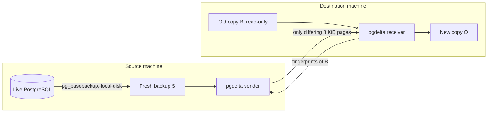
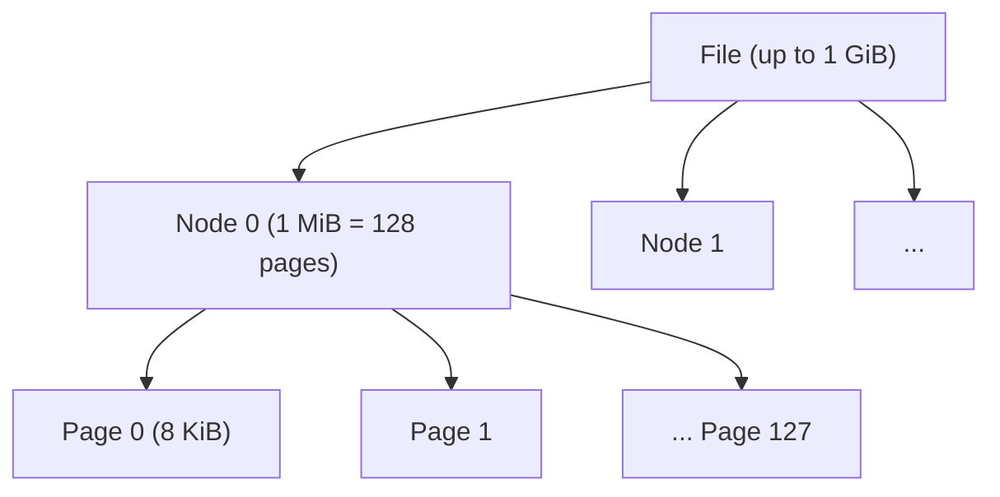
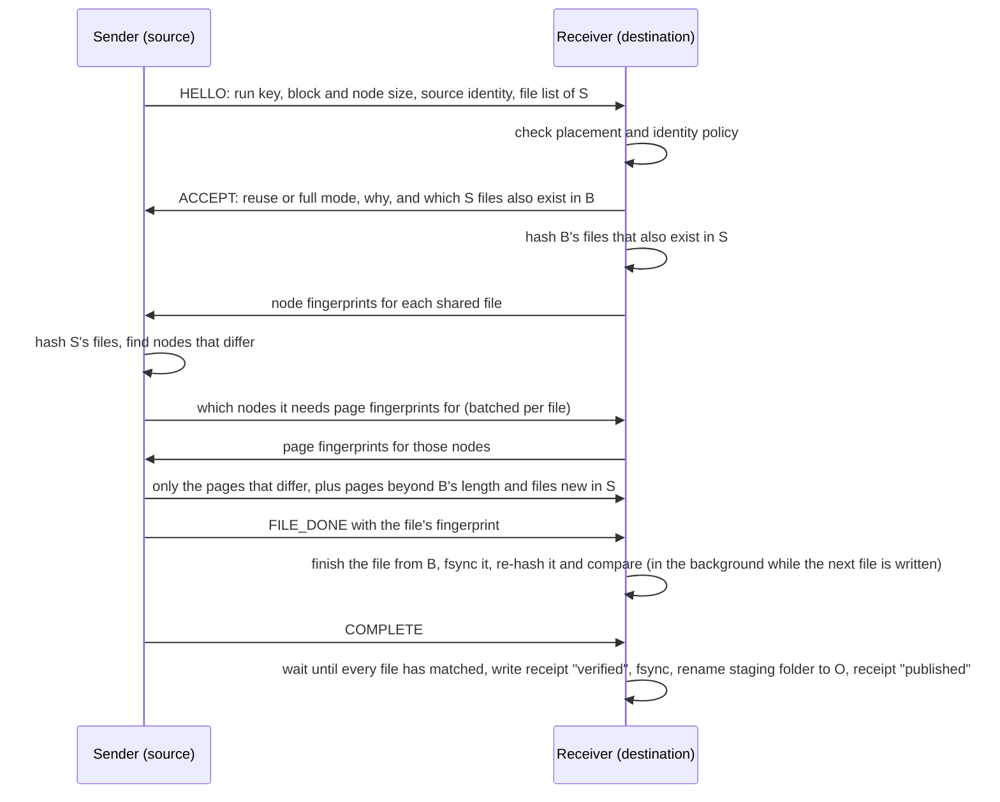
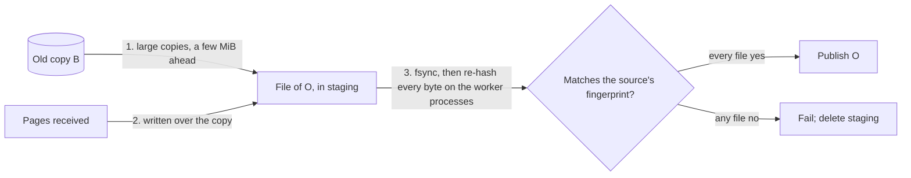

# How the tool works (v0)

This explains the design in plain terms, with diagrams. The precise contracts are in [SPEC.md](SPEC.md); the reasons behind each choice are in [the research summary](research/state-of-the-art.md).

## The pieces



- **v0 is "staged".** A normal `pg_basebackup` makes a frozen, consistent copy S on the source machine first. That handles every hard part of copying a live database: checkpoint, WAL, `backup_label`. The tool only has to turn B into an exact copy of S while sending as little as possible.
- **The destination's old copy B is never modified.** The new copy O is built in a staging folder next to it and only appears under its final name once every file has been verified.

## Finding what differs: a hash tree per file



- **Leaves:** every 8 KiB page gets a 16-byte fingerprint from keyed BLAKE2b. The key is random and new for every run, so nobody who controls table contents can craft two pages that look the same.
- **Nodes:** every 128 pages (1 MiB) get one fingerprint built from their page fingerprints. For an unchanged 1 GiB file, the receiver sends only 1,024 node fingerprints (16 KiB), instead of 131,072 page fingerprints (2 MiB).
- **Comparison is positional:** page *i* of a file in S against page *i* of the same file in B. PostgreSQL never shifts data within a file, so there is no need for rsync-style searching at every byte offset.

## The conversation between sender and receiver



Most bytes flow from source to destination as page data. The return direction carries only fingerprints.

## Waiting for the sender: reading B ahead

```mermaid
sequenceDiagram
    participant S as Sender (source)
    participant R as Receiver (destination)
    R->>R: listen, then read B's files into the page cache (background thread, read-only)
    S->>S: take the fresh backup S
    S->>R: connect, HELLO with the run key
    R->>R: stop reading ahead; hash B, now mostly from memory
```

- **Why.** The receiver can't hash B before the sender connects: the hash key is random for every run and arrives in HELLO, so nobody who controls table contents can prepare pages that look alike. That stays as it is. But the receiver is usually started first and then waits, for example while the source takes S. Reading B during that wait takes B's first read off the transfer's critical path whenever B wasn't already cached.
- **How.** A background thread reads B's files in the order the receiver will hash them, sequentially in 8 MiB pieces, asking the kernel for the next piece in advance where it can (`posix_fadvise`). It stops the moment the sender connects; the receiver's own reads continue from there.
- **Safe.** It only opens B read-only, without following links, and doesn't even update access times where the kernel allows. A read error is noted, not raised: the receiver's own reads report real problems. Nothing about the output or its verification changes.
- **Capped.** It reads at most half of the memory the kernel says is available. Reading more than can stay cached would evict the first files, the ones needed first, before they are used.
- **Switch.** `--prefetch-basis on|off` (default on) and `--prefetch-cap BYTES`. Only `receive --listen` waits; `local` and `receive --stdio` are connected from the start.

## Building and checking the new copy



- **Copy, then patch.** For each file the old copy also has, the destination first copies B's bytes into the new file in large pieces. The kernel does the copy where it can (`copy_file_range` on Linux). Then it writes each received page over them at its offset:
  - Pages past the end of B are always sent, and the file ends at the source's length.
  - The copy stays a few MiB ahead of the pages being received, so each byte of B is copied once.
  - A file that is sent whole copies nothing.
  - This replaces the earlier gap-filling: one small copy per run of unchanged pages, tens of thousands for scattered changes ([EXP-05](experiments/EXP-05-parallel-hashing.md)). Gap-filling stays available as `--rebuild gap-fill`.
- **Checked as files finish.** Each finished file is fsynced and handed to the worker processes to re-hash, while the destination writes the next one. Nothing is published until every file has matched the source's fingerprint, and the first mismatch stops the run.
  - The check is as strong as before: every byte of every file is re-read and compared.
  - It no longer waits on the critical path, or does so only for the last files.
  - `--verify sequential` checks each file before accepting the next.
- **Hashing in worker processes.** With `--jobs N`, each 1 MiB node is hashed in one of N separate processes. Each has its own interpreter lock, so hashing scales with N, which threads couldn't (EXP-05).
  - The same pool hashes S on the source; and B, the page fingerprints B is asked for again, and the new files on the destination.
  - `--jobs 1` keeps everything in the one process.
- **Every combination gives the same answer:** the same pages sent and a byte-identical, verified copy. Only the time differs, which is what [EXP-06](experiments/EXP-06-engine-throughput.md) measures.

## Why the result is trustworthy

1. **Every output file is re-hashed and compared** against the source's file fingerprint before O is published. A wrong reuse would have to collide a keyed 128-bit hash. That includes pages copied from B: if B changed during the copy, the check fails.
2. **O must be byte-identical to S.** So S's own `backup_manifest` checks it with `pg_verifybackup`, independently of our code.
3. **Restore test:** a copy of O is started, recovers using its WAL, and its data is compared with the source's state at the backup's end point.

Because of (1) and (2), correctness never depends on where reused bytes came from. A wrong or foreign old copy can only make the tool send more, never produce a wrong copy. That's the difference from LSN-based shortcuts, which [EXP-03](experiments/EXP-03-tricky-copies.md) tested on ten tricky old copies. The tool was correct in all ten; LSN skipping produced stale or wrong pages in four of the eight same-cluster cases, including real stale data after a failover.

## Safety rails on the destination

- **Identity policy.** By default, an old copy from a different cluster (system identifier, catalog or checksum version differs) gets full mode, with no reuse. That is caution, not a correctness requirement. `--reuse-any-basis` allows reuse from any old copy, because every reused page is still verified. Across a 17→18 `pg_upgrade` that reused 53% of pages ([EXP-03](experiments/EXP-03-tricky-copies.md)).
- **Placement.** The receiver refuses to write O, its staging folder or its receipt anywhere inside B, or inside S in local mode. It compares filesystem identities (device and inode), not path text, so a differently-capitalised path on macOS or a bind mount can't sneak O into the old copy.
- **Receipt.** `<O>.pgdelta-receipt.json` is written beside O as "verified" before the rename and "published" after. If the connection drops right after publishing, the receiver still knows O is complete, and so does anyone reading the receipt.

## What v0 does not do yet

- **Read the live data directory directly**, inside PostgreSQL's backup start/stop window, instead of staging S. That's v1, which removes the extra full read and the scratch space on the source.
- **Hand off to native incremental or `pg_rewind`** when their prerequisites hold.
- **Use LSNs or WAL summaries** to send likely-changed pages sooner. They'll never be used to skip pages.
- **Handle tablespaces outside the data directory** (refused with a clear error).
