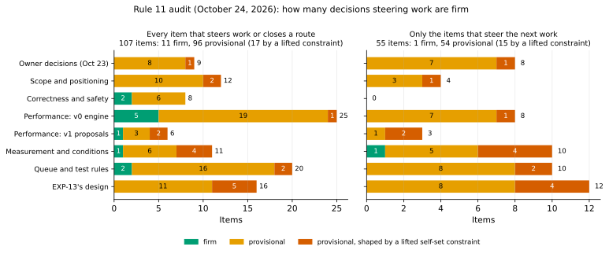

# Which decisions are firm? A rule 11 audit

*October 24, 2026 (night). An audit of the [decision ledger](DECISIONS.md) under its rule 11, which the owner added the same evening. Nothing was run. No pre-registration, registered verdict or ledger grade was changed; grade changes and EXP-13's revisions are proposed here, for the owner. The proposed queue is a ranking by judgment, so it is provisional too.*

How it was done. Five audits read the ledger, EXP-01 to EXP-13, the log, the spec and the code, each from one side: the owner rows and scope, the performance rows, the measurement rows and the queue, the self-set constraints, and EXP-13's design. Their items were merged, and duplicates folded together. Verifiers then checked them and sent corrections and missing items. Each correction was checked here against the files before it was applied; where this page differs from a correction, [section 7](#7-the-auditors-corrections-checked) says so.

## 1. What rule 11 says, and how it was applied

Rule 11 (the owner, October 24): "Only a firm decision picks a single route. A decision is firm when the evidence that decides it is graded A for the conditions it is applied to: measured on the relevant platform, not by proxy or inference; pre-registered or replicated in a second session; not flagged fragile by its own robustness views; and not shaped by a constraint the project set itself and has since lifted. Anything less is provisional: the work keeps every route it would close open, as a branch, and an experiment is queued to make it firm before one route is chosen. A ranking of the queue by judgment is provisional too, and says so."

Each item was put to the four tests. A fifth code marks what no measurement can settle:

| Code | Test failed | How it was read here |
|---|---|---|
| **P** | Measured on the relevant platform, for the conditions it is applied to, not by proxy or inference | The conditions are where the decision is used: Omni's HA rebuild (same region, standbys in another zone, GKE's balanced persistent disk, a live and often busy primary) and DR re-seed (another region), at sizes beyond RAM ([Omni notes](research/notes/alloydb-omni.md)). A clean result on local NVMe at 2.1 GB from a stopped source fails P for those uses. So do the Mac (rule 2), a proxy (EXP-12's `v1proxy`), an emulated WAN, an argument, and an inference across sessions |
| **R** | Pre-registered, or replicated in a second session | Pre-registration meets it as written. Where a deciding margin is smaller than the shift measured between sessions, that is noted: between EXP-09 and EXP-11 v1 ran 14–18% slower and one `pg_basebackup` stream 22–30% slower unthrottled (DECISIONS.md, What T2 settled), and no robustness view can see it. Whether such a session counts as firm is owner decision K10 |
| **F** | Not flagged fragile by its own robustness views | The experiment's own registered views, as its write-up reads them |
| **L** | Not shaped by a self-set constraint since lifted | The two-VM limit, lifted October 24 ([log](LOG.md)). And per-experiment VM-hour budgets: their reason, cost, is the one the owner set aside that day ("a VM count that shapes a design costs more in validity than the VMs cost"), but the ledger still says T12's overrun "awaits the owner", so K1 asks. Items shaped by either are counted "provisional (lifted)" |
| **J** | (no test can pass it) | A ranking by judgment, or a value judgment in the last step. Rule 11 makes rankings provisional, and the grading table puts a value judgment at B. Only an owner decision settles it |

**An item** is a decision, default, ranking, registered rule or self-set condition that steers work or closes a route. Firm means one route may be chosen. Provisional means the routes it would close stay open as branches (the table's "Kept open now"), and a test is named that would make it firm ("Firmed by"; the tests are in [section 4](#4-the-firming-plan)).

## 2. The answer

**No: almost nothing that steers the next work is firm.** Of 107 items that steer work or close a route, 11 are firm and 96 are provisional; 17 of those are provisional because a self-set constraint the owner has lifted shaped them. Of the 55 items that steer the next work, one is firm, and that one is the vCPU quota, an external limit.

*How to read it:* each bar is one area of the ledger, split into firm (green), provisional (orange) and provisional because a lifted self-set constraint shaped it (red); the left panel counts every item, the right only the 55 that steer the next work. Data: [firmness.csv](experiments/data/firmness.csv); figure: `.venv/bin/python analysis/firmness.py`.

**Counts:** 107 items: 11 firm, 79 provisional, 17 provisional (lifted). 55 steer the next work: 1 firm, 39 provisional, 15 provisional (lifted).

**Firm (11).** Each passes all four tests for the conditions it is applied to:
- D09 (output byte-identical to the source) and D11 (hashes alone decide reuse), for v0 staged and for v1 on a stopped source only. Neither covers v1 reading a live source.
- D10p: the staged capture is dropped as the performance path. The capture alone took as long as a full copy on two VM pairs (EXP-04b, 3.98–4.04 s against 3.96–4.13; EXP-10's three sweeps on another pair, 3.28–3.33 s against 3.13–3.17), and staged pgdelta is that capture plus the same transfer, so reading the files directly can only remove work (on a stopped source it cost 0.14–0.25 s more than the warm transfer, EXP-09).
- D40p (the main-loop fsync), D54 (pipelined verification) and D86b (clones on XFS, which add an option and close none).
- D17 (no units larger than 8 KiB) and D18 (page i against page i of the same file), on byte counts, which rule 2 allows on the Mac.
- The 32-vCPU quota; T11b after T8 (a dependency); T8's rule that any wrong output stops v1 (a gate).

**Provisional because a lifted constraint shaped them (17).** Every deciding row of EXP-12 (T10a): its load's client ran on the source because of the two-VM limit, and its rows for v1 are fragile. That covers O4's measured bar, D04's slowdown side, D50, the source worker cap (CAP), D81, D68's move, D58's busy-load reading, the HA caveat, and the queue moves of T5 and T10b ahead of T8. EXP-13 still carries the limit ("At most two exist at any time"; one pair, one session) and its budget's cut line, which shape its side arms, its uniform 10% rule and its inferred 1 Gbit/s cells. D72 (two VMs as the platform) and D63 (one session per experiment) carry it too.

**Why the rest is provisional.** Five reasons cover most of it:
1. **Nothing has run on AlloyDB Omni.** Every owner row rests on public docs. The project's notes mark two of its premises "not documented": whether the old primary's disk survives a failover (the HA case's B), and whether a sidecar reaches standby pods. Whether TDE leaves B reusable, and whether Omni enables data checksums, are unknown too. G5 is unshown for every tool.
2. **Every VM result comes from conditions the project chose.** One zone at 0.1 ms; local NVMe in RAID 0 with ext4 (Omni's GKE default is a balanced persistent disk); 2.1 GB that fits in RAM; an idle or stopped source; pgbench data; one n2-standard-8 pair per session. EXP-13 would measure DR only through netem, since the us-central1 guardrail stays.
3. **v1 reading a live source has no evidence at all,** correctness or speed. Every v1 number reads a stopped source, and EXP-12 measured v1's source side only by a proxy that streams no WAL.
4. **Several grades don't hold for v1 or for Omni.** D02's A was earned against v0; against v1, numbers from different sessions on ext4 have v1 in place faster than native incremental. D85's A was earned against v0's new copy; against the improved new copy the saving (0.57–0.90 s) is under its own rule's 1 s. D14's A rests on an argument. Short answer 3's "18 of 19 correctness decisions are A or B" counts B rows that are arguments backed by tests; 6 are A.
5. **The queue's order is judgment on fragile moves,** and it doesn't say so, as rule 11 requires.

**What to do.** Keep every closed route open as a branch (section 3), and run the smallest set of tests that firms the decisions steering the next work (section 4): EXP-13, revised, in two sessions on different days, beside a persistent-disk, two-zone re-test of the HA verdict; the in-place crash gate on Linux; T10b with T5 inside it, its load's client on a third VM; an Omni probe; and, if the owner allows one session outside us-central1, a real cross-region check. T8's build starts now, in parallel, since it replaces every proxy. That is about 110 instance-hours before T8 runs, within the 32-vCPU quota. Twelve owner decisions come first (K1–K12).

## 3. Every item that steers work

One table per ledger area. **Fails:** the tests of section 1 that the item fails ("–" when firm). **Kept open now:** what stays open as a branch until the item is firm. **Firmed by:** the test or owner decision in section 4 that would make it firm. Each row's sources are in it or in the ledger row it names.

### Owner decisions of October 23

| ID | Steers | Grade | Verdict | Fails | Kept open now | Firmed by |
|---|---|---|---|---|---|---|
| T1-closed | Every O-row's factual premise. It drops the sponsor as a route, while SPEC §1 and G5 still say Ben's confirmation is pending | B (owner judgment from public docs) | provisional | P, J | BEN-QUESTIONS.md stays open for what documents can't settle (CPU budget, sizes, refresh frequency). O1, O3 and O5's factual premises are hypotheses | OMNI-1, OMNI-2; a written sponsor answer (not an experiment) |
| O1 | HA and DR as the targets; through D03, DR first. No sizes defined, so every result is at 2.1 GB | B | provisional | P | HA and DR both live targets. The rebuild after a major-version upgrade (every standby is rebuilt; 53% page reuse across pg_upgrade, EXP-03) a candidate case. No size claim beyond 2.1 GB (rule 10) | OMNI-2 (a); T9-PD; T9. *OMNI-2 (a), October 26 (EXP-44): on the operator, an HA failover deletes the old primary's disks and reseeds; the HA case needs an operator change* |
| O3 | D04's two agents; the source pool sized from its CPU quota | B | provisional | P | The source cap expressed and tested as a cgroup CPU quota. Packaging as an extension open | OMNI-2 (b); the cgroup arm in T10b. *OMNI-2 (b), October 26 (EXP-44): a Sidecar runs on every instance, reads PGDATA read-only, and its CPU limit is a cgroup quota (`cpu.max`)* |
| O4 | T10a's verdicts; the bar for T10b and T8; D50's cap; the HA caveat | C | provisional (lifted) | J, L | p95 and p99 reported beside O4's two numbers (by proxy v1's p95 was 69–132 ms, pg_basebackup's 1.0–6.4 ms). Slowdown judged against pg_basebackup and, once T8 builds a backup-mode bound, against the fastest copy | T10b; K7 |
| O4-delta | Decision 2 (the cap): EXP-12's floors, δ_W 0.05 s and δ_D 0.03, decide it. By proxy v1 lost ΔW 0.051–0.070 s and ΔD 0.038–0.051 | C | provisional | J | The cap read at 0.5, 1 and 2 times the floors. At twice them every speed meets | T10b's sensitivity view; K7 |
| O5 | D85 (every v1 arm since EXP-09 is in place); no undo journal; it overrides SPEC §4 and §8 | B | provisional | P | The new-copy mode (D86) built and tested. The undo journal kept on paper. SPEC §4 and §8 marked superseded by O5, pending T13c | T13c; OMNI-2 (f) |
| O6 | EXP-13's v1_tls; native TLS in T8; D14's key secrecy | B | provisional | P, J | TLS and SSH both measured; the baselines stated as in clear | T8's native-TLS arm with a packet capture; OMNI-2 (is Omni's replication encrypted?) |
| O9 | No staged-mode speed work; D26, D27, D57 and D61 moot | B | provisional | J | Staged mode stays in the code (--source-kind backup, today's default) as fallback and correctness scaffold until T8 shows G2–G4 for v1 live | T8 |
| Oct23-open | Keeps refresh frequency, TDE and disk retention out of the queue | none (a judgment) | provisional | J | The Omni probe queued with an owner and a date (rule 9) | OMNI-2 (a), (c); refresh frequency labelled an owner assumption |

### Scope and positioning

| ID | Steers | Grade | Verdict | Fails | Kept open now | Firmed by |
|---|---|---|---|---|---|---|
| D01 | The niche and its pitch; T8; T11b | C | provisional | P | The correctness edge stated as "staged, at 200,000 rows". The repository-restore case open | T8 (EXP-08's S2, S2b and S2c at scale 70, v1 live against pg_probackup catchup, 3 repeats); T11b |
| D02 | Hand-off to native incremental (D62); it closes v1 where incremental applies | A, against v0 only | provisional | P | v1 a candidate where incremental applies, at least on ext4 and where a second directory does not fit. On ext4, across sessions, v1 in place took 0.49–0.79 of incremental's time (EXP-04b, EXP-10, EXP-11); on XFS, in one session, incremental won by about 1 s (EXP-10) | INC |
| D02b | pgdelta as rewind's fallback in DR | C; speed D | provisional | P | pgdelta's DR role open beside rewind, both where rewind can run and where it can't | INC's rewind block; OMNI-1's settings read |
| D03 | HA Out on fast links, so DR first; the queue (T12 first, T5 and T13 down) | B | provisional | P, J | HA and DR parallel targets. T9-PD and v1 at 8 jobs treated as HA-deciding | T9-PD; T12r's HA replicate; K6; T9 (pg_probackup -j 8 on 1 GiB segments) |
| HA-qualifier | "Faster than the released copiers tested", with EXP-12's caveat: "slows a busy primary more than pg_basebackup" | B; the caveat fragile | provisional (lifted) | P, F, L | Stated as "cold source, Debian's write-back on dest, stopped source, 2.1 GB". Warm, v1 over full was 0.92 in append (EXP-11, 3 runs); with dest's write-back at 64 MiB one stream beat v1 | T8's speed arms (warm and cold source; dest's write-back at the default and at 64 MiB); OMNI-2 reads vm.dirty_* on a GKE node |
| D04 | Two agents; the source worker cap (D50, T10b) | B | provisional (lifted) | P, F, L | The byte side stands (measured across sessions). The cap and the per-core hash cost stay open | T10b; T8 |
| D08 | Only PostgreSQL 17 and 18; Omni on 15 or 16 refused | C | provisional | P | The PostgreSQL 16 question open; no Omni support claimed | OMNI-1 (Omni images on 16 and 17; the gates against community 16). *Done October 26 (EXP-40): the gate was missing and Omni 16.14 was refreshed; now refused, tested. Omni 17.10 refreshed correctly, stopped and live* |
| D46 | No resume and no stall timeout | D | provisional | P | A stall-timeout design open for the WAN work | T8's transport arm (all packets dropped for 60 s and for 10 min at 60 ms); T9's restart cost |
| D62 | The order of the deferred features (hand-off, hints, tablespaces) | D | provisional | J | The selector open. Its priority set by whether Omni's rebuilds meet incremental's or rewind's preconditions | OMNI-1 and OMNI-2 (summarize_wal; a manifest on B); INC |
| DR-rate | DR first assumes DR links run below v1's crossovers at 0.1 ms (5.0 Gbit/s uniform, 6.5 local). EXP-13 runs 1–2 Gbit/s only | D (assumed: no DR link rate is documented) | provisional | P | T12's rows labelled "at 2 Gbit/s"; DR first provisional | T12r's 5 Gbit/s cells; T12x's unshaped link tests |
| Checksums-Omni | Every byte count (with data checksums on in EXP-01/02 and EXP-04 onward, off in EXP-37 and EXP-38; *corrected October 26*); how often rewind can run (it needs checksums or wal_log_hints); pg_probackup's LSN mode | D (assumed) | provisional | P | Byte counts labelled "data checksums on"; D02b open both ways | OMNI-1's settings read; if off by default, Mac byte counts with checksums off (T4). *Read October 26 (EXP-40): off in Omni 17.10's container, with `wal_log_hints` off too. Bytes closed October 26 (EXP-41): checksums on and off sent the same share of pages, within 0.16 points* |
| Repo-pitch | The pitch to repository users ("no repository needed"); pgBackRest faster for scattered changes below about 6–9 Gbit/s | C (D01) | provisional | P | Both pitches, bytes and "no repository needed", open | T4 (zstd on TPROC-C); T11b |

### Correctness and safety

| ID | Steers | Grade | Verdict | Fails | Kept open now | Firmed by |
|---|---|---|---|---|---|---|
| D09 | The oracle for v0 staged and for v1 on a stopped source | A | **firm** | – | – (scoped; T8 replaces it for v1 live, which has no S) | – |
| D11 | Closes LSN or timestamp skipping as an authority for reuse | A | **firm** | – | – (scoped to v0 staged and v1 on a stopped source; T8 reruns EXP-03 live) | – |
| D14 | The hash; key secrecy | A | provisional | P | Strength recorded as an owner-accepted argument (a 2^-128 event can't be measured). Secrecy rides on O6: today the key crosses in HELLO in clear | T8's native TLS with a packet capture |
| D39 | Publication; the in-place startup block (G1) | B | provisional | P | T13's crash arm ranked as a correctness gate | T13c; the suite on Debian with no Linux-only skips |
| D41 | Verification by a separate re-read (with D41p, graded D); v1's second destination pass | B; D41p D | provisional | P | Hashing while writing and an O_DIRECT re-read kept as T13 arms | T13f |
| D42 | G2 for v1, which emits no manifest today | B | provisional | P | A manifest emitted early in T8's build, checked with pg_verifybackup on a stopped source | T8 (G2) |
| D59 | v1's read order | C | provisional | P | – (PostgreSQL's documented backup protocol) | T8's early-read negative control |
| G5 | Every claim for Omni (SPEC §7: "PostgreSQL results alone are insufficient") | D for Omni | provisional | P | Results labelled "PostgreSQL 17.11, Debian VMs" | OMNI-1 (e); after T8, v1 on an Omni data directory. *Probed October 26 (EXP-40): v1 on Omni 17.10 data directories, stopped (byte-identical) and live (recovered), Omni starting each B with S's data; one refresh of each, in a container. Live under load October 26 (EXP-42): `_mintxid` is WAL-logged with full-page images; 20 of 20 live refreshes correct, 4 of 4 controls caught* |

### Performance: the v0 engine and its settings

| ID | Steers | Grade | Verdict | Fails | Kept open now | Firmed by |
|---|---|---|---|---|---|---|
| D10p | Closes the staged capture as the performance path | X | **firm** | – | – (staged mode stays as the correctness scaffold, D10) | – |
| D40p | Closes the main-loop fsync; v1's build changes DEFAULT_FSYNC | X | **firm** | – | – (which replacement is D86) | – |
| D48 | Worker processes (spawn), not threads | A | provisional | P, R | The thread backend stays, hidden (D49) | T5 (threads, sub-interpreters, the free-threaded build; the Python version recorded) |
| D15 | BLAKE2b; source CPU per worker; hashing B | D | provisional | P | The hash behind an interface that allows BLAKE3 | T5 |
| D20 | Every page hashed; the reason threads lost (D48) | D | provisional | P | Node-level hashing kept as a T5 arm | T5 |
| D07 | Standard library only (kept by D56): no native hash, no compiled core | C | provisional | P, J | T5's BLAKE3 arm uses the native package; shipping it is K5 | T5; K5 |
| D50 | Four workers on each end; every v1 arm since EXP-09; the T5 and T13 cut | C | provisional (lifted) | P, F, L | 4 and 8 jobs, and the source capped with dest at 8, kept as co-equal arms; per-end settings | T10b (a dest-only arm; the larger-source block); T12r's side readings |
| D13 | No cached tree of B, so dest always hashes B | D | provisional | P, J | The route needs a key design first: a cached keyed tree conflicts with D14's fresh key per run (pgdelta/prefetch.py) | K11, then a prototype (v1 in place with and without hashing B, 5 repeats, two sessions) |
| D12 | No LSN or WAL-summary hints, even for ordering | D | provisional | P | A switch candidate on T8's list | An ordering arm in T8 (changed files first, from summarize_wal) |
| D17 | Closes units larger than 8 KiB | A | **firm** | – | – | – |
| D17-sub | No units smaller than a page | D | provisional | P | T4 queued | T4 |
| D18 | Page i against page i of the same file; closes any-offset matching within a file | A | **firm** | – | – | – |
| Rewrite-reuse | Reuse after VACUUM FULL, CLUSTER or a rewriting ALTER TABLE. SPEC §5 rules out CDC because pages "never shift within a file" | D (never measured) | provisional | P | Content-addressed matching across files, and CDC, open | T4's rewrite case |
| D19 | 1 MiB nodes | B | provisional | P | --node-blocks a switch | T14; a recount on TPROC-C pairs in T4 |
| D22 | High-churn fallback off | D | provisional | P | The switch kept, off | T12r's A5 in two sessions; a TPROC-C pair later |
| D29 | A window of 4 files | D | provisional | P | --window kept; 4 until firm | T12r (windows also at default cells; two sessions) |
| D30 | All of a file's leaf requests at once | D | provisional | P | Leaf digests sent unasked, on T8's list | An A/B at 120 ms if idle leaf waits exceed 0.3 s |
| D35 | No compression | D | provisional | P | A switch candidate on T8's list | T4 (ratios); T10b's zstd CPU arm |
| D36 | One TCP stream, default buffers; EXP-13's A2 | C | provisional | P | Three equal fixes on T8's list: parallel page streams, a host buffer setting, buffers forced under CAP_NET_ADMIN | T12r; T12x; the COS sysctl read |
| D24 | The conservative identity gate by default (with D23) | C | provisional | P | The switch kept | T7 |
| D53 | Copy-then-patch in the new-copy mode | B | provisional | P | --rebuild a switch | Gap-fill on XFS, in INC's XFS block |
| D54 | Closes sequential verification | A | **firm** | – | – | – |
| W1 | "Hashing is not the bottleneck on these VMs" ("Where pgdelta's time goes"): the framing of T5 | ungraded; v0 only | provisional | P | T5's transfer effect judged on v1's in-place path | T5 end to end |
| W2 | v1's bottleneck is dest's two passes over B (EXP-09): the ranking of T5 and T13 | ungraded (EXP-09) | provisional | P | Dest's worker count and D13 ranked beside T5 and T13 | T9-PD's dest-8 arm; T9; T8's phase timers |
| Defaults-unmarked | Rule 1 marks untested defaults "assumed". None is: DEFAULT_FSYNC = main (D40p, X), DEFAULT_WINDOW = 4 (D29, D), RUN_BYTES (D31, D) | X, D | provisional | P | Each marked "assumed" with its ledger row | bookkeeping (no VM time) |

### Performance: the v1 proposals

| ID | Steers | Grade | Verdict | Fails | Kept open now | Firmed by |
|---|---|---|---|---|---|---|
| D58 | v1's source path; it closes SPEC §2's source-side helper on the backup stream | B | provisional (lifted) | P, F, L | --source-kind backup kept. A stream-helper arm (pg_basebackup's stream hashed on the source, no S written) kept beside direct reads | T8 (the live read; the stream-helper arm) |
| D60 | v1 streams only the WAL written | A | provisional | P | Whole-segment shipping kept as a fallback | T8 |
| D85 | In place by default; every v1 arm is in place | A | provisional | P | The speed side is firm by dominance: in place writes a subset of what a new copy writes (0.57–0.90 s faster on ext4, EXP-10). The default rests on O5 and the startup block, so the new copy stays built and tested | T13c; OMNI-2 (f) |
| D86 | The new-copy mode's flush: a thread over write-back, by 0.05–0.25 s in one sweep | B | provisional | P | All three --fsync switches kept | T9-PD (thread against write-back on persistent disks, two sessions) |
| D86b | Clones on XFS in the new-copy mode (adds an option) | B (row); arm (d) pre-registered | **firm** | – | – | – |
| CAP | A source worker cap on busy primaries (decision 2), and the pool sized from its CPU quota | C | provisional (lifted) | P, F, L | The cap a switch; uncapped 4 kept; low priority (nice 19 or SCHED_IDLE) a third route | T10b; then v1's own arm after T8 |

### Measurement, platform and conditions

| ID | Steers | Grade | Verdict | Fails | Kept open now | Firmed by |
|---|---|---|---|---|---|---|
| C-quota | What can run at once: 32 vCPUs across all regions; 24 instances and 8 external IPs in us-central1 | external limit | **firm** | – | – (a raise is K2) | – |
| D72 | The platform: n2-standard-8 pairs, local NVMe RAID 0, ext4, one zone, no added latency | B | provisional (lifted) | P, L | Persistent disks and two zones (T9-PD); a third VM (T10b, T8); a larger source (T10b) | T9-PD; T10b's larger-source block; T12r |
| D63 | One pre-registered session per experiment, judged by within-session robustness views only | A (process) | provisional (lifted) | J, L | Proposed reading (K10): a single session is firm only where its deciding margin exceeds the largest between-session shift measured for those arms (up to 30% in EXP-11's drift gates) | Second sessions, at a different time, in T12r, T9-PD, T13c, T10b, T5 and T8; K10 |
| D67 | pgbench scale 70 as every VM test's data | B | provisional | P | Rows labelled "pgbench data"; uniform 1% not generalised to scattered changes | T4 (TPROC-C bytes); a TPROC-C cell later in T9 |
| D68 | 2.1 GB, 1% changes, an idle source | C | provisional (lifted) | P, F, L | Rule 10 kept; T12 and T5 labelled "2.1 GB, idle or stopped source" | T9; T8; T10b |
| D73 | Blocks and trials in a fixed order (EXP-11, EXP-12, EXP-13) | B | provisional | P | A seeded interleaved order in T10b and T8; R_trial a deciding view in T12r | T10b; T8; T12r |
| D78 | Crossovers by interpolation; 6.5 and 5.0 Gbit/s set the DR target | A (the arithmetic) | provisional | P | Crossovers called "interpolated" wherever they set a target | Only if one decides something: both arms at the interpolated rate, 5 runs |
| D81 | The source budget's unit: workers or CPU-seconds | C | provisional (lifted) | P, F, L | Both units kept; neither encoded | T10b's burn arms at matched CPU-seconds |
| C-ckpt | Every slowdown arm takes a fast checkpoint on a small dirty set (shared_buffers 128 MB): O4's measured bar | self-set (EXP-12) | provisional | P | v1's checkpoint mode a switch (done October 27: `--checkpoint fast\|spread`, default fast); T10b's bar registered for -c fast and -c spread | T10b's large-dirty-set setting; OMNI-2 reads Omni's pg_basebackup flags |
| C-freeze | A code freeze about November 13 (PLAN.md, proposed October 22; no later record) | plan date | provisional | J | T8's build starts now; firming costed in calendar days too | K9 |
| C-capacity | Concurrent and three-VM designs. infra/gcp/config.sh fixes one source, one dest and one zone; create.sh deletes known_hosts; stockouts on October 22 and 23 | unverified | provisional | P | Quotas read and recorded; per-pair configuration and a client role before T10b; a sequential fallback for each concurrent plan; the zone recorded | A read-only quota check (no VM time) |

### The queue and the T-sections

| ID | Steers | Grade | Verdict | Fails | Kept open now | Firmed by |
|---|---|---|---|---|---|---|
| Q-rank | The queue, ranked "per unit of cost" and not labelled provisional | judgment | provisional | J | Every place labelled; which tests run at once said | none possible; section 4 proposes an order |
| Q-T12 | T12 first | judgment on D03 (B) | provisional | J | T12 run beside T9-PD, so the HA branch isn't starved | T12r; T9-PD |
| Q-T5 | T5 ahead of T8 (decision 1 by R1; row 7a) | a fragile consequence; EXP-12 change 4, C | provisional (lifted) | F, J, L | T5 and T8's build in parallel, not in order | T8's v1 slowdown arm; T5's BLAKE3 proxy arm in T10b |
| Q-T10b | T10b ahead of T8 (decision 2) | a fragile consequence | provisional (lifted) | F, L | Both cap designs buildable in T8; T10b's v1 arm run again after T8 | T10b; T8 |
| Q-T5-T10b | T5 before T10b | judgment | provisional | J | T5 runs inside T10b's sessions; its proxy arm runs both hashes | none possible |
| Q-T8 | T8 fourth | judgment on fragile moves | provisional | F, J | T8's build starts now | none for the place |
| Q-T9 | T9 fifth | judgment | provisional | J | T9's persistent-disk arm (T9-PD) beside T12 | none for the place |
| Q-T13 | T13 seventh, by T2's cut, which clears the 1.2 s edge by 0.2 s in a session where v1 ran 0.4 s slower; Short answer 3's "18 of 19 A or B" (6 are A) | a consequence on B and C evidence | provisional | P, J | T13 level with T5; its crash arm ranked as a correctness gate | T12r's HA replicate at 4 and 8 jobs; T13c |
| Q-tail | T4, T6, T7 and T14's places | judgment | provisional | J | T4 any time (no cloud) | none possible |
| Q-T11b | T11b after T8 | a dependency | **firm** | – | – | – |
| T8-gate | Any wrong output stops v1 until fixed | a gate | **firm** | – | – | – |
| Firming-plan | "Firming these results": two sessions for T10b and T8 only | owner plan | provisional | J | Two sessions for every test whose result would close a route; T10b's v1 arm after T8; decision 1 reopened | Section 4 |
| T5-rule | T5's rule: per-core speed decides the hash; no slowdown arm; one CPU family | ledger prediction | provisional | P | Pre-registered, with its slowdown arm in T10b and two CPU families | T5 |
| T10b-rule | "4 workers cost 10% or less", "choose 8", "lower the default": percentages written before O4 | ledger prediction | provisional | J | A rule 8 change to O4's two numbers before T10b is pre-registered; the worker count a per-deployment setting | T10b |
| T8-rule | "Not beating the best durable copy at 2 Gbit/s": judged at 0.1 ms on local NVMe | ledger prediction | provisional | P | Persistent-disk and 60 ms conditions added before the rule may close v1 | T8 |
| T9-rule | One disk type and size; "undecided until T2 and T5" (T2 is done) | ledger prediction | provisional | P | Two sessions, two disk sizes; the stale clause fixed | T9-PD; T9 |
| T4-rule | Smaller units and compression closed on synthetic data; zstd's CPU unmeasured | ledger prediction | provisional | P | Compression a switch | T4; T10b's zstd CPU arm |
| T13-rule | "The faults the sponsor cares about": nobody owns that call since T1 closed | ledger prediction | provisional | J | Both verification modes kept as switches | K8 |
| T11b-rule | The pitch by backup age; one session; pgbench WAL | ledger prediction | provisional | P | Two sessions; HammerDB beside pgbench | T11b |
| T6-T7-T14 | Small defaults; T6's "sponsor's sign-off" is stale | ledger predictions | provisional | J | Switches kept; "sponsor" read as "owner" | As queued; a second session only where one closes a route that matters |

### EXP-13's design (T12, not yet run)

| ID | Steers | Grade | Verdict | Fails | Kept open now | Firmed by |
|---|---|---|---|---|---|---|
| X13-pair | "At most two exist at any time": one pair, one session; A10 lets a shifted session's verdicts stand | constraint (the two-VM limit, lifted October 24) | provisional (lifted) | L | Two sessions on fresh pairs at different times | T12r |
| X13-wan | DR measured only by netem in one zone; the us-central1 guardrail kept | B at best | provisional | P | Every DR row labelled "emulated WAN" | T12x (K3) |
| X13-budget | The 3.5 h cut line: at the projected 3.8 h it cuts hot at 20 ms, uniform 10% to 3 repeats, and probackup8 | constraint (a VM-hour budget) | provisional (lifted) | L | Run uncut; cut only for infrastructure faults | K1; K12 |
| X13-order | A fixed trial order; baselines pooled over the trials, 2 runs in each | D (a judgment) | provisional | P | The same order in both sessions; R_trial a deciding view, with baselines in every repeat at the deciding cells | T12r |
| X13-hosts | Debian 12's TCP defaults stand for "hosts as they come" | C | provisional | P | Both host readings kept | The COS sysctl read; OMNI-2 reads a GKE node |
| X13-sockbuf | "Why pgdelta can't fix this alone": SO_RCVBUF is capped by rmem_max | C | provisional | P | Buffers forced under CAP_NET_ADMIN (SO_RCVBUFFORCE) kept as a third fix | A smoke link test with forced 64 MiB buffers |
| X13-v1arm | v1 is the stopped-source path at 4 jobs, idle, in clear | B at best (D58 B, D50 C) | provisional | P | Side readings at the deciding cells: one source worker, 8 jobs, TLS. Every row names what v1 was | T12r's side readings; T8 at 60 ms |
| X13-side | The window, fallback and TLS arms at one cell (120 ms, tuned), applied everywhere | B (change 7) | provisional (lifted) | P, L | Windows also at default cells; v1_hc at 60 ms default; v1_tls at 60 ms | T12r |
| X13-R1 | R1 makes deeper pipelining the fix | a registered rule; change 4 is C | provisional | P | Pipelining, the transport and accepting fixed round trips kept as equal fixes | T12r (both sessions; R1's robustness views) |
| X13-rows | The DR verdict rows; row 4 would close DR | B at best | provisional | P | No row picks a route unless both sessions and T12x agree, unflagged | T12r; T12x; T8 |
| X13-A3 | A3 names one fix from its largest part | C | provisional | P | T8 keeps its protocol and its transport items | T12r (both sessions) |
| X13-A6 | TLS priced through stunnel; "O6 adds no material cost" | B | provisional | P | Native TLS gets its own timed arm in T8, whatever A6 reads | T8 |
| X13-A8 | Uniform 10% documented as a case for a full copy | B at best | provisional (lifted) | P, L | Documented as provisional; nothing built on it | T12r, at 5 repeats |
| X13-A16 | full at 1 Gbit/s inferred, not run | C | provisional (lifted) | P, L | The variant always runs | T12r |
| X13-polling | The 1 ms wait polling runs on v1's arms only | D | provisional | P | Its cost is bounded by the code to the wake-ups' CPU (a reply ends a wait at once, pgdelta/sender.py) | A smoke check: v1 with and without polling |
| X13-omitted | Cells left out by inference: tuned hosts at 20 ms; uniform 10% at 120 ms on default hosts | C | provisional | P | The 20 ms row says row 2 wasn't run | 2:20:tuned in T12r (optional) |

**Left out because they steer nothing now** (counted, not listed above):
- Owner rows O2, O7 (no GPL code; the engine is built, and rsync stays a baseline) and O8.
- Rows that are settled, moot or folded into an item above: D05, D06 (into O7), D10 (into D09), D16, D21 (T14 covers it), D23 (into D24), D25, D26, D27, D28, D31 (into Defaults-unmarked), D32, D33, D34, D37 and D38 (into O6 and O5), D38p (contradicted, superseded), D40, D41p (into D41), D43, D44, D45, D52, D55, D56 (into D07), D57, D61, D69b, and the measurement rows D47, D49, D51, D64, D65, D66, D69, D70, D71, D74, D75, D76, D77, D79 (into D50), D80, D82, D83 (into D50) and D84.
- **EXP-12's G4 and R3** (every output of `pg_basebackup` and staged pgdelta under load was correct): firm, but only about those two tools. Staged mode is dropped and `pg_basebackup` is a baseline, so it steers nothing. It says nothing about v1's live read (EXP-12, Limitations).
- **EXP-13's A7** (SSH dropped if capped): O6 already chose TLS. Its wording should still say "SSH with OpenSSH's default channel window", and leave SSH dormant, not closed.
- **EXP-13's changes 1 and 2:** "pgdelta" read as v1's path (firm: it closes only what D10p's X closed), and the bound in B_fast (both readings are reported, so neither closes a route).

## 4. The firming plan

Costs are in **instance-hours** (one VM for one hour) and wall time. The ledger's "VM hours" are a pair's wall-clock hours, so EXP-13's 3.8 VM hours are about 7.6 instance-hours here. At EXP-13's figure of about 1 USD an hour for a pair, an instance-hour costs about 0.5 USD.

### 4.1 The tests

What firms the 96 provisional items folds into eleven tests and twelve owner decisions (4.2). Seven tests extend queued T-items; four are new (T12x, OMNI-1, OMNI-2 and INC). Every test that closes a route runs in two sessions on fresh VMs **on different days**. Two pairs run at the same time measure only the spread between pairs; the shifts measured so far came between pairs a day apart (EXP-09 and EXP-11, both in `us-central1-a`), so a replicate must differ in time too.

| Test | Extends | Decides | VMs at once (vCPUs) | Sessions | Instance-hours | Harness | Needs |
|---|---|---|---|---|---:|---|---|
| **T12r** | T12 (EXP-13, revised as in section 5) | D36, D29, D22, R1 and the DR rows, DR-rate, the X13 items; a second and third session of EXP-11's HA cells (D03, Q-T13) | 2 (16) | 2 | about 24 | about 1.5 days on top of what is built | K1, K12 |
| **T12x** | new | X13-wan and X13-rows (is the emulation right?), DR-rate, D36 on a real path | 4 (32) | 1, pre-registered | about 10 | about 1 day | K3; the inter-region quota checked |
| **T9-PD** | T9's persistent-disk arm, moved up and widened | D03 on Omni's disk and zones, D86, D72, W2, D85's price, T9-rule | 2 (16) | 2 | about 12, plus disks | about 0.5–1 day | K6 to read it |
| **T13c** | T13's crash arm, split off | O5 on Linux, D39, D85's safety side | 2 (16) | 2 | about 12 | about 1 day | – |
| **OMNI-1** | new | T1-closed in part, D08, Checksums-Omni, D62, D02b's preconditions, G5 in part | 1 (8) | 1, pre-registered, arms repeated 3 times | about 3 | about 1 day | – |
| **OMNI-2** | new | O1 (does the HA case's B exist?), O3, O5 (f), O6, Oct23-open, X13-hosts, HA-qualifier's `vm.dirty_*`, C-ckpt's flags | 3 n2-standard-4 (12) | 1, pre-registered, arms repeated 3 times | about 10 node-hours of n2-standard-4 | about 1.5 days | K4 |
| **T10b** | T10b, revised | D50, CAP, D81, O4, O4-delta, O3's cgroup, C-ckpt, D68, D73, D35's CPU, Q-T10b, T10b-rule | 3 (8 + 8 + 4 = 20) | 2, then 2 for v1's own arm after T8, and 2 for a larger source | about 27, then 12 and 12 | about 3 days | a rule 8 change to O4's numbers |
| **T5** | T5, revised, run inside T10b's sessions | D15, D20, D48, D07, W1, Q-T5, T5-rule | T10b's pair plus 1 (8) | T10b's 2 | about 9 | about 1 day | K5 before a BLAKE3 result can ship |
| **T8** | T8, extended | D58, D59, D60, D42, D46, D01, D12, D14 and O6 (native TLS), O9, HA-qualifier, D04, CAP for v1 itself, Q-T5, Q-T10b, X13-v1arm, X13-A6, T8-rule; G2–G4 for v1 live | 3 (20) | 2 | about 30 | the build, 1–2 weeks | – |
| **INC** | new (D02's session pair) | D02, D02b's speed, D53 | 2 (16) | 2 | about 10 | about 1 day | – |
| **T4** | T4, extended | D17-sub, Rewrite-reuse, D35's ratios, D67, Repo-pitch, Checksums-Omni's bytes | none (the Mac) | – | 0 | about 2 days | – |

**T12r.** EXP-13 as registered, with the revisions of section 5: two fresh n2-standard-8 pairs, on different days; no cut line; side readings with one source worker, with 8 jobs and through TLS at the deciding cells; windows and the fallback also on default hosts; 5 Gbit/s at 60 ms; `full` always run at 1 Gbit/s; baselines in every repeat at the deciding cells; EXP-11's unthrottled HA cells (v1 at 4 and 8 jobs, `parcopy8`, `full`; hot and uniform 1%) replicated on each pair. About 6 h of the pair per session (5.5–6.5).

**T12x.** Pair R: source in `us-central1-a`, dest in the region whose round trip, pinged beforehand, is nearest 60 ms, over internal addresses. Pair E, at the same time: a pair in `us-central1-a` running `wan.sh` at the round trip R measured. On both: (a) `wan.sh`'s tbf at 2 Gbit/s with no added delay on R; v1, `full` and `parcopy8`; hot and uniform 1%; default and tuned hosts; 5 runs for v1, 3 for each baseline. (b) Unshaped link tests with 1, 8 and 16 streams on both host settings, pings under an 8-stream load, and `nstat` retransmissions, to learn the rate a DR path actually carries. On R the control path and the sender's launch cross the WAN, so `R_trig` and the time less the launch are the readings compared. Pre-registered rule: the emulation stands if every deciding ratio on R is within 10% of E's and gives the same row. Before it runs: the owner allows the region (K3); the inter-region bandwidth quota is read; the default network's internal firewall rule must already reach the region, since firewall changes stay off limits. Egress costs a few dollars.

**T9-PD.** The HA verdict on Omni's platform shape: source and dest in different `us-central1` zones, on balanced persistent disks of two sizes, about 2,000 GiB (Omni's sizing for 1 TiB of data) and about 100 GiB. Balanced PD's throughput scales with size (140 MiB/s plus 0.28 MiB/s per GiB, up to 1,200 MiB/s per VM; [Omni notes](research/notes/alloydb-omni.md)), so each size is judged on its own, with its provisioned throughput and the VM's cap recorded. Arms: v1 at 4 and 8 jobs, v1 with the source at 4 and dest at 8, `parcopy8`, `full`, `full_syncfs`, and the new-copy mode with its fsync on a thread and with early write-back (D86; it also prices O5's safe mode against in place). Hot, append and uniform; unthrottled and 2 Gbit/s; 10 runs for v1 at 4 jobs, `parcopy8` and `full` unthrottled, 5 for the rest; pings and 1- and 8-stream link tests across the zones. Judged by EXP-09's bands against the fastest durable copy measured, and beside it against the released copiers (K6 says which one decides). About 3 h of the pair per session. No local NVMe is needed, so the stockouts that hit local-SSD shapes don't apply.

**T13c.** Two Debian VMs. In place and the new-copy mode: the receiver killed (SIGKILL) at 20 seeded random points per mode, and dest hard-reset (`gcloud compute instances reset`) 5 times per mode mid-run, with B on a disk that survives a reset (checked in its smoke run). After each: in place, PostgreSQL refuses to start on B; new copy, B is unchanged; a rerun completes, is byte-identical to the stopped source and starts. The whole test suite also runs on the VM with no Linux-only skips (it last ran on a VM on October 22, before the in-place code; [log](LOG.md)). About 3 h per session. The fault classes of D41 (T13f) follow later.

**OMNI-1.** One labelled VM with the public AlloyDB Omni container image, on the PostgreSQL 16 and 17 lines: pgdelta (staged, and v1 from a stopped source) between two Omni data directories with Omni's binaries, checked by byte identity, `pg_verifybackup` and a start; the files Omni adds to PGDATA, for T8's exclusion list; the defaults of `data_checksums`, `wal_log_hints`, `summarize_wal` and `full_page_writes`; pgdelta's gates against community PostgreSQL 16. Also, before wave 1, the TCP sysctls (`tcp_rmem`, `tcp_wmem`, `rmem_max`, `wmem_max`, congestion control, the default qdisc, `tcp_slow_start_after_idle`) on a small VM booted from Container-Optimized OS, GKE's default node image (about 15 minutes).

**OMNI-2.** Needs Kubernetes, so it waits for K4. Three n2-standard-4 nodes in three zones (12 vCPUs) with the Omni operator and an HA DBCluster. Arms: (a) three unplanned failovers, by deleting the primary's node: do the old PVC and PV survive? (b) a Sidecar on the primary: is it on the standbys and on a promoted one, can it mount PGDATA read-only, and is its CPU limit a cgroup quota? (c) TDE: do primary and standby share data keys, and do unchanged pages compare equal as ciphertext? Only if it needs no IAM change. (f) What the operator does with a B whose `pg_control` was moved aside. Plus reads on a node: the TCP sysctls and `vm.dirty_*`, and Omni's `pg_basebackup` flags from its seeding log. Cross-zone round trips and disk throughput come from T9-PD instead. If GKE is approved, a regional cluster needs `--num-nodes 1`: the flag counts nodes per zone, and its default of 3 would make 9 nodes, 36 vCPUs, over the quota.

**T10b.** As the ledger plans ([Firming these results](DECISIONS.md#what-t10a-settled-october-24-2026)): the load's client on a third VM (an n2-standard-4) in the same zone, load levels interleaved in a seeded order, two sessions on fresh VMs. Added here:
- **Its rules on O4's two numbers,** not percentages (a rule 8 change; see T10b-rule), with the cap reported at 0.5, 1 and 2 times EXP-12's floors, and p95 and p99 beside them.
- **Loads:** EXP-12's pgbench load at 0.67 and 0.33 of capacity; TPROC-C through an instrument O4's numbers can be read from (per-transaction timestamps from a fixed-rate driver, or a commit counter sampled every 0.5 s; HammerDB's counter reports about every 10 s, at an irregular cadence; EXP-12, Considered and not run); and a cluster with a large dirty set (shared_buffers 8 GB, PostgreSQL's default checkpoint settings).
- **Arms:** none; `full` with `-c fast` and with `-c spread`; `v1proxy` at 1, 2, 4 and 8 source workers, at normal and at low priority (nice 19 or SCHED_IDLE); `v1proxy` under a cgroup `cpu.max` equal to a sidecar's limit (O3); dest at 4 and at 8 with the source at its cap; `v1proxy` with keyed BLAKE3 at 4 workers (T5's slowdown arm); burn controls at matched CPU-seconds and different concurrency (2 processes for 4 s against 4 for 2 s; D81); a burn arm sized to zstd's measured CPU for v1's bytes (D35).
- **About 4.5 h of the three VMs per session.** After T8: v1's own arm, two sessions of about 2 h. Then a larger-source block: an n2-standard-16 source, an n2-standard-8 dest and the n2-standard-4 client (28 vCPUs), two sessions of about 2 h, so the cap isn't read from one machine shape.
- Until v1's own arm runs, every T10b result is still by proxy, so the cap stays provisional however good the third VM.

**T5.** Run inside T10b's sessions, on its pair before the load blocks, plus one n2d-standard-8 (AMD) VM. Per core, in isolation, on both CPU families: BLAKE2b and keyed BLAKE3 (the native package), each per page and per node; on processes and on threads, at 1, 2, 4 and 8 workers; on Debian's Python 3.11 and on Python 3.14, with sub-interpreters and the free-threaded build; CPU-seconds throughout. End to end on v1's in-place path, idle: BLAKE2b against BLAKE3 at 4 and 8 jobs, hot and uniform 1%, 5 runs. Its registered rule stays ("under 1.5 times faster per core keeps BLAKE2b"). Added: if a native keyed hash at least halves source CPU and lets 4 workers meet O4 in T10b, D07 goes to the owner (K5).

**T8.** As planned, two sessions with the load's client on a third VM, plus:
- **Correctness:** a manifest emitted first in the build and checked on a stopped source (D42); recovery and a logical comparison with EXP-12's oracle; EXP-03's scenarios; EXP-08's S2, S2b and S2c at scale 70 with v1 live against `pg_probackup catchup`, 3 repeats (D01); the early-read negative control (D59).
- **Speed and slowdown:** v1 live idle and under EXP-12's busy and moderate loads, at 0.5 and 2 Gbit/s, unthrottled, and at 60 ms on default and tuned hosts; against `full`, `full_syncfs`, `full_wb` and the bound in backup mode; warm and cold source; dest's write-back at the default and at 64 MiB. A stream-helper arm (`pg_basebackup -Ft -D - -X fetch` piped into the sender's hasher; D58). Native TLS against clear at 0, 60 and 120 ms, with a packet capture showing HELLO's key unreadable (O6, D14). WAL streamed against whole segments (D60). A stall arm at 60 ms: all packets dropped for 60 s and for 10 min (D46). Optional: changed files first, from `summarize_wal` (D12).
- **Its niche rule restated at 60 ms and on a persistent disk** before it may close v1 (T8-rule).
- About 5 h of the three VMs per session.

**INC.** v1 in place against native incremental (an incremental capture plus `pg_combinebackup --copy-file-range`), dest on ext4 and then on XFS; hot, append and uniform; 2 Gbit/s and unthrottled; 5 repeats; two sessions. On XFS, gap-fill beside copy-then-patch (D53). A rewind block: `pg_rewind` against pgdelta on S2, S2b and S2c at scale 70, timed to a usable copy, with the data directories kept to settle S2c's catalog page (D02b). It can run now on the stopped-source path; once T8 exists, v1 live is the arm that decides D02.

**T4.** On the Mac, as registered, plus: a rewrite case (B0, then `VACUUM FULL` and `CLUSTER` of `pgbench_accounts` on the source), comparing the bytes of positional matching, content-addressed page matching across files, and content-defined chunking; and, if OMNI-1 finds checksums off by default, byte counts with checksums off for a standby B under a read-heavy load.

**Later, as queued:** T9 at 100–200 GB (local NVMe and persistent disk; v1 at 4 and 8 jobs, `parcopy8`, `full`, `pg_probackup -j 8`; two sessions); T11b (two sessions, with HammerDB's WAL beside pgbench's); T13f (fault classes, with re-read, fused and O_DIRECT timed beyond RAM); T7; T6; T14 (with node sizes 32 and 512 for D19).

### 4.2 Owner decisions this plan needs

None of these is an experiment. Each settles a J item or lets a test run.

| # | Decision | Settles or allows |
|---|---|---|
| K1 | Are per-experiment VM-hour budgets lifted with the VM count? | X13-budget; how much each test may run |
| K2 | Raise the quota, for example to 64 vCPUs? | Running T10b beside EXP-13, and more at once |
| K3 | One session outside `us-central1`, after the inter-region quota is read | T12x |
| K4 | Kubernetes for OMNI-2: GKE (enabling its API adds a Google-managed service agent to the project's IAM, and GKE creates its own firewall rules, both under the kept guardrails), or self-managed Kubernetes on labelled VMs, if the operator installs there | OMNI-2 |
| K5 | May pgdelta use a native package (keyed BLAKE3), or must it stay standard library only (D07)? | D07, and whether T5's BLAKE3 arm can ship |
| K6 | Rule 3's yardstick for HA: the best possible copy (EXP-11's bound) or the released tools Omni could run? | D03; how T9-PD is read |
| K7 | How much lost work is material for O4, and does latency count? | O4, O4-delta |
| K8 | Which fault classes matter for T13? | T13-rule |
| K9 | Does the code freeze of about November 13 stand? | C-freeze; what lands before it |
| K10 | Is a single pre-registered session firm when its deciding margin is inside the shift measured between sessions? Proposed: no | D63; how every one-session result is read |
| K11 | Only if D13 is pursued: a key kept per pair beside B, or unkeyed 256-bit cached digests? | D13 |
| K12 | Accept EXP-13's revised cost (about 12 instance-hours a session, two sessions) | T12r |

Two sponsor questions are left that no document answers and no test here settles: the CPU and scratch space a source agent may use, and the database sizes and refresh frequency that matter. Writing to the sponsor is the owner's call.

### 4.3 What runs at once

Within 32 vCPUs. This order is a proposal, and a judgment, so it is provisional.

| Wave | At once | vCPUs | Wall time |
|---|---|---|---|
| 0 | No VMs: K1–K12; the harness for T12r, T9-PD, T13c and OMNI-1; T8's build starts; T4 on the Mac; the quotas read and recorded (regional CPUs, N2 CPUs, local SSD, addresses); the Container-Optimized OS sysctl read on one small VM | – | about 2 days |
| 1 | T12r session 1, beside T9-PD session 1: the DR side and the HA side of the positioning together | 16 + 16 | about 6 h |
| 2 | T13c session 1, beside OMNI-1 | 16 + 8 | about 3 h |
| 3 (another day, fresh VMs) | T12r session 2, beside T9-PD session 2 | 16 + 16 | about 6 h |
| 4 | T13c session 2, beside OMNI-2 (if K4) or INC session 1 | 16 + 12 or 16 | about 3 h |
| 5 | T12x (if K3) | 32 | about 2.5 h |
| 6 | T10b session 1, with T5 inside it | 20 + 8 | about 6 h |
| 7 (another day, fresh VMs) | T10b session 2, with T5 | 20 + 8 | about 6 h |
| 8 | T8 sessions 1 and 2, on different days, once built | 20 each | about 5 h each |
| then | T10b's v1 arm; T10b's larger source; INC; T9 at scale; T11b; T13f; T7; T6; T14 | | |

Two three-VM sessions can't run at once (48 vCPUs), nor can T10b beside an EXP-13 pair (40), or two EXP-13 pairs beside T10b (56); K2 would allow them. The infrastructure today makes one pair from one configuration (`infra/gcp/config.sh`: one source, one dest, one zone), and `create.sh` deletes the shared `known_hosts` whenever it creates VMs. So wave 1 needs per-pair configuration first, T10b needs a client role, and every concurrent wave needs a sequential fallback if a shape is out of stock, as n2-standard-8 with local SSDs was on October 22 and 23 ([log](LOG.md)). Each pair's zone is recorded as a factor.

**The calendar.** Wave 1 could start about October 27, after two days of harness work. Waves 1–5 fit in a week; T10b's three days of harness run beside them, putting waves 6–7 about November 2–4. T8's build of 1–2 weeks puts its sessions about November 5–10, against a code freeze about November 13 ([PLAN.md](PLAN.md), proposed October 22). T9 at scale, T11b, INC and T13f would likely land after the freeze (K9).

**Instance-hours:** about 107 before T8's sessions (T12r 24, T12x 10, T9-PD 12, T13c 12, OMNI-1 3, T10b with T5 36, the small checks under 1, plus OMNI-2's 10 node-hours of n2-standard-4), and about 110 after (T8 30, T10b's v1 arm 12, its larger source 12, INC 10, T9 about 28, T11b about 12, T13f about 8). At about 0.5 USD an instance-hour, about 110 USD in all, plus disks and egress.

### 4.4 The queue under rule 11

| Ledger place | Test | What the place rests on | Firm? | Proposed |
|---|---|---|---|---|
| 1 | T12 | D03 (B), read as "DR first", then a judgment ("no registered consequence of T10a moves it") | provisional | Wave 1, as T12r, beside T9-PD |
| 2 | T5 | Decision 1 by R1 (fragile; R1 read through EXP-12's change 4, graded C) and row 7a (by proxy) | provisional (lifted) | Inside T10b, waves 6–7 |
| 3 | T10b | Decision 2, "Cap meets" (fragile) | provisional (lifted) | Waves 6–7; its v1 arm again after T8 |
| 4 | T8 | A judgment after the two fragile moves | provisional | Build now; sessions when built |
| 5 | T9 | A judgment; the ledger itself calls it the test most likely to move T2's verdict | provisional | Its persistent-disk arm in wave 1 (T9-PD); its scale arm after T8 |
| 6 | T4 | A judgment; it needs no cloud | provisional | Now, on the Mac |
| 7 | T13 | T2's cut, which clears the rule's edge by 0.2 s in a session where v1 ran 0.4 s slower, at 4 jobs (D50, C) | provisional | Its crash arm in waves 2 and 4 (T13c), as a correctness gate; its fault classes later |
| 8 | T11b | Needs T8's live path | **firm** (a dependency) | After T8 |
| 9 | T6 | A judgment | provisional | Later |
| 10 | T7 | A judgment | provisional | Later |
| 11 | T14 | A judgment | provisional | Later |
| new | T12x, OMNI-1, OMNI-2, INC | – | – | Waves 5, 2, 4 and 4 |

Only one place in today's queue rests on a firm consequence: T11b after T8. And T8's gate, any wrong output stops v1, is firm by construction, so v1's speed results stay provisional until T8's correctness checks pass.

**The proposed order** (a proposal for the owner; a judgment, so provisional):
1. **Owner decisions K1–K12,** and the harness for wave 1. T8's build starts the same day and runs throughout: harness work, not VMs, is the bottleneck, and T8 replaces every proxy reading.
2. **T12r beside T9-PD, twice, on different days.** "HA Out, DR first" steers what every later test measures, and both of its halves rest on conditions the project chose. This firms the DR side (latency, one stream, the window) and re-tests the HA side on Omni's disk and zones, with EXP-11's HA cells replicated.
3. **T13c and OMNI-1.** In place is v1's default in every arm, and it rests on a startup block shown only on the Mac and on an Omni premise; OMNI-1 also tests G5 for the first time.
4. **T12x and OMNI-2,** when the owner allows them (K3, K4). They are the only ways to test DR on a real path and Omni's own behaviour.
5. **T10b with T5 inside it.** It firms the cap and the hash as far as a proxy can, with the client off the source.
6. **T8's sessions;** then T10b's v1 arm, T11b, INC, T9 at scale, T13f, T7, T6 and T14.

### 4.5 Ledger changes proposed (not applied)

- **D02, A to C** ("contradicted in part"). The A was earned against v0. Against v1, on ext4, numbers from different sessions have v1 in place at 0.49–0.79 of incremental's time (incremental 3.98–4.04 s for local changes unthrottled and 5.86 s for uniform in EXP-04b, `exp04b-cells.csv`; v1 in place 2.36–2.38 s and 2.85 s in EXP-10; at 2 Gbit/s, 4.02–4.05 and 7.08 s against 3.11–3.19 and 5.31 s in EXP-11). On XFS, measured in one session, incremental won (1.22–1.36 s against 2.35–2.36 s, EXP-10). EXP-04 and EXP-04b ran back to back on the same two VMs (EXP-04b, "Differences between the two sweeps"), so they aren't two independent sessions either.
- **D85, A to B** (a value judgment in the last step). In place is faster, by dominance and by measurement. But rule (e) compared it with v0's new copy; against the new copy with its fsync on a thread the saving was 0.57–0.59 s for local changes and 0.90 s for uniform, under the rule's 1 s (EXP-10, "What this changes"). So the default rests on O5 (B) and on needing no room for a second copy.
- **D14, A to B.** Its strength is a calculation (about 4e-30 over 10 TiB), which the grading table places at B for correctness: "a sound correctness argument backed by tests". It stays the right choice; nobody wants a rival route.
- **Short answer 3:** "18 of 19 correctness decisions are A or B" becomes "6 of 19 are A (D14's on an argument), 12 B and 1 C; none covers v1 reading a live source".
- **"Where pgdelta's time goes":** a dated note that "Hashing is not the bottleneck on these VMs" holds for v0 only; for v1, EXP-09 found the destination pool's two passes over B to be the bottleneck, and EXP-12 by proxy points at the source's hashing.
- **The queue:** its preamble says "Ranked by judgment; provisional (rule 11)", and each place names what it rests on, as in 4.4.
- **D72 and the test conditions:** the two-VM part is lifted; T9-PD and a third VM are in the plan.
- **SPEC.md:** §1 and G5 still say Ben's confirmation is pending, and §4 and §8 say B is read-only and must survive an interrupted run, which O5 overrides. Dated notes there would point to O5 and to this page.

With D85 at B, the performance scorecard would read 5 A, 6 B, 6 C, 12 D and 3 X.

## 5. EXP-13 before it runs

EXP-13 is pre-registered, its harness merged, and not run. As registered, two things keep it from giving firm results under rule 11. Its design still carries the lifted two-VM limit and the budget's cut line. And several of its rules pick a single route from one emulated session: A2 contradicts D36 even on provisional rows, A4 can move the default window from one cell, R1 names deeper pipelining as the fix, row 4 would close DR, A6 says O6 adds no material cost, A7 closes SSH, and A8 writes guidance for operators. These revisions would make it fit rule 11. Each would be a dated change before the smoke run, under rule 8, if the owner accepts it. Nothing here edits EXP-13.

| # | Where in EXP-13 | Change | Why | Cost per session |
|---|---|---|---|---|
| 1 | Status, Question, Setup (Machines and software) | Two sessions on fresh n2-standard-8 pairs, **on different days**. Delete "At most two exist at any time". Record each session's start time and zone | L: the two-VM limit. A replicate at the same time measures only the spread between pairs | a second session |
| 2 | Run plan and budget | Delete the 3.5 h cut line and its cut order; cut only for an infrastructure fault; stop and ask the owner only if a session projects above 8 h of the pair | L: the budget. Cut 1 alone would leave the 20 ms verdict "Not judged" | +0.3 h against the cut middle |
| 3 | The DR verdict; Added rules | A rule 11 paragraph. No row, A-rule outcome or D-row move picks a route unless both sessions give it, neither carries a flag (near the line, fragile, TLS-sensitive, pooled baseline unstable, emulator-limited, tuned not measured, shifted by A10, provisional), and, for the DR rows, T12x agrees. Otherwise both readings are reported and every route stays open. Each row also names what v1 was: "v1's stopped-source path at 4 jobs, in clear; provisional until T8". Under it: A2's X is recorded "provisional (rule 11)" and T8's list carries three equal fixes (parallel page streams, a host buffer setting, buffers forced by pgdelta); A4 and A5 change no default (the window stays 4, the fallback off, both switches kept); A6 gives native TLS its own timed arm in T8 in both outcomes and drops "O6 adds no material cost on these VMs"; A7 reads "SSH with OpenSSH's default channel window is capped at DR latency", SSH dormant; A8's guidance is documented as provisional; R1's consequence stands (no DR claim), but pipelining is chosen as the fix only if R1 fires unflagged in both sessions and A3 names idle waits as the largest part in both | Rule 11: these rules would otherwise pick a route from one emulated session. No registered text, prediction or range changes | none |
| 4 | Notes written now on R1 | Beside R1 at each cell: Δ_v1 − Δ_full on maxima and per trial; R1 "fragile" where a view doesn't fire. Reported only; it lifts nothing | F: R1 has no robustness view, so it can't pass test 3. It can fire on any one of 14 cells (8 on default hosts, 6 tuned; 13 after cut 1) | none |
| 5 | Repeats and order | Baselines (`full`, `parcopy8`, and `parcopy16` where it runs) in every repeat at the four deciding 2 Gbit/s cells (60 and 120 ms, default and tuned), for hot and uniform 1%, so `R_trial` reads 5 runs per trial; `R_trial` joins `R_fast` as a deciding view. The same trial order in both sessions | The fixed order confounds workload with time, and `R_trial` compares v1 with baselines run at the same time. Reversing the order in session 2 would confound order with session; interleaving trials needs harness work that isn't built | +0.5 h |
| 6 | Arms | Side readings, never the row: v1 with 1 source worker and 4 dest workers (a new engine entry beside `v1proxy_s1`, with `send_jobs` 1), and `pgdelta_direct_inplace_j8`, at the anchor and at 60 ms on default and tuned hosts, hot and uniform 1%, 5 runs; `v1_tls` also at 60 ms, default and tuned | P: v1's arm is a stand-in. A DR re-seed reads the live new primary, where T10a's cap (provisional) may allow one source worker; O6 makes TLS what ships | +0.65 h |
| 7 | Arms | `v1_w1` and `v1_w16` also at 2:60:default and 2:120:default, hot and uniform 1%; `v1_hc` at 2:60:default, uniform 1% and 10% | L and P: the side arms ran at one cell for budget, and A4 (i) would set a default for default hosts, where no window but 4 ran | +0.4 h |
| 8 | The emulated WAN; Considered and not run | 5 Gbit/s at 60 ms on default and tuned hosts: v1 5 runs, `full` and `parcopy8` in repeats 2 and 4, hot and uniform 1%. Correct the reason given: the 3 Gbit/s per-flow cap applies to external IPs; internal traffic is capped per VM (N2: about 2 Gbit/s per vCPU, at most 32) and by a per-project inter-region quota ([Omni notes](research/notes/alloydb-omni.md)) | DR-rate: no DR link rate is documented, and above 5.0 Gbit/s EXP-11 already has v1 behind the bound at 0.1 ms | +0.3 h |
| 9 | A16 | Always run `full` at 1:60:default and 1:120:default (repeats 2 and 4); the inferred cell is reported beside the measured one and not used | P and L: an inference kept for budget | +0.15 h |
| 10 | Setup, before the sweep | On each fresh pair, EXP-11's deciding unthrottled cells: v1, `pgdelta_direct_inplace_j8`, `parcopy8` and `full`, hot and uniform 1%, 5, 5, 3 and 3 runs, by an EXP-11-style invocation (`--speeds unthrottled`) | D03 and Q-T13: HA Out and T2's cut rest on one session; this gives them a second and a third | +0.3 h |
| 11 | TCP settings; Smoke run | Before the smoke run, read the TCP sysctls on a VM booted from Container-Optimized OS; if they differ from Debian's, add them as a third host setting at 60 and 120 ms for v1, `full` and `parcopy8`, with a named exception in the preflight. In the smoke run, a link test with 64 MiB buffers forced by `SO_RCVBUFFORCE` and `SO_SNDBUFFORCE` (which need CAP_NET_ADMIN), Debian's `rmem_max` unchanged, at 2:60:default and 2:120:default | P: Debian stands in for Omni's nodes, and "pgdelta can't fix this alone" is argued, not measured | 0.25 instance-hours before; +0.5 h only if a third setting is needed |
| 12 | Smoke run | v1 with and without the wait polling at 2:120:tuned, hot, 3 runs each (a pgdelta switch that turns the polling off) | A validity check. The polling can't delay a reply: a reply ends the wait at once (`pgdelta/sender.py`, `Inbox.wait` and `notify_all`), so its cost is the wake-ups' CPU | +0.05 h |
| 13 | Considered and not run | Move "A real cross-region VM pair" into a separate pre-registered validation block (T12x), with its agreement rule; until it runs, every DR row carries "emulated WAN" | P: an emulation. The reason given for skipping it, one round trip per region pair, is a two-VM argument; with four VMs, pair E runs the emulation at the real round trip beside it | T12x, about 10 instance-hours, once |
| 14 | Analysis readings | `analysis/exp13.py` gains a two-session reader that prints each consequence per session and whether they agree, and "provisional (rule 11): reasons" beside each row in place of route texts such as "D29 changes, graded B" | So the analysis can't print a single route from one session | harness only |
| 15 | Optional | 2:20:tuned for v1 and `full`, hot and uniform 1% | The 20 ms row can't reach row 2 today | +0.2 h |

**The cost change.** As registered: one session of about 3.8 h of the pair (3.5–4.3), about 7.6 instance-hours, with cuts allowed. Revised: about 6 h of the pair per session (5.5–6.5), two sessions on different days, about 24 instance-hours; T12x about 10 more if K3 allows it; the Container-Optimized OS read about 0.25. Added harness: about 1.5 days (two new engine entries in `experiments/network/measure.py`, the polling switch in pgdelta, a forced-buffer option on `blast-send` and `blast-recv`, the two-session reader, the run lines for the new cells and for the EXP-11 replicate), plus about 1 day for T12x's real-link mode.

## 6. The figure and its data

- **Data:** [docs/experiments/data/firmness.csv](experiments/data/firmness.csv), one row per item in section 3: `id`, `area`, `firm` (`firm`, `provisional`, or `provisional-lifted`), `reason` (the tests failed, joined by `+`; `none` when firm), `urgency` (`next` or `later`).
- **Figure:** `.venv/bin/python analysis/firmness.py` writes [firmness.svg](figures/firmness.svg) and `.png` in `docs/figures/`, in `analysis/plotting.py`'s style (shown in section 2).
- **Test:** `tests/test_firmness.py` checks that the CSV and section 3's tables list the same ids with the same area, verdict and failed tests, and that the counts in section 2 match the CSV.

## 7. The auditors' corrections, checked

Each correction was checked against the files named here before it was applied. All held. Three were applied in part, with the reason given.

| Correction | Checked against | Applied |
|---|---|---|
| S3 (native incremental) isn't firm; EXP-04 and EXP-04b aren't two sessions | EXP-04b, "The same machines, back to back, one changed flag"; `exp04b-cells.csv`; EXP-10's XFS table | Yes: D02 provisional, with INC; grade C proposed (4.5) |
| D48: Linux did measure threads | EXP-06, "Linux check: results" (4 threads 2.57×, 4 processes 3.88×); `infra/gcp/README.md` (Python 3.11) | Yes: D48 provisional by P and R; T5 adds threads, sub-interpreters and the free-threaded build, and records the Python version |
| D48 is provisional by the letter, but nothing needs to change | EXP-06, "Linux check" (L1–L3 name processes only; the repeat ran a minute later on the same VM); DECISIONS.md D49 (the thread backend kept, hidden) | In part. Nothing changes in the code. But the arm the correction above asks for is kept: it costs little inside T5, and node-level or native hashing, or another Python, could reverse the result |
| D13 conflicts with D14's fresh key | `pgdelta/prefetch.py`'s docstring; `pgdelta/hashing.py` (`os.urandom`) | Yes: K11 before any prototype |
| EXP-13 should add a capped source arm | EXP-13, Arms and Considered and not run; DECISIONS.md, What T10a settled; `measure.py`'s `send_jobs` | Yes: revision 6 |
| The integrator questions have no channel | DECISIONS.md, Decisions of October 23; the Omni notes (a sidecar can mount the data disk; the sizing table) | Yes: answered in part from the notes; the rest go to OMNI-1 and OMNI-2; D13's refresh frequency is an owner assumption |
| The cross-region check needs the owner and a fair comparison | LOG.md, the guardrails kept October 24; EXP-13's conditions; the Omni notes (the inter-region quota) | Yes, with one addition: pair E runs the emulation at the measured round trip at the same time, since EXP-13 has no cell there |
| O4's parcopy8 arm can't run in T10b | EXP-12, Considered and not run (parcopy reads a stopped source) | Yes: the fastest-copy branch waits for T8 |
| The GKE probe meets the kept guardrails, and `--num-nodes` counts per zone | LOG.md (no change to IAM, firewall, billing or org policies) | Yes: OMNI-1 needs no Kubernetes; OMNI-2 waits for K4 |
| The "run beside T12" proposals add up to 76 vCPUs | DECISIONS.md, Firming these results (32 vCPUs) | Yes: one schedule (4.3), marked provisional |
| The firm counts were off | the slices' own items | Yes. After merging and deduplicating, 11 items are firm here |
| G4-R3 steers nothing | EXP-12, Limitations (G4 covers `pg_basebackup` and staged pgdelta) | Yes: listed under "steer nothing" |
| D17 doesn't cover CDC or reuse after a rewrite | DECISIONS.md D17, D18 and T4; SPEC §5 | Yes: split into D17 (firm), D17-sub and Rewrite-reuse; T4 gains a rewrite case |
| D10p's reason is dominance, not "as long as a full copy" | DECISIONS.md, Where pgdelta stands today (staged pgdelta wins below 1.97–2.47 Gbit/s); D58 | Yes |
| D85's speed side is firm by dominance; its firming moves to T13 | DECISIONS.md D85 and O5; EXP-10 (e) | In part. The speed side is firm. D85 stays provisional, because the default also rests on O5's Omni premise, so OMNI-2 (f) joins T13c. The new-copy timing stays at one T9-PD cell to price O5's safe mode, not to decide D85 |
| HA Out also needs a ruling on the yardstick | EXP-11, Limitations ("No operator can run it as it stands"); change 2 | Yes: K6, and T9 at scale with `pg_probackup -j 8` |
| Persistent disks need a size | the Omni notes (throughput scales with size; 2,000 GiB for 1 TiB) | Yes: T9-PD uses two sizes |
| T8's speed rule can't fail at 0.1 ms | DECISIONS.md T8 (the bound's 9.30–9.33 s against v1's 3.11–5.31 s at 2 Gbit/s) | Yes: T8-rule, and 60 ms in T8 |
| HammerDB needs an instrument for O4 | EXP-12, Considered and not run; `benchmarks/workloads/hammerdb/README.md` | Yes: in T10b's harness |
| A concurrent replicate measures pairs, not time | LOG.md (EXP-09 and EXP-11 in `us-central1-a`, a day apart) | Yes: second sessions on different days |
| Reversing EXP-13's trial order confounds order with session | EXP-13, Repeats and order | In part. Interleaving, the correction's fix, needs harness work that isn't built. Revision 5 keeps the same order in both sessions and makes `R_trial` a deciding view, with baselines in every repeat at the deciding cells |
| The two slices' schedules don't fit the quota together | DECISIONS.md, Firming these results | Yes: one schedule (4.3) |
| The wait polling can't delay a reply | `pgdelta/sender.py` (`Inbox.wait` waits on a condition that `Inbox._run` notifies after each message); `pgdelta/waits.py` | Yes: a smoke check, not a bias on R1 |
| Socket buffers can be forced under CAP_NET_ADMIN | EXP-13, TCP settings | Yes: revision 11 |
| R1 can fire on 14 cells, not 17 | EXP-13, The conditions run | Yes: 8 on default hosts, 6 tuned; 13 after cut 1 |
| Two EXP-13 pairs plus T10b need 56 vCPUs, not 40 | arithmetic | Yes |
| HA's own path crosses zones | the Omni notes (in-region standbys replicate synchronously across zones) | Yes: T9-PD runs across two zones |

**The missing items were added,** each checked first: DR-rate (EXP-13, The emulated WAN and Considered and not run), C-ckpt (EXP-12, The source cluster and Limitations), Checksums-Omni (the Omni notes; `correctness-pitfalls.md`), C-freeze (`PLAN.md`), C-capacity (`infra/gcp/config.sh`, `create.sh`, the log), O4-delta (EXP-12, the robustness views), T10b-rule (DECISIONS.md, T10b), D07 (`pgdelta/README.md`), G5 (SPEC §7) and Defaults-unmarked (`pgdelta/flush.py`, `pgdelta/sender.py`; no default in `pgdelta/` is marked "assumed").
