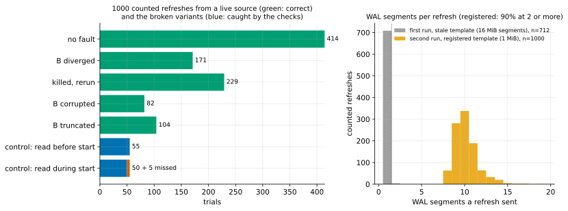
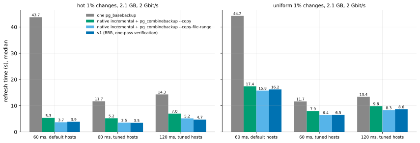
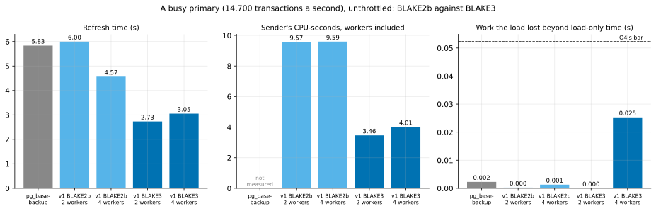
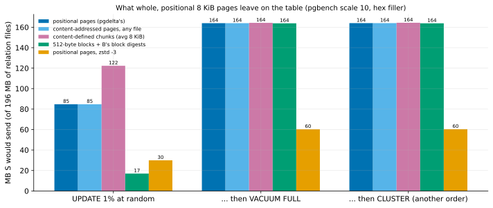

# What the evidence says (October 26, 2026)

A one-page summary of the questions pgdelta's pitch rests on: the answer, how firm it is, and the figure behind it. Every answer links to its experiment, which was pre-registered, analysed by a committed script, and reports its failed predictions as failed. The full ledger is [DECISIONS.md](DECISIONS.md), and the day-by-day record [LOG.md](LOG.md).

pgdelta refreshes an older physical copy of a PostgreSQL cluster (B) from the live server (S). It hashes both, sends only the pages that differ, patches B in place, and verifies the result. v1 is that path reading the running server in backup mode.

## Is it correct?

| Question | Answer | Firmness |
|---|---|---|
| Wrong copies from a stopped source? | **None in 10,000 randomized trials** (EXP-17), plus **2,000** more with one-pass verification (EXP-32) | Below 0.069% per refresh at 99.9% confidence; macOS, 50 MB |
| Wrong copies from a live, busy source? | **None in 1,000 trials** (EXP-25), and **1,000 more** with BLAKE3 and one-pass verification (EXP-33) | EXP-25: below 0.69% at 99.9%. EXP-33 claims no bound: a control fell below its bar |
| Would the checks catch a wrong copy? | **Yes: 76 of 76** wrong copies of the read-during-start kind were caught, and no correct copy was flagged (EXP-27, EXP-35, with an oracle) | Measured for that kind of fault |
| A killed refresh? | B is always left untouched, blocked from starting, or complete (EXP-17, -25, -32, -33) | Several hundred kills |
| On AlloyDB Omni? | **Omni 17.10, yes:** stopped, B came out byte-identical; live, Omni recovered B; both started with S's data (EXP-40). Omni 16 is now refused, which the probe found missing. Omni's container ships with data checksums off (its Kubernetes operator turns them on, EXP-44), and either way the bytes sent are the same (EXP-41: within 0.16 points). **On a busy Omni, 20 of 20 live refreshes were correct**, and Omni's own `_mintxid` fork goes through the WAL like a page, so recovery repairs it (EXP-42). Unlogged tables are copied as Omni's own `pg_basebackup` copies them (EXP-43) | A container on one VM; the live claim rests on the mechanism |
| Is there an old copy to refresh on Omni's Kubernetes operator? | **Not after an HA failover:** the operator deletes the old primary's disks and reseeds a new standby with `pg_basebackup` (EXP-44). A sidecar does run on every instance with PGDATA readable and a CPU quota. So HA on Kubernetes needs an operator change; DR remains pgdelta's case | One cluster, one failover |
| A power loss? | **16 of 16 hard resets** left B blocked (refusing to start) or complete, never wrong (EXP-34) | An existence check |

## Is it fast, and where?

| Question | Answer | Firmness |
|---|---|---|
| **DR (20–120 ms round trips): faster than the full copies?** | **Yes**, with BBR on pgdelta's socket: 0.33–0.75 of the fastest parallel copy (EXP-20, -24), confirmed on a real 31 ms link (EXP-15) | Three emulated sessions and a real link |
| **DR: faster than native incremental, where history exists?** | **As fast or faster:** v1 was faster by 14–74% on ext4, and the two tied on XFS with reflinks (EXP-36) | XFS tie at two sessions |
| **Where a backup repository exists: faster than pgBackRest?** | **Yes, to a usable copy:** from a backup a day's churn old (5% of rows), pgdelta took 0.024–0.084 of pgBackRest's time (2.4–10.6 s against 99–125 s), and 0.053–0.122 with pgBackRest fetching WAL asynchronously. Nearly all of pgBackRest's time is recovery, replaying the day's WAL (EXP-59, -59b) | Two sessions (the second with asynchronous fetching); one churn, 2.1 GB |
| **What does TLS cost?** | **About 3% at DR rates:** inside pgdelta's own mutual TLS 1.3 a 2.1 GB refresh took 1.033 of its in-clear time at 2 Gbit/s and 60 ms, 1.148 at 5 Gbit/s, with 0.3–0.6% more bytes (EXP-58) | One session; neither ratio near its bar |
| **Does the hash matter on fast links?** | **Yes, about 13% at 2.1 GB:** with the `blake3` package, v1 took 0.87 of BLAKE2b's time at 5 Gbit/s; the VMs' earlier DR runs all hashed with BLAKE2b (EXP-60) | Two sessions |
| HA (fast links): faster? | **Hashing:** only for small data on a fast, idle destination; beyond memory at best a tie, since it must read all of B (EXP-22, -31, -48; the bound in research loop 1). **The WAL-summary fast path** (opt-in; the old copy's lineage provable; `summarize_wal` on; PostgreSQL 17.11+): beyond memory it refreshed 18 GB of local changes in **1.98 s against 90.7 s for a full copy and 87.8 s by hashing** (0.022). Scattered changes touching 28% of the pages took 164.8 s, 1.8 times a full copy; its timers place that gap in unoverlapped source reads, a systems problem (EXP-64). **With 8 reader threads (`--read-ahead 8`, opt-in) that fell to 102.8 s** (0.614; 1.13 times a full copy's 91.0 s). The receiver, syncing each file in its main loop, was then the constraint (EXP-64b). **With its syncs on a worker thread, now the fast path's default, the same cell took 76.5 s, 0.842 of a full copy's 90.9 s:** the fast path beats `pg_basebackup` at 28% of pages changed. The source's operation rate now binds (EXP-68). The disk counts writes of up to 32 KiB as one operation (EXP-66). **Filling clean gaps of up to 2 pages between the changed ones, now also the fast path's default, cut it to 46.6 s: 0.608 of no filling, 0.512 of a full copy's 91.0 s.** Nearly all of the gain came from 1 page, since past it both disks run at a full copy's byte rate; 4 pages took 1.20 times as long (EXP-70) | Hashing: two sessions. Fast path: one session, far from its bars; read-ahead, the worker and filling: one session each |
| **A lagging standby with a WAL archive: faster than replaying it?** | **Yes, with the fast path:** an 18 GB standby beyond memory came current in **3.1 s against 19.8 s** for replaying the archive (0.156; hot rows updated 10 times, 1,754 MB of WAL) and 166.2 s against 256.2 s for 1% of rows scattered (0.649). Replay's floor: the archive already on the standby's disk. For scattered lag a re-clone (91.0 s) beat both (EXP-65) | One session, far from its bar |
| **An old primary after a failover: faster than `pg_rewind`?** | **Yes, with idea 1, now on with the fast path** (`--diverged-basis`; the old primary stopped cleanly, with its WAL since the last checkpoint before the fork, and checksums or `wal_log_hints`). For an 18 GB old primary beyond memory, with hot rows updated 10 times on the new primary (1,737 MB of WAL), pgdelta took **6.9 s against `pg_rewind`'s 35.1 s** (0.197) and a re-clone's 90.8 s. For 1% of rows scattered (8,001 MB of WAL), **48.2 s against a re-clone's 91.1 s** (0.529) and `pg_rewind`'s 457.5 s (0.105). Every copy matched the new primary, and `pg_amcheck --heapallindexed` passed (EXP-71). Idea 1 sends the new primary's copy of every block either side changed since the last common checkpoint, the old primary's side read from its own WAL (about 20,000 blocks, read in 0.65 s), so none of the new primary's WAL is replayed. **Before it,** pgdelta's fast path refused a diverged copy and hashed both: 90.2 s and 177.9 s, where `pg_rewind` won the hot case and a re-clone the scattered one (EXP-67). `pg_rewind`'s uniform time includes replaying 3.7 GB of WAL the lab's own state check wrote; without it about 313 s (inferred, EXP-69). Idea 1's guard refuses what it can't see: on local failovers a copy without checksums would have shown 20,000 rows the new primary never committed (EXP-69, EXP-69b) | EXP-71: one session, far from its bars; EXP-67: one session; idea 1's correctness: local, counted |
| Can we project beyond memory? | **Yes, on this disk type:** v1 ≈ \|B\| ÷ read rate + pages written ÷ page-write rate; fixed at 12 GB, it predicted 18 GB within 4.4% (EXP-48) | Two sizes, one disk |
| How old can the copy be? | **For local changes, any age measured**; for evenly scattered OLTP, about **1.75 updated rows per page** behind (58,000 transactions at 345 MB) before a full copy is as fast at DR (EXP-38) | Bytes measured, time projected |
| On a busy primary with a large dirty set? | **The start checkpoint dominates, not pgdelta:** with about 4.9 GB dirty on a balanced persistent disk, a fast checkpoint (pgdelta's default, `pg_basebackup -c fast`) nearly stalled the load for 30 s (27.5 s of work lost); a spread one (`pg_basebackup`'s default) ran it half short for 4.5 minutes (51.8 s lost). `--checkpoint spread` exists; which O4 number governs is open (EXP-57) | One session, one VM |
| On a busy primary? | At 2 source workers on 8 vCPUs, and 4 on 16, v1 costs the load no more than `pg_basebackup`. **With BLAKE3 it refreshes 2.1× faster than `pg_basebackup` on 8 vCPUs, and 2.1× on 16 at 4 workers** (EXP-28, -30, -39) | Three sessions (4 workers on 8 vCPUs missed in one of them) |

## What it costs others

| Question | Answer |
|---|---|
| Is BBR fair to other traffic? | **No: it stays opt-in.** On a shared bottleneck it took 81–96% of the link from cubic flows when the queue held a round trip or less (EXP-26) |
| Slowdown of the source's load? | Within `pg_basebackup`'s, at live mode's default of one source worker per 4 CPUs (EXP-28, -30, -39) |

## What's left on the table

| Question | Answer |
|---|---|
| Reuse after `VACUUM FULL` / `CLUSTER`? | **None, by any strategy:** cross-file page matching and content-defined chunking found nothing (EXP-37). Positional pages lose nothing |
| Fewer bytes on slow links? | **zstd is built** (`--compress zstd`, opt-in): 2.8× fewer bytes. Scattered changes took 0.52 of v1's time at 0.5 Gbit/s (6.8 s against 13.1; `pg_basebackup` 36.9), 0.75 at 1 Gbit/s and, with batched pool tasks, 0.86 at 2. **Break-even about 4 Gbit/s** (EXP-45 to -47, -52, -53). **Sub-page deltas are built but off** (`--subpage`): 3.5× fewer bytes again, but slower as built, since their block hashing outweighed the link time saved (EXP-54 to -56) |

## The defaults these results set

| Setting | Default | Evidence |
|---|---|---|
| `--hash` | `auto`: BLAKE3 where both ends have the package, else BLAKE2b | EXP-29 (4.8× per core), EXP-30 |
| `--verify-scope` | `written` in place, `all` for a new copy | EXP-31, -32, -33, -35 |
| `--jobs` with `--source-kind live` | at most CPUs ÷ 4, from 1 to 4 | EXP-28, -30, -39 |
| `--congestion-control` | the host's default; `bbr` opt-in | EXP-24 (speed), EXP-26 (fairness) |
| `--compress` | `off`; `zstd` opt-in for DR links below about 4 Gbit/s, chiefly 2 and slower | EXP-37, -45 to -47, -52, -53 |
| `--subpage` | off (slower as built) | EXP-54 to -56 |
| `--checkpoint` (live) | `fast`; `spread` opt-in | EXP-57 |

## Still open

- **HA on Omni's Kubernetes operator:** the operator deletes the old instance's disks on a failover and reseeds with `pg_basebackup` (EXP-44), so pgdelta's HA role there needs the operator to keep and refresh the old disk. DR is unaffected.
- **Larger sizes:** beyond memory, a two-term disk model (read B, then the scattered writes) fixed at 12 GB predicted 18 GB within 4.4% (EXP-48). Other disks' page-write rates still need measuring; sizes past a few times memory remain projection.
- **The rest of the slowdown tests:** a moderate load, a large dirty set, a source near saturation at 16 vCPUs.
- **A fast path past the HA tie (EXP-61, local):** PostgreSQL 17's WAL summaries, used only when a lineage guard proves the old copy is an ancestor of the source (`pg_rewind`'s test, plus identity, version, checksums and summary coverage), left no real wrong page on any of EXP-03's 12 tricky copies, and read 2–35% of the pages hashing both copies reads where the guard let it run. Without the guard, summaries failed like page LSNs (1,276–8,046 real wrong pages after a failover, `pg_checksums`, or on a foreign cluster). Hint-bit-only differences are left behind, so the copy would not be byte-identical. Counted, not timed; Omni ships with `summarize_wal` off. EXP-62 found the guard's blind spot real: an old primary that lost its WAL past the split passed it with 1,444 stale pages. A guard v2, which takes the old copy's end only from a clean stop or a base backup's manifest, refused it and left none in 13 scenarios. Building it is the owner's decision (DESIGN.md's "never skip pages").
- **The hash on the VMs:** every DR run on VMs (EXP-45 to -57) and EXP-48's beyond-memory runs hashed with BLAKE2b, not BLAKE3: `--hash auto` picks BLAKE3 only where both ends have the `blake3` package, and the VMs' startup script doesn't install it. EXP-60 measured the difference in two sessions: at 5 Gbit/s and 2.1 GB, BLAKE3 took 0.872 of BLAKE2b's time, each hashing phase about 0.58 of BLAKE2b's, as EXP-29's per-page cost predicted. So those fast-link numbers understate v1 by about 13%; they stay as measured, with this note. Beyond memory the disk read of B is the floor (EXP-48), and no hash changes that.
- **The bandwidth levers:** zstd's own time floor (about 6.1 s here, which keeps it even at 2 Gbit/s; EXP-47). EXP-49 traced it to the thread pools' cost per task on pgdelta's small runs (about 12–13 µs each, and 12 µs more for each of the receiver's writes), not to the codec. Batching runs into 1 MiB tasks is now the default: in two local sessions it cut zstd's extra time over plain v1 to 0.45 of it, with every copy byte-identical to S (EXP-50, -51). On VMs at 2 Gbit/s zstd went from even (1.05) to 0.86 of v1 (4.88 s), in two sessions (EXP-52). Its break-even is now about 4 Gbit/s at 60 ms (interpolated: 0.95 at 3 Gbit/s, 0.97 at 4, 1.06 at 5; EXP-53), so it is worth it chiefly at 2 Gbit/s and slower. **Sub-page deltas multiply with zstd:** 512-byte blocks plus zstd sent 0.21 of zstd's bytes, 13.6× fewer than whole pages, counting B's block digests (EXP-54). Cheap beyond their bytes on the Mac (EXP-55), but **as built, slower** on VMs: 1.16× v1 + zstd's time at 0.5 Gbit/s and 1.44× at 1, with 3.5× fewer bytes. Its block hashing, about 2.2 s on the sender's main thread plus waits on the receiver's, outweighed the link time saved (EXP-56). `--subpage` stays opt-in and off; moving that hashing onto the workers is the revision to test.
