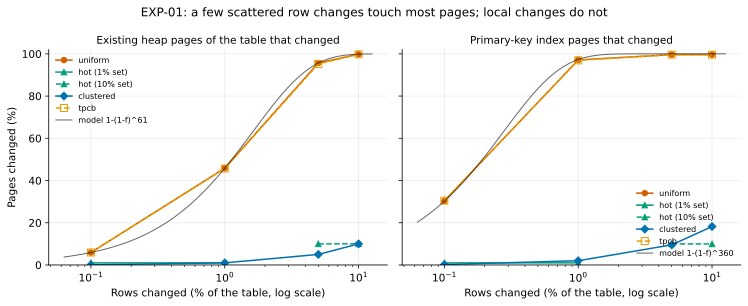
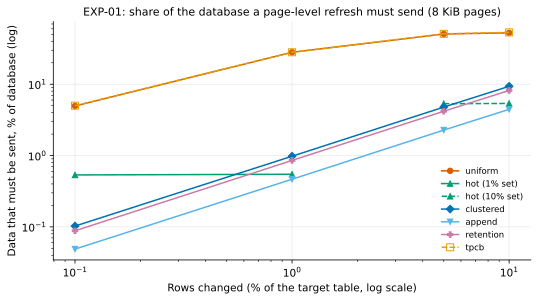
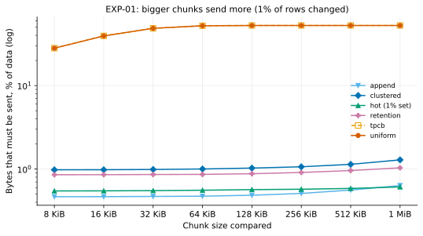

# EXP-01: How many pages change when rows change?

Status: **done.** Predictions recorded October 22, 2026, before any data; results added below the same day without editing them.

## Question

The tool only sends pages that differ between the old copy and the source. Its benefit therefore depends on the fraction of **8 KiB pages** that change, not the fraction of **rows**. Nobody has published this for PostgreSQL ([research summary](../research/state-of-the-art.md), "One percent of rows can dirty most of the pages"). If a typical day of changes touches most pages, the tool can't win, and the project should know that before building more.

The experiment also tests two design choices:
- **Hash-tree node size.** Larger nodes mean less metadata but more "changed" nodes.
- **Trackers vs. content.** Does PostgreSQL's change tracker (WAL summaries, used by incremental backup) report the same pages that actually differ in content?

## Hypotheses and predictions

The table used, `pgbench_accounts`, is created by `pgbench -i` with fillfactor 100. That means full pages, so an update can't stay on its page and becomes a non-HOT update (a new row version written elsewhere, plus a new index entry). With about 61 rows per heap page and roughly 360 entries per index leaf page, a simple probability model gives the predictions below. "f" is the fraction of rows changed.

| ID | Workload | Prediction |
|---|---|---|
| H1 | **Uniform**: f of rows updated, chosen at random | Old heap pages hit ≈ 1 − (1 − f)^61, about **46% at f = 1%** and **6% at f = 0.1%**. Primary-key index leaves hit ≈ 1 − (1 − f)^360, about **97% at f = 1%**. New row versions add new pages at the end of the table. |
| H2 | **Hot set**: the same number of rows, all within the first 1% of the table | Changed pages stay close to the hot region plus the new versions. **Under 5%** of heap and index pages at f = 1%. |
| H3 | **Clustered**: a consecutive range of rows | About f of heap pages and f of index leaves, plus the appended versions. |
| H4 | **Append**: inserts only | Existing pages almost unchanged. Changes are the new pages plus the right-most index leaves. |
| H5 | **Retention**: append f and delete the oldest f | About twice the append case: new pages plus the deleted range. |
| H6 | Chunk size | For uniform updates, 1 MiB chunks at f = 1% are **nearly all changed (over 95%)**. For hot, clustered and append workloads, chunk size matters much less. |
| H7 | Tracker vs. content | Pages the tracker lists will almost always really differ. Pages that differ but aren't tracked will be few, and mostly free space map (FSM) pages, which PostgreSQL doesn't fully log. |
| H8 | Read-only scan after the changes (sets hint bits) | With data checksums on, a scan dirties extra pages, but these are logged and tracked. It increases the number of changed pages without any new row changes. |

**What would prove the model wrong:** for uniform updates at f = 1%, heap pages changed outside 35–60% or index pages under 80%. Either would mean the model of how PostgreSQL places row versions is wrong, and the predictions for other workloads should be distrusted too.

## Design

- **Setup:** one machine (Apple M5 Pro), PostgreSQL 17.11 from Homebrew, a fresh cluster for every trial. Data checksums on, `summarize_wal = on`, otherwise default settings.
- **Data:** `pgbench -i -s 70` (7 million account rows, about 1 GB), plus an `events` table for the append and retention workloads.
- **Procedure:**
  1. Take backup B0.
  2. Apply exactly one workload from a fixed random seed. The workload is generated as SQL in small transactions, so the exact number of distinct rows changed is known.
  3. Take a full backup B1 and an incremental backup I1 based on B0.
- **What's measured:**
  - **Content changes:** compare B0 and B1 block by block, at chunk sizes from 8 KiB to 1 MiB. Report overall and by relation kind (heap, index, FSM, VM, catalog, other files).
  - **Tracker changes:** the blocks listed in I1's `INCREMENTAL.*` files.
  - **Agreement** between the two views.
- **Variables:** workload (uniform, hot, clustered, append, retention, pgbench's TPC-B-like mix) × row fraction (0.1%, 1%, 5%, 10%) × an optional read-only scan or VACUUM afterwards.
- **Repetitions:** three seeds per cell for the headline cells (uniform, hot and append at 1%); one seed elsewhere. The model predicts small variance, and three seeds checks that.
- **Tooling:** [experiments/change_patterns/](../../experiments/change_patterns/).

## Results

Run October 22, 2026: PostgreSQL 17.11, Apple M5 Pro, scale 70, 37 trials (36 planned plus the H8 cell), all passing. The database is about 2.1 GB:

| Table | Size | Rows | Changed by |
|---|---|---|---|
| `pgbench_accounts` (heap + index) | about 1.05 GB | 7 million | uniform, hot, clustered and tpcb workloads |
| `events` | about 1.05 GB | 7 million | append and retention workloads |

A workload that touches only one of the two tables can change at most about 53% of the data.

- **Exact runs:** [run_exp01.sh](../../experiments/change_patterns/run_exp01.sh).
- **Curated data (all 37 trials):** [exp01-trials.csv](data/exp01-trials.csv).
- **Figures:** `.venv/bin/python analysis/exp01_02.py`.

### Pages vs. rows: the model holds

| Workload | Rows changed | Existing heap pages changed (model) | Index pages changed | Share of the data a page-level refresh must send |
|---|---:|---:|---:|---:|
| uniform | 0.1% | 5.9% (5.9%) | 30.3% | 4.96% |
| uniform | 1% | **45.9% (45.7%)** | **97.2%** | 28.1% |
| uniform | 5% | 95.7% (95.3%) | 99.6% | 50.7% |
| uniform | 10% | 99.8% (99.8%) | 99.6% | 52.5% |
| tpcb (pgbench OLTP mix) | 1% | 45.7% | 96.9% | 28.1% |
| hot (1% set) | 1% | 1.0% | 1.0% | 0.55% |
| clustered | 1% | 1.0% | 2.0% | 0.98% |
| append | 1% | 0.0% | 1.0% | 0.47% |
| retention | 1% (2% of rows touched) | 1.0% | 1.0% | 0.85% |

**Repeatability:** three seeds of uniform, hot and append at 1% agreed within 0.1 percentage point. For example, uniform 1% sent 28.10%, 28.03% and 28.00%.

### Bigger chunks send more, but only for scattered changes

For uniform 1%, comparing 8 KiB pages means sending 28% of the data, but 64 KiB chunks already mean 52%, the entire touched table. For hot, clustered, append and retention changes, going from 8 KiB to 1 MiB raises the amount sent by less than a third, from 0.5–1% to 0.6–1.3%.

### PostgreSQL's change tracker agrees with page contents

With data checksums on (36 of 37 trials), **not a single changed block was missed by the WAL-summary tracker** ("changed but not tracked" = 0). A few hundred to a few thousand blocks were tracked without differing in content. Those are blocks written and then restored, and free space map pages; they make incremental backup send slightly more, never less.

The exception is the trial with **checksums off, no VACUUM after loading, and a read-only scan before B1.** There, 100,001 blocks changed only through hint bits and were not tracked, since hint bits aren't WAL-logged without checksums. So the tracker and content views disagree exactly where PostgreSQL's own design says they should. pgdelta, which compares content, re-sent those pages: 1.43 GB against incremental's 0.62 GB. They're harmless to skip for PostgreSQL's purposes, since hint bits are recomputable.

### Verdict on each prediction

| ID | Prediction | Result |
|---|---|---|
| H1 | Uniform: heap pages changed ≈ model (46% at 1%, 6% at 0.1%); index about 97% at 1% | **Held.** Within 0.4 points of the model at every fraction; index 97.2% at 1% and 30.3% at 0.1% |
| H2 | Hot set: under 5% at 1% | **Held.** 1.0% |
| H3 | Clustered: about f of heap and index | **Heap held** (exactly f). **Index was about 2f** (2.0% at 1%, 18% at 10%): every non-HOT update adds a new index entry, so the touched range of the index doubles |
| H4 | Append: existing pages almost unchanged | **Held.** 0.0% of existing heap pages; only new pages and the right-most index leaves |
| H5 | Retention ≈ 2× append | **Held.** 1.8× (0.85% vs 0.47% at 1%) |
| H6 | Uniform 1%: 1 MiB chunks nearly all changed; little effect for local patterns | **Held.** All 1 MiB chunks of the touched table changed; local patterns changed at most a third more |
| H7 | Tracker ≈ content, misses only FSM pages | **Held, stronger than predicted.** Zero misses with checksums on, including FSM |
| H8 | A read scan with checksums on dirties more pages, all tracked | **Held.** Run as an extra trial (`F-h8`): uniform 1%, no post-load VACUUM, then a read scan, with checksums on. The share of data to send rose from 28% to 67%, every changed block was tracked (0 misses), and incremental grew to match pgdelta (1.44 GB vs 1.43 GB) |

## Conclusions

1. **The project's premise holds for most realistic change shapes, and fails for one.** Changes that are local in the key space (hot rows, time-ordered inserts, retention, ranges) leave 99% of pages untouched, so a page-level refresh sends about 1% of the database. Updates scattered uniformly across a large table touch nearly every page once more than about 2% of rows change. Above that point, no page-level method (pgdelta, rsync or incremental) can avoid sending the whole table.
2. **8 KiB chunks matter.** For scattered changes they halve the bytes compared with 64 KiB or larger chunks. That rules out large chunk sizes as the comparison unit; hash-tree nodes stay at 1 MiB only as a way to skip unchanged regions quickly.
3. **The model `1 − (1 − f)^(rows per page)` is a reliable planning tool.** Given a table's rows per page and its update rate, it predicts the cost of a refresh within a fraction of a percentage point. Index pages need their own entries-per-page figure.

## Limitations

- pgbench tables at fillfactor 100, so most updates are non-HOT. A lower fillfactor would keep more updates on their page and change fewer index pages.
- Seconds between backups: no autovacuum or freezing dynamics, and the VACUUM variant only approximates them.
- One machine.

## Limitations known in advance

- One machine, synthetic workloads, and a short time between backups. Real long-running systems also see autovacuum and freezing. The VACUUM variant only approximates that.
- `pgbench_accounts` at fillfactor 100 is close to the worst case for non-HOT updates. Real tables often leave free space. Fillfactor is worth a follow-up variant if results hinge on it.
