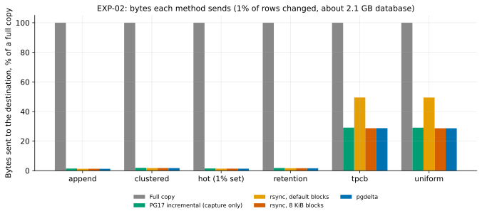
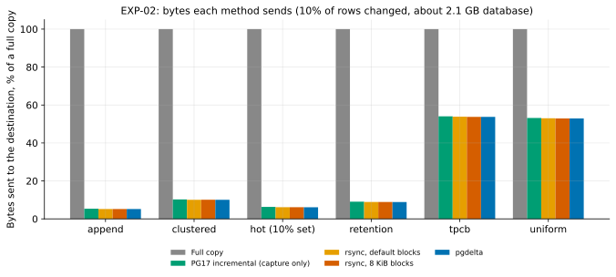
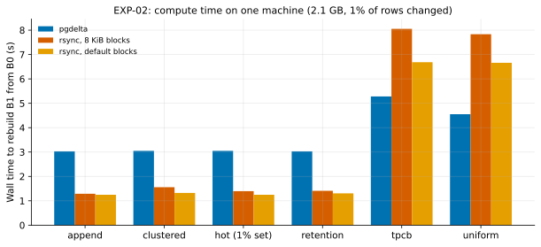
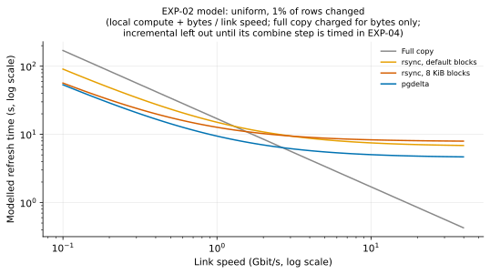
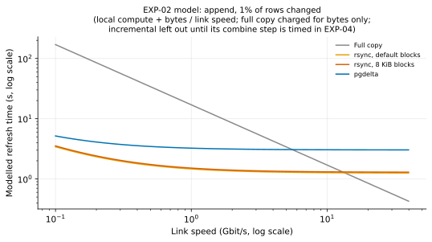

# EXP-02: Bytes and compute on identical inputs

Status: **done.** Predictions recorded October 22, 2026, before the engine existed; results added below the same day without editing them.

## Question

Given the same old copy (B0) and the same fresh backup (S), how many bytes does each method move between source and destination, and how much computing does it need?
- Full copy
- PostgreSQL 17 incremental backup
- rsync with its default block size
- rsync with 8 KiB blocks
- The tool (`pgdelta`)

Bytes are measured exactly on one machine; there is no network bottleneck here. EXP-04 checks the time predictions on real links.

## How each method's bytes are predicted

| Method | Bytes from source to destination | Bytes back to source |
|---|---|---|
| Full copy | Size of S | 0 |
| Incremental | Size of I1: changed blocks according to the WAL tracker, plus whole non-relation files and WAL | Only the old manifest |
| rsync, default | Changed rsync blocks × block size, plus file list. rsync picks block size from file size, about 30 KiB for a 1 GB table file | 6–20 bytes of checksum per old block, about 0.2–0.7 MiB per GiB |
| rsync, 8 KiB | Changed 8 KiB pages × 8 KiB | About 2–2.5 MiB of checksums per GiB |
| pgdelta | Changed 8 KiB pages × 8 KiB, plus file list | 16 bytes per 1 MiB node (16 KiB per GiB), plus 2 KiB of page fingerprints per changed node |

## Predictions

| ID | Prediction |
|---|---|
| P1 | **WAL floor.** Every method has to send the WAL written during the new backup, at least one 16 MiB segment. For small changes this floor dominates, so all delta methods look alike below roughly 1% of pages changed. |
| P2 | **Scattered changes** (uniform 1%): pgdelta, incremental and rsync with 8 KiB blocks each send within ±15% of one another. Default rsync sends at least 2× as much, because its bigger blocks catch more changed pages per block. |
| P3 | **Local changes** (hot set, append): all delta methods send under 10% of the full copy. |
| P4 | **Metadata:** pgdelta's fingerprint traffic back to the source is under 1% of the database size at every change level. That's the point of the hash tree. rsync with 8 KiB blocks sends about 0.25% for checksums alone, whatever the change level. |
| P5 | **Compute:** pgdelta reads and hashes both sides, about 1–2 seconds per GB per side on this machine. Incremental reads only the changed blocks on the source, but combining rewrites the whole copy at the destination. |
| P6 | **Time vs. link speed, a model checked in EXP-04:** at 1 Gb/s, delta methods finish sooner than a full copy whenever under about 70% of pages change; at 10 Gb/s and above, the advantage mostly disappears. |

## Design

- **Inputs:** reuse EXP-01's B0/B1 pairs (the same workloads and fractions), so the bytes can be explained by EXP-01's changed-page counts.
- **Runs:** each method runs through the measurement harness's pluggable backup methods, so capture, transfer and verification are timed the same way for every method.
- **Correctness:** every output is checked with `pg_verifybackup`. pgdelta's output must also be byte-identical to S.
- **Repetitions:** three per cell, reporting the median and spread.

## Results

Run October 22, 2026, on the same 37 trials as [EXP-01](EXP-01-change-patterns.md): PostgreSQL 17.11, Apple M5 Pro, scale 70, database about 2.1 GB. All 37 passed.

- **Exact runs:** [run_exp01.sh](../../experiments/change_patterns/run_exp01.sh) (`--compare-methods` on every trial).
- **Per-cell medians, including the crossover speeds below:** [exp02-methods.csv](data/exp02-methods.csv). Every trial: [exp01-trials.csv](data/exp01-trials.csv).
- **Figures:** `.venv/bin/python analysis/exp01_02.py`.

### How it was actually run (differences from the design)

| Design said | What happened, and why it is still a fair comparison |
|---|---|
| Run every method through the harness's pluggable backup methods | pgdelta and both rsync settings ran from [compare_methods.py](../../experiments/change_patterns/compare_methods.py), straight after each trial, on that trial's B0 and B1. Same inputs, same machine, one after another. The harness methods are used for the two-machine runs in EXP-04. |
| Check every output with `pg_verifybackup` | Stronger check for the three methods that ran: each output was compared **byte for byte** with B1. All 37 × 3 = 111 outputs were identical. |
| Full copy and incremental as methods | Counted from sizes: full copy = size of B1, incremental = size of I1. Incremental's restore step (`pg_combinebackup`, which writes a whole new copy at the destination) was **not run or timed** here, so incremental appears in the byte results only. EXP-04 times it. |
| Three repeats per cell | As in EXP-01: three extra seeds for the headline cells (uniform, hot, append at 1%), one run elsewhere. Repeats agreed within 0.4% on bytes and 0.7 s on time. |

### Bytes: pgdelta and rsync with 8 KiB blocks send exactly the same data

> **Correction, October 22, 2026, from [EXP-04](EXP-04-network-sweep.md).** Incremental's bytes below are I1's size on disk. That includes a 16 MiB WAL segment padded with zeros, which `pg_basebackup` writes locally but never sends: over a network it streams only the WAL actually written. Measured on the wire in EXP-04, incremental sent 16–17 MB for hot and append at 1%, against 27–30 MB for pgdelta and rsync (their staged S holds the padded segment, and they must send it), and about 1% less than pgdelta for uniform. So on the wire, **incremental sends the fewest bytes**, not pgdelta. The padded segment accounts for the whole gap. Without it, pgdelta's own payload would be the smaller (about 12 against 17 MB for hot), so the difference comes from the staged capture, not from comparing pages. The comparison of pgdelta with rsync is unaffected. The claims below about incremental's extra bytes refer to its on-disk size.

| Workload, rows changed | Full copy | Incremental | rsync, default | rsync, 8 KiB | pgdelta | pgdelta as % of full |
|---|---:|---:|---:|---:|---:|---:|
| uniform 0.1% | 2,116 MB | 125 MB | 306 MB | 122 MB | **121 MB** | 5.7% |
| uniform 1% | 2,122 MB | 616 MB | 1,049 MB | 608 MB | **608 MB** | 28.7% |
| uniform 10% | 2,131 MB | 1,133 MB | 1,130 MB | 1,128 MB | **1,127 MB** | 52.9% |
| tpcb 1% | 2,126 MB | 618 MB | 1,052 MB | 610 MB | **610 MB** | 28.7% |
| hot (1% set) 1% | 2,116 MB | 32 MB | 28.5 MB | 28.9 MB | **28.3 MB** | 1.3% |
| clustered 1% | 2,125 MB | 41 MB | 37.7 MB | 38.0 MB | **37.5 MB** | 1.8% |
| append 1% | 2,125 MB | 30 MB | 26.8 MB | 27.2 MB | **26.7 MB** | 1.3% |
| retention 1% | 2,125 MB | 39 MB | 35.0 MB | 35.4 MB | **34.9 MB** | 1.6% |

What the table shows:
- **pgdelta and rsync with 8 KiB blocks find the same changed pages.** The page data pgdelta sent equals the "literal data" rsync reported, to the byte, in **all 37 trials**. The small differences in the table are each tool's own overhead (file list, control messages).
- **Incremental sends 0.5–20% more than pgdelta.** The extra is almost exactly the blocks the tracker listed that turned out unchanged (EXP-01's "tracked but unchanged"): 417 blocks (3.4 MB) for append 1%, 956 blocks (7.8 MB) for uniform 1%, 5,434 blocks (44.5 MB) for uniform 5%. These are blocks written and then put back, so their final content is the same. In relative terms it matters most when the change is small.
- **Default rsync matches EXP-01's chunk analysis.** rsync picks a block size of about 30 KiB for a 1 GB file, so EXP-01's 32 KiB chunks are the closest comparison. At uniform 0.1% it sent 14.4% of the database; EXP-01 predicted 15.4% from comparing 32 KiB chunks. At 1%: 49.5% sent, 48.7% predicted. Bigger blocks cost **2.5× the bytes at 0.1% of rows and 1.7× at 1%**. Above 5%, every block is dirty anyway and the methods converge.
- **Local changes cost about 1% of a full copy, for every delta method.**

**The floor is one WAL segment.** Every new backup includes the write-ahead log (WAL) written while it was taken. WAL is the database's change journal, kept in 16 MiB files ("segments"), and a new backup's segment never matches anything in the old copy. In the smallest change (append 0.1%), pgdelta sent 17.8 MB of page data, and 16.8 MB of it (94%) was that one segment.

### Traffic back to the source: small for everyone, and smaller than predicted for rsync

To find what changed, the destination has to describe its old copy to the source. That traffic flows "backwards," which matters on links that are slow in that direction.

| Workload | rsync, default | rsync, 8 KiB | pgdelta |
|---|---:|---:|---:|
| scattered (uniform or tpcb), any fraction | 0.31 MB (0.015%) | 0.94 MB (0.044%) | 2.2 MB (0.105%) |
| local (hot, clustered, append, retention) | 0.30 MB (0.014%) | 0.84–0.94 MB (0.04%) | 0.08–0.30 MB (0.004–0.014%) |

Percentages are of the database size. Two things differ from what was expected:
- **rsync sends far less than predicted** (0.04%, not 0.25%). Two reasons. `--checksum` first compares whole-file checksums, so rsync only sends block checksums for files that actually changed. And rsync shortens each block's checksum to about 7 bytes (a 4-byte rolling checksum plus a few bytes of a stronger one), relying on a whole-file check at the end to catch a rare collision. 0.94 MB for about 135,000 blocks of the changed table fits that.
- **For scattered changes pgdelta sends more back than rsync** (2.2 MB vs 0.94 MB). When a 1 MiB node differs, the destination sends a 16-byte fingerprint for each of its 128 pages. Under uniform changes nearly every node of the table differs. Shorter page fingerprints would close the gap safely, because every finished file is verified against the source's digest anyway. It's noted as a possible improvement; at 0.1% of the database it isn't urgent.

### Compute: this is where the methods really differ

Wall-clock seconds to turn B0 into an exact copy of B1 on one machine (both ends running on the same Mac, so there's no network time):

| Workload, rows changed | rsync, default | rsync, 8 KiB | pgdelta | pgdelta CPU seconds |
|---|---:|---:|---:|---:|
| uniform 0.1% | 3.4 s | 2.5 s | 3.6 s | 6.0 |
| uniform 1% | 6.7 s | 7.8 s | **4.6 s** | 6.9 |
| uniform 10% | 7.2 s | 10.0 s | **3.4 s** | 5.8 |
| hot (1% set) 1% | **1.2 s** | 1.4 s | 3.0 s | 5.5 |
| append 1% | **1.2 s** | 1.3 s | 3.0 s | 5.5 |
| clustered 10% | **3.0 s** | 4.3 s | 3.8 s | 6.4 |

- **pgdelta's cost is nearly fixed: 3.0–5.3 s for 2.1 GB, whatever changed.** It reads and fingerprints every page three times: the new backup at the source, the old copy at the destination, and the finished output (to verify it). That's about 6.3 GB of hashing in 5.4–7.3 CPU seconds, roughly **1 second per GB per pass on one core**. Both ends run at the same time, so wall time is lower than CPU time.
- **pgdelta also writes a complete new copy** (2.1 GB, flushed to disk), because it builds the output in a staging folder and only renames it into place once every file is verified. rsync here patched a copy-on-write clone of B0 in place, writing only the changed blocks; making the clone is nearly free on macOS and wasn't timed. On a disk without cheap clones, rsync would have to either copy B0 first or patch the old copy directly, which leaves it half-updated if interrupted. EXP-04 measures this on Linux.
- **rsync's cost grows with how scattered the changes are: 1.2 s to 10 s.** When nothing changed in a file, rsync's quick whole-file checksum skips it. When a block doesn't match, rsync searches for the next match by sliding forward one byte at a time. That fits the times: cheap when few blocks differ, expensive when a quarter of the pages do.
- So **rsync is 2–3× faster for local changes, and pgdelta is 1.5–3× faster for scattered changes of 1% of rows or more.** At uniform 0.1%, rsync with 8 KiB blocks was still faster (2.5 s vs 3.6 s).
- **One result isn't explained yet:** pgdelta took longer at uniform 1% (4.6 s) than at 5–10% (3.4 s), consistently across repeats and in the tpcb workload too. A likely cause: at 1%, changed and unchanged pages alternate, so the output is assembled from many short pieces (each gap filled by a separate read from the old copy); at 5% and above, nearly every page of the table changed, so the pieces are long. EXP-05 profiles the engine and checks this.

### Time vs. link speed: a model, tested on real links in EXP-04

On one machine there is no network, so the model below adds the measured compute time to the time the bytes would take on a link of a given speed: **time = compute + bytes ÷ link speed.** The full copy is charged for its bytes only (no compute), which favours the full copy.

Where a line crosses the full copy's line is the link speed above which simply copying everything is faster. Higher is better:

| Workload, rows changed | rsync, default | rsync, 8 KiB | pgdelta |
|---|---:|---:|---:|
| uniform 1% | 1.3 Gbit/s | 1.6 Gbit/s | **2.7 Gbit/s** |
| uniform 10% | 1.1 Gbit/s | 0.8 Gbit/s | **2.4 Gbit/s** |
| tpcb 1% | 1.3 Gbit/s | 1.5 Gbit/s | **2.3 Gbit/s** |
| hot (1% set) 1% | **13.4 Gbit/s** | 12.0 Gbit/s | 5.5 Gbit/s |
| append 1% | **13.5 Gbit/s** | 13.0 Gbit/s | 5.5 Gbit/s |
| retention 1% | **12.8 Gbit/s** | 11.9 Gbit/s | 5.5 Gbit/s |

**pgdelta's ceiling of about 5.5 Gbit/s comes entirely from its fixed compute time,** not from its bytes, which are the lowest. Halving that time would double the ceiling. That is the question for [EXP-05](EXP-05-parallel-hashing.md): hashing on several cores.

### Hint bits: where comparing content costs more than reading the tracker

The two extra variants from EXP-01, at uniform 1%:

| Variant | Incremental | pgdelta | rsync, 8 KiB |
|---|---:|---:|---:|
| Read scan after the changes, **checksums on** (`F-h8`) | 1,436 MB | 1,428 MB | 1,428 MB |
| Read scan after the changes, **checksums off** | **617 MB** | 1,428 MB | 1,428 MB |

A read scan sets "hint bits": small flags PostgreSQL writes into a page to remember that a row's transaction committed, so it doesn't have to look it up again. With data checksums on, setting a hint bit is logged, the tracker sees it, and every method sends those pages. **With checksums off it isn't logged, so incremental skips 100,001 pages whose only change is hint bits, and sends 2.3× less than pgdelta.** Skipping them is safe: hint bits can always be recomputed. pgdelta and rsync send them because they compare raw bytes. This gap shrinks over time, since PostgreSQL 18's `initdb` turns data checksums on by default.

### Verdict on each prediction

| ID | Prediction | Result |
|---|---|---|
| P1 | Every method sends at least one 16 MiB WAL segment; below about 1% of pages changed, delta methods look alike | **Held.** Smallest delta 17.9 MB, 94% of it the segment. Under 1% of pages changed, all delta methods were within 4 MB of one another |
| P2 | Uniform 1%: pgdelta, incremental and rsync 8 KiB within ±15%; default rsync ≥2× | **Partly held.** The three agree within 1.3%. Default rsync sent 1.7× at 1% (2.5× at 0.1%), not ≥2× |
| P3 | Local changes (hot set, append): all delta methods under 10% of a full copy | **Held.** 1.3% at 1% of rows; at most 6.3% at any fraction (incremental, hot 10% set at 10%). Clustered and retention, not named in the prediction, reached 10.2% and 9.0% at 10% of rows |
| P4 | pgdelta's back-traffic under 1% of the database; rsync 8 KiB about 0.25% | **pgdelta held** (at most 0.105%). **rsync was wrong**: about 0.04%, six times lower, for the two reasons above |
| P5 | pgdelta hashes at about 1–2 s per GB per side; incremental's combine rewrites the whole copy | **pgdelta held, at the fast end:** about 1 s per GB per pass, with three passes, not two (the output is re-hashed for verification). The incremental half wasn't measured here; EXP-04 times `pg_combinebackup` |
| P6 | At 1 Gbit/s delta methods win below about 70% of pages changed; at 10 Gbit/s the advantage mostly disappears | **Held in the model.** At 1 Gbit/s, pgdelta beats a full copy while it sends under 73% of the data. At 10 Gbit/s, pgdelta loses in every cell; rsync still wins up to about 14 Gbit/s for small local changes, because of its lower compute. Real links in EXP-04 decide this |

## Conclusions

1. **On bytes, the problem is solved, and pgdelta is at the floor.** It sends exactly the changed 8 KiB pages, the same as rsync with 8 KiB blocks, and slightly less than PostgreSQL's own incremental backup. No page-level method can send less without skipping pages whose content really changed (like hint bits).
2. **Compute time is what separates the methods.** pgdelta pays a fixed ~1 s per GB per pass; rsync is cheap for local changes and expensive for scattered ones. On links of a few Gbit/s and up, compute decides who wins.
3. **The next improvement is clear and measurable:** parallel hashing ([EXP-05](EXP-05-parallel-hashing.md)), then real links (EXP-04, being built).

## Limitations

- One machine: both ends share the same cores and SSD, and the "network" is a pipe. EXP-04 runs on two machines over real links.
- Time vs. link speed is a model here, not a measurement.
- Incremental's restore step wasn't timed, and full copy's compute wasn't measured.
- rsync 3.5.1 (Homebrew) with `--checksum`; without it rsync trusts file size and modification time, which is unsafe for database files (see the [research summary](../research/state-of-the-art.md)).
