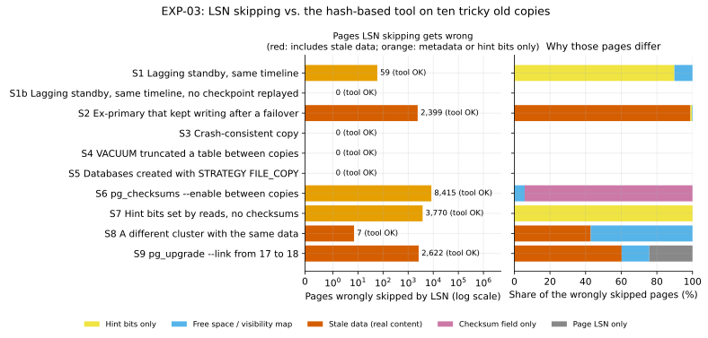
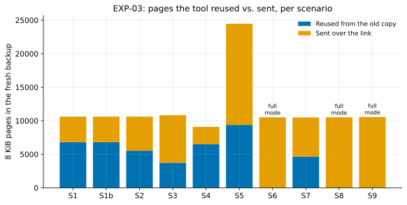
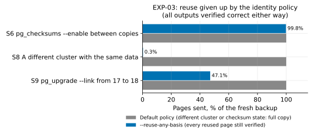

# EXP-03: Does the tool stay correct on tricky old copies, and would LSN skipping?

Status: **done.** Predictions recorded October 22, 2026, before any data; results added below the same day.

## Question

The project's pitch is that the tool works on *any* older copy of the cluster, because it checks page contents by hash instead of trusting page LSNs (the "last changed at" stamp in each page header). The research found nine documented situations where LSN-based skipping goes wrong ([research summary](../research/state-of-the-art.md), "Page LSNs mislead in at least nine documented situations").

This experiment checks both sides on real clusters:
1. Does the tool produce a correct, restorable copy in each tricky situation?
2. In the same situations, how many pages would an LSN-skipping shortcut have gotten wrong? This also answers Ben's October 16 question to Uttansh with evidence.

## The LSN-skip shortcut being tested

Skip every source page whose LSN is below the old copy's redo point. The redo point is taken from the old copy's `pg_control`, the threshold the research says is the safest one. Send every other page.

A page counts as **wrongly skipped** if it was skipped but its bytes differ between the old copy and the source. The rebuilt copy would then contain a stale page.

## Scenarios and predictions

| ID | Old copy at the destination | Tool (hash) prediction | LSN-skip prediction |
|---|---|---|---|
| S1 | A standby that stopped replaying, on the same timeline | Correct, reuses most pages | Correct (same history) |
| S2 | An ex-primary that kept writing after a failover | Correct; diverged pages detected and re-sent | **Wrong.** Pages the ex-primary changed after the split carry LSNs that look "old enough" to skip on the source side, so they keep diverged contents |
| S3 | A crash-consistent copy (server killed, folder copied) | Correct | Correct (same history) |
| S4 | VACUUM truncated a table between copies | Correct; the shorter file is handled | Correct for skipped pages; truncation must still be handled |
| S5 | A database dropped and recreated with `STRATEGY FILE_COPY` | Correct | **Wrong.** Copied pages keep their template's old LSNs |
| S6 | `pg_checksums --enable` run between copies | Correct; every page re-sent, since all changed | **Wrong** on nearly every page (checksum field rewritten, LSN untouched) |
| S7 | A cluster without checksums or `wal_log_hints`, then a read-only scan | Correct | **Wrong** on hint-bit-only pages (harmless for PostgreSQL, but proves the stamp misses content changes) |
| S8 | A different cluster (wrong database) | Correct. The output is still checked byte for byte against the source, so reuse is only an efficiency question | Not applicable (LSNs are meaningless across clusters) |
| S9 | The old copy is PostgreSQL 17; the source was upgraded to 18 with `pg_upgrade --link` | Correct. Unchanged user-table pages may still be reused, because the hash compares content, not history | Not applicable |

A key point this design relies on: the tool's output is verified against the **source's** file digests, so correctness never depends on where reused bytes came from. A wrong or foreign old copy can only make the tool slower (more pages sent), never wrong. The probability of a false match is about 2⁻¹²⁸ per page with a keyed 128-bit hash. The identity gate in `pgdelta/identity.py` is therefore an efficiency and safety-net policy, and S8 and S9 test what reuse it gives up.

## Design

- **Setup:** PostgreSQL 17.11 and 18.6 from Homebrew on one machine; fresh clusters per scenario; small datasets (about 100–300 MB), because correctness doesn't depend on scale.
- **Per scenario:**
  1. Build the old copy in the described state.
  2. Take a fresh backup S of the source.
  3. Run the tool to rebuild O from the old copy plus S.
  4. Check that:
     - O is byte-identical to S;
     - `pg_verifybackup O` passes;
     - O starts up after WAL replay;
     - a logical comparison (row counts and hashes of each table) matches the source at S's end point.
- **LSN-skip analysis:** read every page's LSN in S and compare it with the old copy's redo point. Count pages skipped, pages wrongly skipped, and the relation kinds involved.
- **Pass criteria:**
  - **The tool:** passes every check in every scenario.
  - **The LSN-skip predictions:** confirmed if wrongly-skipped pages are greater than 0 in S2, S5, S6 and S7, and equal to 0 in S1, S3 and S4.

## Results

Run October 22, 2026: PostgreSQL 17.11 (S9: 17.11 to 18.6), macOS arm64, 200,000-row accounts table (an 83 MB backup).
- **Tooling:** [experiments/tricky_copies/](../../experiments/tricky_copies/).
- **Curated data:** [exp03-summary.csv](data/exp03-summary.csv) and [exp03-reuse-any-basis.csv](data/exp03-reuse-any-basis.csv).
- **Reproduce:** `python3 experiments/tricky_copies/run_scenarios.py run all --out results/exp03`, then `.venv/bin/python analysis/exp03.py`.

**One scenario was added after the tooling was reviewed. The predictions above were not changed.**
- **What was added:** S1b, the same lagging standby as S1 but one that had not replayed a checkpoint.
- **Why:** S1's outcome depended on whether the standby had replayed a checkpoint before stopping, a detail the design didn't specify. Real standbys replay checkpoints all the time, so S1 is the realistic case. S1b shows the other branch.

### 1. The tool was correct in all ten scenarios

For every scenario, the rebuilt copy O was:
- byte-identical to the fresh backup S;
- passed `pg_verifybackup`;
- started up after WAL replay;
- matched the source's row counts and row hashes for every table.

### 2. LSN skipping went wrong in four of the eight same-cluster scenarios

| Scenario | Pages compared | Changed | LSN shortcut would skip | **Wrongly skipped** | Why they differ | Prediction |
|---|---:|---:|---:|---:|---|---|
| S1 lagging standby | 8,525 | 1,734 | 6,850 | **59** | 53 hint bits only, 6 free space map | "Correct": **not held** |
| S1b lagging standby, no checkpoint replayed | 8,525 | 1,749 | 6,776 | **0** | none | "Correct": held |
| S2 ex-primary after failover | 8,525 | 3,010 | 7,914 | **2,399** | **2,371 stale data**, 20 hint bits, 8 FSM/VM | "Wrong": held |
| S3 crash-consistent copy | 8,742 | 5,019 | 3,722 | **0** | none | "Correct": held |
| S4 VACUUM truncation | 6,998 | 508 | 6,490 | **0** | none | "Correct": held |
| S5 `FILE_COPY` databases | 9,360 | 3 | 9,357 | **0** | (12,990 source pages had no counterpart in B) | "Wrong": **not held** |
| S6 `pg_checksums --enable` | 8,427 | 8,427 | 8,415 | **8,415** | 7,925 checksum field only, 490 FSM/VM | "Wrong": held |
| S7 hint bits, no checksums | 8,396 | 3,770 | 8,396 | **3,770** | all hint bits only | "Wrong": held |
| S8 different cluster | 8,427 | 7 | 8,427 | 7 | 3 stale data, 4 FSM | (no prediction) |
| S9 `pg_upgrade` 17→18 | 8,426 | 2,846 | 8,202 | 2,622 | 1,580 stale data, 635 LSN only, 407 FSM/VM | (no prediction) |

What the pattern shows:
- **S2 is the case that matters most.** After a failover, every one of the 1,000 pages the old primary wrote after the split is stale in B, yet its LSN on the new primary is below B's redo point. A shortcut that trusts LSNs would silently produce a copy holding transactions that the new primary never had: **2,371 pages of real, wrong data**. The hash-based tool re-sent all of them.
- **S1 was a wrong prediction, and an instructive one.** Once a standby has replayed a checkpoint, its own redo point moves forward. But some hint-bit updates on the primary never reach the standby: with checksums on, PostgreSQL writes only the first hint-bit change to a page after each checkpoint into the WAL, and later ones on that already-logged page aren't. So the two copies differ while the LSN stays put. Here that affected 53 heap and index pages plus 6 free-space-map pages: harmless for PostgreSQL, but it proves the LSN shortcut misses real content differences even on the friendliest kind of old copy.
- **S5's prediction failed for a structural reason.** Databases created or re-created with `FILE_COPY` get new OIDs, so their files live under new `base/<oid>` paths that don't exist in B. A path-matched shortcut never gets the chance to skip them. Every one of their 6,495 pages carries an old LSN, so the hazard is real if a path ever coincides. This experiment didn't force that, so it does not show the shortcut is safe there.
- **S6 and S7 differ in metadata only**, but on nearly every page (S6) or every page holding the bulk-loaded rows (S7). A shortcut would leave copies whose page checksums are wrong (S6) or hint bits stale (S7).

### 3. What the tool sent

- **Every run sent exactly one 16 MiB WAL segment (2,048 pages) plus the pages that differ.** For example, S1 sent 3,796 pages: 2,048 of WAL, and 1,748 others against 1,734 changed relation pages. This is the WAL floor predicted in [EXP-02](EXP-02-local-comparison.md) P1.
- **In reuse mode, fingerprints flowing back to the source totalled 57–167 KB per run**, about 0.1–0.2% of the backup size.
- **S6, S8 and S9 used full mode under the default identity policy:**
  - S6, because the checksum version changed;
  - S8 and S9, because the system identifier differs.

  Re-running them with `--reuse-any-basis`, where every reused page is still verified against the source, measures what that policy gives up:

| Scenario | Default policy | `--reuse-any-basis` | Output correct |
|---|---:|---:|---|
| S6 checksums enabled | 100% sent | 99.8% sent | yes |
| S8 different cluster | 100% sent | 0.3% sent* | yes |
| S9 `pg_upgrade --link` 17→18 | 100% sent | **47.1% sent** | yes |

\* S8's clusters were built by the same deterministic script and happened to produce identical pages, even down to their WAL positions. An earlier build of the same scenario differed on 1,708 pages. Real, independently created clusters would share almost nothing, so don't read anything into this number.

## Conclusions

1. **Hashing is the right correctness bet, and it's now backed by evidence.** The tool was correct in every scenario, including the four where the LSN shortcut produced stale or wrong pages. In S2 those pages held data that was simply wrong.
2. **The answer to Ben's October 16 question to Uttansh**, "what problems do they cause?":
   - **Failover:** a page LSN carries no timeline, so pages the old primary changed after the split look unchanged. That leaves stale data (S2).
   - **Enabling checksums:** every page changes without its LSN changing (S6).
   - **Hint bits:** these change pages without changing their LSN, even on a healthy standby (S1, S7).
   - **`pg_upgrade`:** the catalogs are rebuilt with LSNs below the old copy's redo point (S9).
3. **Correctness doesn't depend on the old copy's identity**, because every output file is verified against the source's digest. The identity policy only trades reuse for caution. Across a major-version upgrade it gave up 53% reuse (S9). The default stays conservative for now; whether to relax it is a product decision worth raising with the AlloyDB team.

## Limitations

- **Small clusters (83 MB) on one machine.** Correctness doesn't depend on scale; page counts do.
- **S5 doesn't exercise the hazard it was meant to test**, because recreated databases get new paths (see above).
- **S8's reuse number is an artifact** of deterministic builds.
- **Not tested:** tablespaces outside the data directory (the tool refuses them), and PostgreSQL 18 for S1 to S8, beyond a small-scale check of S1, S6 and S7 during the tooling's review.
