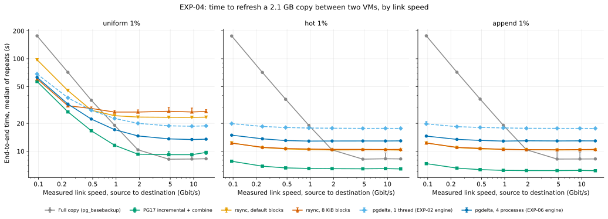
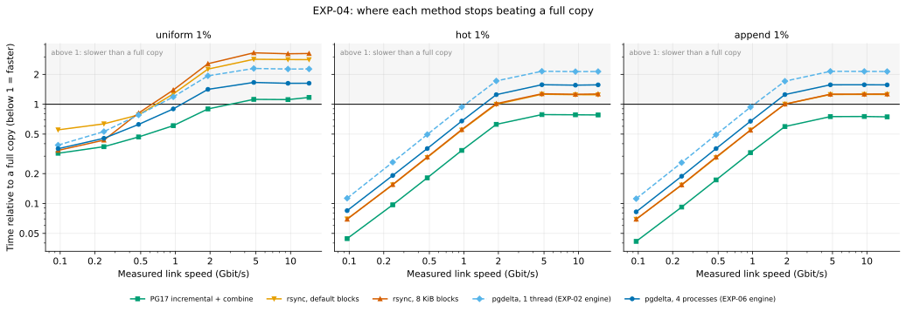
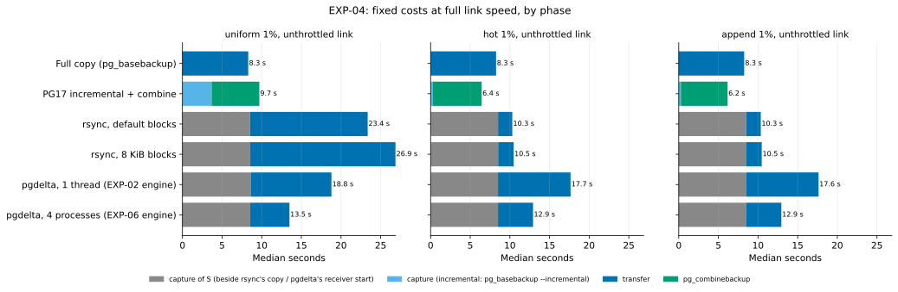
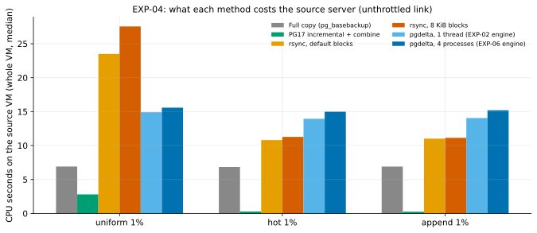

# EXP-04: At what link speed does each method win, on two real machines?

Status: **done.** Predictions recorded October 22, 2026, before the sweep; results added below the same day. The tooling was built and smoke-tested on GCP first; no smoke-test numbers were looked at when writing the predictions. **Read the results with [EXP-07](EXP-07-capture-speed.md) and [EXP-04b](EXP-04b-default-checksums.md):** the harness used SHA-256 backup manifests. EXP-07 measured that this doubled the local capture of S. The same setting applied to the full copy and to incremental's capture and combine, and EXP-04b measures what it did to them.

## Question

[EXP-02](EXP-02-local-comparison.md) measured bytes and compute on one Mac and combined them in a model: **time = compute + bytes ÷ link speed.** The model says pgdelta beats a full copy below about 2.7 Gbit/s for scattered changes and 5.5 Gbit/s for local ones, and that rsync wins for local changes because it computes less. A model isn't evidence. This experiment runs every method between two real machines, over a link throttled to a range of speeds, and measures:
- the **end-to-end time** of each method at each link speed;
- the **link speed where each method stops beating a full copy** (the crossover);
- whether the EXP-02 model, fed with the times measured here, predicts what happens.

## Setup

- **Machines:** two `n2-standard-8` VMs on Google Cloud, `us-central1-b` (8 vCPUs, 32 GB RAM each). Data on 4 local NVMe SSDs striped together, formatted ext4, so disks are fast and not shared between machines. Debian 12, PostgreSQL 17.
- **Link:** the VMs' internal network, throttled on both machines' outgoing side with Linux traffic control (`tc tbf`). Before each set of runs, the achieved speed is measured in both directions with a timed bulk transfer, and that measured speed (not the setting) is what results are plotted against.
- **Speeds:** 0.1, 0.25, 0.5, 1, 2, 5 and 10 Gbit/s, plus unthrottled.
- **Data and workloads:** EXP-01's own code: `pgbench` scale 70 (about 2.1 GB), then uniform, hot (1% set) or append changes to 1% of rows, with the same random seed as EXP-01. The same old copy B0 is reused for every speed and method of a workload.
- **Fairness controls:**
  - methods run in a new random order at every speed;
  - the OS file cache is emptied on both machines before every run;
  - bytes are counted from the network interface counters, not from the tools' own reports;
  - every output is verified after its timer stops, then deleted.
- **Tooling:** [experiments/network/](../../experiments/network/) and [infra/gcp/](../../infra/gcp/).

## Methods and what is timed

Every method starts from the same state: the source database with the changes applied, and the old copy B0 at the destination. Each ends with a complete, verified new copy at the destination.

| Method | Steps, in order |
|---|---|
| Full copy | `pg_basebackup` from the destination over the link |
| Incremental | `pg_basebackup --incremental` against B0's manifest over the link, then `pg_combinebackup` B0 + increment into a new copy |
| pgdelta | `pg_basebackup` to a local folder on the source (S), then `pgdelta send` to `pgdelta receive` over the link |
| rsync, 8 KiB and default blocks | Same local S; a copy of B0 made at the destination (ext4 has no instant clones); then rsync from S into that copy |

The headline number is **end-to-end time: every step, including rsync's copy of B0.** pgdelta writes a whole new copy as part of its run, so the copy rsync needs to avoid damaging B0 is the fair counterpart. rsync's time without that copy is also reported, as a lower bound for patching B0 directly. That's faster, but it leaves B0 half-updated if anything fails.

**Decision on rsync's timing (recorded October 22, 2026, after the smoke tests and before the sweep).** The table above orders rsync after both the capture of S and the copy of B0, but not those two relative to each other. They run on different machines (the capture on the source, the copy at the destination) and the link is idle during both, so a real copy-then-rsync refresh would run them at the same time. The sweep does the same:
- **rsync's end-to-end time is max(copy of B0, capture of S) + rsync transfer.** The copy is on rsync's critical path only where it takes longer than the capture.
- The sum with the copy and the capture one after the other is also reported, as an **upper bound**, and the time without the copy as the **lower bound** for patching B0 in place.
- The OS cache is emptied once before each run, as for every method. The copy then leaves its output in the page cache for rsync to read, as a real run would.

The predictions below are unchanged. In N5, "its copy of B0 costs more than pgdelta's hashing" is read as the time the copy adds to rsync's end-to-end time, the part longer than the capture. With the serial upper bound reported too, N5 can be checked under both readings.

**Decision on pgdelta's receiver (recorded October 22, 2026, after the smoke tests and before the sweep).** The rsync decision gave rsync's destination-side preparation the capture's time, and pgdelta had no such overlap. Its receiver (Python start-up, `pg_controldata` on B0, the scan of B0, binding the port) started only after the capture, inside the transfer timer, and then hashed B0 cold, since the one cache drop comes before the capture. A real refresh would start the receiver first and let it wait, as it lets rsync's copy of B0 run. So the sweep does this for both pgdelta methods (`pgdelta` and `pgdelta_1thread`):
- **The receiver starts beside the capture.** One timed phase, `receiver_capture`, after the one cache drop: the receiver on the destination from its launch until it listens, and the capture on the source. pgdelta's end-to-end time is **max(receiver start, capture) + transfer**. The transfer runs from starting the sender until both ends exit.
- **While it waits, the receiver reads B0 into the page cache** (pgdelta's new `--prefetch-basis on`, the default for `receive --listen`). It reads B0 read-only, in the order it will hash it, at most half of the memory the kernel reports available, and stops when the sender connects. It can't hash B0 early: the hash key is random per run and arrives with the sender, and that doesn't change. Verification doesn't change either.
- **Prefetching is on for both methods**, passed explicitly as `--prefetch-basis on`. It is a receiver feature that doesn't depend on how either end hashes, so `pgdelta_1thread` keeps EXP-02's hashing, rebuild and verification flags and gets the same prefetch. With it off, the single-threaded engine would read B0 cold where the parallel one doesn't, and their difference would no longer be the engine's alone. Each record holds the flags passed and the receiver's prefetch statistics (bytes, seconds, how long it waited and why it stopped).
- As for rsync, the sum with the two parts one after the other is reported as an **upper bound** (`serial_total_s`). It still includes the prefetch, so it is not the old arrangement, in which B0 was read cold.

The predictions below are unchanged. The earlier smoke runs' pgdelta figures came from the old arrangement and are not comparable with the sweep's. In N5, "single-threaded pgdelta" is `pgdelta_1thread` with the prefetch; how much of B0 it found cached is recorded per run (`prefetch_bytes`).

**How the predictions are read with the receiver change (recorded October 22, 2026, after a review of the decision above, before the sweep).** The prediction texts are unchanged.
- **Some of the prefetch can fall outside the timers.** Between `receiver_capture` and the transfer, the harness reads both VMs' counters outside any timer. In the smoke run that gap was 0.113–0.118 s. If the prefetch hasn't finished, it keeps reading B0 during the gap, so that part of B0 is read off the clock and pgdelta's `total_s` can understate by up to that time. No other method has destination work in the gap: rsync's copy of B0 ends inside `prep_capture`, and `full` and `incremental` run nothing there.
  - **It's measured per run.** Each pgdelta record has `prefetch_untimed_s`: how long the prefetch read inside the gap, from the receiver's wall-clock start and end against the phases' (both on pgd-dest's clock). Beside it are `prefetch_untimed_bytes_est`, an estimate at the prefetch's average rate, and the gap itself, `untimed_gap_s`. `report.py` lists every run where `prefetch_untimed_s` is above 0.
  - **The bound.** At most the gap, about 0.12 s. That is about 85 MB at the 725 MB/s at which the smoke run's prefetch read B0 cold.
  - **When it matters.** At scale 5 the prefetch finished about 0.6 s before the capture ended, so no smoke run was affected. At scale 70 (about 2.9 s of prefetch after 0.15 s of start-up), a run is affected only where its capture is shorter than that.
  - **Rule.** Each verdict that uses pgdelta's `total_s` is also checked with `total_s + prefetch_untimed_s`. If the verdict differs, it is reported as depending on this bias.
- **N5 under the serial reading.** The rsync decision says N5 can be checked under both readings. Under the serial one, "its copy of B0" is rsync's whole prep (`prep_s`), which reads B0 cold. pgdelta's serial schedule has no cold read of B0 on its critical path: the receiver starts first, then the capture runs while the receiver waits and prefetches, then the transfer hashes B0 warm. So the two `(serial)` rows are upper bounds of different schedules, not a like-for-like pair.
  - Under the serial reading, "pgdelta's hashing" counts as `hash_basis_s + prefetch_s`: pgdelta's one cold read of B0 (the prefetch) plus its hashing. This matches rsync's prep, which holds one cold read of B0 plus the copy.
- **N4 is judged on `pgdelta_1thread` as it now runs**, with the receiver beside the capture and B0 prefetched. N4's reasons assumed the old arrangement, with the receiver's start-up in the transfer and B0 hashed cold. The new arrangement shifts the comparison toward pgdelta, and the shift grows with B0's size. In the smoke runs it took 0.12–0.26 s off `pgdelta_1thread`'s total per cell at scale 5, and `hash_basis` fell from 0.66–0.72 s (cold) to 0.42–0.45 s (warm). That moves the crossover upward.
  - So the crossover is also computed on `serial_total_s + prefetch_s`: the receiver's start-up, the capture and the transfer one after the other, plus the cold read of B0 that the prefetch took off the transfer. This bounds the old arrangement from above. In the smoke runs, the old arrangement's totals (3.41, 2.63, 2.85 and 2.60 s) fell between the new `total_s` and this bound, cell for cell (different runs, one each).
  - A crossover above N4's range is put down to a cheaper capture or faster hashing, as N4's "what would change the plan" says, only if it is also above the range on this bound.
- **Incremental is now the only method that reads B0 cold on its critical path.** `pg_combinebackup` reads B0 in the combine phase, after the capture and after the run's one cache drop.
  - **No warm-up, and why.** `pg_combinebackup` has no prefetch. Unlike the staged methods, incremental also has no idle wait at the destination to read B0 in: its capture runs on the destination itself, over the link and onto the destination's disk.
  - **It's in the comparisons.** Differences between pgdelta and incremental, and between rsync and incremental (N6), include this cold read. It costs at most B0's cold read time, about 2.9 s for 2.1 GB at 725 MB/s, and less in practice, since `pg_combinebackup` overlaps its reads of B0 with its writes. No warm-B0 combine is measured.

## Predictions

Two things are uncertain before running: how fast these Intel cores hash compared with the Mac, and how long the local capture of S takes. The predictions are written so they can be checked either way.

| ID | Prediction |
|---|---|
| N1 | **Bytes don't change.** Each method's bytes on the wire equal what EXP-02 measured for the same workload, plus 2–6% of TCP/IP overhead, and vary by under 1% across link speeds. pgdelta and rsync at 8 KiB stay within 1% of each other. |
| N2 | **The model holds.** For every method, end-to-end time ≈ its fixed local time (measured here, unthrottled) + wire bytes ÷ measured link speed, within 15% at every speed up to 5 Gbit/s. |
| N3 | **Slow links reward every delta method.** At 0.1 Gbit/s, every delta method is at least 10× faster than a full copy for hot and append changes, and at least 2.5× faster for uniform 1%. |
| N4 | **pgdelta's crossover is lower than the Mac model said.** Before parallel hashing, pgdelta beats a full copy only below **1–2 Gbit/s** for uniform 1% and **2–4 Gbit/s** for hot and append (EXP-02's model: 2.7 and 5.5). Two reasons: the local capture of S adds a few seconds, and these cores hash 1.2–2× slower than the Mac's. |
| N5 | **rsync vs. pgdelta follows the change shape.** For hot and append, rsync at 8 KiB finishes before single-threaded pgdelta at every speed, unless its copy of B0 costs more than pgdelta's hashing. For uniform 1%, pgdelta finishes first at 1 Gbit/s and above; at 0.1 Gbit/s the two are within 10%, since both send the same bytes and the link dominates. |
| N6 | **Incremental is the method to beat when it's allowed.** Its capture reads only changed blocks, and `pg_combinebackup` is a disk-speed copy. For hot and append, it's at least as fast as rsync at every speed. Its prerequisite, which the others don't need: B0 must be a backup taken from this same server with `summarize_wal` on, and its WAL summaries must still exist. |
| N7 | **The source pays for pgdelta's hashing.** pgdelta and rsync with `--checksum` each use at least 1 CPU-second per GB on the source, regardless of how much changed. A full copy and incremental use less. This matters on a production server. |

**What would change the plan:**
- **N2 failing** would mean the EXP-02 model can't be trusted for planning. Its components would then be measured separately for every environment.
- **N4 coming out above 4 Gbit/s even for uniform changes** would mean the staged capture is cheaper than expected, and parallel hashing matters less.
- **N6 holding** confirms the positioning in the [research summary](../research/state-of-the-art.md): pgdelta is for the cases incremental can't serve (an old copy with no shared chain, after failover, after restore elsewhere), and it must be close to rsync's speed while being safer.

## Design

- **Trials:** uniform, hot (1% set) and append, each at 1% of rows; every link speed; every method.
- **Repetitions:** three per (workload, speed, method), in random order, reporting the median and range.
- **Parallel hashing:** if [EXP-05](EXP-05-parallel-hashing.md)'s change is merged before the sweep, pgdelta runs twice, with one thread and with the default thread count, so the effect is measured on real links.
  - *Added October 22, 2026, after [EXP-06](EXP-06-engine-throughput.md); the design is otherwise unchanged.* The two runs name their engines by flags instead of relying on defaults, so a later default can't change what they measure. `pgdelta` is EXP-06's choice, which is also the default on these 8-vCPU VMs: `--jobs 4` (worker processes) with copy-then-patch and pipelined verification. `pgdelta_1thread` is the single-threaded engine that EXP-02 and the smoke runs measured: `--jobs 1 --rebuild gap-fill --verify sequential`. Per-process CPU (`proc_cpu_*_s`) includes pgdelta's worker processes, which are started with `spawn` as pgdelta's own children.
- **Measured per run and step:** wall time; bytes on the wire in each direction; CPU seconds on each machine; peak memory; the bytes each tool reports.
- **Cost control:** the two VMs are deleted as soon as the sweep finishes ([teardown.sh](../../infra/gcp/teardown.sh)).

## Results

Run October 22, 2026, 18:13–22:12 UTC, at commit `d559b1b`:
- **Machines:** two `n2-standard-8` VMs (Intel Xeon 2.8 GHz, 4 cores × 2 hyperthreads), `us-central1-b`, Debian 12, PostgreSQL 17.11, rsync 3.2.7, Python 3.11.2.
- **Data:** scale 70, 2.12 GB.
- **Runs:** 3 workloads × 8 link speeds × 6 methods × 3 repeats = **432 runs, all passed and verified.**
  - Every output passed `pg_verifybackup`.
  - Every pgdelta and rsync output was byte-identical to S.
  - B0 was unchanged at the end of each trial, after all 144 of its runs (checked by digest once per trial, not after every run).
- **Measured link speeds:** 0.096, 0.24, 0.48, 0.96, 1.92, 4.79 and 9.3–9.5 Gbit/s, and 13.2–15.3 unthrottled.

**Data and figures:**
- every run: [exp04-runs.csv](data/exp04-runs.csv);
- medians per workload, speed and method: [exp04-cells.csv](data/exp04-cells.csv);
- figures: `.venv/bin/python analysis/exp04.py`;
- raw records: `results/exp04/full/`, not in git.

**A setting to keep in mind:** the harness ran `pg_basebackup` and `pg_combinebackup` with SHA-256 manifest checksums; PostgreSQL's default is CRC32C. [EXP-07](EXP-07-capture-speed.md) found this doubled the local capture of S (8.6 s instead of 4.1 s for 2.1 GB). The same setting applied to:
- the full copy, which ran at the same speed as the capture, so it was probably slowed the same way;
- incremental's capture and its combine (not measured in EXP-07).

It doesn't affect pgdelta's or rsync's own transfer. The numbers below are as measured. [EXP-04b](EXP-04b-default-checksums.md) repeats the sweep with CRC32C.

### Time against link speed

Median end-to-end time in seconds (3 repeats):

| Workload | Link | Full copy | Incremental | rsync, default | rsync, 8 KiB | pgdelta, 1 thread | pgdelta, 4 processes |
|---|---|---:|---:|---:|---:|---:|---:|
| uniform 1% | 0.1 Gbit/s | 176.6 | **56.7** | 97.5 | 60.5 | 68.4 | 62.9 |
| | 1 Gbit/s | 19.1 | **11.6** | 24.2 | 26.5 | 22.6 | 17.1 |
| | unthrottled | **8.3** | 9.7 | 23.4 | 26.9 | 18.8 | 13.5 |
| hot (1% set) 1% | 0.1 Gbit/s | 176.0 | **7.8** | 12.3 | 12.2 | 19.9 | 14.9 |
| | 1 Gbit/s | 19.0 | **6.5** | 10.4 | 10.6 | 17.8 | 12.9 |
| | unthrottled | 8.3 | **6.4** | 10.3 | 10.5 | 17.6 | 12.9 |
| append 1% | 0.1 Gbit/s | 176.8 | **7.3** | 12.3 | 12.3 | 19.8 | 14.6 |
| | 1 Gbit/s | 19.1 | **6.2** | 10.5 | 10.5 | 17.9 | 12.9 |
| | unthrottled | 8.3 | **6.2** | 10.3 | 10.5 | 17.6 | 12.9 |

**The link speed below which each method beats a full copy** (interpolated in log-log between the two measured speeds that bracket it; incremental's uniform crossover lies between 1.9 and 4.8 Gbit/s, so 3.0 is one interpolation):

| Workload | Incremental | rsync, default | rsync, 8 KiB | pgdelta, 1 thread | pgdelta, 4 processes |
|---|---:|---:|---:|---:|---:|
| uniform 1% | 3.0 Gbit/s | 0.68 | 0.62 | 0.72 | **1.13** |
| hot 1% | always faster | 1.93 | 1.89 | 1.03 | 1.49 |
| append 1% | always faster | 1.91 | 1.91 | 1.04 | 1.49 |

With the serial upper bounds (rsync's copy of B0 and pgdelta's receiver start-up not overlapped with the capture), these move by at most 0.55 Gbit/s for rsync (to 1.4 for local changes) and by 0.02 for pgdelta.

### Where the time goes

At an unthrottled link (median seconds, uniform / local changes):

| Method | Capture | Transfer | Combine | Total |
|---|---:|---:|---:|---:|
| Full copy | – | 8.3 | – | 8.3 |
| Incremental | 3.7 / 0.3 | – | 6.0 | 9.7 / 6.2–6.4 |
| rsync, 8 KiB | 8.5 (its copy of B0, 3.4 s, runs alongside) | 18.3 / 1.9 | – | 26.9 / 10.5 |
| pgdelta, 1 thread | 8.5 (its receiver reads B0 alongside) | 10.2 / 9.2 | – | 18.8 / 17.6 |
| pgdelta, 4 processes | 8.5 (its receiver reads B0 alongside) | 5.0 / 4.4 | – | 13.5 / 12.9 |

- **The staged capture of S costs as much as a whole full copy** (8.5 s against 8.3 s). Both are one `pg_basebackup` of the same data, and at these speeds the network isn't the limit. So a staged method can beat a full copy only on links slow enough to make the full copy take longer than the capture plus the staged method's own transfer. That is why every staged crossover is below 2 Gbit/s. [EXP-07](EXP-07-capture-speed.md) found the backup is limited by computing SHA-256 checksums, a harness setting.
- **pgdelta's 4 worker processes halve its transfer** (5.0 against 10.2 s, and 4.4 against 9.2 s): 2.1×, less than the 2.3–3.1× EXP-06 found end to end on the Mac. Its transfer still costs more than rsync's for local changes (4.4 s against 1.9 s). It hashes all of S (1.1 s) and all of B0 (1.3 s), about 1.7–1.9 GB/s on 4 processes, then writes, flushes and verifies a complete new copy.
- **rsync is slow with scattered changes** (18.3 s): its search for matching blocks slides one byte at a time through the changed regions, as on the Mac.
- **Incremental's capture reads only what changed** (0.3 s for local changes), and **its combine (6.0 s) is its fixed cost:** `pg_combinebackup` reads B0 and writes a whole new copy, with SHA-256 manifests in this sweep.
- pgdelta's receiver read all of B0 (2.1 GB) in a median 1.4 s during the capture, in all 144 pgdelta runs; it never read past the timed phases.

### Bytes, CPU and memory

- **Bytes on the wire** (network interface counters) were within 0.4% of what each tool reported.
  - **Across link speeds:** the medians at each speed varied by under 0.4%, except incremental (3–4%). Single runs differed by up to 1.1% (one pgdelta append repeat whose own byte count was also lower), and one incremental append run sent 21.6 MB against a median of 15.8.
  - **Uniform:** pgdelta and rsync at 8 KiB sent 610.3 and 611.0 MB on the wire (609.6 MB each by their own counts).
  - **Local changes:** they sent 27–30 MB, with rsync 1.5–1.6% higher on the wire (1.7–1.8% by the tools' own counts).
  - **Incremental sent much less than its on-disk size for local changes: 16–17 MB on the wire, against 31–33 MB on disk.** It streams only the WAL actually written. The staged methods' S, like the backup on disk, holds a 16 MiB WAL segment padded with zeros, and they have to send all of it. **This corrects EXP-02,** which compared incremental by its on-disk size. On the wire, incremental sends less than pgdelta for local changes (17 against 29 MB) and about 1% less for uniform (604 against 610 MB). See the note added to EXP-02.
- **CPU on the source** (whole VM, median over all link speeds, including the capture's `pg_basebackup`):
  - full copy 7.1–7.4 s;
  - incremental 0.2–2.5 s;
  - rsync 11–28 s;
  - pgdelta 14–16 s (1 thread 14.0–15.0).

  By phase:
  - **The staged capture of S costs 9.7–9.9 CPU-seconds,** about 2.5 more than a full copy, because the `pg_basebackup` client also runs on the source.
  - **The staged methods' own transfer** costs 5.3–6.0 s for pgdelta (4.3–5.1 s with 1 thread), 1.2–1.4 s for rsync with local changes, and 14–18 s for rsync with uniform changes.
- **Peak memory** of any single process: pgdelta 27–34 MB on each side for local changes and 35–41 MB for uniform; rsync and `pg_basebackup` 8–12 MB.

### Verdict on each prediction

| ID | Prediction | Result |
|---|---|---|
| N1 | Wire bytes = EXP-02's + 2–6% TCP/IP overhead; under 1% variation across speeds; pgdelta and rsync 8 KiB within 1% | **Partly held.** Wire bytes matched EXP-02 within 3.2% (full copy −0.6%, uniform +0.2–0.4%, local +1.5–3.2%). Per-speed medians varied under 0.4% (incremental 3–4%). The overhead was 0.1–0.4%, not 2–6%: the interface counters see segments offloaded to the network card, one header per up to 64 KiB, not per 1,460-byte packet. pgdelta and rsync 8 KiB agreed within 0.1% for uniform, but rsync sent 1.5–1.6% more on the wire for local changes (its file list). Incremental's on-wire bytes contradict EXP-02's on-disk comparison (above) |
| N2 | Time ≈ fixed local time + wire bytes ÷ link speed, within 15% up to 5 Gbit/s, for every method | **Failed; held only for pgdelta.** Both pgdelta engines: 18 of 18 cells within 15% (worst +7%). Incremental 15/18 (worst +28%), rsync default and 8 KiB 14/18 each (worst +45% and +52%), full copy 6/18 (worst +54%). `pg_basebackup` and rsync overlap their computing with the transfer, so the sum overestimates them; their time is closer to the larger of the two. pgdelta's phases barely overlap ([model figure](../figures/exp04-model.svg)). As the plan says for this case, the simple model can't be used for planning without measuring how much each tool overlaps computing and transfer. That includes EXP-02's modelled crossovers, which lean on the full copy, the method the model misses worst |
| N3 | At 0.1 Gbit/s: every delta method ≥ 10× faster than a full copy for hot and append, ≥ 2.5× for uniform | **Partly held.** Hot and append: incremental 23–24×, rsync 14×, pgdelta 12×, but **pgdelta 1 thread only 8.9×**. Uniform: incremental 3.1×, rsync 8 KiB 2.9×, pgdelta 2.8×, pgdelta 1 thread 2.6×, but **default rsync only 1.8×** (it sends 1.05 GB) |
| N4 | pgdelta 1 thread beats a full copy below 1–2 Gbit/s (uniform) and 2–4 (hot, append) | **Failed: lower.** 0.72 Gbit/s for uniform and 1.03–1.04 for hot and append. Lower still on the decision note's upper bound (serial + prefetch time): 0.65 and 0.94 (0.71 and 1.02 on the serial bound alone). Two causes, both measured, though their shares weren't separated. The capture took 8.5 s, not "a few seconds" (SHA-256 manifests, EXP-07). And a VM core hashes 2.4× slower than the Mac's in EXP-06's isolated test (2.5–2.6× from this sweep's own hashing times), outside the assumed 1.2–2× |
| N5 | Hot and append: rsync 8 KiB beats single-threaded pgdelta at every speed. Uniform: pgdelta first at ≥ 1 Gbit/s, within 10% at 0.1 | **Mostly held end to end; held in full under the serial reading.** rsync beat pgdelta 1 thread at every speed for hot and append (10.4–12.3 against 17.6–19.9 s). For uniform, pgdelta 1 thread was faster from 1 Gbit/s up (18.6–22.6 against 26.5–27.0 s). **End to end, at 0.1 Gbit/s they were 13% apart** (68.4 against 60.5 s, rsync faster), just outside 10%. Under the serial reading the decision notes require, the two were 7% apart at 0.1 Gbit/s (64.0 against 68.6 s; 9% with pgdelta's cold read of B0 added). rsync's copy of B0 (3.4 s) cost less than pgdelta's hashing plus prefetch (5.5 s), and rsync stayed ahead for hot and append |
| N6 | Incremental at least as fast as rsync for hot and append at every speed | **Held.** 6.2–7.8 s against 10.3–12.3 s |
| N7 | pgdelta and rsync with `--checksum` use ≥ 1 CPU-second per GB on the source whatever changed; a full copy and incremental use less | **Partly held.** Whole VM, including the staged capture: pgdelta 6.6–7.5, rsync 5.1–13.1, full copy 3.4–3.5, incremental 0.1–1.2 CPU-s per GB, so the ordering held. But the capture alone is 9.8 CPU-s (4.6 per GB). In their own transfer: **pgdelta held** (4.3–6.0 CPU-s, 2.0–2.8 per GB, whatever changed). **rsync did not:** it used 1.2–1.4 CPU-s for hot and append (0.5–0.7 per GB), less than a full copy, and 14–18 s for uniform (6.6–8.4 per GB) |

## Conclusions

1. **On these VMs, with this harness, a staged refresh beats a full copy only below about 1.1–1.5 Gbit/s (pgdelta) or 1.9 Gbit/s (rsync, local changes).** Incremental backup beats a full copy at every speed for local changes, and below 3 Gbit/s for scattered ones. This is the measured answer to EXP-04's question, but with the harness's SHA-256 manifests (see EXP-04b).
2. **The staged design is capped by its own capture.** Taking S costs as much as a full copy, so a staged method can't win on fast links however fast its own transfer gets. This is the main design finding. But it isn't the only cost: pgdelta's own transfer (4.4–5.0 s at fast links) is about what a full copy with PostgreSQL's default checksums should take (EXP-07). Reading the source's files directly would remove the capture, and [EXP-07](EXP-07-capture-speed.md) measures how fast that could be. Beating a full copy on fast links would also need a cheaper transfer.
3. **Where its prerequisites hold, PostgreSQL's incremental backup is faster than every other delta method at every speed,** and faster than a full copy except for scattered changes on links above about 3 Gbit/s. It also sends the fewest bytes on the wire for local changes. This confirms the project's positioning: pgdelta is for old copies incremental can't use (no shared backup chain, after failover, restored elsewhere). It must stay correct there and come close to rsync's speed.
4. **pgdelta against rsync:** pgdelta is faster for scattered changes from about 0.5 Gbit/s up, and slower for local changes at every speed (12.9 against 10.5 s). Its fixed cost is hashing all of S and B0 and writing a new copy; rsync's is checksumming files and searching byte by byte through changed regions.
5. **The time model** (fixed time + bytes ÷ link speed) predicts pgdelta within 7%, and failed for the other methods (N2). It overestimates tools that overlap their computing with the transfer, by up to 54% for the full copy.

## Limitations known in advance

- One machine type, one region. Disk and CPU speeds shape the crossover, so other hardware will move the numbers, though the model in N2 should still apply with that hardware's measured times.
- `tc tbf` shapes bandwidth but adds no latency. A long-distance link would also hurt protocols that wait for replies; pgdelta pipelines its requests, but this isn't tested here.
- The source database is idle during each refresh, so slowdown of a busy production server isn't measured.
