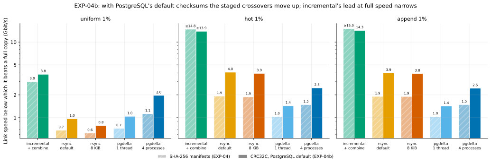
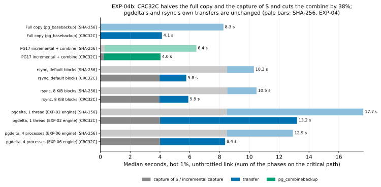
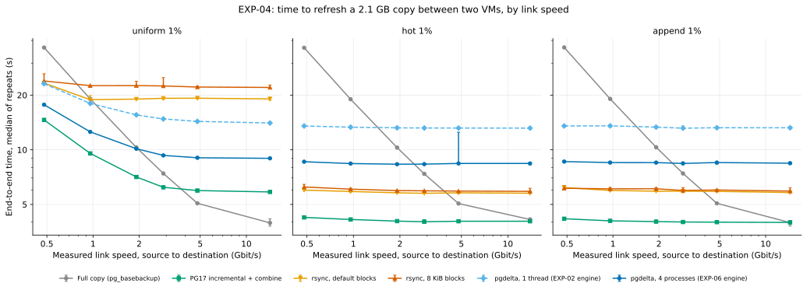

# EXP-04b: EXP-04 again, with PostgreSQL's default backup checksums

Status: **done.** Predictions recorded October 22, 2026, after EXP-04 and EXP-07's first attempt, before this sweep; results added below on October 23.

## Question

[EXP-04](EXP-04-network-sweep.md) found that a local `pg_basebackup` of 2.1 GB took 8.5 s on the VMs, as long as a full copy over the network. [EXP-07](EXP-07-capture-speed.md) found why:
- The benchmark harness asked `pg_basebackup` and `pg_combinebackup` for **SHA-256 checksums in the backup manifest**. PostgreSQL's default is CRC32C.
- With CRC32C, the same backup took **3.9 s instead of 8.6 s** (EXP-07's first attempt; its final result is 4.07 s, and the predictions' ranges contain both).

That setting touched every full copy, every staged capture of S and every `pg_combinebackup` in EXP-04, but neither pgdelta's nor rsync's own transfer. So EXP-04's crossovers describe a harness choice, not PostgreSQL as it ships. This experiment re-runs the comparison with PostgreSQL's default, and changes nothing else.

## What changes from EXP-04

- **Changed:** `--manifest-checksums CRC32C` for every `pg_basebackup` (B0, the full copy, incremental's capture, the staged captures) and for `pg_combinebackup`.
- **Same:** VMs, data, workloads, seed, methods (pgdelta pinned by flags as in EXP-04), fairness rules and decision notes. The receiver still prefetches B0 during the capture, and rsync's copy of B0 still overlaps the capture.
- **Speeds:** 0.5, 1, 2, 3 and 5 Gbit/s, plus unthrottled. EXP-04 showed every crossover lies between 0.5 and 5 Gbit/s, and that below 0.5 Gbit/s the order of the methods doesn't change. So the slowest speeds are dropped to save time, and 3 Gbit/s is added to resolve the crossovers.
- **Repeats:** 3, in random order, as in EXP-04.

## Predictions

The numbers come from EXP-04's phase times plus EXP-07's CRC32C capture time (3.9 s).

| ID | Prediction |
|---|---|
| R1 | **The full copy at an unthrottled link takes 3.5–4.5 s** (EXP-04: 8.3 s): server-bound, as in EXP-07's C6. |
| R2 | **The staged capture of S takes 3.5–4.5 s** (EXP-04: 8.5 s). |
| R3 | **pgdelta's and rsync's transfer phases stay within 10% of EXP-04's**, since neither computes manifest checksums. |
| R4 | **pgdelta's crossover rises to 1.5–2.5 Gbit/s** for all three workloads (EXP-04: 1.1 uniform, 1.5 hot and append). |
| R5 | **rsync's crossover rises to 2.3–3.5 Gbit/s for hot and append** (EXP-04: 1.9), and stays at or below 1 Gbit/s for uniform. |
| R6 | **Incremental is faster than a full copy at every speed for hot and append, and crosses at 2.5–5 Gbit/s for uniform** (EXP-04: 3.0). |
| R7 | **At an unthrottled link, nothing but incremental beats the full copy.** Every staged method pays at least the 3.9 s capture plus its transfer. |

**What would change the plan:**
- **R1/R2 failing** (CRC32C not faster over the network) would mean EXP-07's local result doesn't carry over, and EXP-04's numbers stand.
- **R7 holding** confirms that the staged design is capped by its own capture: to beat a full copy on fast links, pgdelta must stop writing S and read the source's files directly (EXP-07's C4 measures how fast that could be).

### Note on the predictions (added October 22, 2026, 22:42 UTC, after an independent check of the arithmetic. The sweep was running, only uniform runs had finished, and no result had been looked at)

The predictions above are unchanged. The check found three things they assume without saying so:
- **R6, and R7's exception for incremental, assume `pg_combinebackup` gets much faster with CRC32C.** Its 6.0 s in EXP-04 would have to fall to about 3 s or less. EXP-07 didn't measure the combine. If it stays near 6 s, incremental would cross at about 3 Gbit/s for hot and append and about 2 Gbit/s for uniform. R6 would then fail, and R7 would hold without its exception.
- **R4 and R5 depend on how far the full copy runs above pure link time.** In EXP-04 that was about 1.5 s at 1–2 Gbit/s. With that overhead, the same arithmetic puts rsync's hot and append crossover at about 3.8–4.0 Gbit/s, above R5's range, and pgdelta's at about 2.5 for local changes, R4's upper edge.
- **R7 holding would not show that the capture alone caps pgdelta.** pgdelta's transfer alone (4.4–5.0 s in EXP-04) is already about R1's predicted full copy. On fast links pgdelta would need both no capture and a faster transfer. Only for rsync with local changes is the capture the deciding cost.

Also, the new speed grid can't re-measure where rsync and pgdelta trade places for uniform changes (about 0.3 Gbit/s in EXP-04). A crossover above 5 Gbit/s would be bracketed only by 5 Gbit/s and the unthrottled link.

## Results

Run October 22–23, 2026, 22:24–00:03 UTC, on the same two VMs as EXP-04, with `--manifest-checksums CRC32C`:
- **Runs:** 3 workloads × 6 link speeds × 6 methods × 3 repeats = **324 runs, all passed and verified.** Every output passed `pg_verifybackup`, every pgdelta and rsync output was byte-identical to S, and B0 was unchanged at the end of each trial.
- **The VMs were deleted** right after the results were fetched. No instances or disks remain in the project.
- **Data:** every run, [exp04b-runs.csv](data/exp04b-runs.csv); medians, [exp04b-cells.csv](data/exp04b-cells.csv).
- **Figures:** `.venv/bin/python analysis/exp04.py results/exp04/crc32c/summary.csv --tag=-crc32c --datadir <scratch>` for this sweep's own figures, and `.venv/bin/python analysis/exp04b.py` for the comparison with EXP-04.

### What changed, phase by phase

At an unthrottled link, median seconds, EXP-04 (SHA-256) → EXP-04b (CRC32C):

| Step | uniform 1% | hot 1% | append 1% |
|---|---|---|---|
| Full copy | 8.30 → **3.96** | 8.26 → **4.13** | 8.25 → **3.97** |
| Staged capture of S | 8.5 → **4.0** | 8.5 → **4.0** | 8.5 → **4.0** |
| Incremental's capture | 3.68 → 1.89 | 0.29 → 0.24 | 0.27 → 0.22 |
| `pg_combinebackup` | 6.02 → **3.97** | 6.15 → **3.80** | 5.89 → **3.76** |
| pgdelta's transfer (4 processes) | 4.95 → 5.02 | 4.42 → 4.38 | 4.41 → 4.39 |
| rsync 8 KiB's transfer | 18.33 → 18.06 | 1.96 → 1.96 | 1.93 → 1.92 |

The full copy, the staged capture of S and incremental's capture for scattered changes roughly halved. Incremental's capture for local changes, already about 0.3 s, fell by about a fifth. The combine fell by 34–38%. pgdelta's and rsync's own transfers stayed within 2% at the unthrottled link, and within 6% at every speed both sweeps share.

### End-to-end time and crossovers

| Workload | Link | Full copy | Incremental | rsync, default | rsync, 8 KiB | pgdelta, 1 thread | pgdelta, 4 processes |
|---|---|---:|---:|---:|---:|---:|---:|
| uniform 1% | 0.5 Gbit/s | 36.6 | **14.6** | 23.3 | 23.9 | 23.1 | 17.7 |
| | 2 Gbit/s | 10.3 | **7.1** | 19.0 | 22.6 | 15.6 | 10.1 |
| | unthrottled | **4.0** | 5.9 | 19.1 | 22.0 | 14.0 | 9.0 |
| hot (1% set) 1% | 0.5 Gbit/s | 36.5 | **4.2** | 6.0 | 6.2 | 13.5 | 8.6 |
| | 2 Gbit/s | 10.3 | **4.0** | 5.8 | 6.0 | 13.2 | 8.3 |
| | unthrottled | 4.1 | **4.0** | 5.8 | 5.9 | 13.2 | 8.4 |
| append 1% | 0.5 Gbit/s | 36.6 | **4.2** | 6.2 | 6.1 | 13.5 | 8.6 |
| | 2 Gbit/s | 10.3 | **4.0** | 5.9 | 6.1 | 13.3 | 8.5 |
| | unthrottled | **3.97** | 3.98 | 5.8 | 5.9 | 13.2 | 8.4 |

The link speed below which each method beats a full copy (EXP-04's value in brackets):

| Workload | Incremental | rsync, default | rsync, 8 KiB | pgdelta, 1 thread | pgdelta, 4 processes |
|---|---:|---:|---:|---:|---:|
| uniform 1% | 3.75 (3.0) | 0.97 (0.68) | 0.79 (0.62) | 1.04 (0.72) | **1.97** (1.13) |
| hot 1% | every speed (every) | 4.00 (1.93) | 3.86 (1.89) | 1.44 (1.03) | **2.47** (1.49) |
| append 1% | 14.3: lost narrowly at the unthrottled link (every) | 3.90 (1.91) | 3.83 (1.91) | 1.43 (1.04) | **2.45** (1.49) |

### Who wins where

The bottom panel is the case pgdelta exists for: an old copy that incremental backup can't use. There:
- pgdelta (4 processes) is fastest only for scattered changes, from 0.5 to about 2 Gbit/s. EXP-04 found rsync 8 KiB ahead below about 0.3 Gbit/s, which this grid didn't re-test;
- rsync is fastest for local changes, below about 3.9 Gbit/s, by 1–4% between its two block sizes;
- a full copy wins everywhere above that.

### Verdict on each prediction

| ID | Prediction | Result |
|---|---|---|
| R1 | Full copy at an unthrottled link: 3.5–4.5 s | **Held:** 3.96–4.13 s (medians), 3.80–4.21 s single runs |
| R2 | Staged capture of S: 3.5–4.5 s | **Held:** median 4.0 s, 3.91–4.19 s single runs |
| R3 | pgdelta's and rsync's transfers within 10% of EXP-04's | **Held:** within 2% at the unthrottled link, and within 6% at every speed both sweeps share (largest −5.5%, uniform rsync default at 1 Gbit/s) |
| R4 | pgdelta's crossover 1.5–2.5 Gbit/s for all three workloads | **Held** for pgdelta with 4 processes, the engine behind R4's EXP-04 baselines. 1.97 (uniform), 2.47 (hot), 2.45 (append) measured Gbit/s, 2.41–2.48 per repeat for local changes, near the top of the range as the dated note's arithmetic expected. The 1-thread engine crossed at 1.04–1.44 |
| R5 | rsync's crossover 2.3–3.5 Gbit/s for hot and append; ≤ 1 for uniform | **Failed for hot and append:** 3.83–4.00 Gbit/s, 9–14% above the range. That is where the dated note's arithmetic put it (3.8–4.0) once the full copy's overhead above link time is counted (1.4–1.5 s at 0.5–3 Gbit/s here). Held for uniform: 0.79–0.97 |
| R6 | Incremental faster than a full copy at every speed for hot and append; crosses at 2.5–5 for uniform | **Partly held.** Uniform crosses at 3.75 Gbit/s, and hot is faster at every speed (by 2% at the unthrottled link). **Append isn't:** at the unthrottled link the full copy was faster in all three paired repeats (median 3.97 against 3.98 s). As the dated note warned, the combine (3.8 s) didn't fall to about 3 s. At that speed, incremental for local changes (0.22–0.24 s capture plus 3.76–3.80 s combine, about 4.0 s) is level with the full copy (3.80–4.21 s across runs). Its 2% edge for hot and 0.3% deficit for append are within the full copy's run-to-run spread |
| R7 | At an unthrottled link, nothing but incremental beats the full copy | **Held.** Every staged method lost: pgdelta 8.4–9.0 s (1 thread 13.2–14.0 s), rsync 5.8–22.0 s, against 4.0–4.1 s. Incremental beat it only for hot (by 2%), lost narrowly for append and lost for uniform |

**Model check (N2 from EXP-04, re-run here):** pgdelta again fits the additive model in every cell (30 of 30 within 15%, worst +11%). The full copy fits in only 9 of 15, and rsync in 12–13 of 15.

### Differences between the two sweeps

- **The same machines, back to back, one changed flag.** EXP-04 ran 18:13–22:12 and EXP-04b 22:24–00:03 UTC on the same two VMs, with the same kernel, PostgreSQL 17.11 and rsync 3.2.7, and disk tests within 2%. The deployed code differs only in passing `--manifest-checksums`.
- **The speed grid differs.** EXP-04 had no point between 1.9 and 4.8 Gbit/s. The SHA-256 full copy reached its floor of about 8.2 s inside that gap, so EXP-04's crossovers there (incremental's 3.0 for uniform in particular) are coarser interpolations. A floor-aware estimate puts that one nearer 2.2. EXP-04b adds a 3 Gbit/s point.
- **The workload order is fixed.** Both sweeps run uniform, then hot, then append, each as its own trial with its own cluster and B0. So differences between workloads at the same speed (hot's full copy took 4.13 s at the unthrottled link, uniform's and append's 3.96–3.97) can't be separated from trial effects. Those differences decide incremental's hot and append verdicts.
- **The unthrottled link** measured 13.9–14.5 Gbit/s here, against 14.5–15.0 in EXP-04.
- **The overlaps still held, with less slack.** The shorter capture still hid rsync's copy of B0 (3.38–3.53 s against a capture of at least 3.91 s) and pgdelta's prefetch (finished in all 108 runs).

## Conclusions

1. **With PostgreSQL's default checksums, every staged method's crossover moves up (1.25–2.1×), and so does incremental's for uniform changes (3.0 → 3.75 Gbit/s).**
   - Incremental is still the fastest delta method in every cell. But at full link speed for local changes, its lead over a full copy shrinks from about 30% to nothing: the full copy gained more from CRC32C (−52%) than the combine did (−34 to −38%).
   - For local changes, rsync beats a full copy below about 3.9 Gbit/s and pgdelta below about 2.5.
   - For scattered changes, pgdelta beats a full copy below 2.0 Gbit/s, and rsync below 0.8–1.0. pgdelta is the better staged method for scattered changes and rsync for local ones.
2. **A staged method can't beat a full copy at full link speed on these VMs.** The capture of S (4.0 s) alone is as long as the whole full copy (4.0–4.1 s), as R7 predicted.
3. **At the unthrottled link (about 14 Gbit/s), pgdelta needs two changes to compete, as the dated note warned.**
   - **No capture:** read the source's files directly.
   - **A cheaper transfer:** its own transfer alone (4.4–5.0 s) is longer than the full copy (4.0–4.1 s). That transfer was measured with B0 already read into memory during the capture, so a design without a capture would pay that read too.
   - **At 5 Gbit/s and below,** removing the capture alone would be enough on these numbers: the full copy takes 5.05–5.07 s there, and pgdelta's transfer 4.4–5.0 s.
   - **Against rsync:** for local changes, pgdelta's transfer is 2.2–2.4× rsync's (4.4 against 1.8–2.0 s). Both read and hash all of B and S (rsync runs with `--checksum`). The likely difference, not measured here: pgdelta writes a complete new copy, while rsync rewrites only the changed blocks of a copy made during the capture.
4. **What a next version of pgdelta would have to do** (design directions, not yet tested):
   - **Start the session before the capture,** so the key arrives early. The receiver could then hash B and copy it into place while S is taken, as rsync's copy of B0 already overlaps the capture.
   - **Read the source's files directly** in backup mode instead of taking S (EXP-07: 0.73 s of raw parallel reads against 4.0 s for a CRC32C capture).

   Each needs its own pre-registered experiment, and direct reads need a correctness experiment too.
5. **The harness setting mattered as much as the engine.** EXP-04's crossovers were 48–80% of these: about 60% typically, and half for rsync with local changes. Results that depend on `pg_basebackup` should state its manifest-checksum setting.

