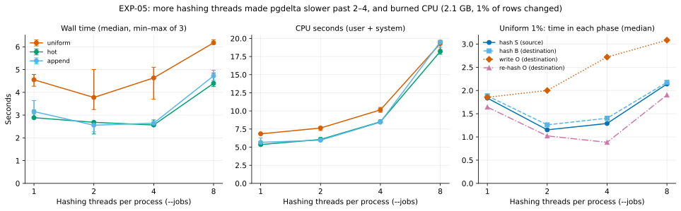

# EXP-05: Does hashing in parallel remove pgdelta's compute bottleneck?

Status: **done; three of the four predictions failed.** Predictions recorded October 22, 2026, before the change was built; results added below the same day without editing them.

## Question

[EXP-02](EXP-02-local-comparison.md) found that pgdelta sends the fewest bytes (tied with rsync at 8 KiB blocks), but spends a fixed **3–5 seconds of computing per refresh of a 2.1 GB database**, whatever changed. That cost sets the link speed above which a plain full copy wins: about 2–5 Gbit/s on this Mac. For small, local changes rsync is faster (about 1.3 s). Its quick whole-file checksums skip unchanged files, while pgdelta hashes every page on one core with BLAKE2b.

Hashing is embarrassingly parallel: every 1 MiB node can be hashed independently, and Python's `hashlib` releases the interpreter lock for inputs over 2 KiB, so threads can use several cores. This experiment measures how much of the fixed cost that removes.

## Change under test

- **Sender and receiver:** hash each file's 1 MiB nodes on a pool of worker threads.
- **Receiver:** re-hash the output for verification the same way.
- **`--jobs N`:** sets the pool size; the default is the number of CPUs, capped at 8.
- **The protocol, digests and outputs stay identical.** Only how fast they're computed changes.

## Predictions

| ID | Prediction |
|---|---|
| Q1 | Output and statistics are identical with 1 and N threads: same digests, same pages sent, byte-identical output. |
| Q2 | On this Mac (15 cores), pgdelta's wall time for a 2.1 GB refresh falls from about 4.5 s (1 thread) to **under 2 s** with 8 threads, at least 2.5× faster. Scaling stops once reading the disk becomes the limit. |
| Q3 | CPU seconds stay about the same, since the same work is spread across cores. |
| Q4 | The modelled crossover against a full copy (as in EXP-02) moves from about 2.6 Gbit/s to **above 6 Gbit/s** for uniform 1% changes, and above rsync's for local changes. |

## Design

- **Inputs:** the same B0/B1 pairs as EXP-02, regenerated with the same seeds: uniform, hot (1% set) and append at 1%, scale 70.
- **Thread counts:** 1, 2, 4 and 8, with three repeats each, in random order, with the machine otherwise idle.
- **Measured:**
  - wall and CPU time;
  - bytes each way, which must not change;
  - a byte-identical output every time.

## Results

Run October 22, 2026, on the Mac (15 cores, Python 3.14), engine commit `91b8a38` on branch `wip/parallel-hashing`. Fresh B0/B1 pairs from EXP-01's code and seeds reproduced EXP-02's byte counts exactly. 36 runs: 3 workloads × 1, 2, 4, 8 threads × 3 repeats, in shuffled order.

- **Benchmark script:** [run_exp05.py](../../experiments/parallel_hashing/run_exp05.py).
- **Every run:** [exp05-runs.csv](data/exp05-runs.csv), including the time in each phase.
- **Figure:** `.venv/bin/python analysis/exp05.py`.

| Workload | Threads | Wall time, median (range) | vs 1 thread | CPU seconds | Crossover vs full copy (model) |
|---|---:|---:|---:|---:|---:|
| uniform 1% | 1 | 4.55 s (4.27–4.79) | 1.00× | 6.8 | 2.66 Gbit/s |
| | 2 | 3.77 s (3.24–5.00) | 1.21× | 7.6 | 3.20 Gbit/s |
| | 4 | 4.63 s (3.70–5.10) | 0.98× | 10.1 | 2.61 Gbit/s |
| | 8 | 6.18 s (6.13–6.31) | **0.74×** | **19.3** | 1.96 Gbit/s |
| hot (1% set) 1% | 1 | 2.89 s | 1.00× | 5.4 | 5.78 Gbit/s |
| | 4 | 2.57 s | 1.13× | 8.5 | 6.51 Gbit/s |
| | 8 | 4.40 s | **0.66×** | 18.2 | 3.80 Gbit/s |
| append 1% | 1 | 3.15 s | 1.00× | 5.7 | 5.32 Gbit/s |
| | 2 | 2.56 s | 1.23× | 6.0 | 6.57 Gbit/s |
| | 8 | 4.72 s | **0.67×** | 19.5 | 3.55 Gbit/s |

One thread matches EXP-02 (uniform 4.55 s vs 4.53 s), so the new code costs nothing when it isn't used.

### Why threads didn't help: Python's interpreter lock

Python runs one thread's code at a time, guarded by the global interpreter lock (GIL). `hashlib` lets go of the lock while it hashes a buffer, but pgdelta hashes each 8 KiB page separately. So every 5 microseconds or so, each thread must take the lock back to start the next page. With more than about 3 threads, waiting for and handing over the lock costs more than the hashing itself:
- **Hashing one 1 GiB file in isolation:** 1.45 GB/s with 1 thread, 3.3 GB/s with 3, and back down to 1.3 GB/s with 8.
- **Most of the extra CPU is the operating system handing the lock around.** At 8 threads, system time was 12.5 s of the 19.3 CPU seconds (uniform), against 2.1 s with 1 thread.
- **Separate interpreters avoid it.** In a quick test outside this design, Python 3.14's sub-interpreters (each with its own lock) hashed the same file at 7.1 GB/s with 8 workers.

### The other half of the time: writing the output

The time in each phase (right panel, uniform 1%) shows a second limit that threads can't touch:

| Phase, 1 thread, median | uniform 1% | hot 1% | append 1% |
|---|---:|---:|---:|
| Hash S (source) | 1.84 s | 1.61 s | 1.89 s |
| Hash B (destination, at the same time) | 1.89 s | 1.68 s | 1.90 s |
| **Write O** from received pages plus pages copied from B | **1.85 s** | 0.41 s | 0.51 s |
| Re-hash O to verify it | 1.64 s | 1.64 s | 1.73 s |

**This answers EXP-02's open question** (why uniform 1% was slower than 5–10%). With scattered changes, changed and unchanged pages alternate. The receiver copies each run of unchanged pages from B with its own read and write, tens of thousands of small copies, taking 1.85 s. For local changes, unchanged files are copied in large pieces (0.4–0.5 s). Above 5%, almost everything is sent, so there are few gaps to fill. Writing O even got slower with more threads (3.1 s at 8), since the hashing threads compete with it for the lock.

The destination writes each file of O and then re-hashes it, one after the other, on the same thread: 1.85 s + 1.64 s, about 3.5 s of the 4.55 s wall time for uniform 1%. Even if hashing became four times faster, writing O would still leave about 1.85 + 0.4 ≈ 2.3 s. So **Q2's "under 2 s" couldn't be reached by parallel hashing alone**, whatever the thread count.

### Verdict on each prediction

| ID | Prediction | Result |
|---|---|---|
| Q1 | Identical output and statistics for any thread count | **Held.** Same pages, same bytes and a byte-identical O in all 36 runs. Traffic back to the source differed by 1–2 bytes, all in the timing values of the final status message |
| Q2 | Uniform wall time falls from about 4.5 s to under 2 s with 8 threads | **Failed.** 6.18 s with 8 threads, slower than 1. Best 3.77 s with 2 threads, and that cell's range overlaps 1 thread's |
| Q3 | CPU seconds stay about the same | **Failed.** CPU rose from 6.8 to 19.3 s, mostly in the operating system |
| Q4 | Crossover above 6 Gbit/s for uniform 1%, and above rsync's for local changes | **Failed.** Uniform reached 3.2 Gbit/s at best. Local changes reached 6.5–6.6, about half of rsync's 12.7–13.6 |

### Problems the review found in the change

An independent review tried to break the branch:
- **Major:** the default (8 threads) is the slowest setting measured, and any caller that doesn't pass `--jobs` gets it silently.
- **Major:** a **deadlock**. When a transfer fails while the destination is still hashing a large file, shutting down the thread pool can leave that thread waiting forever. It was reproduced 6 times out of 6.
- **Minor:** every thread keeps a read buffer as big as a hash-tree node, so very large nodes (up to 64 MiB) multiply memory by the thread count.

The branch isn't merged as is. The deadlock gets fixed, and the default goes back to one thread until a version that actually scales is measured.

### Disturbances

The Mac wasn't fully idle:
- Other programs were using a quarter to a half of a core: desktop applications and macOS's window server.
- The 1-minute load average before each run was 4.7–6.5, partly the benchmark itself.

The wide ranges in the uniform 2- and 4-thread cells may come from this. The conclusions don't rest on those cells: 8 threads is clearly slower everywhere, and the failure has a measured cause.

## Conclusions

1. **Threads in Python can't parallelise per-page hashing.** The lock hand-off costs more than the 8 KiB hash it guards. That rules out plain threads.
2. **Hashing is only half of pgdelta's fixed cost.** Writing O page by page and then re-reading it to verify takes as long. Any next attempt has to address both:
   - real parallelism for hashing, through separate processes or sub-interpreters;
   - copying unchanged runs from B in large pieces;
   - verifying O while it is being written, not in a separate pass afterwards.
3. These changes are pre-registered as [EXP-06](EXP-06-engine-throughput.md) before they are built.
