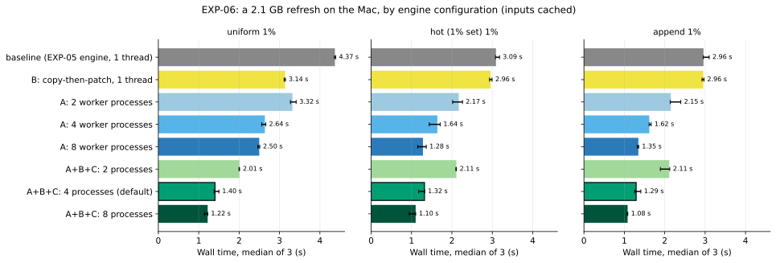
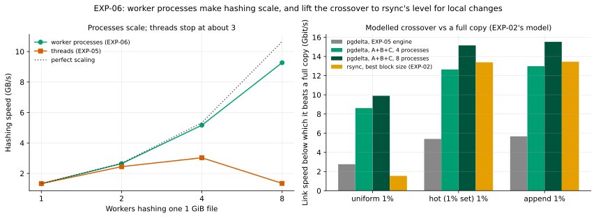
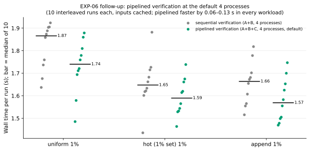

# EXP-06: Can pgdelta's fixed cost be cut in half?

Status: **done.** In the primary pass, S1, S3, S4 and S6 held, S2 held for steady-state hashing only, S5 held up to 4 processes, and S7 held in part. A re-run on a busier Mac, after the review fixes, missed S2, S3 (hot), S4 (hot and append) and S5 at 4 processes, each by 1–5%. The Linux check on an EXP-04 VM held L3, and L1 and L2 for steady-state hashing only (L2 at the bottom of its range, within run-to-run noise); with pool start-up included, L1 and L2 missed. Predictions recorded October 22, 2026, before the changes were built (L1-L3 before the Linux check ran); results added below the same day without editing them.

## Question

[EXP-05](EXP-05-parallel-hashing.md) found two limits on pgdelta's fixed cost of about 3–5 s per 2.1 GB:

1. **Hashing can't use more cores through threads.** Python's interpreter lock is taken back after every 8 KiB page, and that hand-off costs more than the hash. Separate interpreters don't share the lock; a quick test hashed at 7.1 GB/s with 8 of them, against 1.45 GB/s on one thread.
2. **Building the output is as slow as hashing.** The destination copies each run of unchanged pages from the old copy with its own read and write: tens of thousands of small copies when changes are scattered (1.85 s for uniform 1%). Then it re-reads the whole output to verify it, on the same thread (1.64 s).

This experiment tests three changes aimed at those limits. Each can be switched off on its own, so each one's share of the gain is measured.

## Changes under test

| Change | What it does | Why it should help |
|---|---|---|
| **A. Hash in worker processes** | Each 1 MiB node is hashed in a pool of separate processes. Each one opens the file, reads its node and returns the page and node fingerprints, so no interpreter lock is shared. `--jobs N` sets the pool size. `--jobs 1` keeps today's single-threaded code. | Real parallelism on any Python version (the cloud VMs run 3.11, which has no sub-interpreter pool). |
| **B. Copy, then patch** | For a file the old copy also has, first copy the old file into place in large pieces, letting the kernel do the copy where it can. Then write each received page at its offset. Pages past the old file's end are sent anyway and simply written. | Replaces tens of thousands of small copies with one large sequential copy plus page writes. That's what rsync effectively does on a clone. |
| **C. Verify in parallel, as files finish** | Each finished file is handed to the worker pool to re-hash while the destination writes the next file. Publication still waits until every file has matched the source's fingerprint. | Takes the re-read off the critical path without weakening it. Every output byte is still re-read and checked against the source. |

**What doesn't change:** the protocol, the fingerprints, the bytes sent, and the guarantee that every file of the output is re-read and verified against the source before the output is published. If the old copy changes while it's being copied, verification still catches it.

## Predictions

On the Mac, with the same B0/B1 pairs as EXP-05 (2.1 GB; uniform, hot and append at 1% of rows):

| ID | Prediction |
|---|---|
| S1 | **Identical results:** the same pages, bytes and byte-identical output for every combination of changes and every N. |
| S2 | **Hashing scales with processes:** hashing one 1 GiB file in isolation is at least 3.5× faster with 4 processes than with 1, and at least 5× with 8. |
| S3 | **Building O gets cheap:** with B, writing O for uniform 1% falls from 1.85 s to at most 0.8 s; hot and append stay at or below 0.5 s. |
| S4 | **End to end, with A + B + C and 4 processes:** uniform 1% takes at most **2.0 s** (from 4.55 s), and hot and append at most **1.5 s** (from 2.9–3.2 s). |
| S5 | **CPU is spent on work, not waiting:** CPU seconds are at most 1.3× those of the single-threaded engine. The extra is only starting processes and passing results. |
| S6 | **Crossover vs. a full copy** (EXP-02's model): above **5 Gbit/s** for uniform 1% (from 2.7) and above **10 Gbit/s** for hot and append (from 5.5), close to rsync's 12–14. |
| S7 | **Each change helps on its own, but the gain needs all three.** A alone brings uniform 1% to about 3 s, since writing O still takes 1.85 s; B alone brings it to about 3.4 s, since hashing is still serial. |

**What would change the plan:**
- **If S4 fails because of something not yet measured** (process start-up, inter-process traffic, flushing to disk), the per-phase timings will show which. That limit is the next target.
- **If S2 fails,** the remaining option for hashing is a compiled core that releases the lock for a whole node (for example in Rust). That's a bigger build, which is why it isn't tried first.

## Design

- **Configurations, with N = number of processes:**
  - baseline: no changes, 1 thread;
  - A only: N = 2, 4, 8;
  - B only: 1 thread;
  - A + B + C: N = 1, 2, 4, 8.
- **Runs:** 3 workloads × 9 configurations × 3 repeats, in shuffled order.
- **Also measured:** hashing a 1 GiB file in isolation with 1, 2, 4 and 8 processes (for S2), and machine load before each run, since the Mac is shared.
- **Measured per run:**
  - wall and CPU time (user and system);
  - time in each phase (hash S, hash B, write O, verify O);
  - bytes each way;
  - a byte-identical output every time.
- **Default `--jobs`:** set from this experiment's results to the best measured setting, then checked on Linux in [EXP-04](EXP-04-network-sweep.md), which runs pgdelta with both that default and one thread.
- **Correctness:** the full test suite, plus new tests for:
  - files that grow, shrink or are new;
  - an old copy that changes during the copy (it must be caught);
  - failures in the middle of a run (no hung threads or processes).

## Results

Run October 22, 2026, on the Mac: an M5 Pro with 15 cores (5 performance, 10 efficiency) and 24 GB of RAM, Python 3.14.7, PostgreSQL 17.11, at nice 0. The worker processes were started with `spawn`. The engine is commit `c0a1de1` on branch `wip/engine-throughput`.

- **Inputs:** fresh B0/B1 pairs from EXP-01's code and seeds: scale 70; uniform, hot (1% set) and append, each at 1% of rows. They have the same bytes as EXP-02's and EXP-05's. B1 is 2.12, 2.12 and 2.13 GB.
- **Runs:** 9 configurations × 3 workloads × 3 repeats = 81 runs per pass, in one seeded shuffled order. Every run used `--pg-controldata` and ran in reuse mode.
- **Benchmark script:** [run_exp06.py](../../experiments/engine_throughput/run_exp06.py). Its raw outputs are in `results/exp06/`, which isn't in git.
- **Curated data:** every run of the primary pass ([exp06-runs.csv](data/exp06-runs.csv)), the warm-once pass ([exp06-runs-warm-once.csv](data/exp06-runs-warm-once.csv)) and the re-run after the review ([exp06-rerun.csv](data/exp06-rerun.csv)); hashing in isolation ([primary](data/exp06-isolation-primary.csv), [re-run](data/exp06-isolation-rerun.csv)). Names of other programs running on the Mac are replaced by generic labels.
- **Figures:** `.venv/bin/python analysis/exp06.py`.

### Which pass counts

Reading every B0 and B1 once before the timed runs, as EXP-05 did, didn't keep them in the page cache. The three pairs hold 12.7 GB, more than this Mac kept cached beside its other applications.
- Right after that read, only 1.1% of the uniform pair was cached, and 59% of the hot pair.
- In that first pass ("warm-once"), 61 of 81 runs started with less than 95% of their B0 and B1 cached (median 15% among those 61; 33% over all 81), and 29 started with none of it.

So a second pass re-read each run's own B0 and B1, untimed, just before the run ("warm-each"). Every run then started with at least 99.7% of its inputs cached and ended with at least 99.8%.
- **The warm-each pass is primary.** The rule ("use the pass whose runs all start at least 95% cached") was fixed before any timings were looked at.
- **The warm-once pass is a partly cold pass with an uncontrolled cache,** not a second sample of the same conditions. Within one cell, the share of its inputs a run had to read from disk ranged from 0% to 100%. Its cells can't be compared with each other or with the primary pass, and no conclusion below rests on them. [Its own section](#the-warm-once-pass) lists where its numbers differ.

### Main results (warm-each pass)

- **Wall time:** median of 3 (range), timed outside pgdelta.
- **CPU:** user plus system seconds of `pgdelta local`, its child receiver and both sides' worker processes. The workers are counted because `spawn` makes them children of pgdelta, which reaps them. See [the CPU accounting fix](#cpu-on-linux-was-not-being-counted) for why that matters on Linux.
- **"vs A+B+C, N=1":** the single-threaded engine with copy-then-patch. It is the same engine as B: with one job there are no workers to verify on, so the nine configurations are eight distinct engines.
- **Crossover:** EXP-02's model, (B1's size − the bytes sent both ways) × 8 / median wall time.

| Workload | Configuration | Wall time, median (range) | vs baseline | CPU s | CPU vs baseline | CPU vs A+B+C N=1 | Crossover (Gbit/s) |
|---|---|---:|---:|---:|---:|---:|---:|
| uniform 1% | baseline | 4.37 s (4.36–4.39) | 1.00× | 6.84 | 1.00× | 1.16× | 2.77 |
|  | A, N=2 | 3.32 s (3.27–3.41) | 1.32× | 7.17 | 1.05× | 1.22× | 3.64 |
|  | A, N=4 | 2.64 s (2.56–2.66) | 1.66× | 7.64 | 1.12× | 1.30× | 4.58 |
|  | A, N=8 | 2.50 s (2.46–2.51) | 1.75× | 8.65 | 1.26× | 1.47× | 4.84 |
|  | B | 3.14 s (3.11–3.15) | 1.39× | 5.86 | 0.86× | 0.99× | 3.85 |
|  | A+B+C, N=1 | 3.17 s (3.15–3.20) | 1.38× | 5.90 | 0.86× | 1.00× | 3.81 |
|  | A+B+C, N=2 | 2.01 s (2.00–2.01) | 2.18× | 6.23 | 0.91× | 1.06× | 6.02 |
|  | A+B+C, N=4 | **1.40 s** (1.38–1.50) | 3.12× | 6.96 | 1.02× | 1.18× | 8.62 |
|  | A+B+C, N=8 | 1.22 s (1.14–1.22) | 3.58× | 7.75 | 1.13× | 1.31× | 9.90 |
| hot (1% set) 1% | baseline | 3.09 s (3.08–3.18) | 1.00× | 5.48 | 1.00× | 1.00× | 5.40 |
|  | A, N=2 | 2.17 s (2.02–2.26) | 1.42× | 5.91 | 1.08× | 1.08× | 7.70 |
|  | A, N=4 | 1.64 s (1.44–1.71) | 1.89× | 6.52 | 1.19× | 1.19× | 10.19 |
|  | A, N=8 | 1.28 s (1.15–1.37) | 2.41× | 7.39 | 1.35× | 1.35× | 13.01 |
|  | B | 2.96 s (2.93–2.99) | 1.04× | 5.47 | 1.00× | 1.00× | 5.64 |
|  | A+B+C, N=1 | 2.95 s (2.83–2.96) | 1.05× | 5.47 | 1.00× | 1.00× | 5.66 |
|  | A+B+C, N=2 | 2.11 s (2.10–2.11) | 1.46× | 5.96 | 1.09× | 1.09× | 7.91 |
|  | A+B+C, N=4 | **1.32 s** (1.18–1.33) | 2.34× | 6.68 | 1.22× | 1.22× | 12.64 |
|  | A+B+C, N=8 | 1.10 s (0.94–1.10) | 2.80× | 7.54 | 1.37× | 1.38× | 15.15 |
| append 1% | baseline | 2.96 s (2.96–3.10) | 1.00× | 5.46 | 1.00× | 1.00× | 5.67 |
|  | A, N=2 | 2.15 s (2.14–2.40) | 1.38× | 5.88 | 1.08× | 1.08× | 7.80 |
|  | A, N=4 | 1.62 s (1.61–1.66) | 1.83× | 6.59 | 1.21× | 1.20× | 10.37 |
|  | A, N=8 | 1.35 s (1.32–1.36) | 2.20× | 7.42 | 1.36× | 1.36× | 12.46 |
|  | B | 2.96 s (2.92–2.97) | 1.00× | 5.49 | 1.01× | 1.00× | 5.68 |
|  | A+B+C, N=1 | 2.94 s (2.81–2.95) | 1.01× | 5.47 | 1.00× | 1.00× | 5.70 |
|  | A+B+C, N=2 | 2.11 s (1.89–2.12) | 1.40× | 5.98 | 1.10× | 1.09× | 7.95 |
|  | A+B+C, N=4 | **1.29 s** (1.25–1.41) | 2.29× | 6.67 | 1.22× | 1.22× | 12.98 |
|  | A+B+C, N=8 | 1.08 s (1.07–1.09) | 2.74× | 7.62 | 1.40× | 1.39× | 15.52 |

Time in each phase, median, as uniform / hot / append. Hashing S and hashing B run at the same time, on different sides.

| Phase, median (s), uniform / hot / append | baseline | B | A, N=4 | A+B+C, N=4 | A+B+C, N=8 |
|---|---:|---:|---:|---:|---:|
| Hash S | 1.72/1.71/1.63 | 1.62/1.71/1.73 | 0.50/0.64/0.65 | 0.51/0.53/0.57 | 0.34/0.45/0.45 |
| Hash B | 1.76/1.71/1.68 | 1.77/1.79/1.79 | 0.51/0.60/0.65 | 0.53/0.60/0.64 | 0.36/0.46/0.50 |
| Write O | 1.72/0.50/0.42 | 0.41/0.34/0.32 | 1.57/0.66/0.60 | 0.44/0.39/0.40 | 0.51/0.72/0.70 |
|   of which copying B | 0.74/0.35/0.25 | 0.25/0.30/0.28 | 0.66/0.44/0.42 | 0.27/0.32/0.33 | 0.29/0.59/0.56 |
| Re-hash O (verify) | 1.65/1.73/1.69 | 1.70/1.74/1.75 | 0.49/0.62/0.66 | 0.59/0.82/0.81 | 0.47/0.50/0.53 |
|   of which the main loop waited | 1.65/1.73/1.69 | 1.70/1.74/1.75 | 0.49/0.62/0.66 | 0.16/0.42/0.22 | 0.07/0.02/0.01 |

### Verdict on each prediction

| ID | Prediction | Result |
|---|---|---|
| S1 | Identical results for every combination and N | **Held** |
| S2 | Hashing one 1 GiB file is ≥ 3.5× faster with 4 processes, ≥ 5× with 8 | **Held for steady-state hashing, with each pool's start-up left out.** With start-up included, neither bound is met |
| S3 | With B, writing O for uniform falls to ≤ 0.8 s; hot and append stay ≤ 0.5 s | **Held for B, and with A + B + C at up to 4 processes.** At 8 processes, writing O took 0.70–0.72 s for hot and append |
| S4 | A + B + C with 4 processes: uniform ≤ 2.0 s, hot and append ≤ 1.5 s | **Held:** 1.40, 1.32 and 1.29 s |
| S5 | CPU ≤ 1.3× the single-threaded engine | **Held up to 4 processes; failed at 8** (1.31–1.40×) |
| S6 | Crossover above 5 Gbit/s for uniform, above 10 for hot and append | **Held:** 8.6, 12.6 and 13.0 Gbit/s at 4 processes |
| S7 | Each change helps on its own, but the gain needs all three | **Partly held.** A helps on its own everywhere. B helps only for uniform. C's own share needed an A + B configuration that the design lacked; the re-run adds it: at 8 processes C saved 0.25–0.32 s in every workload, but at 2 and 4 its effect was mixed, and for uniform at 4, A + B without C was faster |

**S1, identical results.**
- All 162 runs of both passes exited 0 in reuse mode, and each built an O byte-identical to B1. So did the 108 runs of [the re-run](#re-run-after-the-review-fixes).
- Within each workload, every configuration gave the same values of these six: bytes S→D, pages sent, page-data bytes, bytes D→S without the final COMPLETE message, total pages and nodes descended.
- Bytes S→D and pages sent equal EXP-02's and EXP-05's: 608,895,495 / 28,347,258 / 26,700,566 bytes and 74,261 / 3,454 / 3,253 pages. Bytes D→S without the final COMPLETE equal EXP-05's: 2,225,452 / 97,556 / 80,356. EXP-02 didn't record that figure.
- The final COMPLETE carries the receiver's statistics, timings included, so total bytes D→S vary by up to 11 bytes within a workload (hot: 99,688 to 99,699, in both passes). They are about 270 bytes above EXP-05's, because those statistics now also report the switches and more timings. How O was built (`basis_copies`) differs by design: uniform needed 30,751 copies with gap-fill and 1,076 with copy-then-patch.

**S2, hashing scales with processes.** One 1 GiB file, the best of 3 passes on each pool after one untimed pass, in a seeded order:

| Pool | Best | GB/s | vs 1 process | Pool ready (about the first worker) | vs 1 process, start-up included |
|---|---:|---:|---:|---:|---:|
| in-process (serial) | 0.806 s | 1.33 | 1.00× | – | – |
| 1 process | 0.806 s | 1.33 | 1.00× | 0.066 s | 1.00× |
| 2 processes | 0.406 s | 2.65 | 1.99× | 0.060 s | 1.87× |
| 4 processes | 0.208 s | 5.17 | **3.88×** | 0.090 s | 2.93× |
| 8 processes | 0.116 s | 9.27 | **6.96×** | 0.076 s | 4.55× |
| 2 threads | 0.439 s | 2.45 | 1.84× | – | – |
| 4 threads | 0.354 s | 3.03 | 2.27× | – | – |
| 8 threads | 0.795 s | 1.35 | 1.01× | – | – |

- Steady state, 4 processes are 3.88× faster than 1 and 8 are 6.96×, against the ≥ 3.5× and ≥ 5× predicted.
- **That verdict leaves out starting the pool.** The design didn't say whether to include start-up. The runner left it out (each pool got an untimed pass first) and reported it separately, and the verdict rests on that choice.
  - Starting a pool took 0.06–0.09 s of wall time. Counted in, 4 processes are 2.93× faster and 8 are 4.55×, so neither bound is met.
  - Starting the workers also costs CPU: about 0.23 s for 4 workers and 0.52 s for 8, measured during the review.
  - For one 1 GiB file, start-up (0.09 s) is almost half of the hashing time at 4 processes (0.21 s). pgdelta starts its pool once per run, so over 2.1 GB per side it weighs less, and in a run it overlaps the session's first messages.
- "Pool ready" in this pass was close to the start-up of the *first* worker (see the [review fixes](#start-up-time-measured-the-first-worker)). The re-run measures the time until every worker had started: the first and the last worker were ready within 0–14 ms of each other (0.078 / 0.078 s at 2 processes, 0.139 / 0.139 s at 4, 0.108 / 0.122 s at 8), so this pass's figures understate start-up only slightly.
- Threads peak around 3–4 and fall back to serial speed at 8, as in EXP-05. One worker process costs nothing against hashing in-process (0.806 s both).

**S3, building O gets cheap.**
- **B on its own** cut writing O for uniform from 1.72 s (EXP-05 measured 1.85) to 0.41 s, under the 0.8 s bound. For hot it went from 0.50 to 0.34 s, and for append from 0.42 to 0.32 s, both under 0.5 s.
- **With A + B + C at 2 and 4 processes,** writing O took 0.38–0.49 s in every workload.
- **At 8 processes,** it took 0.72 s for hot and 0.70 s for append, above 0.5 s. Copying B (0.56–0.59 s) then competes with 16 hashing workers.
- With B0 partly out of the page cache (the warm-once pass), copy-then-patch also went over 0.5 s at 2 processes (1.16 s hot, 1.05 s append) and at 4 (0.56 s append). The copy then reads B0 from disk. The pre-registration didn't say whether the inputs would be cached; the verdict uses the cached (primary) pass, and a cold B0 is a limit.
- **Copy-then-patch writes more.** For uniform it copies 2.08 GB of B into O, against 1.51 GB with gap-fill: about 570 MB more, almost all of it then overwritten by received pages. That was cheap on the Mac, but on Linux the extra writes have to be flushed to disk for real, so the gain may be smaller there. EXP-04 measures it.

**S4, end to end with A + B + C and 4 processes:** 1.40 s (1.38–1.50) for uniform, against ≤ 2.0 s; 1.32 s (1.18–1.33) for hot and 1.29 s (1.25–1.41) for append, against ≤ 1.5 s. That is 3.1×, 2.3× and 2.3× the baseline, which itself took 4.37, 3.09 and 2.96 s here (EXP-05: 4.55, 2.89, 3.15). All inputs were cached here. EXP-05's reference numbers came from the same warm-once procedure that this experiment found leaves the pairs partly uncached, so they may include some cold reads. The speedups above compare against this experiment's own cached baseline, not EXP-05's.

**S5, CPU seconds against the single-threaded engine.** Uniform / hot / append:

| Configuration | vs baseline | vs A + B + C, N=1 |
|---|---:|---:|
| A + B + C, N=2 | 0.91 / 1.09 / 1.10× | 1.06 / 1.09 / 1.09× |
| A + B + C, N=4 | 1.02 / 1.22 / 1.22× | 1.18 / 1.22 / 1.22× |
| A + B + C, N=8 | 1.13 / **1.37 / 1.40**× | **1.31 / 1.38 / 1.39**× |
| A, N=4 | 1.12 / 1.19 / 1.21× | 1.30 / 1.19 / 1.20× |
| A, N=8 | 1.26 / **1.35 / 1.36**× | **1.47 / 1.35 / 1.36**× |

- Up to 4 processes, CPU stays within 1.3× of either single-threaded engine (A only at N=4 for uniform is at 1.30× against the copy-then-patch one).
- At 8 processes it doesn't: 1.37–1.40× of the baseline for hot and append, and 1.31–1.39× of the copy-then-patch single-threaded engine in all three workloads. Against the latter, uniform is over 1.3× too.
- **The extra isn't only what was predicted** (starting processes and passing results). Starting the workers explains about a third of the extra CPU at 4 processes and about half at 8. The rest is user time for the same hashing, which costs more per byte as N grows: work spilling onto efficiency cores is the likely cause. At N=8, `local` starts 16 workers, and system time rises from about 0.8 s to 1.4–1.5 s for hot and append.
- **This was measured on mixed cores.** Ten of the Mac's 15 cores are efficiency cores. Work that spills onto them takes more CPU seconds for the same hashing, so the failure at 8 may not carry over to uniform cores. EXP-04 runs only 4 processes and 1, so it can't settle this; an isolation test on one of the Linux VMs is planned before the sweep. (It ran: see [the Linux check](#linux-check-results). On 4 hyperthreaded cores, 8 processes cost 1.81× the CPU of one.)

**S6, crossover against a full copy:** with A + B + C at 4 processes, 8.62 Gbit/s for uniform (above 5; baseline 2.77), 12.64 for hot and 12.98 for append (above 10; baseline 5.40 and 5.67). At 8 processes: 9.90, 15.15 and 15.52.

| rsync crossover, Gbit/s | hot, default | hot, 8 KiB | append, default | append, 8 KiB |
|---|---:|---:|---:|---:|
| EXP-02 (another session) | 13.39 | 11.97 | 13.45 | 13.01 |
| This session, when the pairs were built | 11.64 | 10.26 | 11.76 | 11.47 |

The second row comes from rsync's runs while these pairs were built, right after the cluster stopped, so their cache conditions differ from the timed passes. Against it, 4 processes are above rsync, not just close to it; against EXP-02's, they are within its 12–14 Gbit/s, as predicted. 8 processes are above both.

**S7, each change helps on its own, but the gain needs all three.**
- **A on its own** brought uniform to 3.32, 2.64 and 2.50 s at 2, 4 and 8 processes, close to the predicted "about 3 s". Writing O still took 1.57–1.69 s, as predicted. It helped in every workload: 1.32–2.41× the baseline.
- **B on its own** brought uniform to 3.14 s, against "about 3.4 s", with hashing still serial (1.62 s for S, 1.77 s for B).
- **But B on its own helps only uniform** (1.39×): for hot (1.04×) and append (1.00×) it gives essentially nothing, since writing O took only 0.42–0.50 s there to begin with. So "each change helps on its own" fails for B on local changes.
- **C can't run on its own:** it needs worker processes. **The nine configurations don't isolate it either.** There's no A + B configuration (workers and copy-then-patch, sequential verification), so the step from A to A + B + C changes B and C together. The re-run adds that configuration: at 8 processes C saved 0.25–0.32 s in every workload, at 2 and 4 its effect was mixed, and for uniform at 4 A + B was faster without it. See [C's share](#cs-share).
- Two more reasons the phase timings can't stand in for C's share:
  - `verify_wait`, the time the main loop waited for verification, fell from 0.49 / 0.62 / 0.66 s with A at N=4 to 0.16 / 0.42 / 0.22 s with A + B + C at N=4. That comparison changes B and C together.
  - Pipelined verification does more work on the same workers: 0.59 / 0.82 / 0.81 s of verification against 0.49 / 0.62 / 0.66 s sequential. Time the main loop spends waiting for those workers when it re-reads B for leaf digests is counted in `hash_basis`, not in `verify_wait`.
- **All three together** beat A and B alone everywhere at N=4: uniform 1.40 s against 2.64 and 3.14 s; hot 1.32 against 1.64 and 2.96 s; append 1.29 against 1.62 and 2.96 s.

**What is left at A + B + C with 4 processes.** S4 held, so the "what would change the plan" rule doesn't apply. For the record:
- hashing S, 0.51–0.57 s, and B, 0.53–0.64 s, at the same time;
- writing O, 0.39–0.44 s;
- the main loop waiting for verification, 0.16–0.42 s;
- fsync, 0.05 s, although macOS stops at the drive's cache, so Linux may cost more;
- starting each side's pool, about 0.05 s of wall time per side until the first worker is up; the last one followed 3–7 ms later at 4 processes, and 11–15 ms later at 8 (re-run).

### The default `--jobs`

The design said to set the default "to the best measured setting". **That is 8**: A + B + C at 8 processes was 13–17% faster than at 4, with ranges that don't overlap (uniform 1.14–1.22 against 1.38–1.50 s; hot 0.94–1.10 against 1.18–1.33 s; append 1.07–1.09 against 1.25–1.41 s).

**The default is 4 nonetheless (min(4, CPUs)), which departs from the pre-registered rule on CPU efficiency alone.** At 8, CPU was 1.31–1.39× that of the single-threaded engine, over S5's 1.3× bound; at 4 it was 1.18–1.22×. Two cautions:
- That CPU cost was measured on the Mac's mixed cores (above), so the case against 8 is the Mac's. It is also sensitive to load: in the busier re-run, 4 processes went over 1.3× too. Whether 8 is better on uniform cores is checked separately on a Linux VM, not by EXP-04's sweep. ([It isn't](#linux-check-results) on EXP-04's VMs: 8 processes hashed 16% faster than 4 for 1.65× the CPU.)
- An earlier version of this decision (commit `d66d33d`) also said 8 was slower than 4 in the warm-once pass. That was a page-cache artefact and is withdrawn; see the next section.

`local` runs both ends on one host, so it gives each side min(4, CPUs / 2) since the review: 4 on this Mac and on 8 CPUs, 2 on 4 CPUs, and the in-process engine below 4. `--jobs 1` still means the single-threaded engine in the pgdelta process. EXP-04 runs pgdelta with this engine pinned (`--jobs 4`) and with EXP-02's single-threaded one.

### The warm-once pass

The first pass, run with one read of every pair before the runs as EXP-05 did, left most runs partly cold (above). Its numbers are kept for the record, with these differences from the primary pass:
- **4 against 8 processes.** In the warm-once pass, A + B + C at 8 was slower than at 4 for hot (1.61 against 1.33 s) and append (1.43 against 1.35 s). But most of its 4-process runs started with their inputs cached, and most of its 8-process runs started cold. **Matched by how much of B0 and B1 was cached, 8 looked faster in all three workloads. That is suggestive only:** it rests on one or two runs per side, and the uniform 8-process run (067) was disturbed by other work.
  - hot: the 4-process runs started 97–100% cached and took 1.17–1.37 s; the one 8-process run that started warm (97%) took 0.985 s. The 8-process runs that started at 0% and 33% took 1.61 and 1.82 s.
  - append: at 42% cached, 4 processes took 1.745 s, over S4's 1.5 s; at 34–41%, 8 processes took 1.43–1.46 s.
  - uniform: at 40% cached, 4 processes took 1.96 s; at 36%, 8 took 1.60 s. Nearly warm (94%, just under the 95% rule), 4 took 1.55–1.59 s; warm, 8 took 1.26 s.
- **S3:** writing O with copy-then-patch exceeded 0.5 s at 2 processes (1.16 s hot, 1.05 s append) and at 4 (0.56 s append), not just at 8.
- **S5:** A at N=8 for uniform used 1.34× the baseline's CPU, above 1.3.
- **S7, A on its own:** for uniform, A at 2, 4 and 8 processes took 5.71, 2.80 and 4.81 s against the baseline's 5.03 s: 0.88×, 1.79× and 1.05×. Gap-fill reads B0 in many small pieces, so a cold B0 costs it the most.
- **S4 and S6:** A + B + C at 4 processes took 1.59 / 1.33 / 1.35 s (medians), with crossovers of 7.61, 12.55 and 12.43 Gbit/s.
- **S2:** its isolation test gave 3.75× at 4 processes and 6.76× at 8, steady state.

So the warm-once pass doesn't "give the same verdict for every prediction", as an earlier summary said. Its differences come from cold reads it didn't control. Comparing 4 and 8 processes with a cold cache would need a controlled cold share: purging the cache, or warm-each with a set fraction left cold. That hasn't been measured.

### Problems the review found

An independent review of the change and of this report found the following. All were fixed, or measured, before the re-run below.

#### CPU on Linux was not being counted
- **Major:** on Linux, pgdelta started its workers with `forkserver`. They were children of the fork server, which nobody waits for, so their CPU time and memory never reached `wait4`, `RUSAGE_CHILDREN` or `time` of whoever ran pgdelta.
  - At `--jobs 4`, about 85–90% of pgdelta's CPU went missing (`pgdelta local` on 6 × 128 MiB: 0.41 s with forkserver against 3.40 s with spawn), so the parallel engine looked cheaper than `--jobs 1`.
  - This didn't affect the numbers above, which used `spawn` on macOS. It would have made a Linux check of S5, EXP-04's per-process CPU, and compare_methods with worker flags wrong.
  - **Fix:** pgdelta now uses `spawn` on every platform. The statistics record each side's start method. run_exp06 reports a run whose CPU can't include the workers as failed, and compare_methods and EXP-04 record the method.

#### Start-up time measured the first worker
- **Minor:** "pool ready" was meant to be the time until all N workers were up. But the N start-up pings could all be answered by the first worker, so it was close to the first worker's start-up. **Fix:** each worker now reports its pid when it has started, and the statistics give the first and the last (`pool_first_ready`, `pool_ready`). No work waits for them.

#### The report overstated or misstated some claims
- **Major:** the warm-once argument for 4 over 8 (above). Withdrawn; 4 now departs from the pre-registered rule on CPU efficiency alone.
- The warm-once pass was said to give the same verdicts; it doesn't (above).
- S2 was reported as held without saying that it leaves out start-up (now qualified, with the start-up-inclusive ratios).
- S7's "C shows in verify wait" changed B and C together (now measured with A + B in the re-run).
- S1 said the final COMPLETE varies by at most 10 bytes (it's 11), and compared D→S bytes without it with EXP-02's (only EXP-05 recorded that figure).
- S6 compared only with EXP-02's rsync crossovers, not this session's.
- No disturbances were listed (now below).

#### Other fixes
- **`local`'s default** gave each of its two sides min(4, CPUs), so on 4–7 CPUs it started up to 8 workers. It now divides the CPUs between the sides.
- **EXP-04's engines are pinned.** EXP-04 ran `pgdelta` with no engine flags and `pgdelta_1thread` with only `--jobs 1`. Once this engine is merged, those method names would have silently meant other engines. `pgdelta` now passes `--jobs 4` with copy-then-patch and pipelined verification. `pgdelta_1thread` now passes EXP-02's engine: `--jobs 1 --rebuild gap-fill --verify sequential`. Each record keeps the switches pgdelta reports.

### Re-run after the review fixes

After the fixes, at commit `101d1e7` with a clean tree, the nine configurations and A + B at 2, 4 and 8 processes ran again: 12 configurations × 3 workloads × 3 repeats = 108 runs. This re-run used warm-each, another seed (20261023) and the isolation test, and ran from 13:20 to 13:28 UTC. Every run started with at least 99.75% of its inputs cached.

**The Mac was busier than during the primary pass.** Just before the runs:
- a desktop application used 25–103% of a core (median 40%), against 25–35% in the primary pass;
- WindowServer used 59–85% (median 65%), against 42–50%;
- other processes came and went: other desktop applications up to 99% and 142%, and a macOS system process up to 90%;
- the 1-minute load average was 4.4–8.7.

So even the configurations that the fixes don't touch were slower. The baseline, B and A + B + C at N=1 run without any worker process, yet took 6–26% longer than in the primary pass. The configurations with workers took 4–49% longer, since they need free cores. On its own, then, the re-run can't show whether the fixes changed any timing.

**The fixes showed no consistent change in timing.** The engine before the fixes (`d66d33d`) and after (`101d1e7`) were run interleaved, in one seeded order, under the same load. The data are in [exp06-fixes-ab-pool.csv](data/exp06-fixes-ab-pool.csv) and [exp06-fixes-ab-e2e.csv](data/exp06-fixes-ab-e2e.csv).
- **Starting a pool and hashing:** a 512 MiB file on 4 and 8 workers, in 6 fresh processes for each engine.

  | Workers | Engine | First pass, start-up included | Steady state | CPU of the process tree |
  |---|---|---:|---:|---:|
  | 4 | before | 0.181 s (0.177–0.183) | 0.113 s (0.112–0.115) | 2.12 s |
  | 4 | after | 0.178 s (0.176–0.182) | 0.112 s (0.110–0.113) | 2.09 s |
  | 8 | before | 0.145 s (0.141–0.147) | 0.0619 s (0.0617–0.0630) | 2.60 s |
  | 8 | after | 0.143 s (0.141–0.146) | 0.0620 s (0.0612–0.0625) | 2.58 s |

- **End to end:** A + B + C at 4 and 8 processes and A at 4, in each workload, 4 runs per engine and cell (72 runs, at a load average of 7.2–11.6). After the fixes, the median wall time was 0.86–1.14× that before them: 5 cells faster, 4 slower. The ranges overlap in 8 of the 9 cells; in the ninth (uniform, A + B + C at 8) the engine after the fixes was faster. CPU was 0.97–1.04×, and pages and bytes were the same.

**Verdicts in the re-run.** Under this load:

| ID | Primary pass | Re-run, busier Mac |
|---|---|---|
| S1 | Held | **Held.** All 108 runs were byte-identical to B1, with the same pages and bytes; D→S without the final COMPLETE was again 2,225,452 / 97,556 / 80,356. Totals vary by up to 20 bytes across configurations, since the final statistics now name the start method only when there are workers |
| S2 | Held, steady state: 3.88× and 6.96× | **Not at 4 processes:** 3.41×, under 3.5×. 8 processes: 6.61×. With start-up included: 2.42× and 3.77× |
| S3 | Held for B, and up to 4 processes | B: 0.58 / 0.39 / 0.39 s, held. A + B + C at 4: 0.61 / 0.53 / 0.49 s, so hot is just over 0.5 s |
| S4 | Held: 1.40 / 1.32 / 1.29 s | Uniform 1.89 s, held. **Hot 1.54 s and append 1.51 s, just over 1.5 s** |
| S5 | Held up to 4 processes | **Not at 4 processes:** 1.04 / 1.36 / 1.32× the baseline (1.26 / 1.34 / 1.32× A + B + C at N=1). At 8: 1.09 / 1.67 / 1.48× |
| S6 | Held | **Held:** 6.40, 10.86 and 11.10 Gbit/s |
| S7 | Partly held | Partly held; C measured below |

**So the results that held with little margin in the primary pass don't hold on a busier Mac:** S2 at 4 processes, S3 for hot at 4 processes, S4 for hot and append, and S5 at 4 processes, each by 1–5%. These come from the load, not the fixes (see the A/B comparison above). The verdicts above stand for the conditions the design describes, but at 4 processes on this shared, mixed-core Mac their margins are thin.

The re-run also measured the time until each pool's last worker had started. It was 3–7 ms after the first worker at 4 processes and 11–15 ms after it at 8: 0.068–0.078 s per side at 4.

#### C's share

A + B + C against A + B (the same, with sequential verification), interleaved in the re-run. Median wall time (range):

| N | uniform | hot | append |
|---|---|---|---|
| 2 | 2.34 (2.24–2.86) against 2.46 s (2.38–2.65): C saves 0.12 s | 2.53 (2.32–2.92) against 2.64 (2.54–2.69): 0.11 s | 2.54 (2.33–2.64) against 2.32 (2.19–2.46): C costs 0.22 s |
| 4 | **1.89 (1.87–1.91) against 1.71 (1.64–1.84): C costs 0.18 s** | 1.54 (1.44–1.80) against 1.78 (1.41–1.84): 0.24 s | 1.51 (1.50–1.53) against 2.17 (1.63–2.24): 0.66 s, but the A + B cell was disturbed (two runs near 2.2 s, one at 1.63 s) |
| 8 | **1.43 (1.42–1.51) against 1.75 (1.53–2.01): 0.32 s** | **1.29 (1.16–1.36) against 1.57 (1.57–1.67): 0.28 s** | 1.24 (1.12–1.63) against 1.49 (1.24–1.50): 0.25 s |

Bold cells have ranges that don't overlap.
- **At 8 processes C helps every workload,** by 0.25–0.32 s.
- **At 4, the default, its effect is mixed.** For uniform, C cost 0.18 s (ranges don't overlap). For hot it saved 0.24 s with overlapping ranges, and the append comparison rests on a disturbed cell. At 2 processes it changed little either way.
- **So the default ships pipelined verification at `--jobs 4` without a measured benefit there.** It is kept because it is never slower by much and clearly helps at 8, but it is an open question, not a result.
- **Pipelined verification does more work** on the same workers. For uniform at 4 processes, A + B + C used 8.27 CPU seconds against 7.44 for A + B. When the workers are the bottleneck, as they were on this busier Mac, re-hashing O on them competes with hashing B.
- So "the gain needs all three" holds at 8 processes but **is not established at 4**. C was measured once, under heavier load than the primary pass. It needs a measurement in quieter conditions before pipelined verification can be counted on at the default `--jobs`.

### Disturbances

The Mac wasn't idle in any pass. ps was sampled before each run in the first two passes, and before and after each run in the re-run, but never during one.
- **Throughout:** macOS's window server used 41–50% of a core before every run, and a desktop application about 25–35%.
- **Before primary-pass run `043-append-ABC-4-r1`:** two background jobs of another desktop application at 84% and 75%. That run's 1.25 s is its cell's minimum.
- **Before warm-once run `031-append-ABC-8-r2`:** the same background jobs at 77% and 76%.
- **Before warm-once runs 067, 069, 070 and 072:** another session's `python -m unittest tests.test_exp04_network` at 30–49%. It probably caused the 1.60 s maximum of warm-once uniform A + B + C at 8.
- **Before warm-once runs `019-hot-ABC-4-r0` and `074-hot-baseline-r2`:** a desktop application at 90–94%.
- **Once each:** macOS system services at 27–42% (one of them before the primary pass's isolation test).
- **Load:** 1-minute load averages were 3.9–6.2 in the warm-once pass and 4.6–8.1 in the primary pass, partly from the benchmark itself.

None of the disturbed primary-pass runs is an outlier in its cell. No other postgres, run_study or pgdelta process was running at the start of either pass. The runner waits only for those, and records other heavy processes without waiting for them.

**The record of the primary pass.** It says the tree was dirty (`git_dirty: true` at `c0a1de1`). The dirty files were experiment scripts, not the engine: compare_methods.py, its README and its test, changed at 08:08–08:09 and committed as `ca1ee83`. pgdelta's receiver, sender and tree date from 07:48. cli.py changed at 08:19, after the pass ended at 08:17. The runner now lists the dirty files in its record.

**Order.** Both passes used the same seed, so they ran in the same order, back to back (warm-once 12:07–12:12 UTC, warm-each 12:12–12:17), not interleaved. The re-run used another seed.

## Linux check (predictions recorded October 22, 2026, before running)

The Mac has mixed cores, so two results may not carry over to EXP-04's VMs (`n2-standard-8`, Debian 12, Python 3.11): how hashing scales with processes (S2), and the CPU cost of 8 processes (S5). An `n2-standard-8` has 8 vCPUs, which are 4 physical cores with two hyperthreads each. Hashing one 1 GiB file in isolation on `pgd-dest`, best of 3 per pool, as in S2:

| ID | Prediction |
|---|---|
| L1 | 4 processes hash at least 3.5× faster than 1, since they can use 4 separate cores. |
| L2 | 8 processes gain much less than the Mac's 7×: **4.5–5.5×**, because the second hyperthread on a core adds only about a quarter to a third more throughput. |
| L3 | CPU seconds per pass at 8 processes are at least 1.3× those at 1, because hyperthreads share a core and each runs slower; at 4 processes, at most 1.15×. |

If L2 and L3 hold, 8 workers per side are not worth it on these VMs either, and the default of 4 stands on Linux for a different reason than on the Mac.

### Linux check: results

Run October 22, 2026, 17:27 and 17:28 UTC, on `pgd-dest`: `n2-standard-8`, Intel Xeon @ 2.80 GHz, 4 cores with 2 threads each, Debian 12 (kernel 6.1), Python 3.11.2, workers started with `spawn`, nice 0. The tree was commit `ea03ef4` (clean), deployed with `remote.py`. That comes from `DEPLOYED.json`, kept in the record as `environment.deployed`. The record's own `git_dirty: false` only meant that the VM has no git; the runner now records that as unknown (`null`). The VM was otherwise idle: no process above 25% of a CPU before or after, and a 1-minute load average of 1.2 from writing the test file just before.
- **Procedure:** S2's, with `run_exp06.py --isolation-only` (no B0/B1 pairs needed): one generated 1 GiB file on `/data`, read once before; on each pool in a seeded order, one untimed pass, then the best of 3 timed passes; every digest checked against serial.
- **Primary pass:** seed 20261022, as pre-registered. A **repeat** with seed 20261023 followed a minute later. It gave the same verdicts, with best times within 1.3% of the primary's, speed-ups and CPU ratios within 0.03, and pool start-up within 6 ms.
- **CPU per pass** is S2's column: this process's and its reaped workers' CPU over the pool's whole life (start-up, the untimed pass and the 3 timed ones) divided by 4. The runner now also records the CPU of the timed passes alone, from each live worker's `/proc/<pid>/stat`, which leaves start-up out.
- **Data:** [exp06-isolation-linux.csv](data/exp06-isolation-linux.csv) (both passes).

Primary pass:

| Pool | Best | GB/s | vs 1 process | Pool ready (last worker) | vs 1 process, start-up included | CPU s per pass | vs 1 process | CPU s per timed pass | vs 1 process |
|---|---:|---:|---:|---:|---:|---:|---:|---:|---:|
| in-process (serial) | 1.967 s | 0.55 | 1.01× | – | – | 1.97 | 0.96× | 1.97 | 0.97× |
| 1 process | 1.986 s | 0.54 | 1.00× | 0.076 s | 1.00× | 2.05 | 1.00× | 2.03 | 1.00× |
| 2 processes | 0.999 s | 1.07 | 1.99× | 0.077 s | 1.92× | 2.09 | 1.02× | 2.05 | 1.01× |
| 4 processes | 0.512 s | 2.10 | **3.88×** | 0.098 s | 3.38× | 2.18 | **1.06×** | 2.07 | 1.02× |
| 8 processes | 0.440 s | 2.44 | **4.51×** | 0.131 s | 3.61× | 3.71 | **1.81×** | 3.41 | 1.68× |
| 2 threads | 1.082 s | 0.99 | 1.84× | – | – | 2.16 | 1.05× | 2.16 | 1.07× |
| 4 threads | 0.772 s | 1.39 | 2.57× | – | – | 2.71 | 1.32× | 2.73 | 1.35× |
| 8 threads | 1.460 s | 0.73 | 1.36× | – | – | 5.19 | 2.54× | 5.15 | 2.55× |

| ID | Prediction | Result |
|---|---|---|
| L1 | 4 processes hash at least 3.5× faster than 1 | **Held for steady-state hashing** (best of 3, pool start-up left out): 3.88× (repeat 3.87×). With start-up included, 3.38× (repeat 3.36×), under 3.5× |
| L2 | 8 processes: 4.5–5.5× | **Held for steady-state hashing, at the bottom of the range and within run-to-run noise:** 4.51× best of 3 (repeat 4.51×), 0.015 above its lower end. The median of the same three passes gives 4.499× (repeat 4.505×). With start-up included, 3.61× (repeat 3.65×), under 4.5× |
| L3 | CPU per pass at 8 processes at least 1.3× that at 1; at 4, at most 1.15× | **Held:** 1.81× at 8 and 1.06× at 4 (repeat 1.82× and 1.06×). Without start-up (timed passes only): 1.68× and 1.02× |

- **Going from 4 to 8 processes bought 16% more throughput** (0.512 to 0.440 s) for 65% more CPU per timed pass (3.41 against 2.07 s). That is the second hyperthread of each core: it added less than the "quarter to a third" L2's reasoning assumed. 4 processes scale almost perfectly, 3.88× on 4 cores, at 2% more CPU than one.
- **So, by the rule recorded with the predictions, 8 workers per side are not worth it on these VMs either, and the default of 4 stands on Linux**, for a different reason than on the Mac: on the Mac, 8 was faster but cost more than 1.3× the CPU; here, 8 is barely faster than 4 because there are only 4 cores. L2's thin margin doesn't change this: a smaller gain at 8 would make 8 even less worth it.
- **L1 and L2 are qualified as S2 was.** Like S2, they compare the best of 3 steady-state passes and leave each pool's start-up out. With start-up counted, neither bound is met (below).
- **Starting a pool** took 0.076 s for one worker and 0.098 s (4) and 0.131 s (8) until the last worker was up. Counted in, 4 processes are 3.38× faster than one and 8 are 3.61×.
- **Threads** behave as on the Mac: 2.57× at best (4 threads), and 1.36× at 8, at 2.5× the CPU.
- **One core hashes 0.55 GB/s here, against 1.33 GB/s on the Mac's performance cores** (S2): 2.4× slower per core, with Python 3.11 against 3.14. This bears on EXP-04's N4, which assumed 1.2–2×; N4 itself is judged by the sweep.

## Does pipelined verification help at the default of 4 processes? (predictions recorded October 23, 2026, before running)

EXP-06 left this open. At 8 processes, verifying finished files in parallel (C) saved 0.25–0.32 s in every workload. At the default of 4 it was mixed, measured once (3 repeats) on a busy Mac: for uniform, C cost 0.18 s. Yet pgdelta ships `--verify pipelined` at `--jobs 4`. This check settles it with more repeats, interleaved, on the same B0/B1 pairs.

- **Configurations:** A + B + C at 4 processes (the default) against A + B at 4 (`--verify sequential`). Nothing else changes.
- **Runs:** 10 repeats each × 3 workloads = 60 runs, in one seeded shuffled order. Each run's own B0 and B1 are re-read just before it (warm-each), and machine load is recorded before each run.

| ID | Prediction |
|---|---|
| V1 | **Hot and append: pipelined is faster by at least 0.1 s** (median). Verification of earlier files overlaps writing later ones, as the main loop's shorter wait for verification suggested (0.42 and 0.22 s with C, against 0.62 and 0.66 s with A alone at 4). |
| V2 | **Uniform: within ±0.1 s.** One 1 GB table dominates, and it can only be verified once it is fully written, so there is little to overlap, while extra verification work competes with hashing B for the same 4 workers. |

**Decision rule, fixed now:**
- If pipelined is slower than sequential in any workload by more than 0.1 s with non-overlapping interquartile ranges, and faster in none by that margin, the default becomes `--verify sequential` at 4 processes or fewer.
- If V1 holds, the default stays pipelined.
- Anything in between is reported as is, and the default is left unchanged.

### Results of the check (run October 23, 2026)

60 runs, all byte-identical to B1, with the switches as configured and inputs cached at the start of every run.
- **Engine:** `work/v0` at `9d4ba63`.
- **Order:** seed 20261023, warm-each.
- **Load:** the 1-minute load average was 3.0–7.8 before the runs. The Mac was in normal use, and the interleaving spreads that over both configurations.
- **Data:** [exp06-verify4.csv](data/exp06-verify4.csv).

| Workload | Sequential (A + B, 4) | Pipelined (A + B + C, 4) | Difference | One-sided permutation p | Main loop's wait for verification |
|---|---:|---:|---:|---:|---|
| uniform 1% | 1.87 s (IQR 1.74–1.90) | **1.74 s** (1.69–1.81) | −0.13 s (−6.7%) | 0.048 | 0.66 → 0.20 s |
| hot 1% | 1.65 s (1.62–1.72) | **1.59 s** (1.53–1.66) | −0.06 s (−3.5%) | 0.057 | 0.75 → 0.06 s |
| append 1% | 1.66 s (1.57–1.70) | **1.57 s** (1.50–1.65) | −0.10 s (−5.7%) | 0.076 | 0.75 → 0.12 s |

- **V1 failed:** pipelined was faster for hot and append, but by 0.06 and 0.10 s, not at least 0.1 s each.
- **V2 failed, in the other direction:** for uniform, pipelined was *faster*, by 0.13 s, outside ±0.1 s. The reasoning behind V2 was wrong. Verifying the smaller files while the large table is written takes most of the main loop's wait off the critical path: 0.66 s down to 0.20 s.
- **The decision rule leaves the default as it is:** pipelined was never slower. All three differences point the same way, each with moderate evidence (p = 0.05–0.08). The earlier re-run's "C costs 0.18 s for uniform" was not reproduced, so it was most likely noise from the busier Mac. **`--verify pipelined` stays the default at `--jobs 4`.**
- **The gain is smaller than the wait it removes** (0.06–0.13 s of wall time against 0.46–0.69 s less waiting). The extra verification work shares the same 4 workers with hashing B, so part of the saving goes back into contention.

## Limitations known in advance

- One machine, and not an idle one. Other applications run on the Mac, so load is recorded before each run.
- macOS flushes writes to the drive's cache, not all the way to storage, unless asked to. Linux results (EXP-04) may show a larger cost for flushing O.

## Conclusions

1. **The three changes cut pgdelta's fixed cost by more than half.** With A + B + C at 4 worker processes, a 2.1 GB refresh with 1% of rows changed took 1.29–1.40 s on the Mac (medians, inputs cached), 2.3–3.1× faster than the EXP-05 engine. It used 1.02–1.22× the CPU and gave the same bytes and an identical output. The crossover against a full copy rose to 8.6 Gbit/s for scattered changes and about 13 for local ones, close to or above rsync's.
2. **Each change removed the limit it was aimed at.**
   - Worker processes make hashing scale: 3.9× at 4 and 7.0× at 8, steady state, where EXP-05's threads went no further than 2.3×.
   - Copy-then-patch brought writing O down to 0.3–0.4 s.
   - Pipelined verification takes most of the re-read off the critical path. At 8 processes it saved 0.25–0.32 s. At the default of 4, a later check with 10 interleaved runs per configuration found it 0.06–0.13 s (3–7%) faster in every workload, so it stays on.
3. **The default is 4 processes, not the best measured 8.** That departs from the pre-registered rule, on CPU efficiency alone: 8 went over S5's 1.3× CPU bound on this Mac's mixed cores. `local` divides the CPUs between its two sides.
4. **The margins at 4 processes are thin on a busy Mac.** A re-run under heavier background load missed S2, S3 (hot), S4 (hot and append) and S5 at 4 processes, each by 1–5%. An interleaved before/after comparison showed no consistent timing change from the review fixes.
5. **On Linux, the default of 4 holds for another reason.** The [Linux check](#linux-check-results) on an EXP-04 VM (4 cores, 2 hyperthreads each) held L3, and L1 and L2 in steady state (start-up left out, as for S2): 4 processes hash 3.88× faster than one at 1.06× the CPU, and 8 processes only 4.51× faster at 1.81× the CPU, because the second hyperthread adds about 16%. One core hashes 2.4× slower there than on the Mac.
   - EXP-04 runs pgdelta pinned to this engine (`--jobs 4`, copy-then-patch, pipelined) and to EXP-02's single-threaded one.
   - Its per-process CPU now counts the workers, which `spawn` makes children of pgdelta. With Linux's former `forkserver`, they would have been missing.
   - C at 4 processes has since been measured (above): it helps a little, so it stays on. Cold-cache behaviour remains unmeasured.
