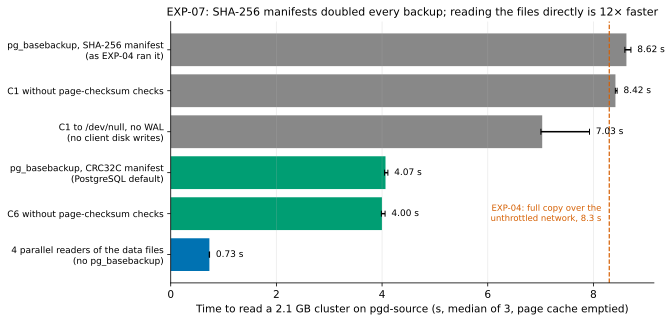

# EXP-07: Why does taking the local backup S take as long as a full copy?

Status: **done.** Predictions C1–C5 recorded October 22, 2026, before running; C6–C7 added before running, after noticing the harness's checksum setting. Results added below the same day.

## Question

In [EXP-04](EXP-04-network-sweep.md), the staged methods (pgdelta and rsync) first take a local `pg_basebackup` S on the source. On the `n2-standard-8` VMs this capture took **8.5 s for 2.1 GB, about 250 MB/s**. That's the same as a whole full copy over an unthrottled 15 Gbit/s link (8.3 s), although the capture writes to a local NVMe array that writes at 1.6 GB/s and reads at 2.0 GB/s, both measured as a single direct-I/O stream with `dd`. So a staged delta method can't beat a full copy on any link fast enough for `pg_basebackup` to run at its own top speed. Every later design choice depends on where those 8.5 s go:
- If the server side of `pg_basebackup` is the limit, a single backup stream can't be made faster, and a delta tool must read the data files itself, in parallel, as pgBackRest does.
- If writing S to disk is the limit, streaming the backup straight into the comparison (never writing S) would fix it.

## Setup

- On `pgd-source`: a fresh scale-70 cluster built with EXP-01's own code, data checksums on (as in EXP-04), PostgreSQL 17.11.
- The OS page cache is emptied before every timed run. Each variant runs 3 times, in a seeded random order.

## Variants and predictions

| ID | Variant | Prediction |
|---|---|---|
| C1 | `pg_basebackup -D S -Fp -X stream` to the local array, as EXP-04's capture does | **About 8.5 s**, reproducing EXP-04. |
| C2 | Same, with `--no-verify-checksums` | **At least 25% faster.** Checking every page's checksum is a large share of the server's work. |
| C3 | `pg_basebackup -D - -Ft -X none` written to `/dev/null`: no client disk writes | **Within 10% of C1.** The server side, not writing S, is the limit. |
| C4 | Reading every file of the data directory directly with 4 parallel readers (`cat` to `/dev/null`) | **At least 1 GB/s, at least 4× C1.** The disks aren't the limit. |
| C5 | CPU of the server's backup process (walsender) during C1 | **About one core busy** for the whole backup: it's CPU-bound on one core. |
| C6 | C1 with `--manifest-checksums CRC32C`, PostgreSQL's default. The harness, and so all of EXP-04's full copies, captures and combines, used SHA-256 | **At least 40% faster than C1.** SHA-256 of every file, on one core without hardware SHA instructions (Cascade Lake), would run at roughly 400–500 MB/s. Added after noticing the harness's setting and before running. |
| C7 | C6 plus `--no-verify-checksums` | **The fastest `pg_basebackup` variant**, and within 2× of C4 per stream. |

**What would change the plan:**
- **C3 or C4 failing** would mean disks are the limit, and the capture can't be avoided cheaply.
- **C2 holding strongly** would suggest a cheap fix for staged captures: skip checksum verification in the capture, since pgdelta verifies every output page anyway.
- **C4 holding** confirms that a design reading files directly in parallel could remove most of the 8.5 s.
- **C6 holding** would mean EXP-04's absolute times were inflated by the harness's SHA-256 manifests. That applies to the full copy, the staged captures and `pg_combinebackup` alike, so its crossovers would have to be re-checked with PostgreSQL's default.

## Results

Run October 22, 2026, on `pgd-source`:
- **Machine:** `n2-standard-8` (Intel Xeon 2.8 GHz, 4 cores × 2 hyperthreads), local NVMe array, Debian 12, PostgreSQL 17.11.
- **Data:** scale 70, as loaded, before EXP-04's 1% workload. The data directory without `pg_wal` is 2.10 GB in 994 files; the backup's manifest lists 990.
- **Runs:** 6 variants × 3 repeats (C5 is measured on C1's runs), in seeded random order, with the page cache emptied before each run.
- **Runner:** [run_exp07.py](../../experiments/capture_speed/run_exp07.py).
- **Data:** [exp07-runs.csv](data/exp07-runs.csv); figure: `.venv/bin/python analysis/exp07.py`.

**The first attempt had a bug in C4,** kept for the record in [exp07-runs-attempt1.csv](data/exp07-runs-attempt1.csv). It listed the data directory's files once, including old WAL segments in `pg_wal`. PostgreSQL recycled some of them during the run, so `cat` failed on missing files, and the rate was computed over the 3.2 GB directory, not the 2.1 GB a backup copies. That file also computes **every** variant's rate over the 3.2 GB directory, so its `mb_per_s` column is wrong throughout. The fix reads the data directory without `pg_wal`, lists the files again before each run, and computes each rate from the listed files' sizes. The other variants' wall times agree between the two attempts within 4%.

| ID | Variant | Median (range) | Rate | Server CPU | Client CPU |
|---|---|---:|---:|---:|---:|
| C1 | `pg_basebackup` to disk, SHA-256 manifest (as EXP-04) | 8.62 s (8.60–8.71) | 245 MB/s | 7.1 s | 2.6 s |
| C2 | C1 without page-checksum checks | 8.42 s (8.42–8.45) | 251 MB/s | 6.9 s | 2.6 s |
| C3 | C1 as tar to `/dev/null`, no WAL | 7.03 s (7.01–7.93) | – | not measured | 0.8 s |
| C6 | `pg_basebackup` to disk, **CRC32C manifest** (PostgreSQL's default) | **4.07 s** (4.05–4.11) | 520 MB/s | 2.3 s | 2.3 s |
| C7 | C6 without page-checksum checks | 4.00 s (3.99–4.06) | 529 MB/s | 2.1 s | 2.2 s |
| C4 | 4 parallel readers of the same files, no `pg_basebackup` | **0.73 s** (0.73–0.74) | **2,870 MB/s** | – | 1.0 s |

"Server CPU" is the growth of the postmaster's reaped-children CPU: both walsenders, plus any other child that exits in the window. The fast checkpoint runs in the checkpointer and isn't counted. It is a close proxy for the backup processes' CPU, stable across repeats. In C3 the walsender hadn't been reaped yet when that was read, so its figure (0.0–0.04 s) is not a measurement.

### Verdict on each prediction

| ID | Prediction | Result |
|---|---|---|
| C1 | About 8.5 s, reproducing EXP-04 | **Held:** 8.62 s |
| C2 | Skipping page-checksum checks ≥ 25% faster | **Failed:** 2% faster. Checking page checksums is cheap |
| C3 | No client disk writes: within 10% of C1 | **Failed: 18% faster** (7.03 s). Writing S and streaming WAL cost about 1.6 s. The server side is still most of the time, but not all of it |
| C4 | 4 parallel direct readers ≥ 1 GB/s and ≥ 4× C1 | **Held, strongly:** 2.87 GB/s, 11.8× C1 and 5.4× even the fastest `pg_basebackup` (C7) |
| C5 | The server's backup process keeps about one core busy | **Held:** 7.1 CPU-seconds over 8.6 s, 0.82 of a core |
| C6 | CRC32C manifest ≥ 40% faster than C1 | **Held:** 53% faster (4.07 against 8.62 s). The SHA-256 manifest cost about 4.8 CPU-seconds on the server, more than half the backup |
| C7 | C6 plus no page-checksum checks: the fastest `pg_basebackup` variant, within 2× of C4 per stream | **Inconclusive on "fastest", held on "within 2×".** C7 and C6 can't be told apart: 4.00 against 4.07 s here, but 4.00 against 3.91 s in the first attempt. Skipping page-checksum checks saves about 0.2 server CPU-seconds, within the noise. One `pg_basebackup` stream (529 MB/s) is 1.35× slower than each of C4's four concurrent readers (716 MB/s) |

## Conclusions

1. **The harness's SHA-256 manifests doubled the local capture of S:** 8.6 s, against 4.1 s with CRC32C, PostgreSQL's default.
   - The same setting applied in EXP-04 to the full copy, incremental's capture and `pg_combinebackup`.
   - The full copy ran at the same speed as the capture (8.3 s), so it was probably slowed the same way.
   - Incremental's capture with local changes (0.3 s) can't have lost much. Its combine wasn't measured here.

   EXP-04's crossovers therefore describe the harness, not PostgreSQL as it ships. [EXP-04b](EXP-04b-default-checksums.md) repeats the sweep with CRC32C and measures how much each method changes.
2. **Even with CRC32C, one `pg_basebackup` stream is 5.5× slower than reading the files directly with 4 readers** (520 MB/s against 2.87 GB/s). Most of that is the four-way parallelism: per stream, a reader is 1.35× faster. What limits the CRC32C stream wasn't identified: its walsender used 0.57 of a core, and no CRC32C variant without client writes was run. A full copy goes through one such stream, and so does a staged capture of S.
3. **For pgdelta, the capture is one of two roughly equal costs.** With CRC32C the capture takes about 4.1 s, and pgdelta's own transfer at fast links takes 4.4–5.0 s (EXP-04). That transfer alone is about what a full copy with PostgreSQL's default checksums should take. A design that reads the source's data files directly, in parallel and in backup mode (`pg_backup_start` / `pg_backup_stop`, as pgBackRest does), would:
   - remove the capture;
   - read in parallel. Raw reads ran at 2.9 GB/s, but pgdelta must hash what it reads, about 1.7–2.1 GB/s on 4 processes;
   - send only the WAL actually written, not a padded 16 MiB segment.

   **Beating a full copy on fast links would also need a cheaper transfer.** Direct reads need their own correctness experiment: pages read while the server writes can be torn, and backup mode with replay of the WAL is what makes them safe.
