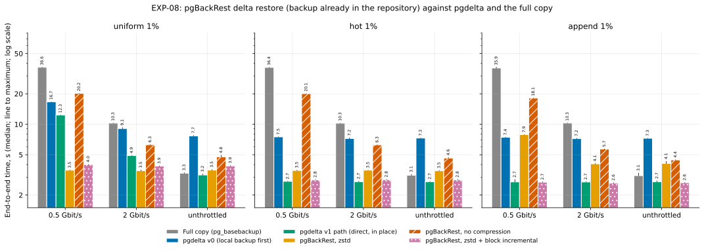
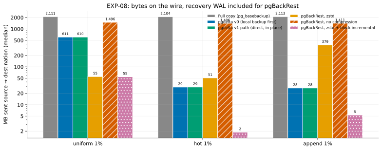

# EXP-08: How do the incumbent refresh tools compare where pgdelta claims its edge?

Status: **done** (results below, October 23–24, 2026). Pre-registered October 23, 2026, before the tooling for it ran. It was **revised the same day, still before running,** after an independent review; see [Revisions before running](#revisions-before-running-october-23-2026), and the first version is in git (commit 6ec413f). This is test T11 of the [decision ledger](../DECISIONS.md#t11-incumbent-tools-where-pgdelta-claims-its-edge), whose registered predictions are marked "ledger" below.

## Question

pgdelta's claimed edge has two halves, and neither has been tested against a real tool:
- **Correctness.** [EXP-03](EXP-03-tricky-copies.md) showed that a bare LSN shortcut keeps stale pages after a failover. But real catch-up tools check the cluster's identity and timeline, so they may refuse that case rather than corrupt it. And `pg_rewind`, which AlloyDB Omni already uses for DR, was never run.
- **Speed and bytes against a repository.** Omni's built-in backups are pgBackRest, and pgBackRest's `restore --delta` reuses an old copy's files whose checksums still match. Where a cluster has a repository, that is the obvious alternative.

## Part A: correctness on tricky old copies

**Setup.** One Debian 12 VM with PostgreSQL 17.11 from PGDG, using EXP-03's scenario builder. The ledger planned this part for the Mac. It moved to a VM because `pg_probackup` and WAL-G aren't packaged for macOS. Each (scenario, tool) pair runs once: the builds are deterministic, and the exact tool versions are recorded.

| ID | Old copy B | Source |
|---|---|---|
| S1 | A standby that stopped following the primary, same timeline | The primary, after more writes |
| S2 | An ex-primary that kept writing after a failover, then stopped cleanly | The promoted standby (timeline 2), after more writes |
| **S2b** (new) | **As S2, but the ex-primary never checkpoints after the fork.** Its diverged pages are forced to disk without a checkpoint, then it is stopped with `-m immediate`. So B's checkpoint is from before the fork, and some of its pages hold writes from after it. | As S2 |
| **S2c** (new, added in revision) | **A standby that followed the ex-primary after the fork, stopped cleanly.** It replays the ex-primary's diverged writes. No checkpoint follows the fork, so its shutdown restartpoint keeps a REDO point from before the fork while flushing the diverged pages. Its state is "shut down in recovery". | As S2 |

**Exposed pages.** S2b and S2c only test LSN-based tools if some of B's post-fork pages are blocks the source hasn't changed since B's REDO point. A tool that sends only pages newer than B's REDO point would skip those blocks and keep B's diverged bytes. The builders record how many such pages exist, and the count must be above zero. To guarantee it, part of the diverged writes go to a table the source doesn't write after the fork.

**Tools**, each refreshing a fresh copy of B from the live source:
- `pg_rewind --write-recovery-conf`. For S2b, it first runs crash recovery itself.
- `pg_probackup catchup --backup-mode=DELTA`.
- **WAL-G `catchup-send` / `catchup-receive`.** This is WAL-G's catch-up path, and it checks the system identifier and timeline. A second WAL-G arm, `catchup-push --from-lsn` then `catchup-fetch`, takes the starting LSN from the user and checks nothing. It is reported, labelled "user-supplied LSN", but doesn't count toward I2 or I3.
- pgdelta, as the reference.

**Classification.**
- **Refused, for identity or history:** the tool declines because of a system-identifier, timeline or history mismatch. Only this kind counts as "refuses" in I2 and I3.
- **Refused, for another reason:** for example, a destination that wasn't shut down cleanly. It's recorded with the tool's message. When a tool refuses S2b only for that reason, its I3 verdict comes from S2c.
- **Failed:** an error after starting work.
- **Accepted.**

**Correct (repaired)** means all three checks pass once the copy has reached consistency the way its tool intends (for `pg_rewind`, replaying the source's WAL as a standby):
1. every user table's row count and md5 equal the source's;
2. `pg_amcheck --heapallindexed` finds nothing;
3. for S2b and S2c, none of B's post-fork pages still holds B's diverged bytes, counted after recovery and a checkpoint.

**WAL for S1.** The runner starts the source with `wal_keep_size` large enough to keep the WAL written since S1's standby stopped, so the copy can catch up by replay.

Runner: `experiments/incumbents/run_t11.py`.

**`pg_rewind` runs in two arms (added October 23, before the registered run).** A development run of the runner on the Mac, not the registered experiment, showed that `pg_rewind` depends on B still holding its own WAL back to the fork. At 200,000 rows, B's shutdown checkpoint had already recycled that WAL:
- on S2, `pg_rewind` refused with "could not find previous WAL record";
- on S2b, its own crash recovery removed the WAL it then needed.

So every scenario runs `pg_rewind` twice:
- **B as EXP-03 builds it,** with PostgreSQL's default WAL retention;
- **B with its WAL retained** (`wal_keep_size` of 4 GB on the old primary). This stands in for production's WAL archive with `--restore-target-wal`, which `pg_rewind`'s documentation names for this case.

I4 is judged on the retained arm, the configuration `pg_rewind` documents. The default arm is reported as what happens without retention. The other tools run on both builds too, so every tool sees the same copies.

### Predictions

| ID | Prediction | Source |
|---|---|---|
| I1 | The catch-up tools accept S1, and the copy is correct. | ledger ("accept S1"); "correct" added here |
| I2 | The catch-up tools refuse S2, for identity or history. | ledger |
| I3 | The catch-up tools accept S2b (or S2c, as above) and keep some stale pages: at least one of the three checks fails. | ledger; S2c added in revision |
| I4 | `pg_rewind` repairs S2 and S2b: the copy is correct as defined above. | ledger |
| I5 | `pg_rewind` on S1 reports that no rewind is needed; the copy then catches up by replay alone. | added here |
| I6 | pgdelta is correct on S2b and S2c, as it was on S1 and S2 in EXP-03. | added here |

**What would change the plan (from the ledger):**
- If the catch-up tools refuse S2b and S2c for identity or history, or repair them correctly, pgdelta has no measured correctness edge over them, only wider reuse.
- If `pg_rewind` repairs S2 and S2b, then for Omni's DR path, where rewind is tried first, pgdelta's role is the fallback when rewind can't run, such as missing WAL. Its job there is not to replace rewind.

## Part B: pgBackRest delta restore over the network

**Setup.** The two `n2-standard-8` VMs of EXP-04b, with the same data, workloads, seed, cache drops, link shaping and wire-byte counting. The repository is on the source VM. The destination restores over SSH, with `process-max=4`. The exact pgBackRest version and configuration are recorded.

| Method | Compression | Block incremental |
|---|---|---|
| `pgbackrest_zst` | zstd (Omni's standalone sample uses it) | no |
| `pgbackrest_none` | none, including on the network (`compress-level-network=0`) | no |
| `pgbackrest_block` | zstd | yes (`repo-block=y`, `repo-bundle=y`) |

**The backup counts as already paid.** One full pgBackRest backup per variant is taken after the workload, untimed. Each run then goes:
1. Copy B0 to a fresh B, untimed, **before** the cache drop.
2. The timed phase: `restore --delta` onto B.
3. Start the restored copy, untimed. It recovers through `archive-get`. The WAL fetched there is counted in pgBackRest's wire bytes, measured at the interface, so both pgBackRest and pgdelta pay for the WAL they need.
4. Compare the copy's per-table row counts and md5s with the trial's ground truth, taken from the source after every method has run, as the harness already does. The source isn't scanned during the trial, because a scan sets hint bits and writes WAL.

**In the same sweep:** the full copy, staged pgdelta (as in EXP-04b), and pgdelta's v1 path (`pgdelta_direct_inplace`, see [EXP-09](EXP-09-direct-read.md)). Speeds 0.5 Gbit/s, 2 Gbit/s and unthrottled; uniform, hot and append at 1%; 3 repeats; random order. Archiving is on for the whole sweep, so source CPU is compared only within this sweep, not with EXP-04b.

### Predictions

Every time and byte comparison uses per-workload medians of 3 runs at each speed. **`pgbackrest_zst` is the arm for I7, I8 and the rules,** because it is Omni's configuration. The other two variants explain the mechanism.

| ID | Prediction | Source |
|---|---|---|
| I7 | `pgbackrest_zst` beats staged pgdelta on time for local changes (hot, append). | ledger |
| I8 | pgBackRest sends more bytes than pgdelta for scattered changes (uniform). | ledger; judged on `pgbackrest_zst` |
| I8a | Without compression (`pgbackrest_none`), I8 holds: it restores whole changed files, about 1.05 GB (EXP-01's `pgbench_accounts` and its index), against pgdelta's 610 MB. A check of the mechanism. | added here |
| I8b | With zstd, I8 fails: `pgbackrest_zst` sends fewer bytes than pgdelta for uniform, because pgbench's padded rows compress unusually well. | added here |
| I9 | `pgbackrest_block` sends at most half of `pgbackrest_zst`'s bytes for local changes. | added here |
| I10 (revised) | For uniform changes, `pgbackrest_zst` is faster than pgdelta's v1 path at 0.5 Gbit/s. | added here |
| I10b (revised) | For local changes, pgdelta's v1 path is faster than `pgbackrest_zst` at 0.5 and 2 Gbit/s. | added here |
| I11 | `pgbackrest_zst` beats the full copy at every speed for local changes. | added here |

**What would change the plan** (revised):
- **I8 (registered), judged on `pgbackrest_zst`:** if it sends fewer bytes than pgdelta for uniform, as I8b expects, the rule fires. On bytes, the pitch to Omni users must be "no repository needed". Whether this depends on pgbench's compressibility is checked offline in T4, which now also measures zstd on the changed files of realistic (TPROC-C) pairs.
- **No edge where a repository exists:** if `pgbackrest_zst`'s median time is at most 1.1 times pgdelta's v1 path at every speed, in all three workloads, and it sends no more bytes, then pgdelta's case for Omni clusters with a repository rests on what pgBackRest can't do. HA and DR seeding bypass the repository, and a refresh straight from the live server needs no recent backup. The pitch becomes "no repository needed".
- **A clear edge:** if pgdelta's v1 path takes at most 0.8 times `pgbackrest_zst`'s time at every speed, in all three workloads, it is worth using even where a repository exists.
- **Mixed (the likely outcome):** otherwise, report for each workload the link speed at which the two cross. The recommendation for clusters with a repository follows that crossover.

## Revisions before running (October 23, 2026)

An independent reviewer checked the first version against the ledger and EXP-04b's data before anything ran. Changes:
- **S2b alone could be refused for the wrong reason.** `pg_probackup`'s catch-up probably requires a cleanly stopped destination in DELTA mode, and S2b is stopped with `-m immediate`. A refusal for that reason says nothing about fork detection. Hence the refusal classes and the cleanly stopped S2c.
- **I3 could fail by construction** if the source rewrote every page that B diverged on. Hence the exposed-page count.
- **The WAL-G arm tested its unchecked mode.** The research names `catchup-send`/`catchup-receive` as WAL-G's catch-up path, the one with identity and timeline checks.
- **"Repairs" and "stale pages" had no fixed definition or time.** They now mean the three checks, counted after recovery and a checkpoint.
- **`pgbackrest_none` would still have compressed on the wire.** pgBackRest compresses network traffic by default when the repository is remote.
- **The predictions and rules named no pgBackRest variant or statistic, and I10 contradicted I8b:** at 0.5 Gbit/s, sending fewer bytes makes zstd the faster one. The rules also missed the likely mixed outcome.
- **Splitting I8 had sidestepped its registered falsifier.** The rule is now judged on Omni's configuration.
- **I8a's 2.1 GB was wrong:** uniform touches one table of about 1.05 GB.
- **Copy order, source scans and WAL bytes are now stated:** B0 is copied before the cache drop; the source isn't scanned during the trial; pgBackRest's WAL is counted.

## Limitations, known before running

- **"Already paid" favours pgBackRest.** A real repository's newest backup can be up to a day old (Omni's default is a daily full), and a restore would then also replay up to a day of WAL. Here the backup is taken right before each restore.
- **pgdelta's v1 arm reads a stopped source:** no backup mode, no WAL streaming, no live workload. That favours pgdelta.
- **The repository sits on the source's local NVMe.** Omni's repositories can be a local disk, Cloud Storage or S3.
- **SSH encrypts pgBackRest's traffic; pgdelta's is unencrypted,** although owner decision O6 requires TLS. The cipher's cost counts against pgBackRest. It could matter for the "clear edge" rule's 20% margin.
- **pgbench's padded rows compress unrealistically,** which helps the zstd variants (I8b).

## Results, part A: correctness on tricky old copies

*Corrected October 24 after an independent recheck (18 findings, 11 major). The first version, in git as 94a4622, explained a flagged page wrongly and didn't say how pgdelta and WAL-G's push/fetch mode actually ran.*

**Run:** October 24, 2026, 00:00–00:05 UTC, on `pgd-dest` (Debian 12, PostgreSQL 17.11 from PGDG), both WAL arms, one run per (scenario, tool), 200,000 rows.

**Tools:**
- `pg_rewind` 17.11;
- `pg_probackup` 2.5.16, built from its official source tag because Postgres Pro's repository didn't answer from Google Cloud;
- WAL-G 3.0.9, the official release, SHA-256 checked;
- pgdelta 0.1.0.

**Data:** [exp08-t11.csv](data/exp08-t11.csv). The raw `result.json`, `scenario.json` and tool logs are under `results/t11/` (git-ignored).

**Two deviations from the design, found by the recheck:**
- **pgdelta ran in EXP-03's staged mode.** It rebuilt a new copy O from the scenario's quiesced backup S and the untouched B, and O was checked against that same S. It didn't refresh B from the live source. So its "correct" here means what EXP-03 showed: a verified rebuild from a stopped backup. It does not test a live-server refresh, and its third check is trivially met.
- **WAL-G's push/fetch mode (`catchup-push --from-lsn`) ignores the LSN in v3.0.9 and sends every file whole.** Its sentinel holds only the start LSN, and no file is marked incremental (`bundle.go`). So that arm is in effect a full copy, and its results say nothing about trusting a user-supplied LSN.

**Every scenario built as designed.** For S2b and S2c, B's REDO point lies before the fork, and B's diverged pages are on disk:

| Scenario | B's pages changed after the fork | Exposed (a tool that trusts page LSNs would keep them) |
|---|---:|---:|
| S2 | 1,699 | 1,686 |
| S2b | 1,871 | 1,447 |
| S2c | 1,872 | 1,448 |

**Outcomes.** "Correct" means checks 1 and 2 passed (rows and md5s; amcheck), plus check 3 (no stale pages after recovery) for S2b and S2c, where it was registered.

| Tool | Arm | S1 | S2 | S2b | S2c |
|---|---|---|---|---|---|
| `pg_probackup catchup` (DELTA) | both | correct | **refused:** "Destination is not in source timeline history" (identity/history) | **accepted, wrong data:** 1,443 stale pages; `accounts` 199,072 of 200,000 rows, `tags` 19,833 of 20,000; amcheck fails | **accepted, wrong data:** 1,444 stale pages, same row losses, amcheck fails |
| WAL-G `catchup-send` | both | correct | **refused:** "Destination is on timeline 1, but we are on 2" | refused, same | refused, same |
| `pg_rewind` | default | correct ("no rewind required", then replay) | failed before modifying the copy: "could not find previous WAL record" (B's WAL was recycled)¹ | failed: its own crash recovery removed the WAL it then needed; the copy is left crash-recovered, cleanly stopped and still diverged | correct on checks 1 and 2; 1 page flagged by check 3² |
| `pg_rewind` | retained | correct | correct | correct | correct on checks 1 and 2; 1 page flagged by check 3² |
| pgdelta (staged, see above) | both | correct | correct | correct | correct |
| WAL-G push/fetch (in effect a full copy; not counted) | both | correct | correct | correct | correct on checks 1 and 2; 1 page flagged² |
| LSN-skip control | both | correct | wrong data, 1,686 stale pages | wrong data, 1,447 | wrong data, 1,448 |

¹ The harness records any error before the copy is modified as a refusal; under the registered classes this is a failure that left the copy untouched.

² **The flagged page is the live source's current version, not stale data.** In all seven flagged runs it is the same page: block 2 of `base/5/2840`, which is `pg_toast_2619`, the TOAST table of `pg_statistic` (checked on a fresh PostgreSQL 17 cluster). The evidence:
- Before recovery the tool's copy of that page equalled S's. After the copy replayed the source's WAL as a standby and was promoted, the page's tuple data equalled B's diverged version.
- Nothing else ran in between: autovacuum is off in every scenario cluster, and the bring-up only checks recovery status, checkpoints and stops.
- So replaying the source's own WAL produced it. Most likely the source made, after S was taken, the same change B had made after the fork (for example pruning dead TOAST tuples), and check 3's reference, S, predates it.

The data directories weren't kept, so this can't be confirmed byte by byte. Three of the seven flagged runs are S2, where check 3 isn't registered; the harness's `verdict` column applied it there anyway, so those are correct by the registered rule. The other four are S2c: "wrong data" by the registered rule, with rows and amcheck correct.

### Verdict on each prediction

| ID | Prediction | Result |
|---|---|---|
| I1 | The catch-up tools accept S1 and the copy is correct | **Held** for `pg_probackup` and WAL-G `catchup-send` |
| I2 | The catch-up tools refuse S2, for identity or history | **Held** for `pg_probackup` and WAL-G `catchup-send` |
| I3 | The catch-up tools accept S2b (or S2c) and keep stale pages | **Held for `pg_probackup`:** it accepts S2b and S2c and returns copies missing 928 `accounts` rows and 167 `tags` rows. **Failed for WAL-G `catchup-send`:** it refuses both. Its check is plain timeline equality, not fork detection, so it would also refuse a copy that never diverged but sits on an older timeline after a promotion (not tested here) |
| I4 | `pg_rewind` repairs S2 and S2b (retained arm) | **Held:** both correct by the registered checks |
| I5 | `pg_rewind` on S1 reports no rewind needed, then catches up by replay | **Held:** "source and target cluster are on the same timeline … no rewind required"; correct after replay |
| I6 | pgdelta is correct on S2b and S2c | **Held, in staged mode:** correct from a quiesced backup of the source, in both arms. A live-server refresh wasn't tested here (that's T8) |

### What the registered rules say

- **Against `pg_probackup`, pgdelta has a measured correctness edge.** `pg_probackup` silently returns a copy with lost rows whenever B's REDO point is older than its diverged pages: a crashed ex-primary (S2b) or a cleanly stopped standby of one (S2c).
- **Against WAL-G's checked mode, there's no correctness edge; the edge is reuse.** WAL-G refuses every copy on another timeline, so after a failover it sends everything again. pgdelta sends only the changed pages.
- **`pg_rewind` repairs the diverged copies when B still has its WAL back to the fork,** on S2 and S2b by every registered check. On S2c its rows and amcheck are correct, but one system-catalog page is flagged by check 3, so by the registered rule it is wrong data there; footnote 2 explains why that page is most likely the source's own later change, which can't be confirmed byte by byte. Without that WAL it can't run: in S2 the WAL had been recycled, and in S2b its own crash recovery removed it. So for Omni's DR path, which tries a rewind first, pgdelta's role is the fallback when rewind lacks that WAL. pgdelta needs no WAL from B: in staged mode it rebuilt every case correctly. The live-server version of that claim is T8's to test.

## Results, part B: pgBackRest delta restore

*Corrected October 24 after the same recheck. The first version reported restore time only, as if it were end to end, and drew conclusions from it that need the recovery time too.*

**Run:** October 23, 2026, 22:22–23:58 UTC, sweep `exp08-pgbackrest`, on the VMs of [EXP-09](EXP-09-direct-read.md).
- **Runs:** 162, every one verified. Every pgBackRest restore was started, recovered through `archive-get`, and matched the source's per-table row counts and md5s.
- **Versions:** pgBackRest 2.59.3 (PGDG); the configuration is in the sweep's `run.json`.
- **Data:** [exp08-runs.csv](data/exp08-runs.csv), [exp08-cells.csv](data/exp08-cells.csv).
- **Analysis:** [analysis/exp08.py](../../analysis/exp08.py), written and dry-run before these results existed (the usable-time column was added after the recheck).

**Restore time** (median of 3, seconds). This is what the harness timed. For pgBackRest it excludes the backup (taken just before, untimed) and the recovery the copy needs before it can be used.

| Workload | Link | Full copy | pgdelta v0 | pgdelta v1 path | pgBackRest zstd | pgBackRest none | pgBackRest block |
|---|---|---:|---:|---:|---:|---:|---:|
| uniform | 0.5 Gbit/s | 36.57 | 16.66 | 12.33 | **3.52** | 20.19 | 4.00 |
| | 2 Gbit/s | 10.27 | 9.08 | 4.91 | **3.48** | 6.28 | 3.86 |
| | unthrottled | 3.29 | 7.67 | **3.16** | 3.52 | 4.77 | 3.88 |
| hot | 0.5 Gbit/s | 36.44 | 7.51 | **2.73** | 3.50 | 20.05 | 2.82 |
| | 2 Gbit/s | 10.25 | 7.23 | **2.71** | 3.52 | 6.26 | 2.83 |
| | unthrottled | 3.14 | 7.31 | **2.71** | 3.47 | 4.64 | 2.82 |
| append | 0.5 Gbit/s | 35.95 | 7.43 | 2.69 | 7.90 | 18.13 | **2.68** |
| | 2 Gbit/s | 10.29 | 7.21 | 2.69 | 4.06 | 5.69 | **2.62** |
| | unthrottled | 3.11 | 7.27 | 2.70 | 4.10 | 4.44 | **2.64** |

**Time until the copy is usable:** the restore plus starting the copy until it is out of recovery. This was measured untimed during verification. The full copy's and v0's outputs weren't started.

| Workload | Link | pgdelta v1 path | pgBackRest zstd | pgBackRest none | pgBackRest block |
|---|---|---:|---:|---:|---:|
| uniform | 0.5 Gbit/s | **12.49** | 17.36 | 40.94 | 16.02 |
| | 2 Gbit/s | **5.08** | 14.84 | 18.80 | 13.84 |
| | unthrottled | **3.32** | 13.30 | 16.74 | 13.72 |
| hot | 0.5 / 2 / unthrottled | **2.87–2.89** | 13.54–16.10 | 14.57–38.46 | 11.99–15.04 |
| append | 0.5 / 2 / unthrottled | **2.85–2.87** | 17.21–19.21 | 17.12–33.88 | 11.46–15.56 |

**How much of pgBackRest's recovery is real and how much comes from the harness:**
- Its recovery time fits about **2.1 s plus 0.38 s per WAL file fetched** (zstd 2.09 + 0.385; block 2.19 + 0.381; none 2.33 + 0.500).
- Each restore fetched **2–45 WAL files**. That count grew within a trial, because every earlier method's backup added WAL, so most of the backlog comes from the harness.
- The fixed ~2.1 s doesn't come from the harness: it's the cost of starting, fetching and promoting.
- A real restore from a day-old BackupPlan backup would fetch far more WAL.
- pgdelta v1's 0.16 s comes from reading a stopped source. A live-source v1 (T8) will also need some recovery.

**Bytes from source to destination** (median, MB; the same at every speed within 2%). For pgBackRest this includes the WAL its recovery fetched; that part is in brackets.

| Workload | Full copy | pgdelta v1 path | pgBackRest zstd | pgBackRest none | pgBackRest block |
|---|---:|---:|---:|---:|---:|
| uniform | 2,111 | 611 | 55 (0.4) | 1,497 (387) | 55 (0.3) |
| hot | 2,104 | 29 | 51 (0.4) | 1,406 (303) | **1.9** (0.4) |
| append | 2,113 | 28 | 379 (0.5) | 1,412 (421) | **5.3** (0.4) |

pgdelta's 28–29 MB for local changes includes one 16 MiB WAL segment, which is more than 99.99% unused space but sent uncompressed. The pages themselves are 10.6 MB (append) and 12.3 MB (hot).

### Verdict on each prediction

| ID | Prediction | Result |
|---|---|---|
| I7 | `pgbackrest_zst` beats staged pgdelta on time for local changes | **Failed: held in 5 of 6 cells, failed for append at 0.5 Gbit/s** (7.90 against 7.43 s, ranges not overlapping), where file-level restore sends 379 MB |
| I8 | pgBackRest sends more bytes than pgdelta for uniform, judged on `pgbackrest_zst` | **Failed at every speed: 55 against 610 MB. The registered rule fires: on bytes, the pitch to Omni users must be "no repository needed".** Part of this is pgbench's padded rows compressing unusually well, which T4 checks on realistic data |
| I8a | Without compression, pgBackRest sends more than pgdelta for uniform | **Held:** 1,109 MB restored plus 387 MB of WAL, against 611 MB (unthrottled; similar at every speed) |
| I8b | With zstd, fewer bytes than pgdelta for uniform | **Held** at every speed |
| I9 | Block incremental sends at most half of zstd's bytes for local changes | **Held** at every speed: 1.9–2.0 against 51 MB (hot), 5.2–5.4 against 379 MB (append) |
| I10 | Uniform: `pgbackrest_zst` faster than pgdelta's v1 path at 0.5 Gbit/s | **Held on restore time:** 3.52 against 12.33 s. Including recovery, the v1 path is faster (12.49 against 17.36 s), but most of that recovery is the harness's WAL backlog |
| I10b | Local changes: v1 path faster than `pgbackrest_zst` at 0.5 and 2 Gbit/s | **Held:** 2.69–2.73 against 3.50–7.90 s |
| I11 | `pgbackrest_zst` beats the full copy at every speed for local changes | **Failed unthrottled** (3.47 against 3.14 s; 4.10 against 3.11 s); held at 0.5 and 2 Gbit/s |

**The registered time rules, on `pgbackrest_zst` against pgdelta's v1 path, on restore time: mixed.**
- The ratios (v1 ÷ zstd) are 0.34–0.78 for local changes at every speed, and 3.51 (0.5 Gbit/s), 1.41 (2 Gbit/s) and 0.90 (unthrottled) for uniform.
- The rule asks for the crossover. For **local changes**, the v1 path is faster at every speed tested. For **scattered changes**, pgBackRest with zstd is faster below a crossing somewhere between 2 and 15 Gbit/s: about 6–9 Gbit/s depending on how the two measured points are interpolated, and nothing in between was tested.
- **On time to usable,** the v1 path is faster in every cell. But that comparison is dominated by the harness's WAL backlog, so it isn't the basis for the verdict.

**Block incremental, not in the registered rules:**
- **Restore time:** it ties pgdelta's v1 path for append (2.62–2.68 against 2.69–2.70 s). It is about 4% slower for hot in every run (2.82–2.83 against 2.71–2.73 s). It is faster for scattered changes on slower links.
- **Bytes:** it sends the fewest of anything measured, 1.9–5.3 MB for local changes.
- **Source CPU during the restore:** 0.3–0.5 CPU-s, against 5.3–6.0 for pgdelta's v1 path. That excludes the source CPU of the backup it restores and of its recovery's SSH fetches, neither of which was measured.

### What this means

- **By the registered byte rule (I8), the pitch to Omni users is "no repository needed".** With a current backup in the repository, pgBackRest sends fewer bytes for scattered changes.
- **For clusters that have a repository, the registered time rule gives this recommendation, on restore time:**
  - local changes: pgdelta's v1 path, faster than Omni's zstd configuration by 1.3–2.9× at every speed;
  - scattered changes: pgBackRest zstd, below a crossing of roughly 6–9 Gbit/s.
- **Block incremental narrows pgdelta's lead to nothing for local changes on restore time.**
- **Every pgBackRest number here assumes a backup taken just before the restore.** A real one is hours old, which adds WAL replay at about 0.4 s per 16 MiB file, plus a fixed ~2 s. pgdelta's v1 path needs no backup and refreshes from the live server (once T8 shows backup mode works).
- **The comparison worth running next:** pgBackRest restoring a realistically old backup, with its WAL replay, against pgdelta refreshing from the live server.

**Caveats from the pre-registration:**
- pgdelta's v1 path read a stopped source.
- pgBackRest's traffic was encrypted by SSH; pgdelta's wasn't.
- pgbench compresses unrealistically well, which helps every zstd variant.
