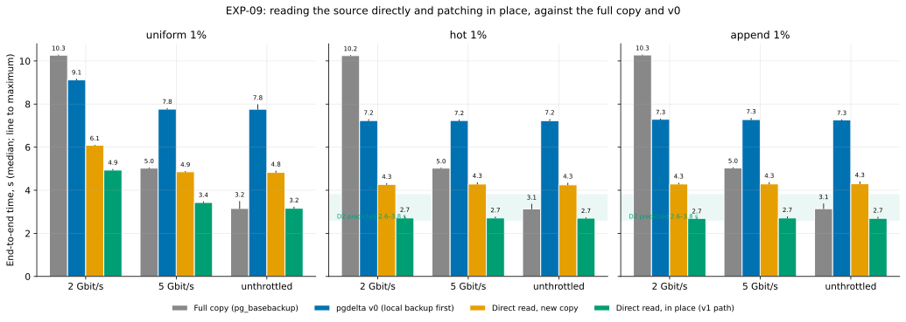

# EXP-09: How fast is pgdelta when it reads the source's files directly?

Status: **done** (results below, October 23, 2026). Pre-registered October 23, before the code for it ran, and **revised the same day before running** after an independent review (see [Revisions before running](#revisions-before-running-october-23-2026)). This is test T8a of the [decision ledger](../DECISIONS.md#t8a-cold-direct-read-without-a-capture), plus a first look at v1's whole path.

## Question

In [EXP-04b](EXP-04b-default-checksums.md), staged pgdelta first took a local backup S on the source. That capture alone took 4.0 s, as long as a whole full copy. v1 is meant to read the source's data files directly instead. Two questions:
1. **T8a, as registered:** with today's destination write path, how fast is pgdelta when its sender reads a stopped source's data directory directly, with caches dropped on both sides?
2. **v1's path:** how fast is it when, in addition, it patches the old copy in place, which owner decision O5 now allows? This is the first measurement of both v1 changes together. It still leaves out backup mode and a busy source; those are T8.

The answer decides whether Omni's same-region HA rebuild, on a fast link, is within reach.

## Setup

The two `n2-standard-8` VMs of EXP-04b (local NVMe, ext4, Debian 12, PostgreSQL 17.11) and the same harness ([experiments/network/](../../experiments/network/README.md)):
- scale 70 (2.1 GB), uniform, hot and append workloads at 1%, EXP-01's seed;
- CRC32C manifests, the page cache emptied on both VMs before every run, link shaping on both VMs, wire bytes counted at the interface, 5 repeats in random order.

| Method | Source side | Destination side | Timed |
|---|---|---|---|
| `full` | `pg_basebackup` (one stream) | new directory | the copy |
| `pgdelta` | captures S, as in EXP-04b | new copy O, today's write path | capture (with the receiver's start beside it) + transfer |
| `pgdelta_direct` | **reads the stopped data directory** (`--source-kind datadir`) | new copy O, today's write path | receiver start + transfer |
| `pgdelta_direct_inplace` | reads the stopped data directory | **patches B in place** (`--in-place`) | receiver start + transfer |

- **Untimed set-up for the direct methods:** stop the source cluster cleanly before the cache drop, and restart it after the run. For the in-place method, also copy B0 to a fresh B before the cache drop.
- **Direct reads** apply PostgreSQL's base-backup exclusions and take only the WAL segment holding the shutdown checkpoint.
- **Every output is verified, untimed:** byte-identical to the source's files, then started and queried.
- **Speeds:** 2 Gbit/s, 5 Gbit/s and unthrottled.
- **Engine:** today's, pinned: 4 worker processes on each end, copy-then-patch, pipelined verification, fsync in the main loop.

## Predictions

| ID | Prediction | Source |
|---|---|---|
| D1 | `pgdelta_direct`'s transfer phase is 0.2–0.6 s slower than the warm staged transfer: in the same session, staged `pgdelta`'s transfer phase at the same speed. At 5 Gbit/s that's 4.6–5.0 s for local changes and 5.2–5.6 s for uniform, against the full copy's 5.07 s in EXP-04b. | ledger (T8a) |
| D2 (revised) | `pgdelta_direct_inplace` takes **2.6–3.8 s in total (median) for local changes (hot, append) at every speed**. For uniform it takes 3.0–4.5 s unthrottled and is faster than the full copy at 5 and 2 Gbit/s. *First version: 2.0–3.2 s for local changes and 2.8–4.2 s for uniform; its derivation was wrong (see revisions).* | added here |
| D3 (revised) | Without the capture, the source VM's CPU per run falls to 4.5–7.5 CPU-seconds for the direct methods, against 9.74–10.81 for staged pgdelta (EXP-04b's medians at 2 Gbit/s, 5 Gbit/s and unthrottled). The full copy uses 2.6. *First version: 3.5–6.5, below what hashing alone needs.* | added here |
| D4 | The direct methods send within 2% of staged pgdelta's wire bytes. | added here |

**Clarification of D1, written before running.** T8a's numbers are for the transfer phase, the part that changes when the sender reads the data directory instead of S. Without a capture, the receiver's start-up (about 0.2 s in EXP-04) is no longer hidden. So each run reports both the transfer phase and the total, and D1 is judged on the transfer phase, as registered. Comparisons with the full copy are reported for both.

**How D2 was estimated (revised).** The destination's pool of 4 processes hashes B (2.1 GB) and then re-reads all of B to verify it (another 2.1 GB, mostly from the page cache), 4.2 GB in all. EXP-04b's timers show that pool hashing 2.1 GB in 1.14–1.37 s with warm inputs, so at least 2.3–2.75 s. Add about 0.3 s for the receiver's start, the pool's start and the remote launch: about 2.6–3.1 s warm. Here both sides read cold, adding D1's 0.2–0.6 s: about 2.8–3.7 s. In place, almost nothing is copied or flushed for local changes. Uniform writes about 610 MB of pages and flushes them.

**What would change the plan** (revised; every comparison uses per-workload medians of `total_s` against the same session's full copy, with the maximum reported beside it):
- **T8a's rule (registered):** if `pgdelta_direct` is slower than the full copy at 5 Gbit/s in all three workloads, fix the write path (T3) before building backup-mode reads. The rule is judged on `total_s`: receiver start plus transfer, each including its remote-launch overhead, as the full copy's time does. T3 runs anyway, in the same session ([EXP-10](EXP-10-write-path.md)).
- **HA within reach:** if `pgdelta_direct_inplace`'s median unthrottled is at most 0.9 times the full copy's for both hot and append, v1's design can serve Omni's same-region HA rebuild on these VMs. The next tests are then T8 (backup mode on a live, busy source), T9 (beyond RAM) and a run on persistent disks.
- **HA out on fast links:** if it is not faster than the full copy (ratio 1.0 or more) unthrottled for hot or for append, v1 targets DR's slower links first.
- **Between 0.9 and 1.0:** undecided. Decided after T2 (the fastest durable full copy) and T5 (a faster hash).
- **Every HA conclusion is provisional until T2 runs.** The comparison here is with one `pg_basebackup` stream, which is what Omni uses today. Rule 3 asks for the fastest durable copy, and T2 predicts a parallel one at 2.0–3.0 s.

## Revisions before running (October 23, 2026)

An independent reviewer checked this write-up against the ledger and EXP-04b's data before anything ran. Changes:
- **D2's derivation was wrong.** It called EXP-04b's hash timers "cold reads included", but they were warm: S had just been written by the capture, and B had been prefetched. The corrected estimate and range are above. The first range (2.0–3.2 s for local changes) was infeasible below about 2.6 s.
- **D2's rules left outcomes undecided.** A result between the old range's top and the full copy fitted neither. The rules now use ratios to the same session's full copy, with an explicit undecided band.
- **D3's lower bound** was below what hashing 2.1 GB at 0.54–0.55 GB/s per core needs (about 3.8 CPU-s), before cold-read kernel time and sending.
- **D1's reference** moved from EXP-04b's transfer to the same session's staged transfer at the same speed. Where the relative part (0.2–0.6 s slower) and the absolute numbers disagree, the relative part governs.
- **The direct methods run with `--prefetch-basis on`,** like every other pgdelta method. It has almost no time to work, since the sender connects as soon as the receiver listens.
- **Statistics:** every prediction and rule uses per-workload medians of 5 runs. Maxima are reported beside them.

## Limitations, known before running

- **The source is stopped,** so this measures read and hash speed, not backup mode, WAL streaming or the effect of a live workload. That is T8.
- **The fastest full copy measured is still a single `pg_basebackup` stream.** A parallel full copy (T2) may be faster.
- **2.1 GB fits in RAM.** Re-reading B to verify it comes from the page cache here; beyond RAM it is a second disk pass (T9).
- **Local NVMe is faster than GKE's default balanced persistent disk.** On a persistent disk, both the full copy and pgdelta may be limited by the disk's throughput instead.

## Results

**Run:** October 23, 2026, 21:07–22:09 UTC, as part of the sweep `exp09-10-ext4` shared with [EXP-10](EXP-10-write-path.md).
- **Runs:** 255, every one passed verification. EXP-09's share is 180: four methods × three speeds × three workloads × 5 repeats. EXP-10 adds 75 and shares the 15 unthrottled v0 runs.
- **Machines:** two `n2-standard-8` VMs in `us-central1-a` (`us-central1-b` was out of stock), four local NVMe SSDs each, ext4. The link measured 14.9–15.2 Gbit/s unthrottled.
- **Data:**
  - [exp09-10-runs.csv](data/exp09-10-runs.csv) (one row per run, with pgdelta's own phase timers);
  - [exp09-10-cells.csv](data/exp09-10-cells.csv) (medians and maxima per workload, speed and method).
- **Analysis:** [analysis/exp09_10.py](../../analysis/exp09_10.py), written and dry-run on smoke data before these results existed.

**This session ran faster than EXP-04b's.** On the same machine type and CPU model:
- the full copy took 3.13–3.15 s unthrottled here, against 3.96–4.13 s in EXP-04b (about −22%);
- v0's local backup took 3.3 s, against 4.0 s (−17%);
- pgdelta's own transfer and hashing sped up less, about 8–10%.

Some of it was measured:
- the VMs' cold disk reads were about 11% faster (2,165 and 2,234 MB/s, against 1,951 and 2,012);
- the link was about 6% faster (median 15.1 against 14.3 Gbit/s);
- disk writes measured the same.

The deployed code also differed, and the physical hosts were different (another zone). Neither explains the uneven speed-up in full. So every comparison below is within this session, against this session's full copy. **The HA ratio below depends on the hosts.**

**End-to-end time** (median of 5 runs, maximum in brackets, seconds):

| Workload | Link | Full copy | v0 (local backup first) | Direct read, new copy | **Direct read, in place (v1 path)** |
|---|---|---:|---:|---:|---:|
| uniform | 2 Gbit/s | 10.27 (10.28) | 9.12 (9.16) | 6.09 (6.09) | **4.94** (4.97) |
| | 5 Gbit/s | 5.03 (5.04) | 7.77 (7.80) | 4.86 (4.87) | **3.43** (3.47) |
| | unthrottled | 3.15 (3.48) | 7.76 (7.98) | 4.83 (4.89) | **3.16** (3.22) |
| hot | 2 Gbit/s | 10.25 (10.25) | 7.24 (7.28) | 4.27 (4.31) | **2.71** (2.78) |
| | 5 Gbit/s | 5.03 (5.03) | 7.24 (7.27) | 4.29 (4.35) | **2.71** (2.76) |
| | unthrottled | 3.13 (3.35) | 7.23 (7.29) | 4.25 (4.33) | **2.71** (2.73) |
| append | 2 Gbit/s | 10.28 (10.29) | 7.29 (7.31) | 4.29 (4.33) | **2.69** (2.71) |
| | 5 Gbit/s | 5.03 (5.05) | 7.28 (7.34) | 4.29 (4.36) | **2.71** (2.77) |
| | unthrottled | 3.14 (3.37) | 7.26 (7.27) | 4.30 (4.39) | **2.70** (2.75) |

### Verdict on each prediction

| ID | Prediction | Result |
|---|---|---|
| D1 | Direct read's transfer phase 0.2–0.6 s slower than v0's in the same session | **Failed in 6 of 9 cells, on the good side.** Reading cold costs only 0.14–0.25 s, so six cells fall below the range. The absolute numbers registered for 5 Gbit/s (4.6–5.0 s local, 5.2–5.6 s uniform) are also missed, low: 4.14 and 4.71 s. As registered, the relative part governs. |
| T8a rule | If direct read is slower than the full copy at 5 Gbit/s in all three workloads, fix the write path first | **Doesn't fire.** Direct read beats the full copy at 5 Gbit/s in every workload (4.29–4.86 s against 5.03 s) |
| D2 | v1 path: 2.6–3.8 s for local changes at every speed; uniform 3.0–4.5 s unthrottled and faster than the full copy at 5 and 2 Gbit/s | **Held.** Local 2.69–2.71 s at every speed; uniform 3.16 s unthrottled, and 3.43 against 5.03 s and 4.94 against 10.27 s. The revision's reasoning was too pessimistic, though: it put a floor of about 2.6 s warm (2.8–3.7 s cold) under the in-place path, assuming hashing B and re-reading it add up. They overlap in the worker pool, so the cold v1 path came in at 2.7 s, under that derivation |
| HA rule | v1 path ≤ 0.9 × full copy, unthrottled, for both hot and append | **Holds against today's single-stream copy: 0.86 for both** (2.71 against 3.13 s; 2.70 against 3.14 s). Even the slowest v1 run (2.75 s) beat the full copy's median. **But T2's registered prediction is a durable parallel copy in 2.0–3.0 s; against that the ratio would be 0.90–1.35, and the rule would not hold.** So the registered expectation is that this verdict reverses against the fastest copy, unless T13 or T5 make v1 faster |
| D3 | Source CPU 4.5–7.5 CPU-s for the direct methods | **Held:** 5.3–6.0, against 8.2–8.9 for v0 and 1.6–1.9 for the full copy in this session (VM-wide medians at all three speeds) |
| D4 | Wire bytes within 2% of v0's | **Held:** within 0.14% |

**For scattered changes on the fastest link, v1's path only ties** (3.16 against 3.15 s). It wins at 5 Gbit/s and below.

### Where v1's time goes now

The median run (repeat 4, 2.71 s end to end), hot 1%, unthrottled, from pgdelta's own timers:

| Part | Seconds | Note |
|---|---:|---|
| Receiver start-up | 0.16 | |
| Source hashes its data directory (cold) | 1.39 | runs alongside the next row |
| Destination hashes B (cold) | 1.62 | |
| Destination re-reads B to verify it | 1.75 busy | shares the 4 worker processes with hashing B, and overlaps it by at least 1 s; the main loop waited 0.62 s for it at the end |
| Writing changed pages, fsync, commit | 0.13 | of which fsync 0.07 |

**The destination's four worker processes are now the bottleneck.** They make two overlapping passes over B: hashing it (1.62 s wall) and re-reading it to verify (1.75 s busy). The destination used about 9 CPU-seconds in a 2.55 s transfer, so its workers are nearly saturated. The re-read is served from the page cache here, since 2.1 GB fits in 32 GB of RAM. The writing that dominated v0 is gone. The next levers are already in the queue:
- **T13:** verify the bytes as they're written instead of re-reading them;
- **T5:** a faster hash.

Neither is measured yet.

## Conclusions

1. **For a stopped source, reading its files directly removes v0's local backup almost for free.** Reading both sides cold costs only 0.14–0.25 s more than the staged path, where S came warm from the capture and B had been prefetched. The source also uses about a third less CPU. Two things this didn't measure:
   - the clean stop itself (0.10 s, untimed);
   - backup mode on a live source, which is what v1 needs (T8).
2. **Reading directly and patching in place together beat this session's single-stream full copy on every link speed for local changes** (2.7 against 3.1 s unthrottled, ratio 0.86). They tie for scattered changes on the fastest link. By the registered rule, **the HA case is within reach against the full copy Omni uses today, on these VMs.** The margin is small (0.12 s under the 0.9 line), and four things could undo it:
   - **T2:** its registered prediction is a durable parallel copy in 2.0–3.0 s. Against that, the ratio would be 0.90–1.35 and the HA rule would fail.
   - **T9:** beyond RAM, the verification re-read becomes a disk pass, predicted at 0.5 s or more per GB.
   - **T8:** reading a live source in backup mode, with WAL and a workload.
   - **Persistent disks,** where both methods may be limited by the disk.
3. **On slower links the gap is large:** 2.7 against 10.3 s at 2 Gbit/s for local changes, and 4.9 against 10.3 s for scattered ones.
4. **The bottleneck has moved** from the destination's writing to its two passes over B, the second of them from the page cache. That ranks T13 (verify while writing) and T5 (a faster hash) higher for v1. Both also bear on point 2.
