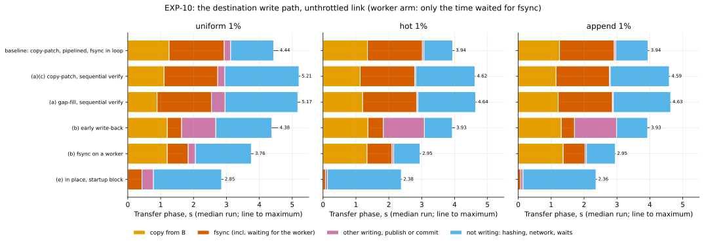
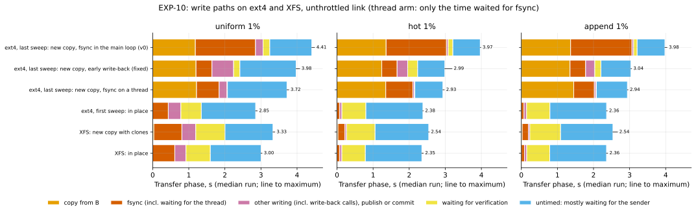

# EXP-10: Where should pgdelta's destination time go?

Status: **done** (results below, October 23–24, 2026; every results section was corrected after an independent recheck: the ext4 arms on October 23, arm (d) and the write-back rerun on October 24). Pre-registered October 23, 2026, before the code for its new arms ran. This is test T3 of the [decision ledger](../DECISIONS.md#t3-destination-write-path-on-linux). Its arms, predictions and decision rules were written there on October 23. Changes since are dated below. The write-up was **revised the same day, still before running,** after an independent review; see [Revisions before running](#revisions-before-running-october-23-2026).

## Question

On the VMs, writing the new copy O is pgdelta's largest cost. For local changes it takes 3.3–3.5 s of a 4.3–4.5 s transfer: about 1.6 s copying B's bytes into O and 1.7 s flushing them to disk ([ledger, "Where pgdelta's time goes"](../DECISIONS.md#where-pgdeltas-time-goes-on-the-vms)). None of the choices behind that was ever compared with an alternative on Linux:
- copy-then-patch against gap-fill;
- where the fsync happens;
- pipelined against sequential verification;
- clones on a filesystem that has them;
- patching B in place instead of building O.

## Setup

The two `n2-standard-8` VMs, the harness and data of EXP-04b:
- scale 70, uniform, hot and append at 1%, CRC32C manifests;
- caches dropped before every run, wire bytes at the interface;
- **unthrottled link** (where the write path matters most);
- **5 repeats** in random order, reporting the median and the maximum.

Every arm uses 4 worker processes on each end. Every arm is staged, as in EXP-04b: S is captured with the receiver started beside it, and the receiver prefetches B while it waits. Only the destination's write path changes between arms. The figure of merit is the **transfer phase** (S warm, B prefetched), with the receiver's write phase (`rebuild_seconds`), copy and fsync timers beside it.

| Arm | Method | Rebuild | Verify | fsync | Filesystem |
|---|---|---|---|---|---|
| baseline | `pgdelta` | copy-patch | pipelined | main loop | ext4 |
| (a), (c) | `pgdelta_seq` | copy-patch | sequential | main loop | ext4 |
| (a) | `pgdelta_gapfill_seq` | gap-fill | sequential | main loop | ext4 |
| (b) | `pgdelta_fsync_wb` | copy-patch | pipelined | early write-back (`sync_file_range`) | ext4 |
| (b) | `pgdelta_fsync_worker` | copy-patch | pipelined | on a background thread | ext4 |
| (e) | `pgdelta_inplace` | in place (B is patched, no copy) | pipelined | main loop | ext4 |
| (d) | `pgdelta`, `pgdelta_inplace`, `rsync_8k`, and `incremental` with `pg_combinebackup --copy-file-range` | as above | | | **XFS** with reflinks, on the destination only |
| reference | `full` | | | | ext4, and XFS in the second sweep |

- **In-place runs** first copy B0 to a fresh B, untimed, before the cache drop. On XFS the copy uses `cp --reflink=never`, so B doesn't share blocks with B0. B is refreshed in place behind a startup block: `global/pg_control` is moved aside until the commit, so PostgreSQL can't start on a half-refreshed copy (owner decision O5). **In place, verification still re-reads all of B,** like the new-copy arms, so every arm verifies the same bytes.
- **Clones on XFS:** on XFS, `copy_file_range`, which copy-then-patch already uses, clones extents instead of copying bytes, and `cp -a` (rsync's preparation) clones too.
- **Sweep order: ext4, then XFS, then ext4 again.** The XFS sweep reformats only the destination's array and rebuilds its trials from scratch, since B0 predates each trial's workload. The source stays on ext4. The last ext4 sweep repeats only `full` and `pgdelta`, so session drift can be told apart from the filesystem. Source-side timings (the capture, the source's hashing, the link rate) are reported for every sweep as drift checks. [EXP-09](EXP-09-direct-read.md) and EXP-08's pgBackRest sweep run before the reformat.

## Predictions and decision rules (registered in the ledger)

| Arm | Prediction | Decision rule |
|---|---|---|
| (a) | copy-patch and gap-fill are within 0.3 s of each other either way (both with sequential verification) | a gap over 0.3 s picks the default |
| (b) | moving the fsync saves 1.0–1.6 s | a saving under 0.5 s leaves the fsync where it is |
| (c) | sequential verification adds at least 1.0 s | keep pipelined unless it is slower by more than 0.1 s anywhere |
| (d) | on XFS, pgdelta's write phase drops to 0.6 s or less for local changes and about 1 s for uniform | a write phase over 1.5 s on XFS rules out reflinks |
| (e) | patching in place gives a local-change transfer of 2.0–2.8 s | a saving under 1 s keeps the new-copy design |
| (f), (g) | dropped (owner decision O9: only meaningful while a capture exists) | |

### Notes written before running

- **(b) has two alternatives.** The prediction and its rule apply to the better of early write-back and the fsync worker, compared with the baseline. Each is reported.
- **(e) changed with O5.** The ledger's arm (e) was "patching B in place with an undo journal, if T1 allows". T1 is closed: B may be patched in place, and a failed refresh leaves B blocked rather than rolled back. So the arm has no undo journal. The registered prediction and rule are unchanged. *(Revised before running: the first version said the result should sit at the low end of 2.0–2.8 s. The ledger's own estimate of the pool's remaining work, 2.7–2.8 s of hashing B and re-reading it, points to the top end instead.)*
- **(d) adds two predictions for the other methods that can clone:** on XFS, rsync's preparation (`cp -a` of B0 plus `sync -f`) takes under 0.5 s, against 3.4–3.5 s on ext4 in EXP-04b. `pg_combinebackup --copy-file-range` takes under 2.5 s, against about 3.8 s with `--copy`. *(Revised before running: the first version predicted `--clone` under 1.0 s. But in PostgreSQL 17, `--clone` applies only to whole-file copies, and files with changed blocks, about 1.05 GB here, are rebuilt block by block.)*
- **The "write phase"** is the receiver's `rebuild_seconds`: copying from B, writing pages, the fsyncs, and the final directory fsyncs and publication or commit. With the fsync worker, the time the commit waits for outstanding fsyncs is reported separately as `fsync_wait_seconds` and counted in the transfer phase.

## Revisions before running (October 23, 2026)

An independent reviewer checked the first version before anything ran. Changes:
- **Statistics.** Every prediction and rule is judged per workload, on medians of 5 runs; maxima are reported beside them. Rule (c)'s "slower by more than 0.1 s anywhere" means in any workload's median, not in a single tail run. Rule (a) applies per workload; if workloads disagree, the default follows local changes, Omni's likelier case. (d)'s "about 1 s" for uniform means 0.7–1.3 s.
- **(d) could mislead on the write phase alone.** With clones, O's unpatched pages aren't in the page cache, so the pipelined verifier reads about 2.1 GB from disk. On ext4 that time was hidden behind a 3.3 s write phase. So (d) reports the transfer phase and `verify_wait_seconds` beside the write phase. Reflinks are adopted for a workload only if both hold: the write phase is at most 1.5 s, and the median transfer phase is at least 0.5 s faster than `pgdelta` on ext4 in the sweeps before and after.
- **In-place copies on XFS** use `--reflink=never` (see Setup), and the sweep order controls for session drift.
- **The incremental arm** uses `--copy-file-range`, with a revised prediction (see the notes above).
- **(e)'s expectation** points to the top of the range, not the bottom.

### Added October 23, after the ext4 results and before the rerun

- **Early write-back reruns.** The first sweep's write-back arm started write-back only after each whole-file copy (see the results below). The fixed engine starts it every 8 MiB during the copy (commit e569d55).
- **When and with what:** the arm reruns in the final ext4 sweep, next to that sweep's baseline (`pgdelta`) and fsync-thread arm, with the same workloads, 5 repeats, unthrottled.
- **What stays the same:** prediction (b) and its rule. Judged on the rerun's own baseline, the fixed write-back arm replaces the first measurement of write-back only.

## Limitations, known before running

- **The staged frame keeps S warm and B prefetched**, as in EXP-04b, so the arms differ only in the destination's write path. [EXP-09](EXP-09-direct-read.md) measures the same in-place path with cold direct reads.
- **One VM pair and 2.1 GB, which fits in RAM.** The fsync costs here reflect local NVMe; persistent disks behave differently.
- **XFS and ext4 runs are separate sweeps** on the same machines, so session drift is confounded with the filesystem. The `full` reference runs in both sweeps to show any drift.

## Results: the ext4 arms (a), (b), (c) and (e)

**Run:** October 23, 2026, in the sweep `exp09-10-ext4` shared with [EXP-09](EXP-09-direct-read.md); see EXP-09 for the machines, the data files and why this session is faster than EXP-04b. EXP-10 adds 75 runs (five arms × three workloads × 5 repeats, unthrottled) and shares its baseline's 15 runs with EXP-09. Every one was verified byte for byte against S. Arm (d), on XFS, runs in a later sweep.

**Transfer phase** (median of 5, maximum in brackets, seconds):

| Arm | uniform | hot | append |
|---|---:|---:|---:|
| baseline: copy-then-patch, pipelined verification, fsync in the main loop | 4.44 (4.57) | 3.94 (3.99) | 3.94 (3.98) |
| (a), (c) copy-then-patch, sequential verification | 5.21 (5.24) | 4.62 (4.63) | 4.59 (4.61) |
| (a) gap-fill, sequential verification | 5.17 (5.24) | 4.64 (4.66) | 4.63 (4.64) |
| (b) early write-back (`sync_file_range`) | 4.38 (4.57) | 3.93 (4.00) | 3.93 (3.98) |
| (b) fsync on a background thread | 3.76 (3.82) | 2.95 (2.97) | 2.95 (2.96) |
| **(e) in place, startup block** | **2.85** (2.90) | **2.38** (2.39) | **2.36** (2.38) |

**The receiver's own timers explain the differences** (hot; medians of each timer over the 5 runs):
- **Baseline:** the write phase took 3.07 s: 1.35 s copying B's bytes and 1.67 s flushing.
- **Early write-back:** the fsync fell to 0.43 s, but the write phase stayed at 3.08 s, because the flushing moved into the `sync_file_range` calls (1.2 s). **The arm didn't test what it was meant to.** For a file copied whole from B, which is most files with local changes, write-back started once, after the copy, not every 8 MiB during it. So the hot and append runs made only 6–7 calls of about 300 MB each (uniform: 150 calls; per-run counts are in the receiver logs). The code is fixed (commit e569d55, with a regression test), and the arm reruns in the final ext4 sweep.
- **fsync on a thread:** the thread spent 1.63 s flushing, but the main loop waited only 0.66 s for it, and the write phase fell to 2.15 s. The figure shows the median run's own values (it waited 0.76 s in that run).
- **In place:** nothing is copied. The write phase is 0.14 s, of which 0.08 s is fsync (0.79 and 0.43 s for uniform, which writes about 610 MB of pages).

### Verdict on each prediction

| Arm | Prediction | Result | Decision rule |
|---|---|---|---|
| (a) | copy-then-patch and gap-fill within 0.3 s of each other | **Held:** differences of −0.03, +0.02 and +0.04 s | no gap over 0.3 s, so the default stays copy-then-patch |
| (b) | moving the fsync saves 1.0–1.6 s (the better of the two alternatives) | **Failed in all three workloads, hot and append by 10 ms or less:** the fsync thread saved 0.68 s (uniform), 0.99 s (hot) and 0.996 s (append). Early write-back first saved 0.01–0.06 s, but as implemented it didn't overlap flushing with copying (see above); its rerun with the fix replaces that measurement and saved 0.43–0.98 s, still less than the thread ([rerun](#results-arm-d-on-xfs-and-the-early-write-back-rerun)) | the saving is over 0.5 s in every workload, so **the fsync moves to a background thread** for the new-copy mode, the better alternative in every workload |
| (c) | sequential verification adds at least 1.0 s | **Failed:** it added 0.65–0.77 s | pipelined is never slower, so **pipelined stays the default** |
| (e) | in place, a local-change transfer of 2.0–2.8 s | **Held:** 2.36 and 2.38 s, saving 1.56–1.58 s against the baseline in all three workloads. The revision's expectation of "the top end" was wrong: hashing B and re-reading it overlap in the pool instead of adding up | the rule compares with the baseline, and the saving is over 1 s, so **in place becomes the candidate default**, as T1's failed prediction anticipated. Against the improved new-copy mode (fsync on a thread) the gap is smaller: 0.57–0.59 s for local changes and 0.90 s for uniform |
| (d) | XFS clones | **held**; see the XFS section below | **adopt reflinks** where the filesystem has them |

### What this changes

- **v1's write path is in place.** It is 1.56–1.58 s faster than today's new-copy path, and 0.57–0.59 s (local changes) or 0.90 s (uniform) faster than the new-copy path with the fsync thread. That second gap is below rule (e)'s 1 s threshold. So choosing in place as the default rests on the registered comparison with the baseline, plus O5 allowing it. In place is also the only arm that removes both of v0's write costs (the copy and most of the flush) and needs no room for a second copy. The new-copy mode stays for copies that must survive a failed refresh; there, the fsync moves to a background thread.
- **The two numeric failures were overestimates:** the fsync thread saved 0.7–1.0 s, not 1.0–1.6 s, and pipelined verification saved 0.65–0.77 s, not over 1.0 s. Both rules still pick the same option as their predictions did.

## Results: arm (d) on XFS, and the early write-back rerun

**Runs:** October 24, 2026.
- **Sweep `exp10-xfs`** (00:07–00:25 UTC): the destination's array reformatted as XFS with reflinks; full, `pgdelta`, `pgdelta_inplace`, `rsync_8k` and `incremental_cfr`; 75 runs.
- **Sweep `exp10-ext4b`** (00:26–00:42 UTC): the array reformatted back to ext4 with `startup.sh`'s options (`infra/gcp/reformat_dest_ext4.sh`); full, `pgdelta`, the fixed `pgdelta_fsync_wb` and `pgdelta_fsync_worker`; 60 runs.
- **Verification:** every run passed. On XFS, every `pgdelta` new copy shared 1.51 GB (uniform) or 2.09–2.10 GB (local) of blocks with another file, B0, as intended, and every in-place B shared none. rsync's new copy shared 1.00 GB (uniform) and 2.09–2.10 GB (local). The incremental output shared 2.12 GB, nearly all of it, but the measure (FIEMAP's shared flag) doesn't say with which file, so that includes the incremental backup's own files.
- **Analysis:** `analysis/exp09_10.py`, function `exp10_later`, which prints the tables and the derived figures below and writes the runs to [exp10-later-runs.csv](data/exp10-later-runs.csv).

How to read it: each bar is one arm's median run, split by the receiver's own timers. The three ext4 new-copy bars come from the last sweep, so they compare within one session; the ext4 in-place bar comes from the first. The orange and red parts are the copy and the flush that dominated v0; the fixed write-back's own flushing calls aren't timed separately and fall in the purple part. For local changes, in place and the new copy on XFS write almost nothing, so what is left is hashing B, the network, and waiting for the verifier (yellow). The bottom two bars show why a new copy on XFS ends up close to in place but not equal: for local changes its write phase is 0.11–0.13 s longer and its verifier wait 0.13–0.18 s longer; for uniform the gap is mostly the write phase (1.18 against 0.91 s, most of it fsync).

**No session drift** (unthrottled medians, seconds unless stated). The source side and the full copy are the same in all three sweeps:

| | ext4, first sweep | XFS | ext4, last sweep |
|---|---:|---:|---:|
| full copy, uniform / hot / append | 3.15 / 3.13 / 3.14 | 3.13 / 3.16 / 3.14 | 3.13 / 3.13 / 3.17 |
| full copy maxima | 3.48 / 3.35 / 3.37 | 3.36 / 3.36 / 3.37 | 3.36 / 3.25 / 3.41 |
| capture, staged pgdelta (range over workloads) | 3.30–3.33 | 3.28–3.31 | 3.29–3.30 |
| source hashing | 1.04–1.05 | 1.05–1.06 | 1.05 |
| measured link, Gbit/s | 15.04–15.08 | 14.98–15.01 | 14.97–15.05 |
| full copy's source CPU, CPU-s | 1.63–1.70 | 1.67–1.72 | 1.64–1.67 |
| pgdelta transfer, uniform / hot / append | 4.44 / 3.94 / 3.94 | **3.33 / 2.54 / 2.54** | 4.41 / 3.97 / 3.98 |

**pgdelta on XFS against ext4** (median, maximum in brackets, seconds; ext4 is the first sweep; the last sweep's medians are within 0.1 s of it on every timer, and its maxima within 0.16 s):

| Workload | | transfer | write phase | copying B | fsync | hashing B | main loop waiting for verification |
|---|---|---:|---:|---:|---:|---:|---:|
| uniform | ext4 | 4.44 (4.57) | 3.11 (3.29) | 1.24 (1.44) | 1.67 (1.68) | 1.18 (1.20) | 0.15 (0.18) |
| | **XFS** | **3.33** (3.38) | **1.18** (1.22) | 0.03 (0.03) | 0.78 (0.80) | 1.19 (1.23) | **0.84** (0.87) |
| hot | ext4 | 3.94 (3.99) | 3.07 (3.11) | 1.35 (1.38) | 1.67 (1.68) | 1.17 (1.22) | 0.14 (0.21) |
| | **XFS** | **2.54** (2.56) | **0.27** (0.28) | 0.03 (0.03) | 0.20 (0.20) | 1.42 (1.44) | **0.78** (0.81) |
| append | ext4 | 3.94 (3.98) | 3.01 (3.09) | 1.31 (1.37) | 1.66 (1.68) | 1.16 (1.18) | 0.17 (0.24) |
| | **XFS** | **2.54** (2.67) | **0.25** (0.27) | 0.03 (0.03) | 0.18 (0.19) | 1.40 (1.44) | **0.85** (0.93) |

**The other methods on XFS** (median, maximum in brackets, seconds):

| Workload | in place, transfer | new copy minus in place | rsync's prep (`cp -a` of B0) | `pg_combinebackup --copy-file-range` | incremental, end to end |
|---|---:|---:|---:|---:|---:|
| uniform | 3.00 (3.03) | 0.33 | 0.05 (0.06) | 1.26 (1.26) | 2.83 (2.84) |
| hot | 2.35 (2.39) | 0.19 | 0.05 (0.06) | 1.16 (1.18) | 1.36 (1.39) |
| append | 2.36 (2.39) | 0.18 | 0.05 (0.06) | 1.02 (1.03) | 1.22 (1.24) |

**With clones, the write phase almost disappears for local changes, but only about half of that saving reaches the transfer.** Copying B's bytes takes 0.03 s instead of 1.2–1.4 s, and the fsync falls to 0.2 s (0.8 s for uniform). For local changes the write phase falls by 2.76–2.84 s, but the transfer by only 1.40–1.44 s. The rest is waiting that the long write phase used to hide. Against either ext4 sweep, the main loop waits 0.64–0.72 s longer for the verifier, and 0.68–0.77 s longer on everything else, mostly hashing B, which itself took 0.23–0.25 s longer:

| Workload | Arm | transfer | write phase | waiting for verification | other waits (hashing B, network) |
|---|---|---:|---:|---:|---:|
| hot | ext4, new copy | 3.94 | 3.07 | 0.14 | 0.73 |
| | XFS, new copy | 2.54 | 0.27 | 0.78 | 1.49 |
| | XFS, in place | 2.35 | 0.13 | 0.66 | 1.56 |
| append | ext4, new copy | 3.94 | 3.01 | 0.17 | 0.76 |
| | XFS, new copy | 2.54 | 0.25 | 0.85 | 1.44 |
| | XFS, in place | 2.36 | 0.14 | 0.66 | 1.56 |

(Medians, seconds; "other" is the transfer minus the write phase and the wait for verification.)

In place shows almost the same waits with no clones at all: 0.65–0.66 s for the verifier, on ext4 and on XFS. So the risk the revision registered, that a cloned O's pages must be read from disk to verify them, accounts for only 0.13–0.18 s of the wait. The rest appears whenever the write phase is short. Even so, building a complete new copy on XFS is within 0.19 s of patching in place for local changes, and 0.33 s for uniform, while leaving B intact.

| | Prediction | Result | Rule |
|---|---|---|---|
| (d) | the write phase on XFS drops to ≤ 0.6 s for local changes and about 1 s (0.7–1.3) for uniform | **Held:** 0.25–0.27 s and 1.18 s | write phase ≤ 1.5 s and transfer ≥ 0.5 s faster than ext4 in the sweeps before and after: **holds in every workload** (1.08–1.44 s faster), so **reflinks are adopted** where the filesystem supports them |
| (d), rsync | rsync's prep takes < 0.5 s on XFS | **Held:** 0.05 s | |
| (d), incremental | `pg_combinebackup --copy-file-range` < 2.5 s | **Held:** 1.02–1.26 s | |

**Early write-back, rerun with the fix** (last ext4 sweep, transfer phase; median, maximum in brackets, seconds):

| Workload | baseline | early write-back (fixed) | fsync on a thread |
|---|---:|---:|---:|
| uniform | 4.41 (4.49) | 3.98 (4.07), saves 0.43 | 3.72 (3.77), saves 0.69 |
| hot | 3.97 (3.98) | 2.99 (3.19), saves 0.98 | 2.93 (2.97), saves 1.03 |
| append | 3.98 (4.04) | 3.04 (3.05), saves 0.94 | 2.94 (2.96), saves 1.04 |

- **Fixing write-back took its saving from 0.01 s to 0.94–0.98 s for local changes.** The first measurement was the bug, not the idea.
- **Prediction (b), judged as the dated note registered it:** the fixed write-back replaces only the first write-back measurement, and the fsync thread keeps its first-sweep result. The better alternative then saves 0.68 s (uniform), 0.99 s (hot) and 0.996 s (append), so **(b) failed in all three workloads**, as the ext4 verdict above says.
- **For local changes the thread's saving sits on the 1.0 s line.** In this sweep it saved 1.03–1.04 s, in the first sweep 0.99–1.00 s, and pooling both sweeps' 10 runs gives 1.005–1.010 s. The rerun's figure is a same-session comparison only. Most of its 0.04 s gain over the first sweep is the baseline's median rising by 0.03 s; the thread's fell by only 0.01–0.02 s. The rerun baseline for append also spread over 0.35 s (two low runs, 3.69 and 3.81 s), against 0.08 s in the first sweep; for hot it spread about as much in both sweeps (0.11 and 0.13 s).
- **The rule moves the fsync,** and the background thread is the better alternative in all three workloads: by 0.05–0.25 s against the fixed write-back in the same sweep.

## Conclusions

1. **v1's write path is in place behind a startup block,** decided by arm (e). It is 1.56–1.58 s faster than v0's new copy, and 0.6–0.9 s faster than a new copy with the fsync on a thread.
2. **Where the old copy must survive a failed refresh** (owner decision O5's option), the new-copy mode moves its fsync to a background thread. On a filesystem with reflinks (XFS, which RHEL and Rocky installs of Omni can use) it also clones B. That makes the safe mode nearly as fast as in place. GKE's default ext4 has no reflinks, so there the safe mode costs 0.6–0.9 s.
3. **Copy-then-patch stays the default for the new-copy mode.** It ties gap-fill on ext4, and it is the mode that turns into clones on XFS.
4. **Pipelined verification stays:** sequential is 0.65–0.77 s slower.
5. **Two predictions were overestimates (b, c), and one of this write-up's revised expectations was wrong ("the top end" of (e)),** for the same reason as EXP-09's revised floor under in place: hashing B and re-reading it overlap instead of adding up. In every case the registered rule still picked the same option as the prediction did.
