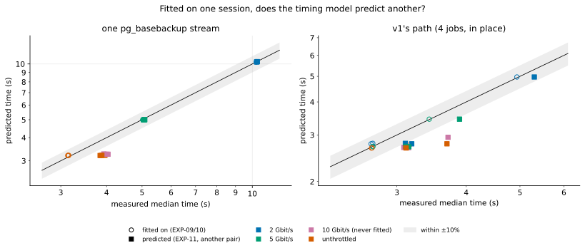

# EXP-16: Can a timing model fitted on one session predict another?

Status: **done October 25, 2026, on existing data; exploratory, not pre-registered.** No VMs were used. It asks whether a simple physical model, calibrated by cheap measurements, can stand in for repeating whole experiments in second sessions, before an experiment is designed around one (the owner's question, October 25: "Is there a smaller model we can use?").

## Question

Between the October 23 sessions (EXP-09/10) and the October 24 session (EXP-11, a new VM pair), v1 ran 14–18% slower and one `pg_basebackup` stream 22–30% slower unthrottled, with the same code. That "session drift" is why the [rule 11 audit](../FIRMNESS.md) wanted every deciding result run twice. If a model explains the drift from things a short benchmark can measure, a second full session isn't needed: the benchmark is.

## Method

Script: [`analysis/model_check.py`](../../analysis/model_check.py). Data: [exp09-10-runs.csv](data/exp09-10-runs.csv) (the fit) and [exp11-runs.csv](data/exp11-runs.csv) (the test). Cells both share: 2 Gbit/s, 5 Gbit/s and unthrottled, three change patterns, two arms; EXP-11 adds 10 Gbit/s, which the fit never saw.

- **One `pg_basebackup` stream:** time = c + bytes ÷ min(L, S). L is the run's own measured one-stream link rate, S the tool's own ceiling. Fitted: c = 1.47 s, S = 9.74 Gbit/s.
- **v1's path (4 jobs, in place):** time = c_pattern + bytes ÷ L. One fixed cost per change pattern, for the reading, hashing and writing that don't depend on the link. Fitted: append 2.66 s, hot 2.67 s, uniform 2.42 s.

Each EXP-11 run is predicted from its own L and wire bytes; the cell's median prediction is compared with its median time.

## Results

*How to read it:* each point is one cell (an arm, a pattern and a speed). Hollow points are the session the model was fitted on, filled points the other VM pair a day later. Points on the black line were predicted exactly; the grey band is ±10%.

| | Fit session (EXP-09/10) | Test session (EXP-11), uncalibrated | Test, v1's fixed work scaled by its CPU-seconds |
|---|---|---|---|
| `pg_basebackup`, link-bound (2 and 5 Gbit/s) | within 0.8% | **within 0.2–1.7%** | – |
| `pg_basebackup`, compute-bound (10 Gbit/s, unthrottled) | within 2.2% | 17–19% too fast | – |
| v1, every cell | median 0.8% (one cell 13%) | 6–25% too fast (median 13.4%) | **median 2.0%** (largest 13.4%) |

- **Wherever the link sets the pace, the model transfers across sessions within 2%.** The 10 Gbit/s cells, never fitted, behave as the model's compute-bound side says they should.
- **Wherever CPU or disk sets the pace, the second pair was slower,** and its runs used more CPU-seconds for the same work: `pg_basebackup` (unthrottled, hot) 1.65 → 2.36 CPU-s on the source and 1.78 → 2.68 on dest; v1 5.49 → 6.14 and 9.97 → 11.22. Both sessions report the same CPU model and platform (Intel Cascade Lake), kernel and manifest checksum, so the difference is in the hosts behind the VMs; the records can't say more.
- **Scaling v1's fixed work by its CPU-seconds closes the gap:** median error 2.0%. The one cell still off (13%) is uniform changes unthrottled, where 610 MB are written and the model has no disk-write term; it is off in the fit session too.

## What it shows, and how strongly

- **Shown (on these two sessions):** session drift lived in the compute part, not the link part, and a measure of compute speed absorbs most of it for v1.
- **Not shown:** that a benchmark taken *before* the runs predicts as well. Here the CPU-seconds came from the runs themselves, so the calibration is partly circular. `pg_basebackup`'s unthrottled gap isn't explained by CPU-seconds alone (they rose 43–51%, its time 23%), so it needs a disk or memory term too.
- **What follows:** a session can start with a two-minute calibration (hash a fixed buffer on each core, read and write a fixed file, one link test) and the model can then put every result on a common footing. A second full session is needed only where a decision's margin is smaller than what the calibrated model can't explain. This is the basis for the single-VM lab proposed to the owner on October 25: deliberate, controlled variation of disk, CPU, memory and network, with each run's compute speed measured, instead of waiting for drift between days.
