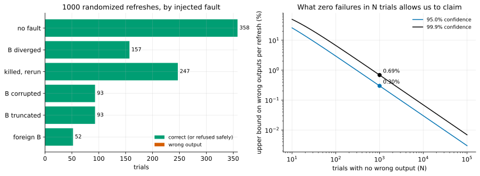

# EXP-17: Does v1's refresh ever produce a wrong copy? A randomized fault campaign

Status: **done October 25, 2026: 1,000 trials, no wrong output** (results below). Pre-registered before running; its kill rule was revised twice after the campaign's stop rule fired on safe behaviour (both revisions are recorded below, before the run that counts). Local (a Mac, PostgreSQL 17); no VMs. It is the correctness campaign of the lean plan (rule 11 as clarified October 25): many cheap randomized trials with an independent check of every output, giving a stated bound on the failure rate instead of a handful of runs.

## Question

When v1's path refreshes an old copy B in place from a stopped source S (`pgdelta local --in-place --source-kind datadir`), is the result ever wrong without the tool saying so, across random workloads and injected faults? And does a refresh killed part-way always leave B unstartable until a rerun completes (G1)?

## The claim it can support

If N independent trials give no wrong output, then the probability that a refresh drawn from this trial distribution produces a wrong output is below 1 − 0.001^(1/N) ≈ 6.9 / N with 99.9% confidence (and below 3.0 / N with 95%). The claim holds for this distribution of workloads, faults and sizes on this platform; it says nothing about conditions outside it (a live source, other filesystems, TB sizes), which T8 and T13 cover.

## Each trial (seeded; the seed is the trial number)

1. **S and B** start as APFS clones of one template cluster (`initdb`, `pgbench -i -s 3`, about 50 MB, one system identifier).
2. **S's workload:** S is started and given a random mix: `pgbench` transactions (100–3,000), `CREATE TABLE ... AS`, `DROP TABLE`, `TRUNCATE`, `VACUUM FULL` of a random table (a new relfilenode), `CREATE INDEX`, bulk `UPDATE` and `DELETE` of a random range, and `CHECKPOINT`s, in random order. A logical digest of S is taken (every user table: row count and the md5 of its rows sorted as text; the schema's md5), then S is stopped cleanly.
3. **A fault, drawn at random:**

| Fault | Share | What is done | Pass means |
|---|---:|---|---|
| none | 35% | – | exit 0 and a correct B |
| diverged | 15% | B gets its own random workload first (an ex-primary's writes) | exit 0 and a correct B |
| kill | 25% | the refresh is SIGKILLed after a random 0.02–2.0 s, then rerun | after a kill that came before completion, B refuses to start; after the rerun, exit 0 and a correct B |
| corrupt | 10% | 1–16 random bytes overwritten in 1–3 random relation files of B | exit 0 and a correct B |
| truncate | 10% | a random relation file of B truncated to a random length, or deleted | exit 0 and a correct B |
| foreign | 5% | B is a separate `initdb` with the same workload (another system identifier), run without `--reuse-any-basis` | the refresh refuses (non-zero exit) and B is left byte-for-byte as it was |

4. **"A correct B"** is judged independently of pgdelta's own verification: every regular file of S outside the excluded set (PostgreSQL's base-backup exclusions, which `pgdelta/datadir.py` lists, and `pg_wal/`) is byte-identical in B, B has no relation file S lacks, and B starts and gives S's logical digest exactly.

## Outcomes and rules

- **A wrong output** (exit 0 with a B that fails the check, or a refusal that changed B) stops the campaign; the trial is kept with its seed for reproduction. It is reported, its cause found, and the bound above is not claimed.
- **A harness error** (the template, a server that won't start for reasons outside pgdelta) is recorded and the trial is not counted.
- **The stop rule:** run for 3 hours or 1,000 counted trials, whichever comes first; the count and the bound are what that gives.
- **The prediction:** no wrong output; every killed run that hadn't finished leaves B unstartable.

## Limitations, known before running

A stopped source only (v1's live read is T8). One small cluster (about 50 MB), so files are few and short; size-dependent bugs above a few relation segments wouldn't show. macOS's APFS, not ext4 or XFS. One PostgreSQL version. The faults are the ones listed; a crash of the host (not just the process) isn't simulated, and that remains T13c's.

## The smoke run and the checker's negative controls (October 25, before the campaign)

- **Harness fixes, none in pgdelta:** `pg_ctl` needed its `start` operation; PostgreSQL on macOS needs `LC_ALL` set; the schema digest needed a cast (`relkind::text`); a workload expression overflowed a 32-bit integer; and the loop now stops after 10 harness errors in a row instead of retrying them.
- **Smoke:** 6 trials in 17.5 s (none, corrupt, foreign, kill among them), every one passing; the killed run had not finished and B refused to start until the rerun completed. At about 3 s a trial, the stop rule's 1,000 trials come before its 3 hours.
- **Negative controls on the checker** (a checker that can't fail shows nothing): from an exact copy of S, one bit flipped in a random relation file was caught in 20 of 20 tries; an extra relation file in B was caught; one changed row was caught by the logical digest and by the byte check.

## The first campaign stopped at trial 30 (October 25; rule 8)

- **What fired:** trial 30's refresh was killed 35 ms after it started, before it finished, and B then started; the kill rule as registered ("after a kill that came before completion, B refuses to start") counts that as a failure, so the campaign stopped as registered, after 31 trials (30 passing). The rerun's output was correct (byte-identical, logical digest equal). No bound is claimed from that campaign.
- **What it was:** reproduced with trial 30's workload and kills at 5 to 500 ms, B's files hashed before and after each kill. Every kill up to 120 ms (8 of 8) came before pgdelta had changed anything in B (0 files changed; the interpreter was still starting), and B started as the intact old copy, which is safe. The kills at 200 and 300 ms came after pgdelta had changed 3 and 20 files and written its `pgdelta-incomplete.json` marker with `global/pg_control` moved aside, and B refused to start, as designed. The kill at 500 ms came after the refresh had finished.
- **The rule was wrong, not the tool:** the property G1 needs is that B never starts in a changed but unfinished state. The registered rule also forbade starting an untouched B.
- **The revision, before the rerun:** for a kill before completion, B's files are hashed before the refresh and after the kill. If B changed, it must refuse to start; if it didn't, it is the old copy and may start. Everything else is unchanged. The campaign reruns from trial 0 with the same seeds, as registered (1,000 counted trials or 3 hours).

## The rerun stopped at trial 48 (October 25; rule 8, a second time)

- **What fired:** trial 48's refresh was killed at 456 ms, after it had changed B, and B started; the revised rule ("if B changed, it must refuse to start") counts that as a failure. The rerun's output was correct. No bound is claimed from this run either (48 of 49 passing).
- **What it was:** reproduced with kills from 300 to 550 ms, checking at each kill whether B already equalled S. Up to 400 ms (4 of 4) B was part-patched, with the marker present and `pg_control` moved aside, and it refused to start. From 420 ms (6 of 6) B was already byte-identical to S, the marker gone and `pg_control` back: pgdelta had published and the process was still exiting. B started, as the complete new copy.
- **The rule was still wrong:** "changed" is not "unfinished". The property, as pgdelta's own help states it, is that B starts only as the old copy or as the complete new one, never in between.
- **The second revision, before the next run:** at each kill before the process exits, B is classed as old (unchanged), new (byte-identical to S over the checked files) or partial (neither). Only a partial B must refuse to start. Everything else is unchanged; the campaign reruns from trial 0.
- **Read with care:** the pre-registered kill rule was revised twice after seeing results. Both revisions narrow it to the exact property and were found by the campaign's own stop rule; neither touched an output check, and no wrong copy has appeared in 80 trials so far.

## Results (the third run, 02:20–03:04 UTC, 1,000 trials)

*How to read it:* left, every counted trial by its injected fault, green where the refreshed copy was correct (or, for a foreign basis, refused with B untouched); right, the upper bound on the failure rate that N trials with no wrong output support, at 95% and 99.9% confidence, with this campaign's N marked.

| Fault | Trials | Correct | Median refresh |
|---|---:|---:|---:|
| none | 358 | 358 | 0.48 s |
| B diverged (its own writes first) | 157 | 157 | 0.47 s |
| killed part-way, then rerun | 247 | 247 | 1.05 s |
| B corrupted (1–16 bytes in 1–3 files) | 93 | 93 | 0.48 s |
| B truncated or a file deleted | 93 | 93 | 0.48 s |
| foreign B (another cluster) | 52 | 52 refused, B unchanged | 0.33 s |
| **all** | **1,000** | **1,000** | |

Data: [exp17-summary.csv](data/exp17-summary.csv); raw trials in `results/correctness/exp17/` (git-ignored); analysis `analysis/exp17.py`.

- **No wrong output, no harness error.** Every refreshed copy was byte-identical to S over the checked files, had no extra relation file, started, and gave S's logical digest exactly.
- **Kills:** 49 of the 247 landed before the process exited. At the kill, B was partial in 30, the old copy in 16 and already the complete new copy in 3. **All 30 partial copies refused to start**; the 19 others started as a whole database, old or new. The other 198 kills came after the process had exited.
- **Foreign bases:** 52 of 52 refused, with B byte-for-byte unchanged.

## What it supports

- **The bound:** with no wrong output in 1,000 independent trials, a refresh drawn from this mix of workloads and faults produces a wrong copy with probability **below 0.69% at 99.9% confidence (below 0.30% at 95%)**. More trials tighten it in proportion: 10,000 would give 0.069%, about 8 hours of a laptop.
- **G1's crash promise held in every case seen:** 30 of 30 copies caught part-way refused to start, across the whole refresh, not just one moment (the kill times were drawn from 0.02–2 s, and the reproductions in the two sections above add 6 more).
- **Detection of a bad basis:** corrupted, truncated, missing and diverged pages in B were all found and replaced from S (343 trials), as the design says every reused page is checked by its digest.
- **Scope, unchanged from the limitations:** a stopped source, a 50 MB cluster, macOS's APFS, PostgreSQL 17, and process kills, not host crashes. It says nothing yet about v1 reading a live source (T8), large files, or a power loss (T13c).
