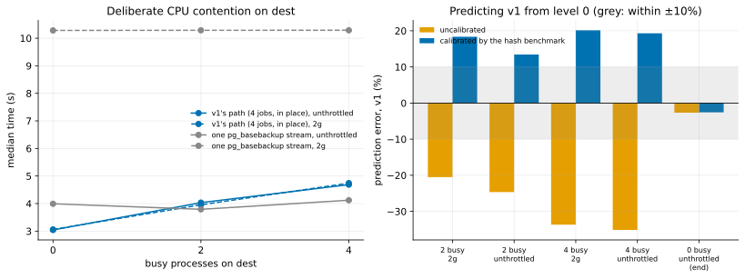

# EXP-18: Does a calibration taken before the runs predict how deliberate CPU contention slows each tool?

Status: **done October 25, 2026 (03:08–03:31 UTC; 42 runs, all verified; VMs deleted): the deciding prediction failed as registered;** results below. Pre-registered before running. One VM pair, about 1 hour. It is the first test of the lean plan's lab (rule 11 as clarified October 25): vary a condition on purpose instead of waiting for it between sessions, and see whether a short benchmark predicts its effect.

## Why

[EXP-16](EXP-16-timing-model-check.md) found that the drift between sessions lived in compute speed: scaling v1's fixed work by its own CPU-seconds cut the prediction error on another VM pair from 13.4% to 2.0%. But those CPU-seconds came from the runs themselves. If a two-minute benchmark taken *before* the runs predicts as well, then compute speed can be measured at the start of any session, on any machine, and timing claims can be stated per unit of measured speed instead of repeated across sessions.

## Design

- **VMs:** one fresh pair of `n2-standard-8` (local NVMe RAID 0, ext4, Debian 12), `us-central1-a`, EXP-11's harness and settings.
- **Contention, set on purpose:** 0, 2 and 4 busy processes on dest (`agent.py burn`, nice 0) for the whole of each level. Dest is where v1's pool works hardest (EXP-09). The levels run in that order.
- **Calibration at each level, before its runs and under its contention:** `calibrate.py` on dest, keyed BLAKE2b over 8 KiB pages for 3 s with 1 and with 4 processes (pages per second).
- **Runs at each level:** `full` (one `pg_basebackup` stream) and `pgdelta_direct_inplace` (v1, 4 jobs, in place), hot 1% changes, at 2 Gbit/s and unthrottled, 3 repeats, order seed 18; 12 runs per level, 36 in all.

## The model, fixed now

From level 0 only:
- v1: time = c × (H0 ÷ H) + bytes ÷ L, where c is level 0's median time less bytes ÷ L (its fixed work), H is the calibration's 4-process hash rate at the level and H0 at level 0, L the run's measured link rate.
- `full`: time = c_f + bytes ÷ min(L, S), with c_f and S from level 0 as in EXP-16 (contention on dest is predicted not to matter to it, so c_f is not scaled).
- The **uncalibrated** prediction is the same with H = H0.

## Predictions

1. With 4 busy processes the 4-process hash rate on dest falls by 25–50% (8 vCPUs are 4 cores with two hyperthreads each).
2. v1's median time grows with contention, by 15–60% at 4 busy processes, and by less than 10% at 2.
3. **The calibrated model predicts v1's median time at levels 2 and 4 within 10% in every cell; the uncalibrated one misses by more than 10% at level 4.** This is the deciding prediction.
4. `full`'s time changes by less than 10% at every level (its dest work is light).

## What follows

- **If 3 holds:** a calibration benchmark is a valid way to carry timing results across machines and load. Later lab experiments state their results per measured hash rate and disk speed, and a second session is run only where a decision's margin is inside the calibrated model's error.
- **If it fails:** the residual is reported per cell, the model's missing term is named from the run records (phase timers, CPU-seconds), and timing claims stay per session.

## Limitations, known before running

One pair, one session, one VM type. Contention is synthetic (busy loops), not a real neighbour's mix of memory and cache traffic; disk and memory contention aren't varied here. Levels run in a fixed order, so a slow drift within the hour would mix with contention; level 0 is repeated at the end (3 runs of each arm, unthrottled) to check for it.

## Results

One fresh pair in `us-central1-a`, created 03:08 and deleted 03:31 UTC (about 23 minutes, about 0.40 USD). 42 runs, every one verified. Data: [exp18-cells.csv](data/exp18-cells.csv); raw sweeps in `results/exp04/exp18-*` (git-ignored); analysis `analysis/exp18.py`. Two harness slips were fixed before any run counted: the calibration file was first written into the sweep's output folder, which the harness refuses, and the driver's log reported `date`'s exit status instead of the harness's.

*How to read it:* left, each arm's median time against the number of busy processes on dest; right, the error of each model's prediction of v1's median, fitted on level 0 alone (grey: within ±10%).

| Level (busy on dest) | Hash rate, 4 processes | v1 unthrottled | v1 at 2 Gbit/s | `full` unthrottled | `full` at 2 Gbit/s |
|---|---:|---:|---:|---:|---:|
| 0 | 292,531 pages/s | 3.044 s | 3.061 s | 3.993 s | 10.282 s |
| 2 | 193,942 (−33.7%) | 4.035 s | 3.955 s | 3.792 s | 10.287 s |
| 4 | 158,634 (−45.8%) | 4.688 s | 4.742 s | 4.122 s | 10.288 s |
| 0, at the end | 292,236 (−0.1%) | 3.124 s | – | 3.926 s | – |

## Verdict on each prediction

| # | Prediction | Verdict |
|---|---|---|
| 1 | The 4-process hash rate falls 25–50% with 4 busy processes | **Held** (−45.8%) |
| 2 | v1 grows 15–60% at 4 busy, under 10% at 2 | **Failed in part:** +54–55% at 4, but +29–33% at 2 |
| 3 | **The calibrated model is within 10% in every cell at levels 2 and 4; the uncalibrated one misses by more than 10% at 4** | **Failed:** calibrated, +13.4% to +20.1% (it overshoots); uncalibrated, −20.5% to −35.1%. The second half held |
| 4 | `full` changes by less than 10% at every level | **Held** (−5.0% to +3.2%) |
| – | Drift check: level 0 again at the end | Held: within 2.7%, and the hash rate returned to baseline after every level (within 0.3%) |

By the registered rule, a calibration benchmark is **not** shown to carry timing results across load on its own: scaling all of v1's fixed work by the hash rate overshoots.

## Beyond the registered rules (exploratory; chosen after seeing the data)

- **A two-part model fits:** if only part of v1's fixed work scales with the hash rate, fitting that part on level 2 alone gives 1.95 s of 3.04 s (64%) unthrottled and 1.76 of 3.06 s (57%) at 2 Gbit/s, and predicts level 4, which the fit never saw, within 0.0% and −4.1%. It is one session and a model picked after the fact, so it is a hypothesis to register and test on fresh data (another contention level, or disk contention), not a result.
- **A finding for the positioning (one session, synthetic contention):** with the destination idle, v1 beat one `pg_basebackup` stream unthrottled (3.04 against 3.99 s). With 2 busy processes on the destination it was slower (4.04 against 3.79 s), and with 4 too (4.69 against 4.12 s), while `pg_basebackup` barely moved. v1's lead on fast links depends on an idle destination CPU. At 2 Gbit/s the link still dominates `pg_basebackup` (10.3 s), and v1 stays far ahead at every level.
