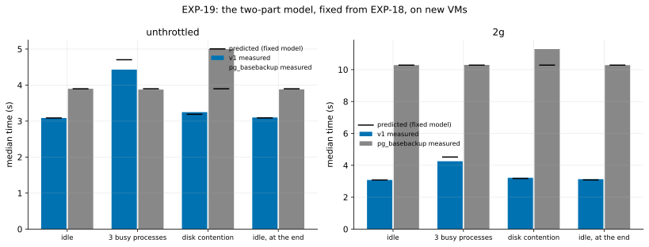

# EXP-19: Does EXP-18's two-part model predict a contention level it never saw, and where does it stop?

Status: **done October 25, 2026 (VMs 03:35–03:56 UTC; 48 runs, all verified; deleted): the deciding prediction held.** Pre-registered before running. One fresh VM pair, about 25 minutes. It tests the hypothesis [EXP-18](EXP-18-calibrated-contention.md) found after the fact, on new VMs and a new level, with the model's numbers fixed here.

## The model, fixed now from EXP-18

v1's time at a contention level = t₀ × [(1 − f) + f × H₀ ÷ H] (+ the link term, which is nearly constant here), where t₀ is v1's median time at level 0 in this session, H₀ and H the destination's 4-process hash rates (`calibrate.py`) at level 0 and at the level, and **f = 0.64 unthrottled and 0.57 at 2 Gbit/s**, the share of v1's time that scaled with the hash rate in EXP-18. Nothing is fitted in this session except t₀ and H₀. `full` is predicted not to change.

## Design

- One fresh `n2-standard-8` pair in `us-central1-a`, EXP-18's harness and runs: `full` and `pgdelta_direct_inplace`, hot 1%, 2 Gbit/s and unthrottled, 3 repeats per cell.
- Levels in order: **0**; **3 busy processes** on dest (a CPU level EXP-18 didn't run); **disk contention** (a background loop of 4 GiB direct writes to dest's data disk); **0** again.
- Before each level's runs, under its condition: the hash benchmark and a 1 GiB direct write and read on dest's data disk.

## Predictions

1. **At 3 busy processes, the fixed model predicts v1's median within 10% in both cells.** This is the deciding prediction.
2. Under disk contention the hash rate stays within 5% of level 0, so the model predicts no change in v1; v1 slows anyway by more than 10%, because its reads and writes share the disk. That is, the model's scope ends at CPU, and the disk benchmark shows how far the disk slowed.
3. `full` changes by less than 10% at 3 busy processes; under disk contention it slows, since it writes 2.1 GB to that disk.
4. Level 0 at the end is within 5% of the first.

## What follows

- **If 1 holds:** CPU contention's effect on v1 is predictable across sessions from a 3-second benchmark, and v1's fast-link verdicts can be stated per measured destination hash rate (for example, "v1 beats one `pg_basebackup` stream unthrottled while dest's 4-process hash rate stays above X").
- **If it fails:** the share f isn't stable across sessions, and the exploratory model is dropped.
- **Prediction 2 decides the next term:** if disk contention slows v1, the next lab test adds the disk benchmark to the model.

## Limitations

One session, one VM type, synthetic contention. Levels run in a fixed order; level 0 is repeated at the end.

## Results

*How to read it:* bars are each arm's median time at each level (blue v1, grey one `pg_basebackup` stream); black ticks are the predictions of the model fixed before the run. Data: [exp19-cells.csv](data/exp19-cells.csv); analysis `analysis/exp19.py`; raw sweeps `results/exp04/exp19-*` (git-ignored).

| Before each level | Hash rate, 4 processes | Direct write | Direct read |
|---|---:|---:|---:|
| idle | 292,161 pages/s | 1,556 MiB/s | 2,159 MiB/s |
| 3 busy processes | 160,569 (−45.0%) | 1,560 | 1,960 |
| disk contention | 277,694 (−5.0%) | 784 (−50%) | 1,409 (−35%) |
| idle, at the end | 291,924 (−0.1%) | 1,560 | 1,977 |

| # | Prediction | Verdict |
|---|---|---|
| 1 | **At 3 busy processes the fixed model predicts v1 within 10%** | **Held:** +6.2% unthrottled (4.703 predicted, 4.429 measured) and +6.2% at 2 Gbit/s (4.516, 4.252) |
| 2 | Disk contention leaves the hash rate within 5% and slows v1 by more than 10% | **Failed in part:** the hash rate fell 5.0%, at the limit, but v1 slowed only 4.4–5.3% (3.078 → 3.214 s, 3.085 → 3.247 s), and the model, seeing only the hash rate, predicted it within 1.8% |
| 3 | `full` changes by less than 10% at 3 busy processes and slows under disk contention | **Held:** −0.1% and +0.6%; under disk contention +9.8% at 2 Gbit/s (10.279 → 11.286 s) and +28.3% unthrottled (3.896 → 4.999 s) |
| 4 | Level 0 at the end within 5% of the first | **Held:** within 1.6% |

## What it shows

- **The two-part model carries across VM pairs.** With its share fixed from EXP-18's session (f = 0.64, 0.57), a 3-second hash benchmark on this session's new VMs predicted v1's time under a contention level neither session had seen within 6.2%. That is the calibration EXP-18's simple form failed to give: a short benchmark taken before the runs, not the runs' own CPU-seconds.
- **The two tools are bound by different resources on dest.** v1, hot 1% changes, is bound by CPU: 45% less hash rate made it 38–44% slower, while halving the disk's write rate cost it 4–5%. One `pg_basebackup` stream is bound by the disk: CPU contention didn't touch it, the slower disk cost it up to 28%.
- **So the fast-link comparison depends on what else runs on dest.** Unthrottled, with dest idle v1 took 3.09 s against `pg_basebackup`'s 3.90; with 3 busy processes 4.43 against 3.87 (v1 slower, as EXP-18 also found); with the disk contended 3.25 against 5.00 (v1's lead grows). At 2 Gbit/s v1 stays far ahead in every case (3.1–4.3 s against 10.3–11.3).
- **Scope:** two sessions of one VM type, hot 1% changes (uniform changes write far more and may be disk-bound for v1 too), synthetic contention.
