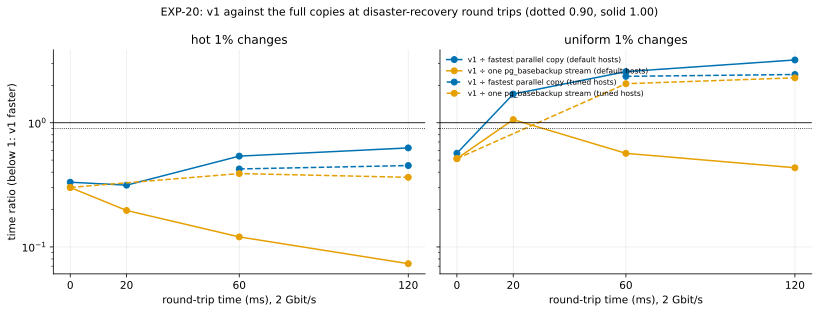

# EXP-20: Does v1 still beat the full copies at disaster-recovery round trips? (EXP-13's deciding cells, one session)

Status: **done October 25, 2026 (VMs 03:59–05:11 UTC; 126 runs, all verified; deleted): "local changes only" at 20, 60 and 120 ms; EXP-13's expectation for scattered changes failed by a wide margin.** Pre-registered before running; analysis `analysis/exp20.py` committed before the data (4336895). One fresh VM pair, about 1.5 hours. It runs only the cells that decide [EXP-13](EXP-13-latency-transport.md)'s DR verdict, under the lean plan (rule 11 as clarified October 25). EXP-13's side arms (TLS, window and high-churn arms, `pg_probackup`, 1 Gbit/s, uniform 10%) and its rule 11 revision stay on hold; they are what remains of EXP-13 after this.

## Why this subset

v1's first target is DR's slower, longer links ([What T2 settled](../DECISIONS.md#what-t2-settled-october-24-2026)). Every measurement so far was at 0.1 ms. EXP-13's DR verdict decides whether v1's lead holds at 20, 60 and 120 ms, and it needs only v1, the fastest parallel copy (rule 3's yardstick) and one `pg_basebackup` stream (the released tool's), at 2 Gbit/s, on default and tuned hosts.

## Design

- **VMs:** one fresh `n2-standard-8` pair in `us-central1-a` (EXP-13's zone), local NVMe RAID 0, ext4, Debian 12; EXP-13's harness (the emulated WAN, `wan.sh`; the control path on port 2222; the sysctl guard).
- **Conditions** (`RATE:RTT_MS:HOST`): 2:0, 2:20, 2:60, 2:120 on default hosts; 2:60 and 2:120 tuned (128 MiB TCP buffers); the tuned anchor 2:0:tuned.
- **Arms:** `pgdelta_direct_inplace` (v1, 4 jobs, `--window 4`), `full` (one `pg_basebackup` stream), `parcopy8` (8-stream parallel copy, the bound) at every condition but the tuned anchor, and `parcopy16` at 2:120:default, where 8 streams may be window-limited (as EXP-13 registered).
- **Workloads:** hot and uniform 1% (scale 70, about 2.1 GB). **3 repeats.** Order seed 200.
- **Durability and verification:** EXP-13's, unchanged; check (a)'s limit 4 MiB at every window length (EXP-13's value until its smoke item 18).
- **A short smoke first** (scale 5, hot, 1 repeat, at 2:0:default, 2:60:default and 2:60:tuned), then the run.

## Predictions and rules: EXP-13's, as registered

- **The verdict** is EXP-13's DR verdict, rows in order, from `R_fast` (v1 ÷ the fastest durable parallel copy) and `R_F0` (v1 ÷ one `pg_basebackup` stream) per workload and host setting at each r. EXP-13's expected outcome (E13): at 20 ms, row 1 ("holds as shipped"); at 60 ms, row 2 ("holds with tuned buffers"): hot 0.33–0.57 on default hosts, uniform 1% 1.43–1.94 on default and 0.57–0.80 tuned; at 120 ms, row 2 or Undecided; the qualifier (v1 faster than one `pg_basebackup` stream) at every r.
- **What this subset can't judge:** EXP-13's rules that need its side arms (TLS, windows, the high-churn fallback, `pg_probackup`, 1 Gbit/s, uniform 10%) are "not run here".
- **Under rule 11 as clarified,** one session decides a row only where its deciding ratio sits clear of the drift measured between sessions (EXP-16: up to about 20% in CPU-bound cells; within 2% where the link sets the pace). A deciding ratio inside that margin of 0.90 or 1.00 is reported as provisional.

## Limitations

An emulated WAN in one zone (EXP-15 would check a real link). One session, one VM type. 2.1 GB in page cache.

## Results

A scale-5 smoke run (9 runs, all passing) checked the emulation first: 60.3 ms round trips at the 60 ms setting; one default TCP stream at 0.43 Gbit/s there (EXP-13's model: 0.42), 1.91 with tuned buffers.

*How to read it:* each line is v1's median time divided by a full copy's at the same condition (blue: the fastest parallel copy, rule 3's yardstick; orange: one `pg_basebackup` stream), solid on default hosts, dashed with tuned TCP buffers. Below 1, v1 is faster; the dotted line is EXP-09's 0.90 band. Data: [exp20-cells.csv](data/exp20-cells.csv).

| Workload, condition | v1 | one `pg_basebackup` | fastest parallel copy | R_fast | R_F0 |
|---|---:|---:|---:|---:|---:|
| hot, 0 ms | 3.09 s | 10.28 s | 9.32 s | 0.33 | 0.30 |
| hot, 20 ms | 3.20 | 16.27 | 10.18 | 0.31 | 0.20 |
| hot, 60 ms | 5.35 | 44.44 | 9.94 | 0.54 | 0.12 |
| hot, 120 ms | 6.50 | 88.62 | 10.37 | 0.63 | 0.07 |
| hot, 60 ms tuned | 4.55 | 11.67 | 10.72 | 0.42 | 0.39 |
| hot, 120 ms tuned | 4.79 | 13.17 | 10.59 | 0.45 | 0.36 |
| uniform 1%, 0 ms | 5.31 | 10.32 | 9.35 | 0.57 | 0.51 |
| uniform 1%, 20 ms | 17.34 | 16.37 | 10.19 | 1.70 | 1.06 |
| uniform 1%, 60 ms | 25.49 | 44.98 | 9.89 | 2.58 | 0.57 |
| uniform 1%, 120 ms | 38.36 | 88.43 | 11.99 | 3.20 | 0.43 |
| uniform 1%, 60 ms tuned | 23.97 | 11.63 | 10.15 | 2.36 | 2.06 |
| uniform 1%, 120 ms tuned | 30.38 | 13.22 | 12.43 | 2.44 | 2.30 |

## Verdict: EXP-13's DR rows

| Round trip | Row | Qualifier (v1 faster than one `pg_basebackup` stream, default hosts) |
|---|---|---|
| 20 ms | **3. Local changes only** | no (uniform 1%: 1.06) |
| 60 ms | **3. Local changes only** | yes |
| 120 ms | **3. Local changes only** | yes |

No deciding ratio lies within 20% of its threshold (hot at most 0.63 against 0.90; uniform at least 1.70 against 1.00), so by rule 11 as fixed in the analysis the rows are not provisional for this session. EXP-13's expectation (E13) for uniform 1% failed badly: 0.57–0.80 expected at 60 ms tuned, 2.36 measured. On tuned hosts one `pg_basebackup` stream beat v1 by about 2× for scattered changes.

## Where v1's time went (pgdelta's own timers and the TCP sampler)

- **Sending page data, not round trips.** For uniform 1% (610 MB of pages), the time `send()` blocked grew from 2.3 s at 0 ms to 14.1 s at 20 ms (one of the three runs took 4.7 s), 21.7 at 60 ms, 33.4 at 120 ms; 19.8 and 24.7 with tuned buffers. There were only 19 leaf requests, and every wait for the receiver together came to under 2.5 s.
- **Not the buffers on tuned hosts.** At 60 and 120 ms tuned, v1's connection spent 0 ms limited by the receive window or the send buffer, yet was busy for 21.5 and 27.6 s: it was limited by its congestion window. It retransmitted 32 and 7 segments there (3 and 25 on default hosts, where the receive window also limited it for 4.3 and 14.5 s).
- **A hypothesis, not a result:** the congestion window keeps falling back. Two causes fit: Linux's slow start after idle (on, `tcp_slow_start_after_idle = 1`), which shrinks the window after each pause between v1's bursts of pages, and losses at the emulated bottleneck, from which cubic recovers slowly at long round trips. One `pg_basebackup` stream sends continuously and reached about 1.45 Gbit/s at 60 ms tuned. EXP-21 tests both causes; and if the losses come from the emulator's queue, a real cross-region link (EXP-15) would show it.

## What follows

- **For the positioning:** at DR round trips, v1 holds for local changes (0.31–0.63 of the fastest copy) and is out for scattered ones on these settings, against both yardsticks on tuned hosts. D36 and the DR claim need "local changes" until the cause is known and fixed.
- **Not yet known:** whether a host setting (no slow start after idle, or BBR) or a protocol change (keeping the stream full between files) recovers scattered changes. That decides whether "local changes only" is a property of v1's design or of today's sending loop.
