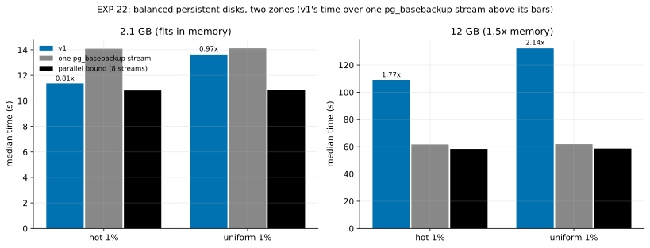

# EXP-22: Does v1's HA lead survive Omni's conditions: persistent disks, two zones, and data larger than memory? (a scale model)

Status: **done October 25, 2026 (VMs 05:20–07:03 UTC; 36 runs, all verified; deleted): v1 is out for HA on persistent disks beyond memory, against both yardsticks (about 2× slower).** Pre-registered before running. One VM pair for about 2 hours. It replaces [EXP-14](EXP-14-ha-persistent-disk.md)'s 30-hour sessions (on hold) with a scale model: instead of a 48.5 GB database on 32 GB machines, a 12 GB database on 8 GB machines, the same ratio of data to memory (1.5×).

## Why

EXP-11's HA verdict, and EXP-18/19's finding that v1 is bound by the destination's CPU while `pg_basebackup` is bound by its disk, all ran on local NVMe in one zone, with 2.1 GB that fits in memory. Omni's HA rebuild runs on GKE's balanced persistent disk, across zones, often at sizes beyond memory. On a slower disk the full copy slows, but v1 also reads both copies once to hash them and re-reads what it verifies; beyond memory, its second pass over B can't come from page cache.

## Design

- **VMs** (set file `infra/gcp/sets/ha.sh`): two `n2-highcpu-8` (8 vCPUs, 8 GB), the source in `us-central1-a` and the destination in `us-central1-b`, each with a 500 GiB balanced persistent disk (140 + 0.28 MiB/s per GiB, about 280 MiB/s) as `/data`, ext4. The round trip and one-stream rate between the zones are recorded by the harness's link tests.
- **Arms:** `pgdelta_direct_inplace` (v1, 4 jobs, in place), `full` (one `pg_basebackup` stream: the released tools' yardstick), `parcopy8` (the 8-stream parallel bound: rule 3's yardstick), unthrottled. Durability and verification as EXP-11.
- **Sizes:** scale 70 (about 2.1 GB, fits in memory) and **scale 400 (about 12 GB, 1.5× memory), which decides**. Workloads hot and uniform 1%; 3 repeats; caches dropped before each run, as in EXP-11.

## Predictions (on the measured disk rate D, from the harness's records)

1. At 12 GB, `full` and `parcopy8` each take within 30% of 12 GB ÷ D plus their 2.1 GB overhead (disk-bound).
2. At 2.1 GB, v1 takes at most `full`'s time for both workloads (its second pass over B still comes from page cache).
3. **At 12 GB, v1 is out:** v1 ÷ `parcopy8` and v1 ÷ `full` are both at least 1.00 for both workloads, because v1 reads both copies and re-reads what it verifies from a disk that caps every arm. This is the deciding prediction.

## What follows (K6: both yardsticks, separately)

- **v1 ≥ 1.00 against both, both workloads:** HA is out as a speed target on Omni-like disks beyond memory, against the fastest copy and the released tools. The positioning drops HA speed and keeps DR for local changes (EXP-20); v1's remaining HA argument would be source slowdown (EXP-12) or bytes, not time.
- **v1 ≤ 0.90 against `full` but not against `parcopy8`:** v1 beats the released tools only; HA's claim names them.
- **v1 ≤ 0.90 against both:** v1's HA lead survives these conditions; EXP-11's "out on fast links" was a local-NVMe effect.
- A deciding ratio within 20% of its threshold is provisional for one session (rule 11, as EXP-20).

## Limitations

A scale model: 12 GB on 8 GB machines, not 1 TB on 64 GB; the ratio holds, the absolute times don't. One session; one disk size (500 GiB); n2-highcpu-8's CPUs are the same family as EXP-11's n2-standard-8.

## Revision before running (October 25, 05:20 UTC)

The region's persistent-disk quota is 500 GB, 100 GB of it held by EXP-21's boot disks, so two 500 GiB data disks don't fit (`create.sh`'s quota check refused the set before creating anything). The data disks are **150 GiB** instead: about 182 MiB/s by Google's formula (140 + 0.28 per GiB), closer to a small GKE default volume. Everything else, and every prediction (stated per measured disk rate D), is unchanged.

## Results

*How to read it:* bars are median times at each size and workload (blue v1, grey one `pg_basebackup` stream, black the 8-stream parallel bound); the number above v1's bar is its time over `pg_basebackup`'s. Data: [exp22-cells.csv](data/exp22-cells.csv); analysis `analysis/exp22.py`; raw `results/exp04/sets/ha/` (git-ignored).

| Size, workload | v1 | one `pg_basebackup` | parallel bound | v1 ÷ `pg_basebackup` | v1 ÷ bound |
|---|---:|---:|---:|---:|---:|
| 2.1 GB, hot | 11.36 s | 14.08 s | 10.82 s | 0.81 | 1.05 |
| 2.1 GB, uniform 1% | 13.63 | 14.11 | 10.86 | 0.97 | 1.26 |
| **12 GB, hot** | **108.98** | 61.63 | 58.32 | **1.77** | **1.87** |
| **12 GB, uniform 1%** | **132.17** | 61.84 | 58.55 | **2.14** | **2.26** |

| # | Prediction | Verdict |
|---|---|---|
| 1 | At 12 GB `full` and `parcopy8` are disk-bound, within 30% of 12 GB ÷ D plus their 2.1 GB overhead | **Held:** both copied 11.9 GB in 58–62 s, about 200 MB/s, the disk's rate (182 MiB/s by Google's formula; one copy's increment from 2.1 to 12 GB is 47.5 s for 9.8 GB) |
| 2 | At 2.1 GB v1 takes at most `full`'s time | **Held:** 0.81 hot, 0.97 uniform (the second barely) |
| 3 | **At 12 GB v1 ÷ `parcopy8` and v1 ÷ `full` are at least 1.00 for both workloads** | **Held:** 1.77–2.26; none within 20% of 1.00, so not provisional |

## Why (pgdelta's own timers, 12 GB)

v1 reads both copies to hash them (S on the source in 57.5–58.0 s; B on the destination in 64.0–71.3 s, about the disk's rate) and then re-reads B to verify it (61–82 s, 23–37 s of it waiting on the disk): beyond memory the second pass over B can't come from page cache, so v1 makes two passes over a capped disk where a full copy makes one write pass. At 2.1 GB the verify pass came from page cache (0.2–0.4 s of waiting), which is why v1 still tied there.

## What follows (K6, both yardsticks)

- **HA is out as a speed target on Omni-like disks once the data exceeds memory, against the fastest copy and against the released tools.** Together with EXP-18/19 (v1 bound by the destination's CPU on fast local disks), v1's HA speed claim survives only for small databases on an idle, fast destination. The positioning drops HA speed; v1's case is DR (EXP-20, EXP-24) and the bytes and source cost it saves.
- **A design lead, not a result:** verifying while writing (T13's arm) or hashing B once into a cached tree (D13) would remove one of the two passes over B; whether either brings v1 under one copy's time here is the question to test, not assume.
- **Scope:** a scale model (12 GB on 8 GB machines, 1.5× memory), one 150 GiB disk size, one session. The ratio of the two passes to one copy is what carries to larger sizes; the absolute times don't.
