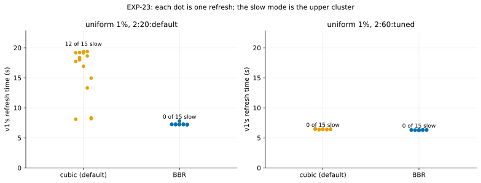

# EXP-23: How often does v1's page stream fall into cubic's slow mode, and does BBR prevent it?

Status: **done October 25, 2026 (05:54–06:27 UTC; 60 runs, all verified): BBR never fell into the slow mode (0 of 30); cubic did in 12 of 15 at 20 ms and 0 of 15 at 60 ms tuned, so the deciding prediction failed as registered.** Pre-registered before running; analysis committed before the data (566beae). On EXP-21's VM pair (still up), about 40 minutes. It turns [EXP-21](EXP-21-tcp-diagnosis.md)'s finding into a rate, with many short repeats instead of sessions on different days.

## Design

- EXP-21's pair and harness. v1 (`pgdelta_direct_inplace`) only, uniform 1% (scale 70, about 610 MB of pages), at **2:60:tuned** and **2:20:default**, the two conditions where cubic's slow mode appeared most; **15 repeats** each.
- Two invocations: **cubic** (as shipped) and **BBR** on both VMs, slow start after idle on in both.
- **The slow mode,** as EXP-21 defined it: the time `send()` blocked over page data is more than twice the time the condition's measured one-stream link rate needs for those bytes.

## Predictions

1. Cubic falls into the slow mode in 3 to 12 of its 15 runs at 2:60:tuned (EXP-20 and EXP-21 together: 4 of 9 with slow start after idle on or off).
2. **BBR falls into it in at most 1 of 15 runs at each condition, and cubic in at least 3 more than BBR at 2:60:tuned.** This is the deciding prediction.
3. Fast-mode runs take the same time under both (within 10%).

## What follows

- **If 2 holds:** pgdelta selects BBR on its own data socket (`TCP_CONGESTION`, falling back to the host's default where BBR isn't allowed), and EXP-20's scattered-change cells are rerun with it: DR's verdict is then judged on the fixed sender.
- **If BBR also falls into a slow mode:** the cause isn't cubic's alone; the next step is to keep the stream full between files, or to send page data on several streams.
- With 15 runs, a 0 of 15 bounds BBR's rate at about 18% (95%); the rate is stated with that bound, not as zero.

## Results

*How to read it:* each dot is one of v1's refreshes (uniform 1%); the slow mode is the upper cluster. Data: [exp23-runs.csv](data/exp23-runs.csv).

| Congestion control | 2:20:default | 2:60:tuned |
|---|---|---|
| cubic | **12 of 15 slow** (95% interval 52–96%); fast 8.20 s, slow 18.65 s | 0 of 15 (0–22%); 6.42 s |
| BBR | **0 of 15** (0–22%); 7.23 s | 0 of 15 (0–22%); 6.31 s |

| # | Prediction | Verdict |
|---|---|---|
| 1 | cubic slow in 3–12 of 15 at 2:60:tuned | **Failed:** 0 of 15 |
| 2 | BBR slow in at most 1 of 15 at each condition, **and cubic at least 3 more than BBR at 2:60:tuned** | **Failed as registered:** BBR 0 and 0, but cubic 0 at 2:60:tuned. The contrast came at 2:20:default instead: 12 against 0 |
| 3 | Fast-mode runs within 10% between the two | Held at 2:60:tuned (6.42 against 6.31 s); at 2:20:default BBR was 12% faster (7.23 against 8.20) |

## What it shows, with EXP-20 and EXP-21

- **BBR has not entered the slow mode in any run: 0 of 42** across EXP-21 and EXP-23 (one-sided 95% bound about 7%), at 20 and 60 ms, on default and tuned hosts, on two VM pairs.
- **Cubic's rate swings with the condition and the pair:** 3 of 3 at 60 ms tuned on EXP-20's pair, 0 of 18 there on this pair (EXP-21 and EXP-23), 12 of 15 at 20 ms on this pair, 2 of 3 at 20 ms on EXP-20's. That is why one session couldn't settle EXP-20's scattered-change verdict.
- **The registered branch:** prediction 2 failed only because cubic didn't fall into the slow mode at the cell named; BBR didn't either, so its "BBR also falls into a slow mode" branch doesn't apply. The next step is the one the pre-registration names for BBR working: rerun EXP-20's scattered-change cells with v1 asking for BBR on its own socket (EXP-24).
