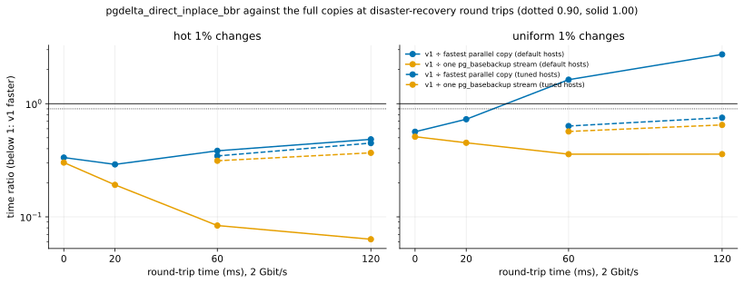

# EXP-24: EXP-20's DR cells again, with v1 asking for BBR on its own connection

Status: **done October 25, 2026 (06:30–07:41 UTC; 150 runs, all verified; VMs deleted 07:43): with BBR on its own socket, v1 holds at every DR round trip, scattered changes included; the same session's cubic v1 was "local changes only" again.** Pre-registered before running. On EXP-21/23's VM pair (still up), about 75 minutes. The follow-up EXP-23 named: [EXP-20](EXP-20-dr-latency-core.md)'s verdict for scattered changes rested on cubic's slow mode, which BBR avoided in 42 of 42 runs.

## Design

- EXP-20's design on EXP-21/23's pair: hot and uniform 1%; 2:0, 2:20, 2:60, 2:120 default and 2:60, 2:120 tuned; `full`, `parcopy8` (and `parcopy16` at 2:120:default); 3 repeats; order seed 240.
- **Both v1s in every repeat:** `pgdelta_direct_inplace` (cubic, the host default, as in EXP-20) and `pgdelta_direct_inplace_bbr` (the same engine, `pgdelta send --congestion-control bbr`: BBR on pgdelta's data socket only).
- **The one host setting:** the source adds BBR to `net.ipv4.tcp_allowed_congestion_control` ("reno cubic bbr"), so an unprivileged sender may choose it. The default stays cubic, for `pg_basebackup`, the parallel copies and every other connection. Each run's statistics record what pgdelta's socket got.

## Predictions

1. Every `pgdelta_direct_inplace_bbr` run gets BBR (pgdelta's statistics) and none is in the slow mode.
2. **EXP-13's DR verdict for v1 with BBR** (EXP-20's analysis, `--v1 pgdelta_direct_inplace_bbr`): row 1 ("holds as shipped") at 20 ms, and row 2 ("holds with tuned buffers") at 60 and 120 ms. At 60 and 120 ms default hosts one stream's 6 MiB window still caps v1, which the parallel copies escape with 8 or 16 streams, so row 1 isn't expected there. This is the deciding prediction.
3. For hot 1%, BBR changes v1 by less than 10% at every condition.
4. Cubic v1 falls into its slow mode in at least 2 of its 3 uniform 1% runs at 2:20:default, as in EXP-23 (12 of 15 there).

## What follows

- **If 2 holds:** pgdelta asks for BBR by default on its data socket, falling back to the host's default (and saying so) where BBR isn't allowed. The DR claim for scattered changes becomes "holds with tuned buffers and BBR allowed on the source", and the deployment note names both host settings. EXP-20's "local changes only" is recorded as a property of cubic's slow mode, not of v1's design.
- **If v1 with BBR still fails row 2 for uniform 1% at 60 ms:** the cause is elsewhere, and EXP-20's verdict stands for scattered changes.
- One session; a ratio within 20% of its threshold is provisional (rule 11, as EXP-20).

## Results

Every one of the 36 `pgdelta_direct_inplace_bbr` runs got BBR on pgdelta's socket (its statistics: requested `bbr`, effective `bbr`, no error); the host's default stayed cubic. Data: `docs/experiments/data/exp20-cells-exp24-inplace.csv` (cubic v1) and `exp20-cells-exp24-bbr.csv` (BBR v1); figures `exp20-dr-exp24-inplace.svg` and `exp20-dr-exp24-bbr.svg`; raw `results/exp04/exp24/`.

*How to read it:* as EXP-20's figure, for v1 asking for BBR: below 1 v1 is faster; dotted line 0.90.

| Workload, condition | cubic v1 | **BBR v1** | one `pg_basebackup` | fastest parallel copy | R_fast, cubic | **R_fast, BBR** |
|---|---:|---:|---:|---:|---:|---:|
| hot, 20 ms | 3.64 s | 3.10 s | 16.18 | 10.66 | 0.34 | 0.29 |
| hot, 60 ms | 5.45 | 3.77 | 44.97 | 9.83 | 0.55 | 0.38 |
| hot, 60 ms tuned | 4.49 | 3.63 | 11.60 | 10.52 | 0.43 | 0.35 |
| hot, 120 ms tuned | 4.73 | 4.83 | 13.12 | 10.76 | 0.44 | 0.45 |
| uniform 1%, 20 ms | 17.51 | **7.32** | 16.23 | 10.05 | 1.74 | **0.73** |
| uniform 1%, 60 ms | 16.18 | 16.02 | 44.76 | 9.83 | 1.65 | 1.63 |
| uniform 1%, 60 ms tuned | 23.94 | **6.62** | 11.66 | 10.44 | 2.29 | **0.63** |
| uniform 1%, 120 ms tuned | 30.32 | **8.61** | 13.28 | 11.46 | 2.65 | **0.75** |

**EXP-13's DR rows** (EXP-20's analysis):

| Round trip | cubic v1 | **BBR v1** |
|---|---|---|
| 20 ms | 3. Local changes only | **1. Holds as shipped** (provisional: uniform 0.73 within 20% of 0.90) |
| 60 ms | 3. Local changes only | **2. Holds with tuned buffers** |
| 120 ms | 3. Local changes only | **2. Holds with tuned buffers** (provisional: uniform 0.75 within 20% of 0.90) |

The qualifier (v1 faster than one `pg_basebackup` stream on default hosts) holds for BBR v1 at every round trip.

| # | Prediction | Verdict |
|---|---|---|
| 1 | Every BBR run gets BBR, none in the slow mode | **Held:** 36 of 36 got BBR; uniform 1% 0 of 15 in the slow mode (cubic 8 of 15). For hot 1% (29 MB of pages) the 2× rule is dominated by round trips and isn't meaningful; there BBR was equal or faster at every condition |
| 2 | **BBR v1: row 1 at 20 ms, row 2 at 60 and 120 ms** | **Held exactly** (20 and 120 ms provisional by rule 11's 20% margin) |
| 3 | For hot 1%, BBR changes v1 by less than 10% | **Failed, in BBR's favour:** 15–31% faster at 20 and 60 ms (3.10 against 3.64 s; 3.77 against 5.45), equal at 120 ms tuned |
| 4 | Cubic v1 slow in at least 2 of 3 uniform runs at 2:20:default | **Held:** median 17.51 s against BBR's 7.32 |

## What follows

- **D36 and the DR claim:** with BBR on pgdelta's socket, v1 holds at 20–120 ms for local and scattered changes (scattered needing tuned TCP buffers at 60 and 120 ms, where one default stream's 6 MiB window caps it; uniform at 60 ms default stays 1.63). EXP-20's "local changes only" was cubic's slow mode, not v1's design.
- **A deviation from the registered consequence (rule 8):** the pre-registration said pgdelta should ask for BBR by default. It doesn't yet. BBR can take more than its share of a link from cubic flows sharing it, and pgdelta sharing a link with production traffic is O4's concern; nothing here measured that. So `--congestion-control bbr` is the documented setting for DR links where the host allows it, and the default waits on a test of fairness to a competing cubic flow.
- **Two host settings for DR, both on the source:** BBR in `net.ipv4.tcp_allowed_congestion_control` (or the privilege to choose it), and raised TCP buffers for scattered changes at 60 ms and beyond.
- **Still emulated:** a real cross-region link (EXP-15) should confirm both cubic's slow mode and BBR's escape from it outside netem.
