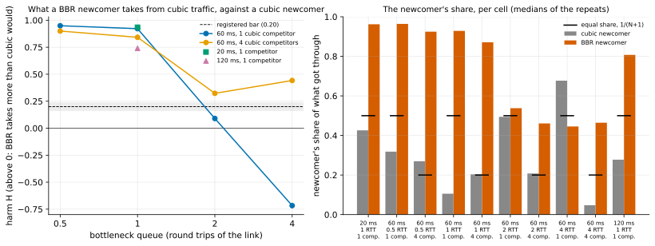

# EXP-26: Is BBR on pgdelta's socket fair enough to other traffic to be the default?

Status: **done October 25, 2026 (lean grid 15:53–16:17 UTC; 24 runs, all counted; VMs deleted 16:20): BBR stays opt-in. A BBR newcomer took far more from cubic traffic than a cubic newcomer would in 8 of 10 cells (H 0.32–0.95; the bar is 0.20), taking 81–96% of the link wherever the queue was one round trip or less.** Pre-registered before any run. One VM pair (`PAIR=fair`, two `n2-standard-8` in `us-central1-b`, as EXP-20/24's), about 2 hours. The open item [EXP-24](EXP-24-dr-with-bbr.md) left: with BBR on its own socket v1 holds at every DR round trip, but BBR isn't pgdelta's default because its fairness to other traffic on a shared link was untested.

## Question

When pgdelta's one data connection uses BBR and shares a bottleneck with other TCP traffic using cubic (Debian's default, and what `pg_basebackup`, replication and most applications use), does it take more from that traffic than a cubic connection in its place would?

## The bar

The harm-based bar for deploying a new congestion control (Ware, Mukerjee, Seshan and Sherry, "Beyond Jain's Fairness Index: Setting the Bar for the Deployment of Congestion Control Algorithms", HotNets 2019): a newcomer is acceptable if it harms the existing traffic no more than that traffic's own algorithm would in its place. Equal shares aren't the bar, since cubic flows aren't equal to each other either (different round trips, the slow mode of EXP-21 and EXP-23).

**The measure.** In each cell, the existing traffic is N cubic flows. Two newcomers take turns: a cubic flow (the reference) and a BBR flow. With C_cubic and C_bbr the competitors' total received rate while each newcomer runs (medians over repeats), the harm is **H = 1 − C_bbr / C_cubic**. H ≤ 0 means a BBR newcomer leaves the competitors at least as much as a cubic one does. H = 0.25 means they lose a quarter more of their rate to it.

**The threshold: H ≤ 0.20.** This is rule 11's 20% margin, the drift EXP-16 measured between sessions. Every verdict is also reported at 0.10 and 0.40 (half and twice), as K7 asks for O4's tolerances.

## Design

- **The link:** `wan.sh`'s tree on both VMs, as in EXP-20/24: 2 Gbit/s, netem delay of half the round trip on each VM, then a tbf shaper with a drop-tail queue. The queue depth is now a factor, set with `QUEUE_MS` so that tc's queue (rate × latency + the 10 ms burst) is exactly the registered depth in round trips. The depth is the factor that decides how BBR v1 shares with loss-based flows in the published measurements: it takes the larger share in shallow buffers and the smaller in deep ones.
- **The hosts:** Debian 12, kernel 6.1 (BBR v1). Tuned TCP buffers (tcp_rmem and tcp_wmem maxima 128 MiB) on both VMs, so one flow can fill 2 Gbit/s at 120 ms. With Debian's defaults one flow can't pass about 0.8 Gbit/s at 60 ms, and the link wouldn't be contested. The source allows BBR for unprivileged sockets, EXP-24's one host setting; its default stays cubic.
- **Flows:** iperf3 3.12 (Debian's package), all source → dest, as pgdelta's data flows. The N competitors (`iperf3 -P N -C cubic`) run from t = 0 to 100 s. The newcomer (`iperf3 -C cubic` or `-C bbr`) joins at t = 20 s and runs to 100 s. The rates are the receiving servers' per-second counts over t = 40–100 s: 60 s, about three of cubic's growth cycles at 60 ms. A ping every 0.2 s from source to dest over the same 60 s measures the queueing delay each newcomer causes. Before each run: `ip tcp_metrics flush all` on both VMs and fresh iperf3 servers.
- **Cells (10):**
  - at 60 ms: queue depth 0.5, 1, 2 and 4 round trips × 1 and 4 cubic competitors (8 cells);
  - at 1 round trip and 1 competitor: 20 ms and 120 ms (2 cells: does the round trip move H?).
- **Repeats:** 3 per newcomer per cell, 60 runs of about 105 s, in an order shuffled with seed 260.
- **Run validity:** a run counts only if both senders got the congestion control they asked for (iperf3's `sender_tcp_congestion`) and each window has at least 55 of its 60 seconds. Runs that don't count are listed with the reason.
- **Analysis committed before the data:** `analysis/exp26.py`; driver `experiments/network/lab_exp26.sh`.

**Why iperf3 stands in for pgdelta.** An iperf3 flow always has data to send, the most a single flow with a given congestion control can take. pgdelta's socket has data to send whenever the link is its bottleneck, which is the DR case (EXP-24: at 20–120 ms, v1's time tracks its bytes over the link). Where pgdelta is held back by hashing or the disk instead, it takes less. So H here is an upper bound on pgdelta's harm, and a verdict of "default" carries over to pgdelta; a verdict of "opt-in" is conservative for the app-limited case.

## Predictions

From the published behaviour of BBR v1 against loss-based flows:

1. At 0.5 round trips, H > 0.20 with 1 and with 4 competitors: BBR v1 keeps its pacing rate while cubic backs off at each loss.
2. At 4 round trips with 1 competitor, H ≤ 0: cubic fills a deep queue that BBR's in-flight cap (about 2 BDP) leaves to it.
3. H with 4 competitors is above H with 1 at every depth: BBR v1's share does not shrink as loss-based flows are added, while a cubic newcomer's does.
4. **Deciding: BBR stays opt-in** (H > 0.20 in at least one cell).
5. The BBR newcomer gets at least the cubic newcomer's rate in every cell at 1 round trip or less.

## What follows

- **If H ≤ 0.20 in every cell:** pgdelta asks for BBR by default on its data socket, falling back to the host default (and saying so) where BBR isn't allowed. A deciding H within 20% of the bar (0.16–0.24) makes the call provisional until a second session repeats that cell (K10, as narrowed).
- **Otherwise: BBR stays opt-in** (`pgdelta send --congestion-control bbr`). The deployment note gives the cells where BBR takes more than cubic would, recommends it for links pgdelta has to itself or that are provisioned for the refresh, and states the harm in the shared cases measured here. The DR verdict of EXP-24 is unchanged either way; it is what BBR buys, not whether to default to it.

## Limitations, known before running

- One emulated bottleneck: a drop-tail FIFO on the sender's egress. Real WAN paths may have AQM (fq_codel or RED, which change the sharing) or policers, and the bottleneck of a real cross-region path is not known. The depths span the range in which the published behaviour changes.
- BBR v1 only, as Linux 6.1 ships it. BBRv3, which was designed to share better with cubic, isn't in the mainline kernel.
- Bulk competitors only. Short flows and latency-sensitive traffic are covered only by the ping's queueing delay, which isn't part of the verdict.
- One newcomer flow, as pgdelta has one data connection; the competitors share one round trip with it.
- One session. A deciding cell near the bar gets a second (K10).

## Smoke

Before the grid, the driver's smoke plan runs one cell (60 ms, 1 round trip, 1 competitor) once per newcomer, to check the pipeline: both congestion controls applied, full windows, readable server intervals. It is not counted.

**Smoke result (October 25, 15:45–15:49 UTC, not counted).** After two harness fixes (ssh read the plan from stdin, so only the first run ran; the iperf3 servers needed `-J` to return their per-second counts as JSON), both runs completed with full windows and the right congestion control. At 60 ms, a 1-round-trip queue and 1 competitor, the cubic competitor got **180 Mbit/s beside a BBR newcomer** (which took 1,683) against **1,396 beside a cubic newcomer** (which took 515): **H = 0.87** from one run each, four times the bar. Data `docs/experiments/data/exp26-cells-smoke.csv`.

## Revision before the grid ran: a lean grid (October 25)

The owner asked that experiments run long only where they must. The registered grid (60 runs of 100 s, about 1 h 45 min) was stopped during its first run, which isn't used. The verdict needs one cell clearly above the bar, and the map of where BBR is safe needs each cell's H, its sign and rough size, not three-repeat precision far from the bar. So, before any grid run:

- **50-second runs:** competitors from 0 to 50 s, the newcomer from 10 s, the window 20–50 s (30 s, about one and a half of cubic's growth cycles at 60 ms).
- **One run per newcomer per cell:** 20 runs, about 20 minutes, in the order seed 260 gives.
- **Extra repeats only near the bar:** a cell whose H falls between 0.10 and 0.40 (half and twice the bar) gets two more runs per newcomer, and its H then comes from the medians.
- **The check on the shorter window:** the lean grid's 60 ms, 1-round-trip, 1-competitor cell is reported beside the smoke's 100-second runs of the same cell (H = 0.87). If the two disagree on which side of the bar the cell falls, the short window isn't trusted and that cell is rerun at 100 s.

The cells, the measure, the bar, the predictions and the verdict rule are unchanged.

## Results

24 runs (20 in the lean grid, plus 2 more per newcomer in the one cell between 0.10 and 0.40), all counted: every sender got the congestion control it asked for, and every window was complete. Data: `docs/experiments/data/exp26-cells.csv`; raw `results/exp04/sets/fair/exp26` and `exp26repeats`; figure `analysis/exp26.py`.

*How to read it:* left, the harm H in each cell: above 0, a BBR newcomer leaves the cubic competitors less than a cubic newcomer would; the dashed line is the registered bar (0.20), with the grey band its ±20% margin. Right, the newcomer's share of what got through, cubic (grey) against BBR (orange); the black tick is an equal share, 1/(N+1).

| Round trip, queue, competitors | Competitors beside a cubic / **BBR** newcomer (Mbit/s) | Newcomer, cubic / **BBR** | Ping, cubic / BBR newcomer (ms) | **H** |
|---|---:|---:|---:|---:|
| 20 ms, 1 RTT, 1 | 1,097 / **71** | 814 / **1,800** | 37 / 26 | **0.94** |
| 60 ms, 0.5 RTT, 1 | 1,303 / **67** | 608 / **1,791** | 81 / 67 | **0.95** |
| 60 ms, 0.5 RTT, 4 | 1,395 / **140** | 516 / **1,721** | 86 / 73 | **0.90** |
| 60 ms, 1 RTT, 1 | 1,710 / **133** | 202 / **1,730** | 106 / 97 | **0.92** |
| 60 ms, 1 RTT, 4 | 1,522 / **241** | 389 / **1,626** | 115 / 105 | **0.84** |
| 60 ms, 2 RTT, 1 | 966 / **880** | 944 / **1,024** | 153 / 122 | 0.09 |
| 60 ms, 2 RTT, 4 (3 runs each) | 1,513 / **1,025** | 397 / **876** | 167 / 125 | **0.32** |
| 60 ms, 4 RTT, 1 | 617 / **1,060** | 1,293 / **851** | 250 / 226 | −0.72 |
| 60 ms, 4 RTT, 4 | 1,824 / **1,018** | 91 / **883** | 264 / 210 | **0.44** |
| 120 ms, 1 RTT, 1 | 1,382 / **359** | 531 / **1,503** | 202 / 192 | **0.74** |

**The verdict, at the registered bar and at half and twice it:** BBR stays opt-in at all three. Above 0.20: 8 of 10 cells. Above 0.10: the same 8. Above 0.40: 7 (the 2-round-trip, 4-competitor cell drops out). No cell lies within 20% of the bar (0.16–0.24), so nothing is provisional by rule 11 and no second session is owed.

**The check on the shorter window held:** at 60 ms, 1 round trip and 1 competitor, the lean grid's 30-second window gave H = 0.92 and the smoke's 60-second window 0.87, both far above the bar.

| # | Prediction | Verdict |
|---|---|---|
| 1 | At 0.5 round trips, H > 0.20 with 1 and 4 competitors | **Held:** 0.95 and 0.90 |
| 2 | At 4 round trips with 1 competitor, H ≤ 0 | **Held:** −0.72 (the cubic newcomer took 1,293 Mbit/s, the BBR newcomer 851) |
| 3 | H with 4 competitors above H with 1 at every depth | **Failed at 0.5 and 1 round trip** (0.90 against 0.95, 0.84 against 0.92: in both, BBR took nearly the whole link either way), held at 2 and 4 (0.32 against 0.09, 0.44 against −0.72) |
| 4 | **Deciding: BBR stays opt-in** | **Held:** 8 of 10 cells above the bar |
| 5 | The BBR newcomer at least as fast as the cubic one at 1 round trip or less | **Held** in all 6 such cells (1,503–1,800 Mbit/s against 202–814) |

## What the records show

- **In shallow queues BBR v1 all but takes the link.** At one round trip of queue or less, the BBR newcomer took 87–96% of what got through at 20 and 60 ms, and 81% at 120 ms, with 1 or 4 cubic flows. The cubic competitors fell to 5–16% of their rate beside a cubic newcomer (26% at 120 ms).
- **Only a deep queue with a single competitor keeps BBR within the bar.** At 60 ms and 2 round trips of queue it took about what a cubic newcomer would (H = 0.09); at 4 round trips cubic took more (−0.72). With 4 cubic competitors it stayed above the bar even at 4 round trips (0.44): BBR v1 holds its share as loss-based flows are added, where a cubic newcomer's shrinks.
- **BBR queues less.** In every cell the ping meanwhile was lower beside a BBR newcomer (by 9–54 ms), so latency-sensitive traffic waits less behind it, even as bulk traffic gets less.
- **The short window may overstate H a little near the bar.** A cubic newcomer takes longer than BBR to reach its share: in the check cell its share was 0.11 over the 30-second window and 0.27 over the smoke's 60 seconds. That biases H upwards where a cubic newcomer is still growing, most in the 2-round-trip cells. The verdict rests on cells at 0.74–0.95, far beyond that.

## What follows

- **BBR stays opt-in** (`pgdelta send --congestion-control bbr`). The default remains the host's (cubic on Debian), and pgdelta does not ask for BBR on its own.
- **The DR claim is qualified accordingly.** EXP-24's "holds at every DR round trip with BBR" is the speed pgdelta gets when it may take the link. The deployment note says when to ask for BBR:
  - on a link the refresh has to itself, or one provisioned for it;
  - not on a link shared with bulk cubic traffic (replication, other copies) whose rate matters during the refresh, where BBR v1 takes most of the link if the bottleneck's queue is a round trip or less.
  With cubic, v1's DR verdict is EXP-20's: local changes only.
- **A cap is the natural next step, untested.** BBR with a pacing-rate cap on pgdelta's socket (`SO_MAX_PACING_RATE`, a `--max-rate` option) would keep BBR's immunity to cubic's slow mode while bounding its share; BBRv3 (not in mainline Linux) and an AQM at the bottleneck would also change the sharing. None is measured here.
