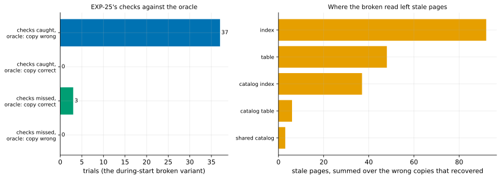

# EXP-27: Were EXP-25's missed controls correct copies, or a gap in the checks?

Status: **done October 25, 2026 (12:52–13:15 local; 40 trials): all three predictions held. Each of the 3 missed controls was physically identical to the correct copy of its backup, and the checks caught all 37 wrong copies, flagging no correct one.** Pre-registered before any counted run (a 3-trial smoke checked the harness; see below). Local (the Mac, PostgreSQL 17.11), about 25 minutes. The question [EXP-25](EXP-25-live-correctness.md) left: its `during_start` negative control was missed in 5 of 55 trials, and nothing in their records told a correct copy from a wrong one the checks failed to see.

## Question

When pgdelta's broken `during_start` variant (it reads the files while `pg_backup_start`'s spread checkpoint is still writing) makes a copy that EXP-25's checks pass, is that copy actually correct? And does every copy it makes wrong get caught?

## Why a copy from the broken variant can be correct

A page read stale is one the load changed before the backup's redo point and the checkpoint hadn't written yet. Recovery replays the WAL only from the redo point on. With `full_page_writes` on, the first change to a page after the redo point puts the whole page into the WAL, and replay restores it whatever was read. A stale page stays wrong only if nothing changes it again before the stop LSN. Under EXP-25's load most pages change again, so some of the variant's copies may contain no unrepaired stale page, and be correct.

## The oracle

Built for this, test-only and honoured only with a broken variant on: `PGDELTA_TEST_ORACLE_DIR`. pgdelta also reads the same files again as soon as `pg_backup_start` returns, a correct read, into that directory. Each trial then yields two copies of one backup, with the same WAL and the same `backup_label`:

- **B**, what the variant sent;
- **B2**, B with those files replaced by the correct read: the copy a correct pgdelta would have made from this backup.

Both are recovered side by side (autovacuum off) and shut down cleanly. Then:

- **Physical comparison.** Every relation page's LSN (main and visibility-map forks; the free-space map is advisory and not WAL-logged), and every byte of `pg_xact`, `pg_multixact` and `pg_filenode.map`. A page whose LSN differs holds a WAL-logged change one copy lacks. Hint bits never cause that, since they aren't WAL-logged here (data checksums off, `wal_log_hints` off).
- **When they differ,** the stale pages are named by relation (from B2's catalog), and both copies are compared logically: every table's rows in the bank database, the schema and the databases.
- **B is correct if it is physically identical to B2.** It is wrong if anything differs, or if it can't recover where B2 can.

## Design

`experiments/correctness/oracle_campaign.py`: EXP-25's harness and load, every trial its `during_start` control, with seeds 2000–2039 (the trial number seeds the DDL), plus a normal refresh after each trial, as in the campaign. Each trial records:
- EXP-25's verdict on B (caught or missed);
- EXP-25's checks on B2;
- the oracle's comparison.

40 trials, about 35 s each.

## Predictions

1. **The oracle's own control:** B2 passes every EXP-25 check in all 40 trials.
2. **Deciding:** every missed control's B is physically identical to B2. The misses are correct copies.
3. Every B the oracle finds wrong (stale, or unable to recover) is caught by EXP-25's checks.

## What follows

- **If 2 and 3 hold:** the checks caught every wrong copy the variant made. EXP-25's shortfall from 100% is the variant sometimes making correct copies, and the bound's premise (checks that catch a wrong copy) is supported for this kind of fault. The share of the variant's copies that are wrong is reported.
- **If a missed B is stale:** the checks have a gap. Which relations were stale (table, index, catalog, visibility map) says what check would close it, and EXP-25's claim is qualified until that check exists and is shown to catch it.
- **If 1 fails:** the oracle isn't a correct copy, and nothing is concluded.

## Limitations

- **One kind of fault:** stale pages from reading during the start checkpoint. It says how sensitive the checks are to that kind, not to others.
- **A stale page that changes no row** (say, a missing page prune) makes B wrong here. That is a stricter standard than the bank checks, which judge content.
- **About 3–4 misses expected** at EXP-25's rate (9%). Prediction 2 rests on those.

## Smoke (October 25, before the run; not counted)

Three trials (seeds 9000–9002), after four harness fixes:
- copying the oracle's files gave B2's root folder mode 0755, which PostgreSQL refuses;
- the relation-mapping query needed a `::text` cast;
- a B that can't recover now counts as wrong;
- the stale pages are named by relation.

All three were caught, and B2 passed every check each time. The oracle found B stale in two (2 and 21 pages, in tables, indexes and catalogs; queries on it then failed) and unable to recover in one ("WAL contains references to invalid pages").

## Results

40 trials, all judged by the oracle, no harness error. Data: `docs/experiments/data/exp27-summary.csv`; raw `results/correctness/exp27/`; figure `analysis/exp27.py`.

*How to read it:* left, each trial by what EXP-25's checks said (caught or missed) and what the oracle found (B identical to the correct copy of the same backup, or not). Right, where the wrong copies' stale pages were, by relation kind, summed over the 35 wrong copies that could recover.

| EXP-25's checks | Oracle: B correct | Oracle: B wrong |
|---|---:|---:|
| caught | **0** | **37** |
| missed | **3** | **0** |

| # | Prediction | Verdict |
|---|---|---|
| 1 | B2 passes every EXP-25 check | **Held:** 40 of 40 |
| 2 | **Every missed B is physically identical to B2** | **Held:** trials 2023, 2032 and 2035 each had 0 stale pages and 0 differing bytes |
| 3 | Every wrong B is caught | **Held:** 37 of 37; and no correct B was flagged |

- **The variant made a wrong copy 37 times in 40** (93%). Two of them couldn't recover ("WAL contains references to invalid pages"). The other 35 had 1–26 stale pages each: 92 in indexes, 48 in tables, 37 in catalog indexes, 6 in catalog tables, 3 in shared catalogs.
- **14 of the 35 had the same rows and schema as the correct copy.** Their stale pages were all in indexes or catalogs, and pg_amcheck alone caught every one of them. The bank and digest checks caught the 21 others (15 with rows or schema that differ, 6 whose catalog queries failed outright).
- **The checks' sensitivity to this kind of fault:** 37 caught of 37 wrong, so the chance that they miss a wrong copy of this kind is below 7.8% at 95% confidence (17% at 99.9%). Their specificity: no correct copy was flagged in 3, and none in EXP-25's 1,000 counted trials.

## What follows

- **EXP-25's five misses were most likely correct copies, not a gap in the checks.** The mechanism is now shown directly: every miss here was a copy the WAL had fully repaired (full-page writes after the redo point). EXP-25's own five weren't recorded with the oracle, so they are explained by this measurement of the same variant, not proven one by one.
- **The bound's premise holds for this fault:** a wrong copy of this kind is caught. pg_amcheck carries a large part of that: 14 of 37 wrong copies had correct rows and stale indexes only. It stays a required part of the checks.
- **What it doesn't cover:** other kinds of wrong copy (a wrong WAL range, a wrong `backup_label`, a page torn in a way the WAL doesn't repair) are exercised by EXP-25's faults and the unit tests, not measured against an oracle here.
