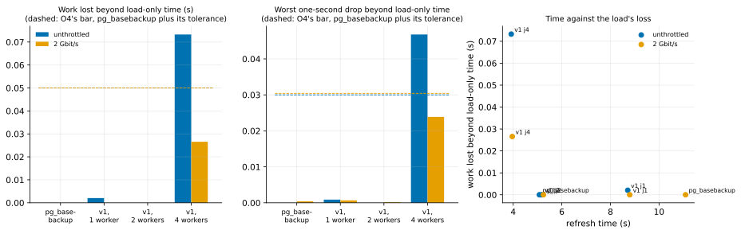

# EXP-28: How much does v1 reading a live primary slow it, against one `pg_basebackup` stream?

Status: **done October 25, 2026 (grid 17:41–17:53 UTC, repeats 17:55–17:57; 22 runs, all counted; VMs deleted 18:00): v1 at 1 and 2 source workers cost a busy primary no more than one `pg_basebackup` stream, at both speeds; at 4 workers it missed O4 unthrottled. Live mode now defaults to at most 2 workers.** Pre-registered before any run. Ledger test T10b, lean: the one decision it serves, with v1 itself on a live source (built since T10a, which could only measure v1 by proxy) and the load's client on its own VM. Three VMs (`PAIR=t10b`: source and dest `n2-standard-8` with local NVMe as EXP-12's, client `n2-standard-4`; 20 vCPUs), about 45 minutes with set-up.

## Question

On a busy primary, does v1's live refresh (`--source-kind live`, in place) slow the load more than one `pg_basebackup` stream, by O4's two numbers, and with how many source workers does it meet O4? That number is the default for live mode.

## What EXP-12 left

By proxy, v1's source side at 4 workers lost 0.05–0.07 s of the load's work and missed O4 at 0.6 of capacity, while 1 worker met it in twice the time. It was fragile, because the load's client shared the source's CPU, which charges CPU-heavy arms more than an application on another host would feel. Here the client runs on its own VM, and v1 runs for real.

## Design

- **The source:** EXP-12's cluster: EXP-01's dataset at scale 70 (about 1 GB) and `loaddb` (EXP-12's bank schema, scale 2), with EXP-12's server settings (`shared_buffers` 128 MB, no checkpoint inside a window but an arm's own). Set up by `source_cluster.py setup` and `loaddb-setup`, unchanged; one added `pg_hba` line lets the client VM in.
- **The load:** EXP-12's bank scripts (`commit.sql` at 99, `abort.sql` at 1), open loop: `pgbench -n -M prepared -c 32 -j 4 -R R`, from the client VM over the network, every transaction logged to the client's tmpfs. R = 0.6 × C, where C is the median of three 30-second closed-loop runs at 32 clients after a 30-second warm-up. The load runs through the whole grid.
- **The old copy:** a `pg_basebackup` of the source taken at set-up. Every v1 run refreshes it in place from the live source, so each run's B is the previous v1 run's output, minutes old: the frequent-refresh case. `pg_basebackup` copies into a fresh folder each time, deleted after the run's tail.
- **Arms:**
  - `none`: 8 s of load only;
  - `full`: one `pg_basebackup` stream, `-X stream -c fast`;
  - `v1_j1`, `v1_j2`, `v1_j4`: v1 live with `--jobs` 1, 2 and 4 on the source, and 4 on dest.

  Both `full` and v1 take a fast start checkpoint.
- **Speeds:** unthrottled, and 2 Gbit/s between source and dest (`wan.sh`, which leaves the client's traffic alone).
- **Runs:** 5 arms × 2 speeds × 2 repeats = 20, in an order seed 280 shuffles. Each run is a 15 s settle (load only, the receiver already listening), the timed arm from t0 to t1 on dest's clock, and a 10 s tail.
- **O4's two numbers,** as EXP-12's change 3 defines them, from the client's log over [t0, t1 + 10 s] in 1-second buckets, mapped to dest's clock by chrony's offsets (each VM's offset from the same reference, the metadata server):
  - the worst drop **D** = max(1 − X_b/S_b);
  - the work lost **W** = Σ max(0, S_b − X_b)/R,

  where S_b counts the transactions scheduled in a bucket and X_b those completed in it. Net values subtract the same speed's median over the `none` runs; below 0 counts as 0.
- **"Meets O4"** (EXP-12's floors): W_net(arm) − W_net(full) ≤ δ_W = max(0.05 s, 0.15 × W_net(full)), **and** D_net(arm) − D_net(full) ≤ δ_D = 0.03. Verdicts are also given at half and twice the floors (K7).
- **The lean simplification,** stated: the null is the `none` runs' median, not EXP-12's block bootstrap.
- **Extra repeats:** an arm whose excess over `full` lies within 20% of its δ on either number gets two more runs at that speed.
- **Also reported, not part of the verdict:** refresh time, the source's VM-wide CPU-seconds (`/proc/stat`), and the p95 and p99 latency over the window.
- **Committed before the data:** `experiments/network/lab_exp28.sh` (the driver, on dest) and `analysis/exp28.py`.

## Predictions

1. `full` costs the load little: W_net under 0.1 s at both speeds. EXP-12 measured nothing beyond its null, with the client on the source.
2. `v1_j1` and `v1_j2` meet O4 at both speeds.
3. **Deciding: `v1_j4` meets O4 at both speeds.** With the client off the source, v1's CPU no longer delays the load's client. EXP-12's proxy miss (0.05–0.07 s over `full`) was about the size of the floor, and was flagged as client wait.
4. v1's refresh time falls with workers (j4 < j2 < j1), and at 2 Gbit/s v1 at 4 workers is faster than `full`: the copy changes only `loaddb`'s pages.

## What follows

- **If 3 holds:** live mode keeps pgdelta's default source workers (min(4, CPUs)). O4's cap for v1 is stated as met at 4 workers on this load, with the client off the source.
- **If `v1_j4` misses but a smaller count meets:** live mode's default drops to the largest count that meets O4 at both speeds, and the time it costs is reported.
- **If even `v1_j1` misses:** v1 on a busy primary is slower on the load than `pg_basebackup`. That is reported as a cost of the design, beside its speed and bytes.
- **One session.** A deciding excess within 20% of its δ is provisional, and that cell gets a second session (K10, as narrowed).

## Limitations, known before running

- **One load** (EXP-12's bank load at 0.6 of capacity), one cluster size (about 1 GB, mostly static), one machine shape. EXP-12's moderate level and its large-dirty-set cluster are not run.
- **The null is the `none` runs' median,** not a bootstrap over load-only time, so "measurable" rests on EXP-12's floors.
- **Each v1 run refreshes a copy minutes old.** A refresh after hours of changes reads and sends more.
- **One session.**

## Smoke (October 25, 17:22–17:29 UTC, not counted) and two revisions before the grid

The smoke ran set-up and each arm once, unthrottled.
- **`full` and `none` ran.** `pg_basebackup` took 3.76 s.
- **Every v1 run failed in 0.45 s,** a driver error: `pgdelta receive` takes neither `--stats-json` nor `--pg-controldata` (its flag is `--basis-pg-controldata`), so the receiver exited at once. Fixed.
- **The load was bound by the network, not the source.** With the client on its own VM, each of a transaction's five statements waits a round trip, and 32 clients reached only C = 7,277 transactions a second. Probes at closed loop: 64 clients gave 13,820 (the source 46% busy), 96 gave 19,325 (64%), 128 gave 21,126 (70%), 192 gave 21,439 (74%). Above 100 clients, PostgreSQL's default `max_connections` refused the connections.

**Revision (rule 8, before the grid):** 128 load clients (and `max_connections = 300`), where C levels off and the source is the limit, as with EXP-12's 32 clients on the source itself. R stays 0.6 × C, measured at set-up. Nothing else changes.

**Second smoke (17:33–17:40 UTC, not counted), after the revisions:**
- every arm ran, at C = 21,891 and R = 13,100;
- `pg_basebackup` took 4.4 s; v1 took 8.7, 5.4 and 3.7 s at 1, 2 and 4 workers;
- the analysis read all five runs.

The grid then reused this set-up (the cluster, B and C), skipping a second set-up.

## Results

22 runs, all counted: the 20 of the grid, plus the 2 extra runs at 2 Gbit/s that the rule gave v1 at 4 workers, whose D excess (0.027 over two runs) lay within 20% of δ_D. The load: 13,100 transactions a second from 128 clients on the client VM (0.6 × C, C = 21,891). Data: `docs/experiments/data/exp28-cells.csv`; raw `results/exp04/sets/t10b/exp28` and `exp28repeats`; figure `analysis/exp28.py`.

*How to read it:* left and middle, O4's two numbers net of load-only time, per arm, unthrottled (blue) and at 2 Gbit/s (orange). The dashed lines are O4's bar: `pg_basebackup`'s value plus the tolerance (0.05 s, 0.03). Right, each arm's refresh time against the work it cost the load.

| Arm | Speed | Runs | Refresh | Work lost, net (s) | Worst drop, net | p95 / p99 latency (ms) | Meets O4 (×0.5, ×1, ×2) |
|---|---|---:|---:|---:|---:|---:|---|
| load only | unthrottled | 2 | (8.0) | – | – | 5.3 / 6.6 | – |
| `pg_basebackup` | unthrottled | 2 | 5.08 s | 0.000 | 0.000 | 6.4 / 9.3 | (the bar) |
| v1, 1 worker | unthrottled | 2 | 8.71 s | 0.002 | 0.001 | 6.6 / 7.9 | yes, yes, yes |
| v1, 2 workers | unthrottled | 2 | **5.17 s** | 0.000 | 0.000 | 7.4 / 11.3 | **yes, yes, yes** |
| v1, 4 workers | unthrottled | 2 | 3.92 s | **0.073** | **0.047** | **74.3 / 114.6** | no, **no**, yes |
| load only | 2 Gbit/s | 2 | (8.0) | – | – | 5.4 / 7.1 | – |
| `pg_basebackup` | 2 Gbit/s | 2 | 11.09 s | 0.000 | 0.000 | 6.4 / 8.4 | (the bar) |
| v1, 1 worker | 2 Gbit/s | 2 | 8.79 s | 0.000 | 0.001 | 7.0 / 8.6 | yes, yes, yes |
| v1, 2 workers | 2 Gbit/s | 2 | **5.24 s** | 0.000 | 0.000 | 7.1 / 10.4 | **yes, yes, yes** |
| v1, 4 workers | 2 Gbit/s | 4 | 3.96 s | 0.027 | 0.024 | 32.2 / 51.1 | no, yes, yes |

| # | Prediction | Verdict |
|---|---|---|
| 1 | `pg_basebackup` costs the load little: W_net under 0.1 s at both speeds | **Held:** 0.000 at both |
| 2 | v1 at 1 and 2 workers meets O4 at both speeds | **Held,** even at half the tolerances |
| 3 | **Deciding: v1 at 4 workers meets O4 at both speeds** | **Failed unthrottled:** 0.073 s of work over `pg_basebackup`'s against 0.05, and 0.047 of a worst drop against 0.03; it meets only at twice the tolerances. At 2 Gbit/s it meets (4 runs) |
| 4 | v1's time falls with workers, and at 2 Gbit/s 4 workers beat `pg_basebackup` | **Held:** 8.7, 5.2 and 3.9 s unthrottled; at 2 Gbit/s 3.96 s against 11.09 |

## What the records show

- **Two workers are the sweet spot on this source.** v1 at 2 workers cost the load nothing measurable at either speed and took 5.2 s: as fast as `pg_basebackup` unthrottled (5.1 s), and 2.1 times faster at 2 Gbit/s (11.1 s), where `pg_basebackup` sends the whole 2.1 GB and v1 only `loaddb`'s changed pages.
- **Four workers saturate the source.** On 8 vCPUs already about 45% busy with the load, 4 hashing workers plus the sender push the load's p95 latency from about 6 ms to 74 ms unthrottled, for a refresh 1.3 s shorter. Their cost varies widely run to run (work lost 0.013–0.114 s), with how their bursts overlap the load's.
- **EXP-12's proxy miss wasn't only the client's wait.** With the load's client on its own VM, 4 workers still missed O4 unthrottled. EXP-12 had flagged its miss as possibly the client sharing the source's CPU; the source's own CPU is enough.

## What follows

- *October 25, after [EXP-30](EXP-30-blake3-live.md): the 4-worker miss did not repeat on fresh VMs (BLAKE2b at 4 workers met O4 there, excesses −0.001 and −0.001), so it is session-dependent. The cap at 2 stands: 2 workers met O4 with margin in both sessions, and with BLAKE3 they were also faster than 4.*
- **Live mode defaults to at most 2 source workers** (`LIVE_MAX_DEFAULT_JOBS` in `pgdelta/cli.py`, for `send` and `local` with `--source-kind live`). A `--jobs` given explicitly is kept, so an operator who accepts the load's cost can ask for 4. The cap is the registered consequence of prediction 3 failing: the largest count that met O4 at both speeds. Tested in `tests/test_pgdelta_cli.py`.
- **O4 is met at 2 workers** on this load, with the client off the source, at both speeds; the time cost against 4 workers is 1.3 s here (5.2 against 3.9 s).
- **Still open:**
  - EXP-12's moderate load and its large-dirty-set cluster;
  - a larger source, so the cap isn't read from one machine shape (T10b's larger-source block);
  - a second session, though no deciding cell is near its line.
