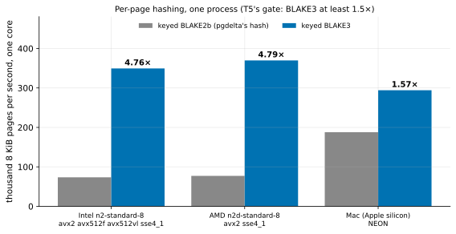

# EXP-29: Is keyed BLAKE3 at least 1.5 times faster per core than pgdelta's keyed BLAKE2b?

Status: **done October 25, 2026 (VMs created, run and deleted 14:14–14:30 local): BLAKE3 passes T5's gate by a wide margin. Per 8 KiB page and per core, keyed BLAKE3 hashed 4.76 times as fast as pgdelta's keyed BLAKE2b on the Intel VM and 4.79 times on the AMD VM (1.57 times on the Mac).** Pre-registered before any VM run. Ledger test T5, lean: its registered gate only. Two VMs (`PAIR=hash`: an Intel `n2-standard-8`, Cascade Lake like every VM so far, and an AMD `n2d-standard-8`), about 15 minutes, plus the Mac.

## Question

pgdelta hashes every 8 KiB page with keyed BLAKE2b, and on a busy source that CPU is what made 4 workers miss O4 in [EXP-28](EXP-28-live-slowdown.md). Would keyed BLAKE3 (the owner allowed a compiled hash library, K5) be fast enough per core to matter?

## The registered rule (T5's, unchanged)

"Under 1.5 times faster per core keeps BLAKE2b." It is judged on both CPU families: BLAKE3 passes only if it is at least 1.5 times faster on the Intel VM and on the AMD VM.

## Design

- **`experiments/network/hashbench.py`** hashes 8 KiB pages exactly as `pgdelta.hashing.Hasher.leaf` does: a pre-keyed state copied, updated with the page, a 16-byte digest.
  - BLAKE2b from `hashlib`;
  - BLAKE3 from the `blake3` package (1.0.x, the Python binding of the official Rust implementation), in a venv.
- **Each measurement:** N worker processes for 3 s, 5 repeats, the two hashes alternating. Pages per second per process, medians, and the ratio.
- **At N = 1** (per core, the gate) and **N = 4** (as pgdelta's default workers run, where turbo and shared caches may differ). The CPU model and its SIMD flags are recorded.
- **The Mac** (Apple silicon, NEON) is reported beside the VMs. Its quick check before registration gave 1.59×.
- **Per page, not per byte.** pgdelta's tree needs a digest per page, so per-call overhead counts as it does in pgdelta. BLAKE3's parallelism across 1 KiB chunks reaches only 8 chunks per page.

## Predictions

1. **Deciding: BLAKE3 passes the gate on both families** (≥ 1.5× at N = 1). On x86 its AVX2 and AVX-512 paths hash several chunks of a page at once, while BLAKE2b is one sequential compression stream.
2. The ratio is higher on the Intel VM (AVX-512) than on the Mac (NEON, 1.59×).

## What follows

- **If 1 holds:** pgdelta gets a BLAKE3 option, with digests distinguished by algorithm and the BLAKE2b default kept until it is measured end to end:
  - v1's source CPU per refresh;
  - O4 at 4 workers (EXP-28's miss) against 2.
- **If not:** BLAKE2b stays, and T5 closes on its gate.

## Limitations

- A micro-benchmark: it shows the hash's cost, not pgdelta's whole CPU per page (reading, the tree, the protocol).
- One machine type per family.
- Python 3.11 only. T5's wider plan (Python 3.14, sub-interpreters, the free-threaded build) isn't run.

## Results

Medians of 5 repeats of 3 s, pages per second per process. Data: `docs/experiments/data/exp29-hash.csv`; raw `results/hash/exp29/`; figure `analysis/exp29.py`.

| Host | CPU, SIMD | Processes | BLAKE2b pages/s | BLAKE3 pages/s | Ratio |
|---|---|---:|---:|---:|---:|
| Intel `n2-standard-8` | Xeon @ 2.80 GHz (Cascade Lake), AVX-512 | 1 | 73,472 | 349,440 | **4.76** |
| | | 4 | 73,280 | 348,715 | 4.76 |
| AMD `n2d-standard-8` | EPYC 7B13, AVX2 | 1 | 77,141 | 369,749 | **4.79** |
| | | 4 | 77,653 | 370,688 | 4.77 |
| Mac | Apple silicon, NEON | 1 | 187,904 | 294,229 | 1.57 |
| | | 4 | 176,363 | 280,107 | 1.59 |

| # | Prediction | Verdict |
|---|---|---|
| 1 | **Deciding: BLAKE3 passes the gate (≥ 1.5× at 1 process) on both families** | **Held:** 4.76× on Intel, 4.79× on AMD |
| 2 | The ratio is higher on Intel (AVX-512) than on the Mac | **Held, for another reason than predicted:** AMD, with AVX2 only, gave the same ratio. The VMs' gain comes less from BLAKE3's width than from BLAKE2b being slow there: 73,000–78,000 pages a second (about 600 MiB/s) per core, against 188,000 on the Mac |

## What it means for pgdelta

- **On the VMs, keyed BLAKE2b costs about 13.6 µs of a core per 8 KiB page; keyed BLAKE3 about 2.9.** At 2.1 GB (268,000 pages) that is about 3.7 core-seconds per pass against 0.8.
- **That is CPU on both ends.** On the source, it is what made 4 workers miss O4 in EXP-28. On the destination, v1 hashes B and re-reads O, two passes, where EXP-18 and EXP-19 found v1 bound by the destination's CPU in the HA case.
- **Per process, 1 and 4 processes gave the same rate**, so the gain doesn't shrink as workers are added.

## What follows (as registered)

pgdelta gets a BLAKE3 option, BLAKE2b staying the default until it is measured end to end:
- v1's CPU and time per refresh, source and destination;
- O4 at 4 workers on a busy primary (EXP-28's miss);
- the HA scale model (EXP-22), where the destination's CPU decided the verdict.

The option needs both ends to agree on the algorithm (the session's HELLO), and the `blake3` package where it is chosen; pgdelta stays standard-library only without it.
