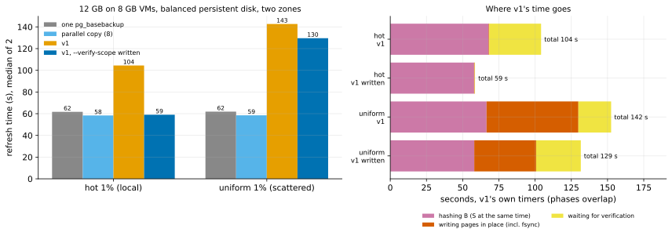
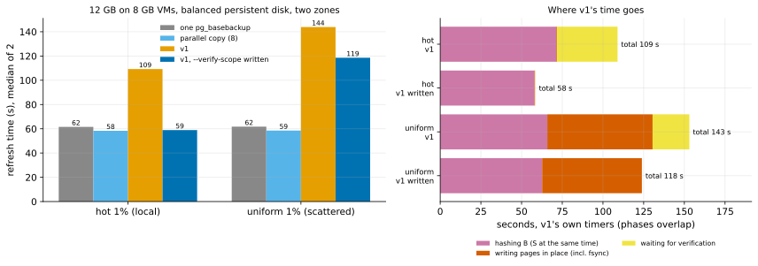

# EXP-31: Without its second pass over B, does v1 recover the HA case beyond memory?

Status: **done October 25, 2026 (run 19:35–21:01 UTC; 16 runs, all verified; deleted): without its second pass, v1 ties the full copies for local changes (0.96 of one `pg_basebackup` stream, 1.01 of the parallel copy, from 1.69 and 1.79), but stays about 2.1× slower for scattered ones. HA beyond memory stays out as a speed target.** Pre-registered before any run. [EXP-22](EXP-22-ha-scale-model.md)'s scale model again, at its deciding size: a 12 GB database on 8 GB machines, on balanced persistent disks, across two zones. Now with v1's new `--verify-scope written` (built since: it verifies each file from B's digests and the pages it wrote, without re-reading B) beside v1 as before. One VM pair (`PAIR=ha`), about 1 hour.

## Question

EXP-22 put v1 out of HA beyond memory, at 1.77–2.14 times one `pg_basebackup` stream. Its timers showed why: v1 read B twice at the disk's rate, once to hash it and once to verify the result, where a full copy makes one write pass. With the verification pass gone, where does v1 land?

## Design

EXP-22's harness command at scale 400 (about 12 GB):
- hot and uniform 1%, unthrottled;
- CRC32C manifests, caches dropped before each run;
- set file `infra/gcp/sets/ha.sh` (two `n2-highcpu-8` in `us-central1-a` and `-b`, balanced persistent disks of 150 GiB).

Arms:
- `full` (one `pg_basebackup` stream, the released tools' yardstick);
- `parcopy8` (the parallel bound, rule 3's yardstick);
- `pgdelta_direct_inplace` (v1 as in EXP-22);
- **`pgdelta_direct_inplace_vw`** (the same, with `--verify-scope written`).

2 repeats, order seed 31400. Every output verified by the harness, as in EXP-22.

## Predictions

From EXP-22's timers: v1 hashed B in 64–71 s and its verification took 61–82 s; the full copies took 58–62 s.

1. `pgdelta_direct_inplace_vw` takes at most 0.7 times `pgdelta_direct_inplace`'s time, for both workloads (the verification pass removed).
2. **Deciding: v1 with `--verify-scope written` is still not faster than either full copy at 12 GB.** Its ratio to `full` and to `parcopy8` is at least 0.90 for both workloads: one read pass over B at the disk's rate is about one full copy's write pass, and on balanced persistent disk reading B costs what writing a copy does.
3. Its ratio is within 1.5 of both full copies (EXP-22: 1.77–2.26).

## What follows (K6: both yardsticks, separately)

- **If 2 holds:** HA beyond memory stays out on this disk. The gap shrinks to what one read of B costs, and closing it needs B's digests without reading B: a tree kept from the previous refresh, which is only safe if B hasn't changed since. `--verify-scope written` is still worth its time wherever v1 is disk-bound, subject to EXP-32's correctness campaign.
- **If v1 with `written` comes in under 0.90 of a yardstick:** HA beyond memory is back in against that yardstick, provisional until a second session (K10), and only once EXP-32 has passed.

## Limitations

EXP-22's, plus: 2 repeats, one session, the 12 GB size only.

## Results

16 runs, all verified by the harness. Data: `docs/experiments/data/exp31-cells.csv`; raw `results/exp04/sets/ha/exp31-s400`; figure `analysis/exp31.py`.

| Workload | one `pg_basebackup` | parallel copy (8) | v1 | **v1, `--verify-scope written`** | v1 written ÷ `pg_basebackup` | ÷ parallel copy |
|---|---:|---:|---:|---:|---:|---:|
| hot 1% (local) | 61.7 s | 58.4 s | 104.4 s | **59.1 s** | **0.96** | **1.01** |
| uniform 1% (scattered) | 61.9 | 58.5 | 142.6 | **129.6** | 2.09 | 2.21 |

v1's own timers (medians, seconds; the phases overlap):

| | Hashing B (S at the same time) | Writing pages in place | of which fsync | Waiting for verification | Total |
|---|---:|---:|---:|---:|---:|
| hot, v1 | 67.9 | 0.4 | 0.3 | 35.8 | 104.0 |
| hot, v1 written | 57.9 | 0.4 | 0.3 | **0.3** | 58.6 |
| uniform, v1 | 66.5 | 63.4 | 61.4 | 22.6 | 142.2 |
| uniform, v1 written | 58.0 | 42.7 | 40.7 | **30.8** | 129.1 |

| # | Prediction | Verdict |
|---|---|---|
| 1 | v1 written takes at most 0.7 of v1's time, both workloads | **Held for hot** (0.57), **failed for uniform** (0.91) |
| 2 | **Deciding: v1 written is still not faster than either full copy (ratio ≥ 0.90)** | **Held:** hot 0.96 and 1.01 (provisional by rule 11's 20% margin, both within 20% of 0.90); uniform 2.09 and 2.21 |
| 3 | v1 written within 1.5 of both full copies | **Held for hot, failed for uniform** (2.09, 2.21) |

## What the records show

- **For local changes the second pass was the whole gap.** Without it, v1's time is its one read of B, about the disk's rate (58 s for 12 GB, as the full copies' one write pass). It sends 82 MB where the full copies send 11.9 GB, and verification waits 0.3 s.
- **For scattered changes two other costs remain.**
  - Writing about 414,000 changed pages in place, nearly all of it waiting on fsync: 41–63 s. Balanced persistent disk serves a few thousand small writes a second, where a full copy writes large sequential pieces.
  - Verifying the written pages: 31 s, all of it waited. This implementation of `written` re-reads and hashes the written pages in the receiver's main loop, one read per run of pages and single-threaded. The full re-read it replaces is pipelined on the worker pool (v1 waited 22.6 s for it).
- **The bytes favour v1 in either case:** 82 MB (hot) and 3.4 GB (uniform) against 11.9 GB. Across zones that is traffic Google bills.

## What follows (K6, both yardsticks)

- **HA beyond memory on balanced persistent disk stays out as a speed target** against both yardsticks:
  - for local changes, v1 now ties them (provisional, near the line) while moving 0.7% of the bytes;
  - for scattered changes it is about 2.1 times slower.
- **`--verify-scope written` helped every case measured** (−43% hot, −9% uniform) and passed [EXP-32](EXP-32-verify-written-correctness.md)'s campaign. It becomes the recommended setting for in-place refreshes. It becomes the default once:
  - its verification runs on the worker pool, pipelined like the full re-read, reading whole nodes where many pages were written;
  - a live-source campaign (EXP-25's) has run with it on.
- **A tie is the most a design that reads everything can get here.** With the second pass gone, v1's time for local changes is its read of S on the source, at the disk's rate (hash S: 57.9 s), and a full copy reads S at that rate too. Keeping B's tree from the previous refresh would only remove the destination's read, which already overlaps S's. To beat a full copy on a disk-bound source, the source must not be read whole: that takes change tracking there, such as PostgreSQL 17's WAL summaries, the mechanism native incremental backup uses. pgdelta's niche, refreshing any older copy whose history is lost, doesn't have that history. So on fast local disks (EXP-11, EXP-18) v1's lead comes from CPU and the copy's write path, and beyond memory on a capped disk it can at best tie, with far fewer bytes. For scattered changes, the in-place write pattern on an IOPS-limited disk is the remaining cost.

## Second session, pre-registered (October 25, before it ran)

**Why:** the hot cell's ratios (0.96, 1.01) lie within 20% of 0.90, so rule 11 (K10, as narrowed) asks for a second session on fresh VMs. The verification for `--verify-scope written` has also changed since: it now runs on the pipelined verifier, and heavily written nodes are re-read whole on the worker pool.

**What runs:** the same design and command, on fresh VMs, with order seed 31401, to `exp31b-s400`.

**Predictions:**
1. Hot: v1 written ÷ each full copy stays between 0.90 and 1.10, a tie either way. The hot cell's verdict ("not faster than the full copies") then stands at two sessions.
2. Uniform: v1 written's wait for verification drops below 10 s (from 30.8), and its time below 115 s (from 129.6). It stays above the full copies: the in-place writes remain.

## Second session: results (21:15–22:40 UTC, fresh VMs; 16 runs, all verified; deleted)

Data: `docs/experiments/data/exp31-cells-b.csv`; raw `results/exp04/sets/ha/exp31b-s400`; figure `analysis/exp31.py --tag=-b`.

| Workload | one `pg_basebackup` | parallel copy (8) | v1 | **v1, `written`** | ÷ `pg_basebackup` | ÷ parallel copy | v1 written's wait for verification |
|---|---:|---:|---:|---:|---:|---:|---:|
| hot | 61.5 s | 58.4 s | 109.3 s | **58.9 s** | **0.96** | **1.01** | 0.0 s |
| uniform | 61.7 | 58.5 | 143.9 | **118.6** | 1.92 | 2.03 | **0.0 s** (was 30.8) |

| # | Prediction (second session) | Verdict |
|---|---|---|
| 1 | Hot: v1 written ÷ each full copy between 0.90 and 1.10 | **Held:** 0.96 and 1.01, as in the first session (0.96, 1.01). The hot verdict, a tie that is not faster, now rests on two sessions |
| 2 | Uniform: the wait for verification under 10 s, and the time under 115 s | **The wait held** (0.0 s, from 30.8), **the time failed narrowly** (118.6 s, from 129.6) |

**What the timers show:** pipelining the verification hid it completely, but saved less than its 31 s. The verifier now reads the written nodes while the next file's pages are written, on the same disk, and the in-place write phase slowed from 42.7 to 61.3 s. For scattered changes v1 written is about 2× the full copies, bound by its in-place writes on an IOPS-limited disk.

**The verdict stands at two sessions:** HA beyond memory on balanced persistent disk stays out as a speed target. For local changes v1 ties the full copies, and for scattered ones it is about 2× slower.
