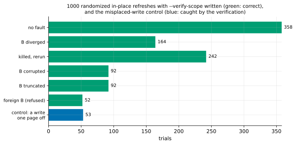

# EXP-32: Is v1 still correct when it verifies only what it wrote?

Status: **done October 25, 2026, twice: on the first implementation (15:35–16:22 local) and, after it moved to the pipelined verifier, again (17:20–18:43). Each run: no wrong output in 1,000 counted trials with `--verify-scope written` (below 0.69% per refresh at 99.9% confidence), and all 53 misplaced-write controls caught and then repaired.** Pre-registered before the counted campaign (a 25-trial smoke checked the harness; see below). Local (the Mac, PostgreSQL 17.11), about an hour. It is the correctness test that `--verify-scope written` needs before it can be recommended. [EXP-31](EXP-31-ha-one-pass.md) measures its speed.

## Question

With `--verify-scope written`, the receiver checks each file from three things, instead of re-reading all of it:
- B's node digests, taken before anything was written;
- B's leaf digests, from the leaf requests;
- the pages it wrote, re-read.

Does v1 still never produce a wrong copy, and does that verification still catch a write that goes to the wrong place?

## Design

[EXP-17](EXP-17-randomized-correctness.md)'s campaign, unchanged except for two options (`experiments/correctness/campaign.py`):
- **`--pgdelta-args "--verify-scope written"`** on every pgdelta run.
- **`--negative-every 20`:** in each block of 20 trial numbers, the one half-way through (10, 30, …) is a negative control, not a counted trial. Its fault is none, and its first run sets the receiver's test switch `PGDELTA_TEST_MISPLACE_WRITE=1`, which writes the run's first movable page run one page away from where it belongs.
  - It is **caught** if pgdelta exits 4 (verification failed), B is left in its blocked state (`global/pg_control` renamed aside, with the marker), and `pg_ctl` refuses to start B.
  - A normal run then must repair B, checked like any trial.

Everything else is EXP-17's:
- the trials: a template cluster cloned to S and B, a random workload on S, S stopped, one random fault applied to B (none, diverged, killed part-way, corrupted, truncated, foreign), B refreshed in place from the stopped data directory;
- the checks, independent of pgdelta: byte identity with S over S's files, no extra relation files, and S's logical digest once B starts.

**Stop rule:** 1,000 counted trials or 2 hours, whichever comes first. A wrong output, a control that isn't caught, or a failed repair stops the campaign.

## Predictions

1. **Deciding: no wrong output in 1,000 counted trials.** That bounds the rate below 0.69% per refresh at 99.9% confidence (EXP-17's bound, with the default scope and 10,000 trials, was below 0.069%).
2. Every negative control is caught (registered: all of them). This is a deterministic argument: the page meant for one place keeps B's bytes, which differ from S's or the page wouldn't have been sent, so the file's digest can't match.
3. Every part-way kill leaves B old, blocked or new, as in EXP-17.

## What follows

- **If 1 and 2 hold:** `--verify-scope written` is shown correct on this platform's fault mix. EXP-31's measurement then decides whether it becomes v1's default for in-place refreshes.
- **Otherwise:** the trial that failed is kept and its cause found, and the scope stays off.

## Limitations

- EXP-17's: a stopped source, about 50 MB, macOS.
- 1,000 trials bound the rate ten times less tightly than EXP-17's 10,000.
- The negative control tests one way a write can go wrong (an offset off by a page). A write that changes a page nobody meant to write, outside every written run, is the case the scope trusts away: in place, every write goes through one function at the offsets of the runs it records.

## Smoke (October 25, before the campaign; not counted)

25 trials with controls every 10: 25 counted, no wrong output; 3 of 3 controls caught (exit 4, B blocked, start refused), each repaired by the next run.

## Results

1,053 trials, no harness error: 1,000 counted and 53 negative controls. Data: `docs/experiments/data/exp32-summary.csv`; raw `results/correctness/exp32/`; figure `analysis/exp32.py`.

| Fault | Counted | Correct |
|---|---:|---:|
| none | 358 | 358 |
| B diverged | 164 | 164 |
| killed part-way, then rerun | 242 | 242 |
| B corrupted | 92 | 92 |
| B truncated | 92 | 92 |
| foreign B (refused, B untouched) | 52 | 52 |
| **all** | **1,000** | **1,000** |

| # | Prediction | Verdict |
|---|---|---|
| 1 | **Deciding: no wrong output in 1,000 counted trials** | **Held:** below 0.69% per refresh at 99.9% confidence (0.30% at 95%) |
| 2 | Every negative control caught | **Held:** 53 of 53, each with pgdelta's exit 4, B blocked and its start refused; each repaired by the next run |
| 3 | Every part-way kill leaves B old, blocked or new | **Held:** of 48 kills before the exit, 16 left B old, 1 new, and 31 part-way, all 31 refusing to start |

The harness passes `--verify-scope written` to every pgdelta run. EXP-17's harness keeps no per-trial pgdelta statistics, so whether the scope was in effect was checked only on the campaign's last run. Its statistics show the scope `written`: 1,044 nodes kept from B's digests, 90 rebuilt from its leaf digests and the written pages, none re-read whole, and 3,970 pages re-read, exactly the 3,970 pages sent.

## What follows

- **`--verify-scope written` is shown correct on EXP-17's fault mix,** at a tenth of EXP-17's 10,000 trials. A misplaced write is caught every time, as argued.
- Whether it becomes v1's default for in-place refreshes is decided by [EXP-31](EXP-31-ha-one-pass.md)'s speed result. A default would also deserve EXP-25's live-source campaign with the scope on.

## The implementation changed after the campaign, so the campaign is rerun (October 25, before the rerun)

EXP-31 found the first implementation's verification single-threaded and waited for (31 s for scattered changes at 12 GB). It now runs on the pipelined verifier:
- nodes with at most an eighth of their pages written are composed from B's leaf digests and the re-read pages, as before;
- more heavily written nodes are re-read whole on the worker pool.

That changes code this campaign judged, so it is rerun in full, with the same design, seeds and rules, to `results/correctness/exp32b/`. The registered predictions are the same. The first run's result above stands for the first implementation.

**Restarted, October 25, 17:20 (before any result was read).** The rerun first started at 17:13. A minute later, `--hash auto` (the hash negotiation) landed in the working tree it ran from, and from then on its trials hashed with BLAKE3. It was stopped after 25 trials and set aside (`results/correctness/exp32b-aborted`, not counted). It restarts from a frozen checkout of commit c870b17 with `--pgdelta-args "--verify-scope written --hash blake2b"`, BLAKE2b pinned as at registration. EXP-33 covers BLAKE3.

## The rerun on the revised implementation: results (17:20–18:43 local; 1,053 trials)

Run from a frozen checkout of commit c870b17, with `--verify-scope written --hash blake2b`. Data: `docs/experiments/data/exp32-summary-b.csv`; raw `results/correctness/exp32b/`; figure `analysis/exp32.py --tag=-b`.

- **No wrong output in 1,000 counted trials** (below 0.69% per refresh at 99.9% confidence): 358 with no fault, 164 diverged, 242 killed and rerun, 92 corrupted, 92 truncated, 52 foreign (refused, B untouched).
- **53 of 53 negative controls caught** (exit 4, B blocked, start refused) and repaired.
- **Of 65 kills before the exit,** 23 left B old, 6 new, and 36 part-way, all 36 refusing to start.

All three predictions held again, on the implementation that EXP-31's second session measured. Across both runs, `--verify-scope written` has 2,000 trials with no wrong output, below 0.35% per refresh at 99.9% confidence. That pooling is fair for the verification logic both versions share, though they differ in how its reads are scheduled.
