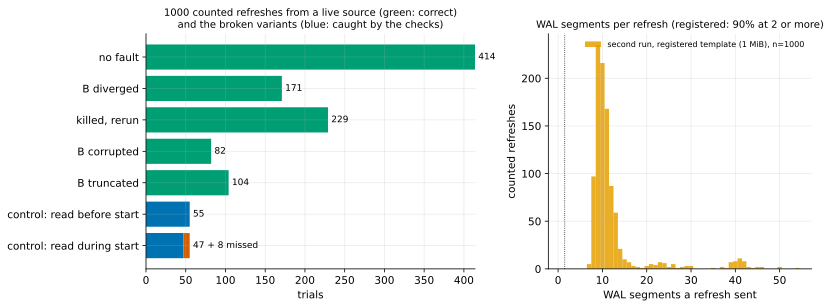

# EXP-33: Is v1 from a live source still correct when it verifies only what it wrote?

Status: **done October 25, 2026 (17:20–19:05 local; 1,110 trials): no wrong output in 1,000 counted trials from a live source with BLAKE3 and `--verify-scope written`, but the read-during-start control was caught in only 47 of 55 (85%), below its registered 90%. By the registered rule, no bound is claimed from this run, and the default stays `all`.** Pre-registered before any run. The second campaign that `--verify-scope written` needs before it can be the default for in-place refreshes ([EXP-31](EXP-31-ha-one-pass.md)'s "What follows"). The first was [EXP-32](EXP-32-verify-written-correctness.md), on a stopped source. Local (the Mac), about 1.5–2 hours.

## Design

[EXP-25](EXP-25-live-correctness.md)'s second run, unchanged, with `--pgdelta-args "--verify-scope written"` on every pgdelta run:
- `experiments/correctness/live_campaign.py`, the registered template (1 MiB WAL segments, timeline 2), a continuous bank load;
- faults none, diverged, kill, corrupt and truncate; checks on a recovered clone (bank invariant and window, static digest, pg_amcheck, the 120 s query limit);
- its two negative controls (read before `pg_backup_start`, and while it runs);
- 1,000 counted trials or 3 hours.

Each trial's record now carries the receiver's verification scope, so the campaign shows the scope was in effect run by run (EXP-32 could check only its last run).

It runs at the same time as EXP-32's rerun and EXP-31's second session on the VMs, so the Mac is busier than in EXP-25. Correctness doesn't depend on the timing, but kill delays land at different points.

## Predictions

1. **Deciding: no wrong output in 1,000 counted trials** (below 0.69% per refresh at 99.9% confidence), every one with the scope `written` in effect.
2. Both negative controls meet their 90% bar.
3. Every part-way kill leaves B old, blocked or new.

## What follows

- **If 1–3 hold, and EXP-32's rerun holds too:** `--verify-scope written` becomes the default for in-place refreshes. The CLI's default changes, and the full re-read stays as `--verify-scope all`.
- **Otherwise:** the trial is kept, its cause found, and the default stays `all`.

**Restarted, October 25, 17:20 (before any result was read).** The campaign first started at 17:13. A minute later the hash negotiation (`--hash auto`, now the CLI's default) landed in the working tree it ran from. It was stopped after 34 trials and set aside (`results/correctness/exp33-aborted`, not counted). It restarts from a frozen checkout of commit c870b17 with `--pgdelta-args "--verify-scope written --hash auto"`: the combination that would ship as the default, BLAKE3 on this Mac, negotiated. Each trial records its hash and scope. EXP-32's rerun pins BLAKE2b.

## Results

1,110 trials, no harness error: 1,000 counted and 110 negative controls. Every counted trial's statistics show the hash `blake3` and the scope `written`, so the configuration was in effect run by run. Data: `docs/experiments/data/exp25-summary-exp33.csv`; raw `results/correctness/exp33/`; figure `analysis/exp25.py --tag=-exp33`.

| Fault | Counted | Correct |
|---|---:|---:|
| none | 414 | 414 |
| B diverged | 171 | 171 |
| killed part-way, then rerun | 229 | 229 |
| B corrupted | 82 | 82 |
| B truncated | 104 | 104 |
| **all** | **1,000** | **1,000** |

- **The WAL range was covered:** every refresh sent 7–54 WAL segments of 1 MiB and the timeline-2 history file, and pages changed between hashing and sending in every one (median 72).
- **Kills:** of 109 kills before the exit, B was blocked 71 times, old 32 and new 6, never anything else. 120 kills came after the exit, and every rerun was correct.
- **The controls:**
  - read before `pg_backup_start`: **55 of 55 caught** (44 by the bank or digest checks, 7 copies that didn't start, 4 whose query hung until the limit);
  - read while it runs: **47 of 55 caught** (36 by the bank or digest checks, 9 copies that didn't start, 10 by pg_amcheck alone); 8 missed (trials 279, 319, 379, 479, 499, 979, 999, 1059).

| # | Prediction | Verdict |
|---|---|---|
| 1 | **Deciding: no wrong output in 1,000 counted trials, the scope `written` in effect in every one** | **Held:** 1,000 of 1,000 correct, all with `blake3` and `written` |
| 2 | Both negative controls meet their 90% bar | **Failed for the read during start:** 47 of 55 (85%); the read before start 55 of 55 |
| 3 | Every part-way kill leaves B old, blocked or new | **Held:** 32 old, 71 blocked, 6 new |

**The registered consequence.** A control below its bar means the bound isn't claimed (EXP-25's rule, which EXP-33 adopted), so this run claims no rate. Its "What follows" also keeps the default at `all`, since a prediction failed.

**What the shortfall likely is, and what it doesn't change.** The checks (bank, digest, pg_amcheck, the query limit) don't depend on pgdelta's hash or scope. [EXP-27](EXP-27-control-oracle.md) measured them against an oracle on this same kind of fault: they caught 37 of 37 wrong copies and flagged none of the correct ones, and every miss was a copy the WAL had fully repaired. If the variant made correct copies at EXP-27's rate (3 in 40), falling below the bar (49 or fewer caught of 55) would happen about one time in four (binomial, p = 0.23). But catching as few as 47 would happen only about one time in twenty (p = 0.05). So either the variant made correct copies more often here (BLAKE3 changes the refresh's timing), or something else is at work. The 90% bar assumed the variant always makes a wrong copy, which EXP-27 later showed it doesn't. That explanation is not shown for these eight misses, though, and the registered verdict stands.

## What follows

- **No bound from EXP-33.** Its 1,000 correct trials stand as evidence, not as a registered rate.
- **The default stays `--verify-scope all`** until a test shows the eight misses were correct copies: EXP-27's oracle on this configuration (BLAKE3 with `written`), pre-registered as [EXP-35](EXP-35-oracle-blake3-written.md).
- **For future campaigns:** a negative control's bar should count catches among the copies an oracle shows are wrong. A share of all runs assumes every run of the variant is wrong.
