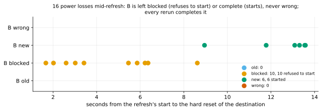

# EXP-34: Does v1's in-place refresh survive a power loss?

Status: **done October 25, 2026 (18:45–19:53 local; 16 trials, all passed; VMs deleted): every hard reset of the destination mid-refresh left B blocked (10, each refusing to start) or complete (6, each starting), never wrong, and every rerun completed it.** Pre-registered before any trial. Ledger test T13c, lean: T13's crash arm. Two VMs (`PAIR=crash`: two `n2-standard-4` in `us-central1-b`, 100 GB balanced persistent disks), about an hour.

## Question

EXP-17, EXP-25, EXP-32 and EXP-33 killed pgdelta's processes mid-refresh: the kernel survived and flushed what was written. A power loss is harder. The page cache is lost, and only what pgdelta made durable (fsync, directory fsync) survives, in whatever order the disk kept it. Does pgdelta's in-place protocol still leave B only in a documented state? That means the old copy, the blocked state, or the complete new copy, and never a wrong copy that starts.

## Design

`experiments/network/crash_t13c.py drive`, run on the Mac, since the destination is the machine that loses power.

**Once, at set-up:**
- the source cluster: EXP-01's dataset at scale 70, about 1 GB;
- B0, a `pg_basebackup` of it (`-X stream`), the old copy;
- a uniform 1% workload on the source, then the source stopped cleanly;
- the SHA-256 manifests of S and B0, over EXP-17's set of files, which leaves out `pg_wal`, `backup_label` and the like;
- one refresh without a crash, which times the refresh (T) and must leave B identical to S.

**Each trial, seeded by its number (seed 340 + n):**
1. B is restored from B0 and synced.
2. v1 refreshes B in place from the stopped source (`pgdelta receive --in-place` on dest, `pgdelta send --source-kind datadir` on the source; the defaults otherwise).
3. After a delay drawn from [0.2 s, 1.15 T], the destination is hard-reset with `gcloud compute instances reset`: no shutdown, no flush. ext4 replays its journal when it mounts again.
4. Once the destination is back, B is classified against the two manifests:
   - **blocked:** pgdelta's documented state, `global/pg_control` renamed aside with the marker beside it;
   - **new:** byte-identical to S;
   - **old:** byte-identical to B0;
   - **wrong:** anything else.
5. A blocked B must refuse to start, and an old or new one (tested on a clone) must start.
6. A normal refresh must then make B new.

**Runs:** 16 trials. A trial that fails any step stops the run.

## Predictions

1. **Deciding: every reset leaves B old, blocked or new,** never wrong.
2. Every blocked B refuses to start, and every old or new B starts.
3. Every rerun makes B new.
4. All three states occur: resets during hashing leave B old, during writing blocked, and after the commit new.

## What follows

- **If 1–3 hold:** O5's in-place default is supported against power loss on Linux (ext4, a persistent disk), as it was against process kills. The ledger's T13c moves to measured. This is 16 trials, an existence check, not a rate bound.
- **If a reset leaves B wrong:** the trial is kept with its state, and the order of pgdelta's durable steps (marker, rename, fsyncs, commit) is examined against what survived. A wrong B that starts would be a serious defect in the in-place mode.

## Limitations

- **16 trials** say that the states seen are possible, and that wrong is rare, not how rare.
- **One filesystem and one disk:** ext4 with ordered data on balanced persistent disk. A disk that acknowledges writes it hasn't made durable isn't modelled.
- **The source is stopped** (`--source-kind datadir`), not live.

## Revision before any trial (October 25)

The two-VM set didn't fit the SSD-backed disk quota while EXP-31's pair ran: balanced persistent disks and boot disks count against it, and 100 GB was free. **One VM** (`n2-standard-4`, a 40 GB data disk) now holds the stopped source cluster and B, and `pgdelta local --in-place --source-kind datadir` runs both ends there. The reset cuts the power to both at once. That changes nothing the test judges: the source is stopped and only read, and what survives on B's disk is what is checked. Everything else is as registered.

**That revision was dropped before any trial:** the VM tooling requires a source and a dest in every set. The run waits for EXP-31's pair to finish and free the quota, then uses two VMs as first registered, with 40 GB data disks. The driver keeps the one-VM path, unused.

## Results

16 trials. Set-up: S had 989 files; an uncrashed refresh took 13.2 s on the harness's clock (pgdelta's own was shorter: B was complete by about 9 s). The destination was back 21–34 s after each reset. Data: `docs/experiments/data/exp34-trials.csv`; raw `results/crash/exp34/`; figure `analysis/exp34.py`.

| Reset after | B after the reset | Its start | After a rerun | Trials |
|---|---|---|---|---:|
| 1.7–8.6 s | **blocked**: `global/pg_control` renamed aside, marker present | refused, every time | new | 10 |
| 9.0–13.6 s | **new**: byte-identical to S (the refresh had committed) | started, every time | new | 6 |
| | old | | | 0 |
| | wrong | | | **0** |

| # | Prediction | Verdict |
|---|---|---|
| 1 | **Deciding: every reset leaves B old, blocked or new** | **Held:** 10 blocked, 6 new, none wrong |
| 2 | Every blocked B refuses to start, and every old or new one starts | **Held:** 10 of 10 refused, 6 of 6 started |
| 3 | Every rerun makes B new | **Held:** 16 of 16 |
| 4 | All three states occur | **Failed: no reset left B old.** pgdelta blocks B as the session starts, before writing anything (the earliest reset, at 1.7 s, already found it blocked), so a reset leaves B old only in the first moments. The draw's minimum, 0.2 s plus the harness's own SSH latency, never reached them |

## What follows

- **O5's in-place default holds up against power loss on Linux** (ext4 on a persistent disk), as it did against process kills in EXP-17, EXP-25, EXP-32 and EXP-33. After a reset, B was either blocked (refusing to start) or complete, and a rerun repaired the blocked ones. T13c moves to measured.
- **It is an existence check, not a rate:** 16 resets show that these are the states a power loss produces here, and that a wrong one is rare, not how rare. One filesystem and one disk type; the source stopped.
