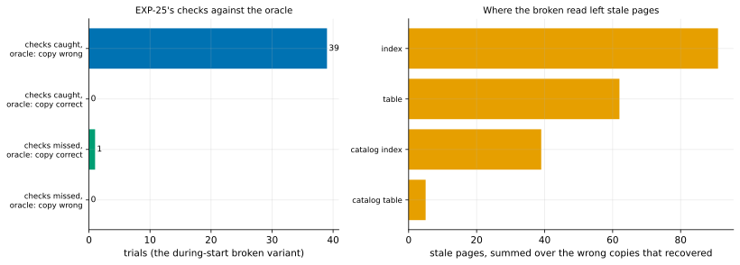

# EXP-35: Were EXP-33's missed controls correct copies, with BLAKE3 and `--verify-scope written`?

Status: **done October 25, 2026 (19:09–19:32 local; 40 trials, all with BLAKE3 and `written`): all three predictions held. The one missed control was physically identical to the correct copy, and the checks caught all 39 wrong copies, flagging none of the correct ones. By the registered rule, `--verify-scope written` becomes the default for in-place refreshes.** Pre-registered before any run. [EXP-27](EXP-27-control-oracle.md)'s oracle on [EXP-33](EXP-33-live-verify-written.md)'s configuration. Local (the Mac), about 25 minutes.

## Question

In EXP-33, the read-during-start control was caught in only 47 of 55 trials, below its 90% bar, so no bound was claimed and the default stayed `--verify-scope all`. EXP-27 had shown, under the default configuration, that this control's misses are copies the WAL fully repaired: the checks caught every wrong copy. Is that still true under BLAKE3 and `written`, or do the checks miss wrong copies here?

## Design

EXP-27's harness (`oracle_campaign.py`), unchanged except `--pgdelta-args "--verify-scope written --hash auto"`, so BLAKE3 is used here, as in EXP-33. Every trial is the during-start control. pgdelta's test-only oracle also reads the same files as soon as `pg_backup_start` returns, which gives B (the variant's copy) and B2 (the correct read's copy) of one backup, recovered side by side and compared page by page. 40 trials, seeds 3000–3039.

## Predictions

1. B2 passes every check in all 40 trials (the oracle's own control).
2. **Deciding: every missed B is physically identical to B2.**
3. Every B the oracle finds wrong is caught by the checks.

## What follows

- **If 2 and 3 hold:** EXP-33's shortfall is the variant making correct copies more often (BLAKE3 changes the refresh's timing), not the checks missing wrong ones, and its 1,000 correct trials read as checked by sensitive checks. With EXP-32's 2,000 trials on a stopped source, `--verify-scope written` then **becomes the default for in-place refreshes**. The full re-read stays as `--verify-scope all`. EXP-33's own registered verdict (no bound) is unchanged.
- **If a missed B is wrong:** the checks have a gap in this configuration. It is reported with the relations it hit, and the default stays `all`.

## Results

40 trials, all judged by the oracle, every one with `blake3` and `written` in pgdelta's statistics. Data: `docs/experiments/data/exp27-summary-exp35.csv`; raw `results/correctness/exp35/`; figure `analysis/exp27.py --tag=-exp35`.

| EXP-25's checks | Oracle: B correct | Oracle: B wrong |
|---|---:|---:|
| caught | **0** | **39** |
| missed | **1** | **0** |

| # | Prediction | Verdict |
|---|---|---|
| 1 | B2 passes every check in all 40 trials | **Held:** 40 of 40 |
| 2 | **Deciding: every missed B is physically identical to B2** | **Held:** trial 3005, 0 stale pages and 0 differing bytes |
| 3 | Every wrong B is caught | **Held:** 39 of 39, and no correct B flagged |

- **The variant made a wrong copy 39 times in 40** (6 couldn't recover). The rest had stale pages in indexes (91), tables (62), catalog indexes (39) and catalog tables (5). 4 had the same rows and schema as the correct copy, and pg_amcheck caught those.

## What it settles, and what it doesn't

- **The checks are sensitive under BLAKE3 and `written`,** as under the default configuration (EXP-27: 37 of 37). Together they caught 76 of 76 wrong copies of this kind. Had they missed about 15% of wrong copies, as EXP-33's 8 misses in 55 would suggest if every miss were wrong, catching 39 of 39 would have had a chance of about 0.2% (0.855^39).
- **EXP-33's own eight misses weren't oracle-checked,** and this run missed far fewer (1 in 40 against 8 in 55). So that they were correct copies is inferred from the checks' sensitivity, not shown one by one. EXP-33's registered verdict (no bound from its run) stands.
- **The registered consequence:** `--verify-scope written` becomes the default for in-place refreshes, on 2,000 stopped-source trials (EXP-32), 1,000 live-source trials (EXP-33) with no wrong output, and checks shown sensitive in this configuration. The full re-read stays available as `--verify-scope all`.
