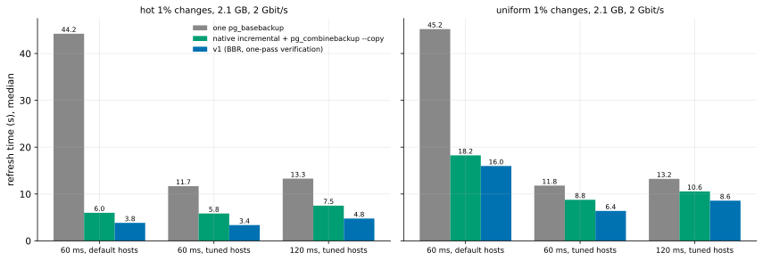

# EXP-36: Where history exists, does native incremental beat v1 at DR round trips too?

Status: **pre-registered October 25, 2026, before any run.** Ledger test INC, lean: D02's question at the DR condition pgdelta is positioned for. One VM pair (the default set: two `n2-standard-8` with local NVMe, as EXP-20 and EXP-24), about an hour.

## Question

PostgreSQL 17's native incremental backup (`pg_basebackup --incremental` against a previous backup's manifest, then `pg_combinebackup` on the destination) needs history: WAL summaries on the source since a backup it knows. pgdelta's niche is the copy without that history. Where history does exist, EXP-04b found native incremental faster than pgdelta in all 42 workload-by-speed cells, at 0.1 ms. At DR round trips v1 now has BBR on its socket (EXP-24), BLAKE3 where available, and one-pass verification in place, while incremental runs on the host's cubic. Does incremental still win there?

## Design

EXP-24's harness command (`run_exp04.py`) with:
- **conditions:** `2:60:default`, `2:60:tuned` and `2:120:tuned` (2 Gbit/s; 60 and 120 ms; Debian's TCP buffers, or maxima of 128 MiB);
- **patterns:** hot and uniform 1% at about 2.1 GB (scale 70);
- **methods:**
  - `full`, one `pg_basebackup` stream, the yardstick;
  - `incremental`, native incremental, then `pg_combinebackup` to a new copy;
  - `pgdelta_direct_inplace_bbr`, v1 asking for BBR.
- **v1's settings:** v1 now runs with the command line's defaults, so `--verify-scope written` in place, and `--hash auto`. The VMs' system Python has no `blake3`, so that means BLAKE2b.
- **The one host setting, as EXP-24's:** the source allows BBR for unprivileged sockets; its default stays cubic.
- **Runs:** 2 repeats, order seed 360, CRC32C manifests, EXP-24's link-test and noise settings. Every output is verified by the harness.

## Predictions

1. **Deciding: native incremental takes at most v1's time in every cell** (3 conditions × 2 patterns). It reads only the changed blocks, found from the WAL summaries; v1 reads both copies whole.
2. For hot 1%, incremental sends at most a third of v1's bytes. Both send only changed pages, but v1 also sends its digests' worth of protocol.
3. For uniform 1% on default hosts at 60 ms, both are bound by one window-limited stream.

## What follows

- **If 1 holds:** D02 is firm at DR too. Where WAL summaries and a previous backup's manifest exist, native incremental is the tool, and pgdelta is for the copies they can't serve: lost history, recycled WAL, a copy from elsewhere. The deployment note says so plainly.
- **If v1 beats incremental in some cell:** the cell and its cause are reported. A likely cause is incremental's one cubic stream falling into the early-loss slow mode on scattered changes (EXP-21, EXP-23), where v1's BBR doesn't. pgdelta's DR role then also covers that case, provisional by rule 11 if the ratio lies within 20% of 1.

## Limitations

- One session, 2 repeats, 2.1 GB, local NVMe.
- Incremental's cost of keeping history (`summarize_wal` on, a manifest kept) isn't measured.
- Incremental runs as released: the host's cubic and default buffers on default hosts. The comparison is of the tools as they ship.

## Part A: results (23:58–00:15 UTC, ext4; 36 runs, all verified)

Data: `docs/experiments/data/exp36-cells.csv`; raw `results/exp04/exp36`; figure `analysis/exp36.py`.

| Workload, condition | one `pg_basebackup` | native incremental | **v1 (BBR)** | incremental ÷ v1 | bytes: incremental / v1 |
|---|---:|---:|---:|---:|---:|
| hot, 60 ms default | 44.2 s | 6.0 s | **3.8 s** | 1.56 | 17 / 29 MB |
| hot, 60 ms tuned | 11.7 | 5.8 | **3.4** | 1.74 | 17 / 29 MB |
| hot, 120 ms tuned | 13.3 | 7.5 | **4.8** | 1.58 | 17 / 29 MB |
| uniform 1%, 60 ms default | 45.2 | 18.3 | **16.0** | 1.14 (provisional: within 20% of 1) | 605 / 611 MB |
| uniform 1%, 60 ms tuned | 11.8 | 8.8 | **6.4** | 1.37 | 603 / 610 MB |
| uniform 1%, 120 ms tuned | 13.2 | 10.6 | **8.6** | 1.23 | 603 / 610 MB |

| # | Prediction | Verdict |
|---|---|---|
| 1 | **Deciding: incremental takes at most v1's time in every cell** | **Failed:** v1 was faster in all 6 cells (incremental 1.14–1.74× v1) |
| 2 | For hot, incremental sends at most a third of v1's bytes | **Failed:** 17 MB against 29 (0.59) |
| 3 | For uniform at 60 ms on default hosts, both bound by one window-limited stream | **Held:** the full copy moved 2.1 GB in 45 s there (about 47 MB/s, one window-limited stream); at that rate either tool's 605 MB takes about 13 s, and they took 16.0 (v1) and 18.3 s (incremental, 4 s of it the combine) |

**Why:** incremental's time is its capture plus `pg_combinebackup`, one after the other. The capture alone was 2.0–3.7 s for hot and 4.7–14.2 s for uniform, shorter than v1 in most cells. But `pg_combinebackup --copy` then wrote a whole new 2.1 GB copy on ext4, in 3.9–4.0 s every time. v1 patches B in place and writes only the changed pages. So part A's result rests on how the combine copies, which part B tests.

## Part B, registered after part A's results and before it ran (October 26)

**Why:** in part A, incremental's time was its capture plus `pg_combinebackup`, which writes a whole new copy. On ext4 that took 3.9–4.0 s for 2.1 GB, and it decided the comparison: incremental's capture alone (2.0–3.7 s hot, 4.7–14.2 s uniform) was shorter than v1's time in most cells. The firmness audit's INC plan already called for the fair version: the destination on XFS, where `pg_combinebackup --copy-file-range` shares unchanged blocks with the previous backup instead of copying them (`incremental_cfr`).

**What runs:** the same VM pair, dest's `/data` reformatted as XFS with reflinks (`infra/gcp/reformat_dest_xfs.sh`), and the same command with methods `full`, `incremental` (`--copy`), `incremental_cfr` and `pgdelta_direct_inplace_bbr`, order seed 361.

**Predictions (B):**
1. `incremental_cfr`'s combine takes under 1 s at every cell.
2. **Deciding: `incremental_cfr` takes at most v1's time in every hot cell** (its capture alone was 2.0–3.7 s against v1's 3.4–4.8 s).
3. For uniform, `incremental_cfr` takes at most v1's time at 60 and 120 ms on tuned hosts. At 60 ms on default hosts both are bound by one window-limited stream, so it is provisional either way.

**What follows (B):**
- **If 2 holds:** D02 reads as follows. Where history exists and B0's filesystem supports reflinks, native incremental is faster at DR too. On ext4 (no reflinks), v1 in place is faster, because `pg_combinebackup` has to write a whole new copy. pgdelta's DR role is the copy without history, plus ext4 destinations.
- **If not:** v1's DR lead over incremental holds on XFS too, and D02 changes. Where history exists, v1 is still faster at DR round trips, and native incremental's advantage is its bytes alone.
