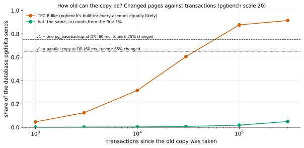

# EXP-38: How old can the copy be before pgdelta stops beating a full copy at DR?

Status: **done October 26, 2026 (scale 20, 52 s; all three predictions held): for TPC-B-like OLTP, scattered evenly, the changed share reached the DR crossover against one `pg_basebackup` (75%) after about 58,000 transactions; for hot, local changes it was 5% after 300,000. The count scales with the table's size: about 1.75 updated rows per page.** Pre-registered before the counted run (a smoke at scale 2 checked the script). Ledger test T11b, lean: the pitch by the age of the old copy. Local (the Mac): bytes measured, DR time projected from EXP-24's measurements.

## Question

pgdelta sends the pages that changed since the old copy was taken. The older the copy, the more pages have changed, until pgdelta sends about what a full copy does, plus the cost of hashing both. At DR round trips, how many transactions of a workload can an old copy be behind before pgdelta stops winning, for scattered and for local changes?

## Design

`experiments/bytes/exp38.py`:
- **The template:** `pgbench -i -s 20` (about 300 MB of relation files).
- **Per workload:** a clone is B0, the old copy, and S runs the workload in steps to 1,000, 3,000, 10,000, 30,000, 100,000 and 300,000 transactions (8 clients). After each step S is checkpointed and stopped, and the bytes pgdelta would send (its positional page comparison) are measured against B0.
- **Workloads:**
  - **tpcb:** pgbench's built-in TPC-B-like script, every account equally likely;
  - **hot:** the same script with the account drawn from the first 1%.
- **The projection,** fixed now from EXP-24 (60 ms, tuned hosts, 2.1 GB, BBR v1). Two medians, hot 3.63 s for 29.0 MB and uniform 6.62 s for 610.4 MB, give v1 ≈ 3.48 s + changed MB ÷ 194.4 MB/s. v1 then equals one `pg_basebackup` stream (11.63 s) at **75.3%** of the database changed, and the fastest parallel copy (10.48 s) at **64.7%**. The fraction is assumed to carry across database sizes, since both costs grow with size.
- **The analysis,** committed before the data: `analysis/exp38.py`.

## Predictions

1. **Deciding, tpcb:** the changed share reaches 75% within 100,000 transactions. At 1,000 transactions a second that's under two minutes, so for uniformly scattered OLTP, pgdelta beats a full copy at DR only if the old copy is refreshed every few minutes.
2. **hot:** the changed share stays under 10% through 300,000 transactions. For local workloads, pgdelta keeps its DR lead at any age measured.
3. tpcb's changed share keeps growing past 75% without reaching 100%. Indexes and the free-space map follow the table, but some pages (the branches, and parts of the history) stay put.

## What follows

- **If 1 and 2 hold:** the pitch is stated by workload. For local changes, pgdelta's DR lead holds whatever the copy's age. For uniformly scattered OLTP, it needs frequent refreshes, minutes behind at a thousand transactions a second, and beyond that a full copy (or native incremental, where history exists) is as good. The deployment note gives the crossover as a share of pages changed, which an operator can estimate.
- **If tpcb's share stays far below 75%:** pgdelta's DR lead lasts much longer for OLTP than feared, and the pitch widens.

## Limitations

- One synthetic workload per pattern; real OLTP mixes hot and cold data.
- Bytes are measured, and time is projected from one condition's model, not measured at each age.
- The projection is for BBR v1 on EXP-24's VMs; BLAKE3 would shorten c and move the crossover up.

## Results (scale 20: 345–365 MB of relation files)

Data: `docs/experiments/data/exp38-age.csv`; raw `results/bytes/exp38/results.jsonl`; figure `analysis/exp38.py`.

| Transactions | 1,000 | 3,000 | 10,000 | 30,000 | 100,000 | 300,000 |
|---|---:|---:|---:|---:|---:|---:|
| tpcb: share pgdelta sends | 4.7% | 12.5% | 31.6% | 60.5% | **87.6%** | 91.4% |
| tpcb: projected v1 at DR ÷ one `pg_basebackup` | 0.34 | 0.42 | 0.59 | 0.86 | 1.11 | 1.15 |
| hot: share pgdelta sends | 0.2% | 0.2% | 0.4% | 0.7% | 1.9% | **5.0%** |

**Crossovers** (interpolated in log transactions):
- **tpcb** reaches 75.3% (v1 = one `pg_basebackup` at DR) at about **58,000 transactions**, and 64.7% (v1 = the parallel copy) at about **36,000**;
- **hot** never reaches either.

| # | Prediction | Verdict |
|---|---|---|
| 1 | **Deciding: tpcb's share reaches 75% within 100,000 transactions** | **Held:** about 58,000 |
| 2 | hot stays under 10% through 300,000 | **Held:** 5.0% |
| 3 | tpcb grows past 75% without reaching 100% | **Held:** 91.4% at 300,000 |

## What follows

- **The pitch, by workload, at DR round trips:**
  - **for local changes,** pgdelta's lead holds at any age measured: 300,000 transactions changed 5% of the database;
  - **for evenly scattered OLTP,** the old copy must be recent: about 58,000 transactions behind (a minute at a thousand a second) before pgdelta and one `pg_basebackup` stream take the same time, and 36,000 against a parallel copy. Past that it is up to 15% slower, since it still hashes both copies. That count belongs to this database's size: TPC-B updates one row per transaction, spread evenly over `pgbench_accounts`' about 33,000 pages at scale 20, so the crossover comes at about **1.75 updated rows per page of the table**, and a database ten times larger takes about ten times as many transactions (for 100 GB of such a table, some 20 million).
- **For an operator:** the crossover is a share of pages changed, about 65–75% at DR, which WAL volume or `pg_stat` counters can estimate. A tool could even switch to a full copy when its own first pass finds most nodes changed. That isn't built.
- **Real OLTP sits between these two:** most production tables are hot in parts and cold in others. EXP-01's change-pattern study measured some of that range.
