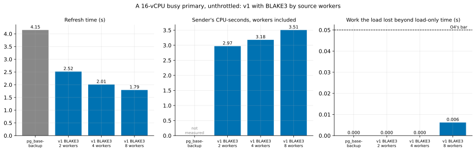

# EXP-39: On a larger source, can v1 use more workers on a busy primary?

Status: **done October 26, 2026 (one session, 10 runs, all counted; all three predictions held): on a 16-vCPU source, 4 workers met O4 and refreshed 20% faster than 2 (2.01 against 2.52 s, both repeats apart), so live mode's default now scales with the source: at most one worker per 4 CPUs, capped at 4.** Pre-registered before any run. T10b's larger-source block, lean. Three VMs (`PAIR=t10c`: a 16-vCPU source, `n2-standard-16`; dest `n2-standard-8`; client `n2-standard-4`; 28 vCPUs), about 45 minutes with set-up.

## Question

Live mode caps the default source workers at 2 (EXP-28, EXP-30), from tests on 8-vCPU sources: with BLAKE2b, 4 workers missed O4 in one of two sessions, and with BLAKE3, 4 were slower than 2. On a 16-vCPU source under the same relative load, do 4 or 8 workers meet O4, and are they faster? Should the cap scale with the source's CPUs?

## Design

EXP-28's driver (`lab_exp28.sh`), unchanged, with `BLAKE=1` (pgdelta from a venv with `blake3` on both ends):
- **The source:** a 16-vCPU `n2-standard-16`.
- **The load:** the bank load from 128 clients on the client VM, at 0.6 × C, with C measured at set-up on this source.
- **Arms:** `none`, `full` (one `pg_basebackup` stream), and v1 with `--hash blake3` at 2, 4 and 8 source workers (`v1b3_j2`, `v1b3_j4`, `v1b3_j8`).
- **Runs:** unthrottled only (EXP-28's harder case), 2 runs each, order seed 390. O4's two numbers and the bar as EXP-28's. An arm whose excess lies within 20% of its δ gets two more runs.

## Predictions

1. v1 at 2 workers meets O4, as on 8 vCPUs.
2. **Deciding: v1 at 4 workers meets O4 on 16 vCPUs.** The workers' share of the source's CPU halves.
3. v1 at 4 workers is faster than at 2 here, unlike on 8 vCPUs with BLAKE3 (EXP-30: 3.05 against 2.73 s). More cores leave room for the reads and the sender beside the load.

## What follows

- **If 2 and 3 hold:** live mode's default scales with the source: at most CPUs ÷ 4 workers (2 on 8 vCPUs, 4 on 16), capped at 4. That is a change to `pgdelta/cli.py`, tested.
- **If 4 workers meet O4 but are no faster:** the cap stays at 2, since the workers buy nothing.
- **If 4 workers miss:** the cap stays at 2 on any size measured.

## Limitations

One session, one load level, unthrottled only, 2 repeats. EXP-28's limitations apply.

## Results

Data: `docs/experiments/data/exp39-cells.csv`; raw `results/exp04/sets/t10c/exp39/`; figure `analysis/exp39.py`. The 16-vCPU source's closed-loop capacity C was 44,942 transactions a second (three runs: 37,987, 45,649, 44,942; EXP-30's 8-vCPU source: 24,527), so the load ran at R = 26,900 a second. Load-only, it kept 8.7 of the source's 16 vCPUs busy.

| Arm | Refresh time (s), 2 runs | Sender CPU-s | Work lost beyond load-only (s) | Worst 1-s drop beyond load-only | Load p95 / p99 (ms) | Meets O4 |
|---|---:|---:|---:|---:|---:|---|
| load only | (8 s window) | – | – | – | 3.8 / 4.6 | |
| `pg_basebackup` | 4.15 (4.00, 4.30) | – | 0.000 | 0.000 | 4.3 / 20.7 | the bar |
| v1, 2 workers | 2.52 (2.37, 2.66) | 3.0 | 0.000 | 0.000 | 4.4 / 26.6 | **yes** |
| v1, 4 workers | **2.01** (1.94, 2.08) | 3.2 | 0.000 | 0.000 | 4.5 / 35.1 | **yes** |
| v1, 8 workers | 1.79 (1.78, 1.81) | 3.5 | 0.006 | 0.007 | 11.1 / 25.7 | yes |

O4's bar was its floor: the load lost 0.05 s of work and 3 points of its worst second beyond `pg_basebackup`, which lost nothing measurable. No arm came within 20% of either number, so no extra runs were due.

| # | Prediction | Verdict |
|---|---|---|
| 1 | v1 at 2 workers meets O4 | **Held** |
| 2 | **Deciding: v1 at 4 workers meets O4 on 16 vCPUs** | **Held:** nothing lost beyond load-only |
| 3 | v1 at 4 workers is faster than at 2 | **Held:** 2.01 against 2.52 s, 20% faster; both runs at 4 beat both at 2 |

## What follows

- **The change, as registered:** with `--source-kind live`, `--jobs`'s default is now at most the source's CPUs ÷ 4, from 1 to 4. That's 2 on 8 vCPUs (EXP-28, EXP-30) and 4 on 16 (here). `pgdelta/cli.py` (`LIVE_CPUS_PER_JOB`, `live_max_jobs`) and its test. A `--jobs` given explicitly is kept, as before.
- **Below 8 vCPUs** the rule gives 1 worker (2 to 7 CPUs). That is untested on a busy source that small, and chosen to be cautious: EXP-28's single worker met O4 on 8 vCPUs.
- **8 workers met O4 too and were 11% faster than 4**, but the load's p95 latency rose to 8.6–13.7 ms, against 4.5 ms at 4 workers. The registered rule caps the default at 4, and one session doesn't justify going past it.
- **How hard this test was:** at 0.6 × C this source had about 7 idle vCPUs, so not even `pg_basebackup` cost the load measurable work. The bar here was its absolute floor (0.05 s of work, 3 points of the worst second), and every arm cleared it with room to spare. On the 8-vCPU source the copies did compete with the load (EXP-28: 4 BLAKE2b workers lost 0.073 s), and there the cap stays at 2.

## Deviations

None.
