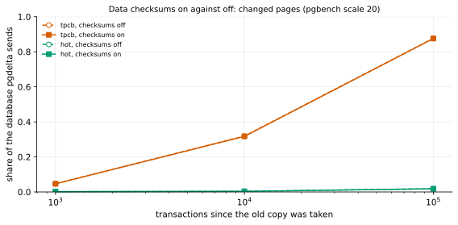

# EXP-41: Do data checksums change how many bytes pgdelta sends?

Status: **done October 26, 2026 (both predictions held): data checksums don't change how many bytes pgdelta sends. The largest gap in 6 paired cells was 0.16 percentage points, against a 2-point band. Byte results carry to AlloyDB Omni's container, which ships with checksums off.** Pre-registered before any run. Checksums-Omni's registered follow-up (FIRMNESS.md), lean: EXP-40 found AlloyDB Omni's container ships with data checksums off. Local (the Mac), about 3 minutes.

## Question

The byte counts so far come from clusters with data checksums on and off, not always said:
- **on:** the change-pattern study (EXP-01/02) and the network experiments' sources (EXP-04 onward), whose `initdb` passes `--data-checksums`;
- **off:** EXP-37 and EXP-38, whose `initdb` used PostgreSQL 17's default. Their documents didn't say so, and FIRMNESS.md's "all with data checksums on" is wrong for them.

Omni's container runs with checksums off. Does the setting change the share of pages pgdelta sends?

**Why it might not.** A page differs between S and B when S wrote it since B was taken. With checksums on, each written page carries a new checksum, but a page is written only after it changed. Setting a hint bit marks a page dirty with checksums on or off; with checksums on, it also logs a full-page image to the WAL, which doesn't change the data files. So the same pages should differ.

## Design

EXP-38's script (`experiments/bytes/exp38.py`) with a new switch, `--data-checksums off|on` (default `off`, what EXP-38 ran). Each row records the checksum version `pg_controldata` reports for its template.
- **Both arms in one session:** `off`, then `on`, each from its own fresh template (`pgbench -i -s 20`).
- **Workloads:** EXP-38's tpcb (every account equally likely) and hot (the first 1%).
- **Steps:** 1,000, 10,000 and 100,000 transactions (`EXP38_STEPS`), 8 clients.
- **The measure:** EXP-38's, the share of S's relation bytes whose page differs from B0's at the same offset.
- **The analysis,** committed before the data: `analysis/exp41.py`.

## Predictions

1. **Deciding:** at every workload and step, the share with checksums on lies within 2 percentage points of the share with them off.
2. `pg_controldata` reports checksum version 0 for `off` and 1 for `on`.

## What follows

- **If 1 holds:** byte counts carry across the checksum setting, so every byte result applies to Omni's container as shipped. Checksums-Omni closes for bytes; its other halves (`pg_rewind` needs checksums or `wal_log_hints`; pg_probackup's LSN mode) stand as EXP-40 recorded. EXP-37 and EXP-38 are labelled "checksums off" and FIRMNESS.md is corrected.
- **If it fails:** every byte result is labelled with its checksum setting, and the gap is measured where it matters (EXP-38's crossover with checksums on).

## Limitations

pgbench's TPC-B-like workloads only, at scale 20; one run per cell, so the 2-point band includes run-to-run variation (pgbench's own random draws differ between arms).

## Results

Data: `docs/experiments/data/exp41-checksums.csv`; raw `results/bytes/exp41/{off,on}/results.jsonl`; figure `analysis/exp41.py`. Both arms ran on the Mac with PostgreSQL 17.11, about a minute each.

| Workload | Transactions | Share sent, checksums off | Share sent, checksums on | Gap (points) |
|---|---:|---:|---:|---:|
| tpcb | 1,000 | 4.67% | 4.67% | +0.00 |
| tpcb | 10,000 | 31.87% | 31.71% | −0.16 |
| tpcb | 100,000 | 87.64% | 87.57% | −0.07 |
| hot | 1,000 | 0.17% | 0.17% | +0.00 |
| hot | 10,000 | 0.35% | 0.36% | +0.01 |
| hot | 100,000 | 1.85% | 1.81% | −0.04 |

The checksums-off arm also repeats EXP-38 (the same setting, another day): 4.7%, 31.6% and 87.6% there for tpcb, and 0.2%, 0.4% and 1.9% for hot.

| # | Prediction | Verdict |
|---|---|---|
| 1 | **Deciding: every cell within 2 percentage points** | **Held:** at most 0.16 |
| 2 | `pg_controldata` reports version 0 for `off` and 1 for `on` | **Held** |

## What follows

- **Byte counts carry across the checksum setting,** so pgdelta's byte results apply to AlloyDB Omni's container as shipped (checksums off, EXP-40). Checksums-Omni closes for bytes. Its other halves stand as EXP-40 recorded: `pg_rewind` needs checksums or `wal_log_hints`, both off in Omni's container.
- **The record is corrected:**
  - EXP-37 and EXP-38 ran with checksums off (PostgreSQL 17's `initdb` default), which their documents now say;
  - FIRMNESS.md's "all with data checksums on" now names which experiments had which.
- **EXP-37's sub-page counts are most likely unaffected too:** a page's checksum sits in its first 24 bytes, beside its LSN, which every write changes anyway, so the 512-byte block holding it already differs. That is reasoning, not measured here.
