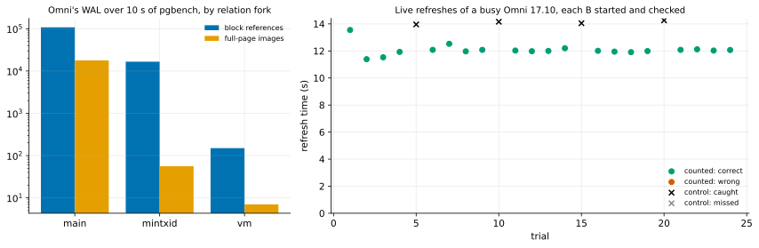

# EXP-42: Is v1 safe on a busy AlloyDB Omni, given Omni's own relation fork?

Status: **done October 26, 2026 (all four predictions held): Omni writes its `_mintxid` fork through the WAL, with full-page images, so live mode's recovery repairs it like any page; 20 of 20 live refreshes of a busy Omni 17.10 gave correct copies, and all 4 deliberately broken ones were caught.** Pre-registered before any run. OMNI-1b, lean: EXP-40's open point. One VM, about 25 minutes with set-up. The owner accepted the Omni container's license terms for this research use on October 26.

## Question

Live mode reads a running server's files while they change, and relies on recovery: every page changed during the backup is rewritten from the WAL, starting with a full-page image. EXP-40 found that Omni adds a relation fork community PostgreSQL doesn't have, `_mintxid`, which pgdelta copies as a plain file. Two questions:
- **The mechanism:** does Omni write `_mintxid` changes through the WAL, with full-page images, so recovery repairs a torn read of it like any page?
- **The outcome:** under a write load, do live refreshes of Omni give correct copies?

## Design

`experiments/omni/omni_live.sh` on one `n2-standard-4` VM (`PAIR=omni`), with Omni 17.10's container and its own binaries:
1. **Where the forks are:** after `pgbench -i -s 20`, every `_mintxid` file in the data directory, and whether pgbench's tables and indexes have one.
2. **The mechanism:** 10 s of pgbench, starting just after a checkpoint, with a slot holding the WAL.
   - The `_mintxid` files are hashed before and after, to see whether the workload changes them.
   - Omni's own `pg_waldump` counts the WAL's block references and full-page images by fork, over the workload's WAL.
3. **The trials:** 24 live refreshes in place.
   - **Each trial:** a fresh copy of B0 (S stopped after step 2, then started again) is refreshed while pgbench writes to S (4 clients).
   - **Controls:** every 5th trial (4 of 24) is pgdelta's deliberately broken variant (`PGDELTA_TEST_READ_BEFORE_START=1`, EXP-25's control), which reads S before `pg_backup_start` and always exits 4.
   - **The checks on each B,** started in Omni:
     - pgbench's invariant: the sums of account, teller and branch balances and of the history's deltas are all equal;
     - `bt_index_check` with `heapallindexed` on every btree index of the database, catalogs included;
     - `verify_heapam` on every table, then `VACUUM (FREEZE)`, then `verify_heapam` again (in case `_mintxid` steers freezing).
   - **Correct:** exit 0, B started, and every check passed. **Caught (a control):** any check failed or B didn't start; exit 4 alone doesn't count.
4. **The analysis,** committed before the data: `analysis/exp42.py`.

## Predictions

1. Recorded without a prediction: which relations have a `_mintxid` fork.
2. **The workload changes `_mintxid` files, and Omni's `pg_waldump` shows block references to that fork, with full-page images.** A persistent fork has to survive a crash, so Omni most likely logs it.
3. **Deciding: all 20 counted trials are correct.**
4. At least 3 of the 4 controls are caught.

## What follows

- **If 2, 3 and 4 hold:** live mode's argument carries to Omni. The fork is repaired by recovery like any page, and 20 trials found no wrong copy. The count is a weak bound on its own (below 35% at 99.9%); the mechanism carries the argument, with EXP-25's 1,000 trials on PostgreSQL behind it. G5 extends to live refreshes of a busy Omni.
- **If 2 fails** (the fork isn't in the WAL): live mode can't rely on recovery for `_mintxid`. Whether a torn or stale `_mintxid` is harmless is Omni's design, so it is recorded as an open risk and a question for Google (for the owner to forward). Omni live refreshes are then not claimed safe, whatever 3 shows.
- **If 3 fails:** live mode on Omni is unsupported until the cause is found.
- **If 4 fails:** the checks are too weak under this load, and 3 claims nothing.

## Limitations

- One VM, one load (pgbench, 4 clients), 24 trials; a container, not Omni on Kubernetes.
- What `_mintxid` is for is undocumented. The checks catch wrong data, broken indexes and broken heap pages, and freezing is exercised once per trial. A stale hint that only matters much later (at wraparound, say) would not show.

## Results

Data: `docs/experiments/data/exp42-trials.csv`; raw `results/omni/exp42/` (steps, every trial's statistics and logs, and a sample of the WAL dump's `_mintxid` lines, `waldump-mintxid-sample.txt`); analysis `analysis/exp42.py`, committed before the data. One `n2-standard-4` VM, Omni 17.10's container.

### Where the forks are

258 `_mintxid` files (8.7 MB) in a cluster with pgbench at scale 20: 6 in `global/` and 37–46 in each database's directory, the templates included. Tables have one and indexes don't:

| Relation | `_mintxid` fork |
|---|---|
| `pgbench_accounts` (about 260 MB) | 272 KiB, about one fork page per thousand table pages |
| `pgbench_branches`, `pgbench_tellers` | 32 KiB each |
| `pgbench_history` (empty after `pgbench -i`) | none |
| the three primary-key indexes | none |

### The mechanism

Over 10 s of pgbench that began just after a checkpoint, Omni's own `pg_waldump` read 127,818 WAL records:

| Fork | Block references | Full-page images |
|---|---:|---:|
| main | 108,191 | 17,826 |
| **mintxid** | **16,631** | **56** |
| vm (visibility map) | 150 | 7 |

The `_mintxid` changes are PostgreSQL's *generic* WAL records (16,627 of them, plus 4 plain full-page images): the facility an extension uses to log pages of its own format. Generic records register their buffers the standard way, so the first change to each page after a checkpoint carries a full-page image, as here. On disk, 17 of the 259 `_mintxid` files changed (one was new).

So live mode's argument holds for the fork. Recovery replays from the backup's checkpoint, rewrites every `_mintxid` page changed during the backup from its full-page image, and applies the later changes. A page pgdelta read while it was being written is replaced.

### The trials

| | Counted (20) | Controls (4, read before `pg_backup_start`) |
|---|---|---|
| pgdelta's exit | 0 in all | 4 in all, as the variant always fails |
| B started in Omni | 20 | 2 (2 refused to start) |
| pgbench's invariant (four equal sums) | 20 | 0 of the 2 that started |
| `bt_index_check` (every btree index) | 20 clean | 1 failed |
| `verify_heapam`, before and after `VACUUM (FREEZE)` | 20 clean, 0 corruptions | `VACUUM (FREEZE)` failed on both that started |
| **Verdict** | **20 correct** | **4 caught** |

The counted refreshes took 11.4–13.6 s (median 12.0), with 1 source worker on 4 vCPUs (EXP-39's default) and 7.4–9.0 s in backup mode. B0 stayed fixed while S ran on, so pgdelta sent 20,050 of 60,573 pages at trial 1 and 55,138 of 63,269 by trial 24, as the copy fell further behind.

| # | Prediction | Verdict |
|---|---|---|
| 1 | Recorded: which relations have a `_mintxid` fork | Tables (catalogs included), not indexes; 258 files |
| 2 | **The workload changes `_mintxid` files, and the WAL carries the fork, with full-page images** | **Held:** 16,631 references, 56 full-page images, 17 files changed |
| 3 | **Deciding: all 20 counted trials correct** | **Held** |
| 4 | At least 3 of 4 controls caught | **Held:** 4 of 4 |

## What follows

- **Live mode's argument carries to Omni 17.10:** Omni logs its own fork like a page, so recovery repairs whatever live mode read mid-write. 20 trials alone bound the failure rate only below 35% at 99.9% confidence. The argument rests on the mechanism, with EXP-25's 1,000 trials on PostgreSQL behind it. G5 extends to live refreshes of a busy Omni.
- **EXP-40's live-mode question closes.** Its other `_mintxid` question stays open: a stopped source's unlogged relation, whose `_mintxid` fork pgdelta would copy rather than leave out or reset. No unlogged table was in these runs.
- **The checks bite on Omni:** the broken variant produced copies that wouldn't start, or had unequal balances, a broken index, and a `VACUUM (FREEZE)` that failed. Omni's own failures look like PostgreSQL's.
- **Still open for Omni:** Omni on Kubernetes (OMNI-2), and what `_mintxid` is for (undocumented; the checks exercise freezing once per trial, not wraparound).
