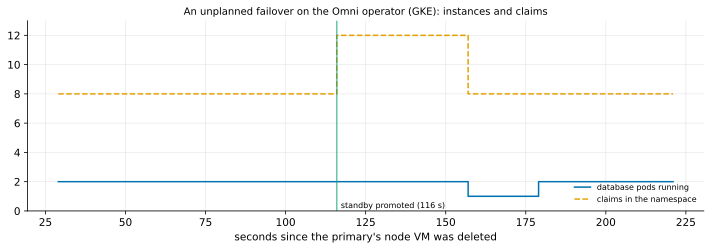

# EXP-44: On Kubernetes, does Omni leave an old copy to refresh, and can pgdelta run beside it?

Status: **done October 26, 2026.**
- **(a)** On Omni's Kubernetes operator, an unplanned failover leaves no old copy: the old primary's four disks were deleted about 40 s after the standby's promotion, and the new standby got new disks and a full `pg_basebackup`. Every instance the operator replaced lost its disks the same way.
- **(b)** A sidecar runs on the primary and the standby, reads PGDATA read-only as the database's user, and gets a real cgroup CPU quota. On a new standby it arrives by a pod restart after the seeding, so prediction 3 failed at its registered check and held 6 s later.

Pre-registered before any run. OMNI-2, lean, allowed by K4 (GKE), on the owner's go-ahead the same day. About an hour, mostly waiting for the cluster. The owner accepted Omni's license terms for this research use on October 26.

## Question

pgdelta's HA pitch assumes something the Omni notes mark "not documented": that a rebuilt standby's old disk still exists. Its deployment on Omni assumes a sidecar can read the data directory on the instance it refreshes. On the AlloyDB Omni operator for Kubernetes:
- **(a)** After an unplanned failover, does the old primary's disk survive (its PersistentVolumeClaim, its volume, its persistent disk)? Is it reused, and how is the new standby seeded?
- **(b)** Does a Sidecar attached to the cluster run on the standby too, and on a promoted primary? Can it read PGDATA, mounted read-only? Is its CPU limit a cgroup quota, as T10b's source cap assumes?

## Design

`experiments/omni/omni_gke.sh`, from the Mac, in phases.
1. **The cluster:** a zonal GKE cluster, 3 `e2-standard-4` nodes (12 vCPUs), labelled `purpose=pg-delta-benchmark`.
   - cert-manager v1.16.3, then the Omni operator 1.9.0 (Helm, Google's chart registry).
   - A `DBCluster` on Omni 18.4.0 with one standby: 2 CPUs, 8 GiB and a 10 GiB data disk per instance.
2. **Inventory:** pods, nodes, claims, volumes, storage classes and their reclaim policies, and the persistent disks. Each instance's settings (checksums, `wal_log_hints`, `summarize_wal`, TLS). Whatever the standby's and the operator's logs show of its seeding (`pg_basebackup` and its flags). A marker row on the primary.
3. **(b) The sidecar:**
   - the data disk's volume name is read from the database container;
   - a `Sidecar` (Debian 12, `sleep`, CPU limit 500m) mounts it read-only and is attached through `primarySpec.sidecarRef`;
   - on each instance pod: is the sidecar there, can it find and read `PG_VERSION`, is a write refused, what is `cpu.max`; and, through it, the node's `vm.dirty_*` and TCP settings.
4. **(a) The failover:**
   - the primary's node VM is deleted outright;
   - every 15 s for up to 25 minutes: the pods, the primary, the claims;
   - then the same inventory again, the marker read on the new primary, the new standby's and the operator's logs, and whether the sidecar is on both instances.
5. **Teardown:** the cluster, its claims and any disk left behind, then a check that nothing of it remains.
6. **The analysis,** committed before the data: `analysis/exp44.py`.

**Deviations from FIRMNESS.md's OMNI-2, decided now:**
- one zone, not three, and `e2-standard-4`, not `n2-standard-4` (us-central1 is short of small N2 VMs today);
- one failover, not three;
- TDE (c) and a blocked B (f) not run.

What the operator does with a disk shouldn't depend on zones or machine types. A second failover runs only if the first leaves the disk's fate unclear.

## Predictions

1. **Recorded, the deciding question (O1's HA case):** what becomes of the old primary's claim and disk, and how the new standby is seeded. No direction is predicted; the notes have no evidence either way.
2. **The sidecar runs on the standby as well as the primary, reads PGDATA, is refused a write, and has a cgroup quota of 500m (`cpu.max` = `50000 100000`).**
3. After the failover, the promoted primary and the new standby both have the sidecar.
4. Recorded: Omni 18.4's settings on Kubernetes, the node's dirty-page and TCP settings, and the seeding's `pg_basebackup` flags.

## What follows

- **(a) The old disk survives with its data:** the HA case's B exists on Kubernetes. pgdelta could refresh it instead of a full `pg_basebackup`, if the operator reused it. That is a change for the integrator, which the positioning names.
- **(a) The claim is reused, and the new standby is seeded into it:** B exists at exactly the step pgdelta would replace. This is the strongest case for HA.
- **(a) The claim and disk are deleted:** on an unplanned failover no B exists on Kubernetes. The HA pitch narrows to rebuilds that keep the disk, and DR, pgdelta's strongest case, leads.
- **(b) The sidecar runs on every instance, reads PGDATA and has a quota:** pgdelta can be deployed as the operator ships, and the source cap is a cgroup quota. If it is missing on standbys, pgdelta on the destination needs another route, recorded as a limit.

## Limitations

One cluster, one failover, one zone; Omni 18.4 under operator 1.9.0. A real deployment's storage class or the operator's settings may keep or delete disks differently, and are recorded as found.

## Results

Data: `docs/experiments/data/exp44-claims.csv`; raw `results/omni/exp44/` (steps, every snapshot's kubectl JSON, the failover timeline, the operator's and the standbys' logs, events); analysis `analysis/exp44.py`, committed before the data. GKE 1.36, operator 1.9.0, Omni 18.4.0, cert-manager v1.16.3.

### What the operator builds

- **Each instance** is a StatefulSet of one pod (`database`, `logrotate-agent`, `monitoring-agent`) plus a node-manager pod.
- **Each instance has four claims:** data, log, backup and observability disks.
  - each claim is owned by the instance's `Instance` resource, so it goes when the instance goes;
  - every storage class on the cluster deletes its disk with its claim (`reclaimPolicy: Delete`).
- **A standby is seeded** by the operator's agent running `pg_basebackup` into `/mnt/disks/pgsql/tmp_basebackup`, which is then moved to `/mnt/disks/pgsql/18/db`: 2.2 s at set-up and 3.5 s at the reseed, on a near-empty database. Its flags aren't logged (`cmd={}`).
- **Omni 18.4's settings under the operator differ from the 17.10 container's (EXP-40):**

| Setting | Operator (18.4) | Container (17.10, EXP-40) |
|---|---|---|
| `data_checksums` | **on** | off |
| `wal_log_hints` | **on** | off |
| `summarize_wal` | off | off |
| `ssl` | on | (not read) |
| replication | synchronous, `FIRST 1` | (none) |
| preloaded libraries | adds `google_db_advisor`, `google_insights`, `pg_stat_statements`, `pglogical`, `pgaudit` | 5 Google libraries |

- **The nodes (GKE's image):** `vm.dirty_ratio` 20, `dirty_background_ratio` 10, `dirty_expire_centisecs` 3000; cubic congestion control; TCP buffers up to 6 MiB (receive) and 4 MiB (send).

### (a) The failover

The primary's node VM was deleted at 0 s; the probe sampled every 20–30 s.

| When | What |
|---|---|
| by 116 s | the standby was promoted, the marker row intact on it. The new standby's four claims appeared (8 claims became 12) |
| 137 s | the old primary's pod still listed (its node gone), beside the two live instances |
| **157 s** | **the old primary's four claims were gone, with their volumes and persistent disks** |
| 179–223 s | the new standby was seeded by `pg_basebackup` (3.5 s) and running |

| The old primary's claim | After the failover |
|---|---|
| data, log, backup, observability | claim deleted, volume deleted, persistent disk deleted |

**The same happened outside the failover.** Attaching the sidecar restarted the pods. The restarted standby then failed its health checks, and the operator replaced it three times (`58d4`, `0f80`, `9431`), each with four new disks. That went on until a fourth node gave the pods room. The log doesn't show why the restart failed: memory, most likely, since the sidecar's 256 MiB pushed the pod over what a node had left. Either way, **in 4 replacements no instance's disk survived it.**

### (b) The sidecar

| Instance | Sidecar | uid | `cpu.max` | Reads `PG_VERSION` (18) | Write refused |
|---|---|---|---|---|---|
| primary | yes | 999 (the database's) | `50000 100000` (500m) | yes | yes |
| standby | yes | 999 | `50000 100000` | yes | yes |
| promoted primary, after the failover | yes | | | | |
| new standby, at 03:19:58 | **no** | | | | |
| new standby, at 03:20:04 | yes, by a pod restart; same claims | | | | |

The data disk is the volume `datadisk`, mounted at `/mnt/disks/pgsql` in the database container; PGDATA is `18/db` under it.

| # | Prediction | Verdict |
|---|---|---|
| 1 | **Recorded, the deciding question: the old primary's disk** | **Deleted, claim, volume and disk alike, about 40 s after the promotion; the new standby got new disks and a full `pg_basebackup`** |
| 2 | The sidecar runs on the standby too, reads PGDATA, is refused a write, and has a 500m quota | **Held** |
| 3 | After the failover, both instances have the sidecar | **Failed at the registered check:** the new standby got it 6 s later, by a pod restart after its seeding |
| 4 | Recorded: settings, node, seeding | Above |

## What follows

- **The HA case's B doesn't exist on Omni's operator as shipped.** After an unplanned failover, or any replacement of an instance, the operator deletes the old instance's disks and seeds a new one with a full `pg_basebackup`. O1's HA premise is refuted for Kubernetes.
  - pgdelta's HA role there needs an operator change: keep the old primary's data disk and refresh it, in place of the new standby's `pg_basebackup`. That is for the integrator, not something pgdelta can do from outside.
  - The rebuild it would replace is exactly the one measured: `pg_basebackup` into a side directory, then a move.
- **`pg_rewind`'s preconditions hold under the operator** (checksums and `wal_log_hints` on), but its HA failover doesn't use them: it deletes and reseeds. EXP-40's "no `pg_rewind`" holds for the container only.
- **DR stays pgdelta's case on Omni:** cross-region secondaries are seeded and re-seeded by the operator's `Replication` resource, not tested here. DR was already pgdelta's strongest result (EXP-20, -24, -36).
- **The sidecar is a workable deployment (O3), with two costs:**
  - **It works:** it runs on every instance as the database's user, reads PGDATA read-only, and its CPU limit is a cgroup quota, so live mode's source cap can be the sidecar's limit;
  - **A new standby gets it only after its seeding,** by a restart, so a sidecar can't take part in that seeding;
  - **Adding one restarts the pods,** and on a tight cluster that cost a standby replacement, a full reseed.
- **The nodes' dirty-page settings** (20 / 10) are what the HA-qualifier's "Debian's write-back" assumed (FIRMNESS.md), so that reading carries to GKE's nodes.

## Deviations

- **A fourth node** (`e2-standard-4`, 16 vCPUs in all) was added when the standby couldn't be scheduled with the sidecar.
- **The sidecar phase ran twice:** the first pass lost the standby mid-check as it was replaced, and the second ran once both instances were Ready.
- **The probe's operator-log capture** used a label selector that matched no pod, so the operator's logs were pulled by pod name before teardown (`operator-all.log`).
- **Prediction 3 is scored at its registered moment** (failed). The recheck 6 s later is reported beside it, not instead of it.
