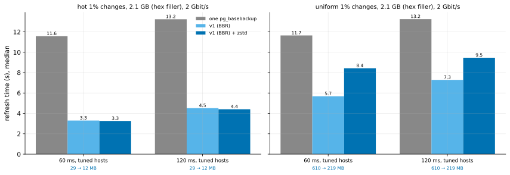

# EXP-45: Does compressing the pages sent make v1 faster at DR round trips?

Status: **done October 26, 2026 (counted run: 24 runs with BBR verified, all passing). The deciding prediction failed: zstd cut the bytes for scattered changes 2.78-fold, but made v1 slower, 1.48× at 60 ms and 1.30× at 120 ms. One VM core compressed only about 140 MB/s, slower than the 2 Gbit/s link, and the sender compresses in the thread that sends.** As registered, `--compress zstd` stays off, and the next build moves compression onto the workers. Pre-registered before any run. D35's lever, built and measured. One VM pair (EXP-36's set-up), 24 timed runs, about an hour with set-up.

## Question

At DR round trips v1 sends the changed pages over a link of a few Gbit/s. EXP-24's timing model puts v1 at about 3.48 s plus one second per 194 MB sent, at 60 ms on a 2 Gbit/s link with tuned buffers: for scattered changes the bytes dominate. EXP-37 measured zstd at level 3 on such pages: 2.83 times fewer bytes, at 548 MiB/s per core. That is faster than the link carries them.

`--compress zstd` (built for this, tested; off by default) compresses each run of pages on the sender and decompresses it on the receiver. Does it make v1 faster at DR round trips, and by how much?

## Design

EXP-36's harness command (`run_exp04.py`) and VMs (the default `n2-standard-8` pair), with:
- **conditions:** `2:60:tuned` and `2:120:tuned` (2 Gbit/s, 60 and 120 ms, TCP buffers up to 128 MiB), where EXP-24 found v1 with BBR ahead;
- **patterns:** hot and uniform 1% at scale 70 (about 2.1 GB);
- **data:** `--hex-filler`, new for this. pgbench's blank filler compresses far better than real rows would, so the accounts' filler is overwritten with hex text after the load, as in EXP-37, whose 2.83× is on this data;
- **methods:**
  - `full`, one `pg_basebackup` stream;
  - `pgdelta_direct_inplace_bbr`, v1 with BBR;
  - `pgdelta_direct_inplace_bbr_z`, the same with `--compress zstd`;
- **the VMs' Python:** Debian 12's 3.11, with `python3-zstandard` installed on both. The hash is BLAKE2b, as in EXP-36 (no `blake3` there).
- **runs:** 2 repeats, order seed 450, CRC32C manifests, EXP-36's link test and noise settings. Every output is verified by the harness.
- **The analysis,** committed before the data: `analysis/exp45.py`.

## Predictions

1. **Deciding:** for uniform 1% changes, v1 with zstd takes at most 0.90 of v1's median time at both round trips. EXP-24's model gives 0.70–0.85, depending on whether compressing overlaps sending: the sender compresses in the thread that sends.
2. For hot changes (about 30 MB sent), v1 with zstd is within 10% of v1: there is little to compress.
3. For uniform 1%, the bytes from source to destination fall at least 2-fold (EXP-37: 2.83× on the pages alone).
4. In every cell, v1 with zstd stays faster than one `pg_basebackup` stream, as v1 is (EXP-24, EXP-36).

## What follows

- **If 1 holds:** `--compress zstd` joins BBR in the DR deployment note: both opt-in, both for links of a few Gbit/s or less at long round trips. Whether it can be a default waits on a fast-link test, where compressing on one core should cost time.
- **If 1 fails while 3 holds:** the bytes fell but the time didn't. The sender's single compressing thread is then the bottleneck. Moving compression onto the hashing workers is the next build, and the option stays off.
- **If 3 fails:** these pages don't compress as EXP-37's did, which is reported, and the option stays as it is.

## Revision before the counted run (October 26, rule 8)

**The first session is set apart: BBR was not in effect.**
- The step that allows BBR on the source failed: the `tcp_bbr` module wasn't loaded, so the kernel answered "No such file or directory".
- pgdelta's statistics show every v1 run requested BBR and got cubic.
- The session's 24 runs (`results/exp04/exp45`) are reported apart, as EXP-25's first run was. They don't test the registered question, since cubic's slow mode at long round trips (EXP-24) varies run to run.

**The counted run uses the same VMs** with the module loaded (`modprobe tcp_bbr`), BBR allowed, and an unprivileged socket checked to get it. The command and order seed are unchanged (`results/exp04/exp45b`). Every v1 run must report `effective: bbr`, or it is set apart too.

## Limitations

One session, one data shape (pgbench with hex filler), 2 repeats, two round trips at one link rate. Compression at level 3 only. Real rows compress more or less than these.

## The set-apart session (cubic, not BBR)

Raw: `results/exp04/exp45/`. 24 runs, all passing and verified. Every v1 run requested BBR and got cubic.

| Cell | `pg_basebackup` (s) | v1, cubic (s) | v1 + zstd, cubic (s) | MB sent, v1 → v1 + zstd |
|---|---|---|---|---|
| hot, 60 ms | 11.69, 11.66 | 5.22, 5.12 | 3.44, 3.42 | 29 → 12 |
| hot, 120 ms | 13.31, 13.23 | 4.53, 4.70 | 4.42, 4.45 | 29 → 12 |
| uniform, 60 ms | 11.59, 11.65 | **23.66**, 6.13 | 8.62, 8.32 | 611 → 220 |
| uniform, 120 ms | 13.34, 13.24 | 7.36, 7.84 | 9.68, 10.71 | 610 → 220 |

The 23.66 s is cubic's slow mode at 60 ms, as EXP-24 found (23.94 s): one of two runs.

**The compression itself, from pgdelta's statistics, holds whatever the congestion control:**

| Pattern | Pages, raw | Ratio | Sender's compress time | Rate (one core) | Receiver's decompress time |
|---|---:|---:|---:|---:|---:|
| hot | 29 MB | 2.45–2.62× | 0.20–0.21 s | 137–142 MB/s | 0.04 s |
| uniform | 609 MB | 2.81–2.82× | 4.08–4.65 s | 131–149 MB/s | 0.93–0.98 s |

- The ratio matches EXP-37's 2.83× on the same data.
- Compressing ran at about 140 MB/s on one VM core: about a quarter of EXP-37's 548 MiB/s on the Mac's core, and slower than the 2 Gbit/s link (250 MB/s).
- The sender compresses in the thread that sends. So for scattered changes its 4.1–4.7 s of compressing came on top of sending: about 2.4 s slower than plain v1's normal runs at both round trips, where 390 MB fewer saves only about 2 s on this link.

## Results: the counted run (BBR)

Data: `docs/experiments/data/exp45-cells.csv`; raw `results/exp04/exp45b/`; figure `analysis/exp45.py --sweep results/exp04/exp45b`. 24 runs, all passing and verified; all 16 v1 runs report `effective: bbr`.

| Cell | `pg_basebackup` (s) | v1, BBR (s) | v1, BBR + zstd (s) | zstd ÷ v1 | MB sent, v1 → v1 + zstd |
|---|---:|---:|---:|---:|---|
| hot, 60 ms | 11.57 | 3.30 | 3.26 | 0.99 | 29 → 12 |
| hot, 120 ms | 13.24 | 4.52 | 4.41 | 0.98 | 29 → 12 |
| uniform, 60 ms | 11.65 | **5.68** | 8.43 | **1.48** | 610 → 219 |
| uniform, 120 ms | 13.25 | **7.29** | 9.46 | **1.30** | 610 → 219 |

Each figure is the median of 2 runs, which lay within 0.1 s of each other for v1 and within 0.7 s for v1 with zstd.

**The compression itself,** from pgdelta's statistics (as in the set-apart session):
- **uniform:** 608 MB became 216 MB (2.81×) in 4.08–4.64 s of the sender's time, 131–149 MB/s;
- **hot:** 2.45–2.62×, in 0.2 s;
- **the receiver** decompressed in 0.9 s (uniform), in its main loop.

| # | Prediction | Verdict |
|---|---|---|
| 1 | **Deciding: uniform, v1 with zstd at most 0.90 of v1 at both round trips** | **Failed:** 1.48 and 1.30 |
| 2 | hot within 10% of v1 | **Held:** 0.99 and 0.98 |
| 3 | uniform bytes fall at least 2-fold | **Held:** 2.78× |
| 4 | v1 with zstd faster than one `pg_basebackup` in every cell | **Held:** 0.28–0.72 |

## Why (after the fact, and labelled so)

The sender compresses each run of pages before it sends it, in one thread. The cost is serial: about 4.3 s for 608 MB at about 140 MB/s. Sending 389 MB fewer saves that many MB divided by v1's effective rate, read off this session's own medians (uniform less hot, per MB): about 244 MB/s at 60 ms and 210 MB/s at 120 ms, so 1.6 and 1.9 s.

| Round trip | Compress (s) | Sending saved (s) | Predicted net (s) | Measured net (s) |
|---|---:|---:|---:|---:|
| 60 ms | 4.3 | 1.6 | +2.7 | **+2.75** |
| 120 ms | 4.3 | 1.9 | +2.5 | **+2.17** |

**Where serial compression would pay** (a projection from these rates): only on links slower than 140 × (1 − 1/2.8) ≈ 90 MB/s, about **0.7 Gbit/s**. With compression running beside sending on its own core it would pay below about 140 MB/s (1.1 Gbit/s). Compressing on the source's workers in parallel, k of them, raises that to about k × 1.1 Gbit/s: about 4.5 Gbit/s with 4, which would make it a win at this 2 Gbit/s link.

Why one VM core managed a quarter of EXP-37's rate on the same data isn't settled here. EXP-37 measured on the Mac, with the standard library's `compression.zstd`, compressing larger buffers. The VMs ran Debian's `zstandard` 0.20, on Intel cores at 2.8 GHz.

## What follows (as registered: 1 failed while 3 held)

- **`--compress zstd` stays off by default** and isn't recommended for DR links of 2 Gbit/s or more as built. Its help text and README row now say where it can pay: links slower than about 0.7 Gbit/s.
- **The next build moves compression onto the source's workers,** in parallel with hashing and pipelined with sending. It is then measured again at this link, with the projection above (about 4.5 Gbit/s break-even with 4 workers) as its registered prediction.
- **The ratio is settled:** 2.81× on hex-filler pages for scattered changes, matching EXP-37. Only the CPU is in the way.
