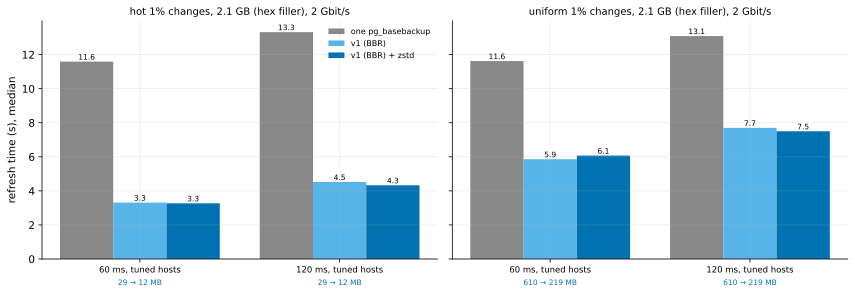
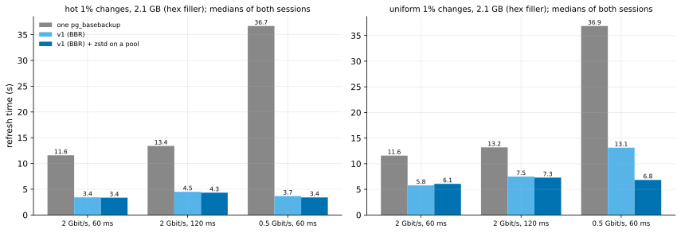

# EXP-46: With compression on a pool beside sending, does zstd make v1 faster at DR?

Status: **done October 26, 2026 (two sessions, 60 runs, 12 of them on the exploratory link; all passing; BBR in effect on all 40 v1 runs).**
- **The deciding prediction failed, firmly:** at 2 Gbit/s, compressing on the pool made scattered changes neither faster nor slower: 1.05 and 0.97 of v1's time at 60 and 120 ms, both sessions alike. The pool did remove EXP-45's penalty, and the sending thread waited only 0.3–0.5 s.
- **The exploratory 0.5 Gbit/s link is where zstd pays:** scattered changes took 0.52 of v1's time, 6.84 s against 13.12, and 0.19 of `pg_basebackup`'s.

Pre-registered before any run. EXP-45's registered next step: its deciding prediction failed because the sender compressed in the thread that sends. EXP-45's design and VMs, about an hour.

## Question

In EXP-45, zstd sent 2.78× fewer bytes for scattered changes but made v1 1.30–1.48× slower at 2 Gbit/s. One thread compressed about 140 MB/s, serially with sending.

Now the sender compresses each run on a pool of threads, one per source worker (`--jobs`, 4 here), while its main thread reads and sends. Up to two runs per thread wait, and they're sent in order.

A local measurement on the same hex-filler pages showed the pool can deliver (Mac, 3-page runs):
- 500–571 MB/s on one thread;
- 1.44–1.68 GB/s on 4 threads, as fast as 4 processes.

zstd releases Python's lock while it compresses. Does compression now pay at this link?

## Design

EXP-45's counted run, unchanged except for the code: the default `n2-standard-8` pair, `2:60:tuned` and `2:120:tuned`, hot and uniform 1% at scale 70 with `--hex-filler`, methods `full`, `pgdelta_direct_inplace_bbr` and `pgdelta_direct_inplace_bbr_z`, 2 repeats, order seed 460. `python3-zstandard` is installed on both VMs.

**BBR is loaded** (`modprobe tcp_bbr`) and allowed on the source, and an unprivileged socket is checked to get it, before the run. Every v1 run must report `effective: bbr`, or it is set apart.

**The analysis,** committed before the data: `analysis/exp46.py`, which runs EXP-45's on these runs (files tagged `-pool`) and reads pgdelta's own statistics.

## Predictions

1. **Deciding: for uniform 1% changes, v1 with zstd takes at most 0.90 of v1's median time, at both round trips.**
   - **The projection:** 4 threads at EXP-45's per-thread rate, less some contention, about 400 MB/s, compress 608 MB in about 1.5 s. That overlaps sending 219 MB, about 0.9 s at v1's effective rate. Against v1's 2.5 s for 610 MB, that's about 0.82.
2. For hot changes, v1 with zstd is within 10% of v1.
3. For uniform, the sending thread waits at most 1.1 s in all for compressed runs: a quarter of EXP-45's serial 4.1–4.7 s. Compression is off the critical path.
4. For uniform, the bytes fall at least 2-fold, and v1 with zstd stays faster than one `pg_basebackup` in every cell.

## What follows

- **If 1 holds:** `--compress zstd` is recommended beside BBR for DR links of 2 Gbit/s and less. A fast-link test finds where it stops paying. Whether it can be part of a DR default then waits on its CPU cost on a busy source (O4): compressing adds source CPU, at most `--jobs` threads.
- **If 1 fails while 3 holds:** compression is off the critical path but still doesn't pay. The source's CPU, shared with the hashing workers, is then the limit, and the option stays off for links this fast.
- **If 3 fails:** the pool doesn't keep up, and the per-thread rate on these VMs is the question.

## Limitations

One session, one data shape, two round trips at one link rate, level 3. The pool adds CPU on the source, which this test doesn't price against a load (EXP-28's O4 does).

## Results: session 1

Data: `docs/experiments/data/exp46-cells-s1.csv`; raw `results/exp04/exp46/`; analysis `analysis/exp46.py`. The pair ran in **us-central1-a**: us-central1-b was out of `n2-standard-8` with local SSDs, and the zone wasn't part of the design. 24 runs, all passing; BBR in effect on 16 of 16 v1 runs; `zstandard` 0.20 on both VMs.

| Cell | `pg_basebackup` (s) | v1, BBR (s) | v1 + zstd on the pool (s) | zstd ÷ v1 | EXP-45's zstd ÷ v1 (serial) |
|---|---:|---:|---:|---:|---:|
| hot, 60 ms | 11.56 | 3.27 | 3.29 | 1.01 | 0.99 |
| hot, 120 ms | 13.32 | 4.52 | 4.33 | 0.96 | 0.98 |
| uniform, 60 ms | 11.62 | 5.86 | 6.07 | **1.04** | 1.48 |
| uniform, 120 ms | 13.09 | 7.70 | 7.50 | **0.97** | 1.30 |

**Where the time went** (uniform; pgdelta's own timers, per run):

| | v1 | v1 + zstd on the pool |
|---|---|---|
| Sender: time blocked sending pages | 1.8 s at 60 ms, 2.4 s at 120 ms | 1.3 s, 1.5 s |
| Sender: compressing, summed over 4 threads | – | 5.8–6.0 s, off the critical path |
| Sender: waiting for a compressed run | – | **0.34–0.37 s** (EXP-45: 4.1–4.7 s, all of it on the path) |
| Receiver: decompressing, in its main loop | – | **0.87–1.19 s** |
| Bytes sent | 610 MB | 219 MB (2.78×) |

| # | Prediction | Verdict (session 1) |
|---|---|---|
| 1 | **Deciding: uniform, at most 0.90 of v1 at both round trips** | **Failed, provisional:** 1.04 and 0.97, both within 20% of 0.90 |
| 2 | hot within 10% of v1 | **Held:** 1.01, 0.96 |
| 3 | uniform: the sender waits at most 1.1 s for compressed runs | **Held:** 0.34–0.37 s |
| 4 | bytes fall at least 2-fold; faster than `pg_basebackup` in every cell | **Held:** 2.78×; 0.33–0.57 |

**What this session says, after the fact:**
- The pool did what it was built for: the penalty of EXP-45 (1.30–1.48×) is gone.
- The bytes saved shortened the sender's blocked sending by 0.5–0.9 s, but the receiver spent 0.9–1.2 s decompressing in its main loop. That is about the same, so the total barely moved.
- The registered guess for "1 fails while 3 holds" named the source's CPU. The timers point at the receiver's serial decompression instead.

## Revision before session 2 (October 26, rule 8 and K10)

- **The second session** runs the same code, design and predictions on fresh VMs. Order seed 461; results in `results/exp04/exp46b`.
- **An exploratory condition is added** and doesn't touch the decision: `0.5:60:tuned` (0.5 Gbit/s, 60 ms). There the network dominates, and the same arms are run.
  - **Registered now for it:** for uniform at 0.5 Gbit/s, v1 with zstd takes at most 0.70 of v1. Sending 610 MB at about 60 MB/s takes about 10 s; 219 MB takes about 3.6 s, and decompressing about 1 s.
- **The verdict on prediction 1** combines both sessions' medians per cell (4 runs). If both sessions miss 0.90, it fails firmly.

## Results: both sessions

Data: `docs/experiments/data/exp46-cells.csv` (medians of all runs per cell; each session's ratio beside them); raw `results/exp04/exp46/` and `results/exp04/exp46b/`; analysis `analysis/exp46.py --sweep results/exp04/exp46 --sweep results/exp04/exp46b`. Session 2 ran on fresh VMs, also in us-central1-a, and its 24 v1 runs all report BBR.

| Uniform 1% (scattered) | `pg_basebackup` | v1 | v1 + zstd on the pool | zstd ÷ v1 | session 1 | session 2 |
|---|---:|---:|---:|---:|---:|---:|
| 2 Gbit/s, 60 ms | 11.58 s | 5.77 s | 6.07 s | **1.05** | 1.04 | 1.07 |
| 2 Gbit/s, 120 ms | 13.19 s | 7.49 s | 7.29 s | **0.97** | 0.97 | 0.97 |
| **0.5 Gbit/s, 60 ms** (exploratory) | 36.87 s | 13.12 s | **6.84 s** | **0.52** | – | 0.52 |

| Hot 1% (local) | `pg_basebackup` | v1 | v1 + zstd | zstd ÷ v1 |
|---|---:|---:|---:|---:|
| 2 Gbit/s, 60 ms | 11.59 s | 3.42 s | 3.35 s | 0.98 |
| 2 Gbit/s, 120 ms | 13.40 s | 4.50 s | 4.33 s | 0.96 |
| 0.5 Gbit/s, 60 ms | 36.69 s | 3.66 s | 3.41 s | 0.93 |

| # | Prediction | Verdict |
|---|---|---|
| 1 | **Deciding: uniform at most 0.90 of v1 at both round trips (2 Gbit/s)** | **Failed:** 1.05 and 0.97, both sessions alike (the revision's rule: both sessions miss, so it fails firmly) |
| 2 | hot within 10% of v1 | **Held:** 0.96–0.98 |
| 3 | uniform: the sending thread waits at most 1.1 s | **Held:** 0.28–0.52 s in both sessions |
| 4 | bytes at least 2-fold fewer; faster than `pg_basebackup` everywhere | **Held:** 2.78×; 0.19–0.57 of it |
| exploratory | uniform at 0.5 Gbit/s at most 0.70 of v1 | **Held:** 0.52 |

## What follows

- **`--compress zstd` is recommended for DR links of about 1 Gbit/s and slower, beside BBR, and stays off by default.**
  - At 0.5 Gbit/s it made scattered changes 1.9× faster: 13.1 s became 6.8 s, against 36.9 s for `pg_basebackup`.
  - At 2 Gbit/s it gains nothing, and loses nothing.
  - The break-even lies between the two and wasn't measured. "About 1 Gbit/s" is a judgment from the two points, not a measurement.
- **Why it stops paying at 2 Gbit/s** (session 1's timers, after the fact): the bytes saved shorten the sending by 0.5–0.9 s, and the receiver spends about as long decompressing in its main loop. Pipelining decompression on the receiver, as the sender now compresses, is the next lever, if a fast-link win matters.
- **For the pitch:** at DR, pgdelta was already 0.50–0.57 of one `pg_basebackup` stream at 2 Gbit/s for scattered changes. On a 0.5 Gbit/s link it is 0.36 without compression and **0.19 with it**.
