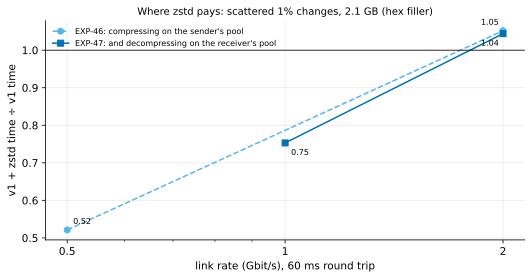

# EXP-47: With decompression pipelined on the receiver too, where does zstd pay?

Status: **done October 26, 2026 (12 runs, all passing; BBR on all 8 v1 runs).**
- **The receiver's pool did its job:** it waited 0.07–0.08 s for decompressed runs, not 0.9–1.2 s.
- **zstd still doesn't pay at 2 Gbit/s:** 1.04 of v1, then 1.05 with the second session's runs added (K10), so the deciding prediction failed, firmly.
- **At 1 Gbit/s it took 0.75 of v1** (prediction 3, at most 0.75, missed by 0.003).
- **zstd's time was about 6.1 s at both link rates,** a floor that doesn't depend on the link. Plain v1 is already under it at 2 Gbit/s (5.91 s). Interpolated within the session, the break-even is about **1.8 Gbit/s**.

Pre-registered before any run. EXP-46's next lever. One VM pair, 12 timed runs, about 45 minutes with set-up.

## Question

EXP-46 moved compression onto a pool beside the sender's sending thread. At 2 Gbit/s zstd was then even with v1 for scattered changes (1.05, 0.97), and at 0.5 Gbit/s it took 0.52 of v1's time. Its timers put the 2 Gbit/s limit at the receiver: it decompressed in its main loop, 0.9–1.2 s per run, about what the smaller sending saved (0.5–0.9 s).

Now the receiver decompresses on a pool of `--jobs` threads as runs arrive, and writes them in order: before plain pages, a file's end, an append and the end, every queued run is written first. Two questions:
- Does zstd now pay at 2 Gbit/s?
- Where is its break-even? EXP-46's "about 1 Gbit/s" was a judgment between two measured points.

## Design

EXP-46's harness command and VMs (the default `n2-standard-8` pair, the first us-central1 zone with capacity), with:
- **patterns:** uniform 1% only (hot changes moved by at most 4% in all of EXP-45 and EXP-46);
- **conditions:** `2:60:tuned` (deciding) and `1:60:tuned` (1 Gbit/s, 60 ms, the break-even probe);
- **methods:** `full`, `pgdelta_direct_inplace_bbr`, `pgdelta_direct_inplace_bbr_z`;
- **data:** `--hex-filler`; 2 repeats, order seed 470;
- **set-up:** BBR loaded, allowed and checked on the source, and `python3-zstandard` on both ends. Every v1 run must report `effective: bbr`, or it is set apart;
- **the analysis,** committed before the data: `analysis/exp47.py`.

## Predictions

1. **Deciding: at 2 Gbit/s, v1 with zstd takes at most 0.90 of v1's median time.** This is projected, not certain: taking the receiver's 0.9–1.2 s off its main loop leaves EXP-46's 0.5–0.9 s of sending saved, about 0.85–0.92.
2. The receiver waits at most 0.3 s in all for decompressed runs: decompression is off its critical path. In EXP-46 it spent 0.9–1.2 s on it.
3. At 1 Gbit/s, v1 with zstd takes at most 0.75 of v1. There the network dominates: about 5 s for v1's 610 MB against 1.8 s for 219 MB.
4. Bytes fall at least 2-fold, and v1 with zstd is faster than one `pg_basebackup` in every cell.

## What follows

- **If 1 holds:** `--compress zstd` is recommended beside BBR for DR links of 2 Gbit/s and slower.
- **If 1 fails while 2 holds:** decompression is off the path but zstd still doesn't pay at 2 Gbit/s. The recommendation's ceiling is then set by prediction 3 (1 Gbit/s) and EXP-46 (0.5 Gbit/s), and the remaining limit is elsewhere: the source's CPU, shared with hashing, or per-frame costs.
- **Either way,** the README states the measured ratio at 0.5, 1 and 2 Gbit/s, not a judgment.

## Limitations

One session, uniform changes only, 60 ms only, hex-filler data, level 3. The receiver's pool adds CPU on the destination.

## Results

Data: `docs/experiments/data/exp47-cells.csv`; raw `results/exp04/exp47/`; analysis and figure `analysis/exp47.py`. The pair ran in us-central1-a; BBR in effect on 8 of 8 v1 runs; `zstandard` 0.20 on both ends.

| Uniform 1% (scattered), 60 ms | `pg_basebackup` | v1 | v1 + zstd (both pools) | zstd ÷ v1 | zstd ÷ `pg_basebackup` |
|---|---:|---:|---:|---:|---:|
| 2 Gbit/s | 11.62 s | 5.91 s | 6.17 s | **1.04** | 0.53 |
| 1 Gbit/s | 20.38 s | 8.11 s | 6.11 s | **0.75** | 0.30 |
| 0.5 Gbit/s (EXP-46, the sender's pool only) | 36.87 s | 13.12 s | 6.84 s | 0.52 | 0.19 |

**The receiver:** it waited 0.07–0.08 s for decompressed runs, with 2.1–2.4 s of decompressing summed over its 4 threads. EXP-46 spent 0.9–1.2 s in its main loop.

| # | Prediction | Verdict |
|---|---|---|
| 1 | **Deciding: 2 Gbit/s, at most 0.90 of v1** | **Failed:** 1.04 (within 20% of the bar, so provisional by rule 11; see below) |
| 2 | the receiver waits at most 0.3 s | **Held:** 0.07–0.08 s |
| 3 | 1 Gbit/s, at most 0.75 of v1 | **Failed, by 0.003:** 0.753 |
| 4 | bytes at least 2-fold fewer; faster than `pg_basebackup` | **Held:** 2.78×; 0.30 and 0.53 |

## Why it stops at 2 Gbit/s, and the break-even (after the fact)

- **zstd has a floor.** v1 with zstd took 6.17 s at 2 Gbit/s and 6.11 s at 1 Gbit/s: its time hardly depends on the link, so something other than the network bounds it. The candidates are the source's CPU (4 hashing workers and 4 compressing threads on 8 vCPUs) and per-frame costs. Neither is diagnosed here.
- **Plain v1's time does depend on the link.** It fits 3.71 s + 4.4 s ÷ (Gbit/s): 5.91 s at 2, 8.11 at 1, and 12.5 projected at 0.5 against EXP-46's measured 13.1. It crosses zstd's 6.1 s floor at about **1.8 Gbit/s**. That is the break-even, interpolated within one session, not measured.
- **The second session (K10)** was argued against at first: to meet the bar zstd would need at most 5.32 s, below the 6.11 s it took on half the link rate. It was then run anyway, on fresh VMs (BBR on all 4 v1 runs): v1 5.71 and 5.87 s, zstd 5.95 and 6.25 s. With all 4 runs per arm, zstd takes **1.05** of v1 at 2 Gbit/s (`docs/experiments/data/exp47-cells.csv`). The failure is firm, and the floor held (6.1 s).

## Revision: the second session after all (October 26, K10)

The owner's rule asks for a second session on a deciding cell within 20% of its bar. The argument above for skipping it stands, but it is a reason, not the rule. The second session runs:
- only the deciding cell: uniform at `2:60:tuned`, the three methods, 2 repeats;
- on fresh VMs, order seed 471; results in `results/exp04/exp47b`.

The verdict on prediction 1 then uses both sessions' runs per method (`analysis/exp47.py --sweep results/exp04/exp47 --sweep results/exp04/exp47b`).

## What follows

- **`--compress zstd` is recommended beside BBR for DR links below about 1.8 Gbit/s,** opt-in. Measured: 0.52 of v1 at 0.5 Gbit/s, 0.75 at 1, and even at 2. The help text and README now give these numbers rather than a judgment.
- **Lowering zstd's floor** would extend it to faster links, starting by finding what the 6.1 s is spent on. It isn't scheduled: v1 alone already takes about half of `pg_basebackup`'s time at 2 Gbit/s.
