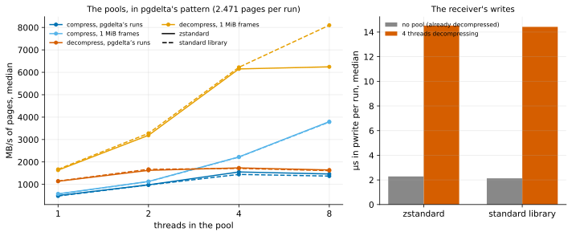

# EXP-49: What sets zstd's 6.1 s floor?

Status: **done October 27, 2026 (one local session, 3 repeats; the deciding prediction held, 2 and 3 failed). With 4 threads decompressing, the receiver's main thread spent 6.4× as long in each write (14.5 µs against 2.3). Neither codec is the bound: on pgdelta's small runs both pools stop gaining at about 1.5–1.7 GB/s, whatever the thread count, while 1 MiB frames scale almost linearly.** The bound is the pool's cost per task, about 12–13 µs here. Pre-registered before any run. Local (the Mac): no network and no VMs, only pgdelta's codec, its thread pools and the page data. Lean: one script, about two minutes of runs. The open item from EXP-47 ("a floor that doesn't depend on the link ... Neither is diagnosed here").

## Question

With `--compress zstd`, v1 took about 6.1 s at both 1 and 2 Gbit/s (EXP-47), so something other than the link bounds it. Plain v1 crosses that floor at about 1.8 Gbit/s. If the floor is set by pgdelta's own code rather than by the CPU, it can be lowered, and zstd would pay on faster links.

## What EXP-47's statistics already say (read after that experiment, so they guide this one but decide nothing)

From the 8 v1 runs at 60 ms (`results/exp04/exp47/logs/*/source/*-stats.json.log`), pgdelta's own timers:

| | plain v1, 2 Gbit/s | zstd, 2 Gbit/s | zstd, 1 Gbit/s |
|---|---|---|---|
| pgdelta's own total | 5.41–5.43 s | 5.64–5.70 s | 5.57–5.68 s |
| sender blocked in `send()` | 1.86–1.88 s | 1.36–1.51 s | 1.32–1.41 s |
| sender waiting for its compressing pool | none | 0.29–0.33 s | 0.32–0.39 s |
| receiver writing pages (`rebuild`) | 0.76–0.77 s | 1.59–1.69 s | 1.57–1.61 s |
| receiver waiting for its decompressing pool | none | 0.08 s | 0.07–0.08 s |

The same 29,060 runs were sent in every run, 20,957 bytes on average (2.56 pages).
- **The sender is not the bound.** It barely waits for its pool, and it blocks in `send()` for longer at 2 Gbit/s than the 216 MB it sends needs there (0.87 s). That is back-pressure from the receiver.
- **The receiver's writes take twice as long with zstd,** although the bytes written are the same, and its pool is never what it waits for.
- **Per-run compression is slow:** the per-run times sum to 5.7–6.1 s on 4 threads, about 105 MB/s per thread. EXP-37 measured 548 MiB/s per core on 1 MiB frames, on the Mac.

**The suspect:** the receiver's main thread, which writes every run, competes for Python's global interpreter lock (GIL) with 4 decompressing threads. Each write is a system call; the thread gives up the GIL for it and must win it back. Small runs make many such handoffs: 29,060 in each direction.

## Design

`experiments/bytes/exp49.py`, on the Mac (Apple M5 Pro, 15 cores, so no CPU is short), Python 3.14.
- **The data:** EXP-37's uniform scenario (pgbench scale 10 with hex filler, `UPDATE` of 1% of the rows at random, stopped cleanly). The pages positional matching sends are grouped into pgdelta's own runs: `matching.runs` with 128 pages at most (`RUN_BYTES`). The mean run length is reported beside EXP-47's 2.56 pages.
- **The codec:** pgdelta's own `Codec` (level 3) on both bindings, `zstandard` (0.25) and the standard library's `compression.zstd`.
- **The pools:** each cell runs pgdelta's pattern: a `ThreadPoolExecutor`, at most two runs per thread in flight, results taken in order on the main thread.
- **Cells:**
  - **Pool throughput:** compress and decompress × 1, 2, 4 and 8 threads × two frame sizes: pgdelta's runs, and 1 MiB frames of the same bytes.
  - **The receiver's loop,** emulated: the main thread writes each decompressed run at its offset with `os.pwrite` into a file. This is timed twice: with the 4-thread decompressing pool running, and with the same bytes already decompressed (no pool). The measure is the main thread's time inside `pwrite`, as pgdelta's `rebuild` timer counts it.
- **Size:** each cell processes at least 300 MB (the data, passed over several times); 3 repeats, median; order fixed.
- **The analysis,** committed before the data: `analysis/exp49.py`, figure `exp49-zstd-floor`.

## Predictions

1. **Deciding: the receiver's writes slow down with the pool.** With `zstandard` and 4 decompressing threads, the main thread spends at least 1.5× as long in `pwrite` as without the pool (the VM: 2.1×).
2. **The pools scale poorly on pgdelta's runs:** with `zstandard`, 4 threads reach less than 2.5× one thread's throughput, for compression and for decompression.
3. **Per-frame cost:** one thread compresses pgdelta's runs at no more than 0.7× its rate on 1 MiB frames.

The standard library's binding is measured beside `zstandard`, with no prediction.

## What follows

- **If 1 holds:** the floor is attributed to the receiver's GIL handoffs, reproduced without the VMs' CPU limits. The fix to test is fewer, larger handoffs: several runs per compressed frame, or per pool task. It is tested locally first. The re-measure at 2 Gbit/s needs VMs, so it waits for the cloud sign-in.
- **If 1 fails:** the receiver's slowdown is not reproduced on an unconstrained CPU. The remaining candidate is the VMs' CPU: each end of EXP-47 ran 4 hashing processes, 4 codec threads and a main thread on 8 vCPUs. That can only be tested on VMs.
- **2 and 3** say whether small frames cost on their own, apart from the GIL. Either way, the result goes in RESULTS.md's list of bandwidth levers.

## Results (October 27)

One session on the Mac, 3 repeats per cell in a fixed order; the repeats agreed within about 7%. The data: 4,187 runs, 2.47 pages each on average (EXP-47: 2.56), 84.8 MB. zstd shrank them 2.83× on both bindings, as in EXP-37. Data: `docs/experiments/data/exp49-cells.csv`; raw `results/bytes/exp49/results.json`; analysis and figure `analysis/exp49.py`.

| MB/s of pages (zstandard, median) | 1 thread | 2 | 4 | 8 |
|---|---|---|---|---|
| compress, pgdelta's runs | 504 | 980 | **1,554** | 1,464 |
| compress, 1 MiB frames | 579 | 1,130 | 2,225 | 3,799 |
| decompress, pgdelta's runs | 1,138 | 1,626 | **1,736** | 1,642 |
| decompress, 1 MiB frames | 1,636 | 3,189 | 6,151 | 6,244 |

The standard library's binding matched within about 7% in every cell but one, decompressing 1 MiB frames on 8 threads (8,099).

**The receiver's loop,** emulated: 4 threads decompress while the main thread writes each run in order.

| zstandard | in `pwrite`, per run | the whole loop |
|---|---|---|
| no pool (bytes already decompressed) | 2.3 µs | 8.7 GB/s |
| 4 threads decompressing | **14.5 µs** | 1.06 GB/s |

The standard library's binding: 2.1 µs and 14.4 µs (6.8×).

| # | Prediction | Verdict |
|---|---|---|
| 1 | **Deciding: with the pool, the receiver's writes take at least 1.5× as long** | **Held:** 6.4× (the standard library's binding: 6.8×) |
| 2 | On pgdelta's runs, 4 threads reach under 2.5× one thread's throughput, compressing and decompressing | **Failed:** decompression held (1.53×), compression didn't (3.08×) |
| 3 | One thread compresses pgdelta's runs at no more than 0.7× its rate on 1 MiB frames | **Failed:** 0.87× |

## What it means

- **The codec isn't the floor.** One thread compresses pgdelta's runs at 0.87× its 1 MiB rate, so zstd's own cost per frame is small.
- **The pool's cost per task is the floor.** On pgdelta's runs both pools stop gaining past 4 threads, at about 77,000 compressions and 86,000 decompressions a second: about 13 and 12 µs of main-thread time per run. Given 1 MiB frames, the same pools scale 3.8× at 4 threads.
- **The receiver's own work pays for it too.** Every write waits about 12 µs longer while the pool runs, consistent with the main thread winning back the interpreter's lock from the pool's threads after each system call. On the VMs, EXP-47's `rebuild` grew in the same way, 0.76 s to 1.6 s (2.1×).
- **How much of the 6.1 s it explains** isn't measured here. On the Mac these per-run costs add up to about 1.1 s for EXP-47's 29,060 runs: about 13 µs at the sender, plus 12 + 12 µs at the receiver. The VMs' vCPUs are slower, and each end shared 8 of them with 4 hashing processes, so it is likely more there, by a factor this experiment doesn't give.
- **The standard library's binding behaves the same,** so changing binding doesn't help.

## What follows

- **The fix to test:** fewer, larger handoffs. A pool task would take consecutive runs up to about 1 MiB of pages: about 50 runs instead of 1 at EXP-47's run length. Nothing on the wire has to change, since each run can stay its own frame.
  - Locally, the pools should then approach their 1 MiB rates (2.2 and 6.2 GB/s at 4 threads), and the receiver's writes should lose most of their 12 µs.
  - Whether that lowers the floor at 2 Gbit/s needs the VMs, so it waits for the cloud sign-in.
- **zstd stays opt-in for links below about 1.8 Gbit/s** until then; nothing here changes EXP-47's verdict.
