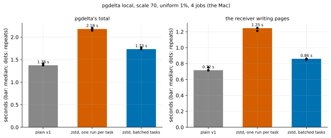

# EXP-50: Do larger pool tasks lower zstd's floor?

Status: **done October 27, 2026 (10 local runs; 1 and 2 held, 3 failed on a flawed criterion). Batching the pools' tasks cut zstd's extra time over plain v1 from 0.81 s to 0.36 s (0.44 of it; the bar was 0.5), and the receiver's writes from 1.74× plain's to 1.20×.** Prediction 3 compared files digests, which are keyed per session and differ on every run, even plain against plain, so it could not hold. Its registered rule applies anyway: **the default is back to one run per task,** and batching waits, behind its switch, for EXP-51. That is a second session (rule 11: 0.44 is within 20% of its bar) with a byte-for-byte check against S. Local (the Mac), end to end with `pgdelta local`. The fix EXP-49 pointed to.

## Question

EXP-49 found that zstd's floor comes from pgdelta's thread pools, not the codec. Each pool task costs about 12–13 µs on the Mac. EXP-47's runs average 2.5 pages, so the pools stop gaining at 1.5–1.7 GB/s, and with 4 threads decompressing, each of the receiver's writes took 6.4× as long. If each task takes many runs instead of one, the handoffs fall about fiftyfold. Does that remove zstd's extra time?

## The change

- **The sender** queues runs and hands its compressing pool one task per `TASK_BYTES` of pages (1 MiB), or less at a file's end. The task compresses each run separately, so every run still goes as its own `PAGE_DATA_ZSTD` frame (or `PAGE_DATA` if it didn't shrink).
- **The receiver** gathers arriving compressed frames into one task per `TASK_BYTES ÷ 4` of frames: 256 KiB, about 0.7 MiB of pages at zstd's 2.8×. Its rules stay as they were:
  - every queued run is written, in order, before any other message is handled;
  - a run that decompresses past its file is refused.
- **Nothing on the wire changes,** and a session without `--compress` doesn't touch either path.
- **For this comparison only,** the environment variable `PGDELTA_ZSTD_TASK_BYTES=0` restores one run per task (EXP-47's code path).

## Design

`experiments/bytes/exp50.py`:
- **The data:** EXP-37's template (pgbench with hex filler) at **scale 70**, as EXP-47's data, and EXP-37's uniform update (1% of rows at random), stopped cleanly. This is S; B is the template before the update.
- **The run:** `pgdelta local --in-place --source-kind datadir --jobs 4`, with B cloned fresh before every run (APFS clones), and its statistics written (`--stats-json`).
- **Arms:**
  - `plain`: v1 without compression;
  - `zstd_per_run`: `--compress zstd` with `PGDELTA_ZSTD_TASK_BYTES=0`;
  - `zstd_batched`: `--compress zstd`, the new default.
- **Order:** one untimed warm-up run, then 3 repeats. Each repeat runs all three arms, in a rotated order (repeat 1: plain, per run, batched; repeat 2: per run, batched, plain; repeat 3: batched, plain, per run).
- **Measures,** all from pgdelta's own statistics:
  - its total time;
  - the receiver's `rebuild` (its time writing pages);
  - the sender's and the receiver's waits for their pools;
  - the files digest.
- **The analysis,** committed before the data: `analysis/exp50.py`, figure `exp50-batched-tasks`.
- **A smoke at scale 1** checked the plumbing before this was committed:
  - all 10 runs completed;
  - with `PGDELTA_ZSTD_TASK_BYTES=0`, both ends ran one task per run (436 of 436);
  - batched, they ran 26 and 30 tasks.

  At that scale each run takes about 0.35 s, too short to say anything about time, and the predictions weren't changed after it (`results/bytes/exp50-smoke`).

## Predictions

1. **Deciding: batching cuts zstd's extra time over plain v1 by at least half** (medians): `zstd_batched − plain ≤ 0.5 × (zstd_per_run − plain)`. If `zstd_per_run` is less than 0.3 s slower than `plain`, there is too little to cut locally, and 1 is reported as undecided.
2. **The receiver's writes:** `rebuild` takes at least 1.5× plain's with one run per task, and at most 1.3× plain's when batched.
3. **Correctness:** every run completes verified, and all three arms produce the same files digest.

## What follows

- **If 1 holds:** batching stays as the default; the code, tests and README note go in with this write-up.
  - The VM re-measure at 2 Gbit/s (EXP-47's cells) waits for the cloud sign-in. Its registered prediction will be that zstd at 2 Gbit/s falls below plain v1's 5.9 s.
- **If 1 fails or is undecided:** the batching is reverted, and what remains is reported. Candidates are the per-run work inside each task and each end's main thread.
- **If 3 fails anywhere,** the change is reverted, whatever 1 says.

## Results (October 27)

One local session: the warm-up and 3 repeats per arm, in the rotated order. Every run completed with pgdelta's own verification. Each zstd run sent the same 29,114 runs (EXP-47: 29,060) as 212.7 MB on the wire. Data: `docs/experiments/data/exp50-runs.csv`; raw `results/bytes/exp50/runs.jsonl`; analysis and figure `analysis/exp50.py`.

| Median of 3 | plain v1 | zstd, one run per task | zstd, batched tasks |
|---|---|---|---|
| pgdelta's total | 1.38 s | 2.18 s (+0.81) | **1.73 s (+0.36)** |
| the receiver writing pages (`rebuild`) | 0.72 s | 1.25 s (1.74×) | **0.86 s (1.20×)** |
| pool tasks, sender / receiver | none | 29,114 / 29,114 | 548 / 783 |
| waiting for the pool, sender / receiver | none | 0.08 / 0.03 s | 0.006 / 0.003 s |

The repeats agreed within 0.06 s in every arm.

| # | Prediction | Verdict |
|---|---|---|
| 1 | **Deciding: batching cuts zstd's extra time over plain by at least half** | **Held:** 0.36 of 0.81 s remains (0.44); the per-run arm was 0.81 s slower, enough to decide locally |
| 2 | `rebuild`: at least 1.5× plain's per run, at most 1.3× batched | **Held:** 1.74× and 1.20× |
| 3 | Every run complete, one files digest across all runs | **Failed as written:** all 10 complete, but 10 different digests |

**Why 3 failed:** the files digest combines per-file digests keyed with the session's random key (`pgdelta/hashing.py`, `FilesDigest`), so it names one run's verified content and differs on every run. The 4 plain runs differ from each other too. The criterion was wrong, not, as far as this shows, the copies. But the registered rule said a failed 3 reverts the change, whatever 1 says, so it is applied rather than reinterpreted.

## What it means

- **Larger tasks remove most of zstd's extra time locally.** The pools went from 29,114 tasks to 548 and 783, waiting for them almost vanished, and the receiver's writes lost most of their slowdown. That is the mechanism EXP-49 found.
- **What remains, 0.36 s,** is compression and decompression themselves and the per-run work inside each task.
- **This is the Mac, end to end over loopback.** Whether it lowers the 6.1 s floor at 2 Gbit/s on VMs is a separate question.

## What was done

- **The default is back to one run per task** (`compress.TASK_BYTES` defaults to 0, EXP-47's path), as the rule says. The batching code stays, off by default, behind `PGDELTA_ZSTD_TASK_BYTES`; its tests run it explicitly.
- **EXP-51,** pre-registered next:
  - a second local session of the same comparison;
  - every refreshed copy's relation files compared byte for byte with S's;
  - a negative control: B before the refresh must differ.

  If both hold, batching becomes the default, and the VM test at 2 Gbit/s follows.
