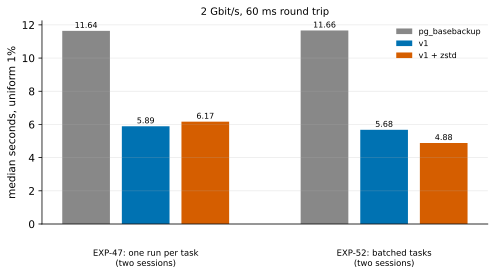

# EXP-52: With batched pool tasks, does zstd beat plain v1 at 2 Gbit/s?

Status: **done October 27, 2026 (two sessions on fresh VMs, 12 runs, all passing; the deciding prediction held, prediction 2 failed). At 2 Gbit/s and 60 ms, v1 with zstd now takes 0.86 of plain v1's time (4.88 s against 5.68), where EXP-47 found it even (1.05, 6.17 s). It took 0.42 of `pg_basebackup`'s time.** Batched pool tasks took 1.3 s off zstd's floor on the VMs. The receiver's writes still took 1.38× v1's, above prediction 2's 1.3, though down from 2.1×. Pre-registered before any run. One VM pair, about 45 minutes. The test on a DR link that EXP-51 called for: batching is now the default, and EXP-47's deciding cell is rerun with it.

## Question

At 2 Gbit/s and 60 ms, zstd took 1.05 of plain v1's time over EXP-47's two sessions: about 6.1 s, a floor that didn't depend on the link. EXP-49 traced the floor to the thread pools' cost per task. EXP-50 and EXP-51 cut zstd's extra time over plain v1 to 0.45 of it locally, by giving each pool task up to 1 MiB of pages. Does zstd now beat plain v1 on the link where it was even?

## Design

EXP-47's second session exactly (`results/exp04/exp47b`), with pgdelta as it now is:
- **The VMs:** the default `n2-standard-8` pair, in the first us-central1 zone with capacity. BBR is loaded, allowed and checked on the source, and `python3-zstandard` is installed on both ends.
- **The cell:** uniform 1%, `2:60:tuned` (2 Gbit/s, 60 ms, tuned TCP buffers), hex-filler data, 2 repeats, order seed 520.
- **Methods:** `full`, `pgdelta_direct_inplace_bbr` (v1), `pgdelta_direct_inplace_bbr_z` (v1 with zstd, now in batched tasks).
- **The comparison is within the session,** zstd against v1, as in EXP-47. Every v1 run must report `effective: bbr`, or it is set apart.
- **The analysis,** committed before the data: `analysis/exp52.py`, which reuses EXP-47's medians. Its figure, `exp52-batched-dr`, sets this session beside EXP-47's.
- **A second session** on fresh VMs follows if prediction 1's ratio lands within 20% of its bar (rule 11). The verdict then uses both sessions' runs, as EXP-47's did.

## Predictions

1. **Deciding: at 2 Gbit/s, v1 with zstd takes at most 0.90 of v1's median time.** EXP-47 registered the same bar and measured 1.05.
   - The projection behind it: plain v1 at 2 Gbit/s is about 3.7 s of fixed work plus 2.2 s of link (EXP-47's fit). zstd's floor of about 6.1 s is 2.4 s above that fixed work.
   - If batching removes about as much of that 2.4 s as it removed locally (0.55), zstd takes about 4.8 s, about 0.81 of v1.
   - The VMs' slower vCPUs, 4 hashing processes beside the pools, could move that either way.
2. **The receiver's writes:** with zstd, its `rebuild` takes at most 1.3× v1's (EXP-47: 2.1×; locally batched: 1.20×).
3. **The setup holds:**
   - every zstd run uses batched tasks, with fewer than a tenth as many tasks as runs at both ends (so the deployed code is the new one);
   - BBR is in effect on every v1 run.
4. Bytes fall at least 2.5-fold, and v1 with zstd is faster than one `pg_basebackup`.

## What follows

- **If 1 holds:** zstd's floor no longer keeps it even at 2 Gbit/s. The README's "below about 1.8 Gbit/s" is re-derived from the new numbers. The break-even moves up, and a run at a faster link rate would place it. zstd stays opt-in either way, because EXP-26's fairness finding is about BBR, and compression costs the source CPU.
- **If 1 fails:** batching stands on its local evidence, but the floor on VMs is set by something else. Each end's 8 vCPUs, shared with 4 hashing processes, are the first candidate, testable with `--jobs`.

## First session (October 27), before the second

- **Where and what:** us-central1-a; BBR in effect on both v1 runs; batched tasks on both ends (560 and 796 tasks for 29,053 runs).
- **Times:** zstd 4.89 s against v1's 5.72 s, **0.855** (EXP-47: 6.17 s, 1.05). Prediction 1's ratio is within 20% of its 0.90 bar, so the second session runs on fresh VMs (order seed 521), as registered. The verdict on every prediction will use both sessions' runs.
- **The receiver's writes:** they took 1.41× v1's (1.08 s against 0.76; EXP-47: 2.1×), over prediction 2's 1.3.

## Results (October 27)

Both sessions ran in us-central1-a, on fresh VMs each time (order seeds 520 and 521). Every run passed. BBR was in effect on 4 of 4 v1 runs, and every zstd run used batched tasks on both ends: 560 and 796 tasks for 29,053 runs. Data: `docs/experiments/data/exp52-cells.csv`; raw `results/exp04/exp52` and `exp52b`; analysis and figure `analysis/exp52.py`.

| Uniform 1%, 2 Gbit/s, 60 ms (median) | `pg_basebackup` | v1 | v1 + zstd | zstd ÷ v1 |
|---|---|---|---|---|
| EXP-47, one run per task (two sessions) | 11.64 s | 5.89 s | 6.17 s | 1.05 |
| **EXP-52, batched tasks, first session** | 11.60 s | 5.72 s | 4.89 s | 0.855 |
| **EXP-52, second session** | 11.75 s | 5.64 s | 4.88 s | 0.865 |
| **EXP-52, both (4 runs each)** | 11.66 s | 5.68 s | **4.88 s** | **0.859** |

zstd sent 219 MB against v1's 610 MB (2.79× fewer). The receiver's `rebuild` took 1.08 s with zstd against 0.78 s for v1 (EXP-47: 1.60 against 0.76).

| # | Prediction | Verdict (both sessions) |
|---|---|---|
| 1 | **Deciding: zstd takes at most 0.90 of v1 at 2 Gbit/s** | **Held:** 0.859 (0.855 and 0.865) |
| 2 | The receiver's `rebuild` with zstd at most 1.3× v1's | **Failed:** 1.38× (EXP-47: 2.1×) |
| 3 | Batched tasks on every zstd run; BBR on every v1 run | **Held:** 560 and 796 tasks per 29,053 runs; BBR on 4 of 4 |
| 4 | Bytes at least 2.5× fewer; zstd faster than one `pg_basebackup` | **Held:** 2.79×; 0.42 |

## What it means

- **zstd's floor fell from about 6.1 s to 4.9 s,** about what the projection from the local cut gave (4.8 s). The cause was the one EXP-49 found: the pools' cost per task. zstd now pays at 2 Gbit/s, where it didn't.
- **The receiver still pays some of it:** its writes take 0.3 s longer with zstd than without, down from 0.85 s. On 8 vCPUs shared with 4 hashing processes, the remaining handoffs cost more than on the Mac (1.20× there).
- **The break-even is now above 2 Gbit/s, but not measured:**
  - **Low end, about 3.7 Gbit/s:** if zstd's time stays at about 4.9 s on faster links, plain v1 reaches it there, by EXP-47's fit (3.7 s + 4.4 s ÷ Gbit/s).
  - **High end, about 9 Gbit/s:** zstd's time can fall by at most its own 0.9 s on the wire at 2 Gbit/s, which puts the break-even no higher than that.

  A run at a faster rate would place it.
- **The advice changes:** use `--compress zstd` on DR links of 2 Gbit/s and slower. It was measured faster there:
  - 0.52 at 0.5 Gbit/s and 0.75 at 1 Gbit/s, with one run per task (EXP-46, EXP-47), which batching can only help;
  - 0.86 at 2 Gbit/s, batched.

  Above 2 Gbit/s it is unmeasured. It stays opt-in: it costs the source CPU, and EXP-26's fairness finding concerns BBR, which these runs used.
