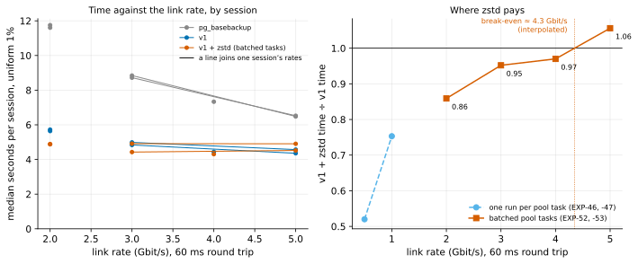

# EXP-53: Where is zstd's break-even now?

Status: **done October 27, 2026 (three VM sessions, 30 runs, all passing; all four predictions held). zstd's break-even with batched tasks is about 4 Gbit/s at 60 ms:** zstd took 0.95 of v1's time at 3 Gbit/s, 0.97 at 4 and 1.06 at 5. Interpolated, it crosses 1.0 at 4.35 Gbit/s across all the measured rates, or 3.9 from the two-session cells at 3 and 5 alone. Within each session zstd's time is flat from 3 Gbit/s up (its floor), while v1's keeps falling. Pre-registered before any run; the 4 Gbit/s session was added by a rule 8 revision, before any result was read. Two sessions on one VM pair each, about 45 minutes each. The open number behind the README's zstd advice.

## Question

With batched pool tasks, zstd took 0.86 of plain v1's time at 2 Gbit/s and 60 ms (EXP-52). Above 2 Gbit/s nothing is measured, so the advice stops there. On faster links v1's own time falls, because 610 MB crosses the link faster. zstd's falls less, since it sends 219 MB. Somewhere the two meet. Where?

**The projection,** from EXP-52's session and EXP-47's fit:
- **Plain v1** is about 3.5 s of fixed work plus 4.4 s ÷ Gbit/s on the link: 5.68 s at 2 Gbit/s.
- **zstd's time** of 4.88 s at 2 Gbit/s lies between two bounds:
  - **flat:** it stays at 4.88 s on faster links;
  - **falling:** it loses its own wire time, 1.75 Gbit ÷ the rate, on top of 4.0 s.

Equating each with v1 puts the break-even between **3.1 Gbit/s (flat)** and **5.1 Gbit/s (falling)**.

## Design

EXP-52's command and VMs, at two new rates:
- **The VMs:** the default `n2-standard-8` pair, the first us-central1 zone with capacity; BBR loaded and checked; `python3-zstandard` on both ends.
- **Conditions:** `3:60:tuned` and `5:60:tuned`. 5 Gbit/s at 60 ms is within these VMs' internal egress, about 16 Gbit/s; EXP-13 ran it.
- **The rest:** uniform 1%, hex-filler data, 2 repeats; methods `full`, `pgdelta_direct_inplace_bbr` and `pgdelta_direct_inplace_bbr_z`.
- **Two sessions on fresh VMs, from the start** (order seeds 530 and 531). Every ratio here is expected near 1.0, within rule 11's 20% of the bar, so a second session would be required anyway. The verdict uses both sessions' runs; each session is also reported.
- **The emulator check:** a condition whose steady one-stream link test falls below 90% of its rate is reported as emulator-limited (prediction 2).
- **The analysis,** committed before the data: `analysis/exp53.py`, figure `exp53-break-even`. EXP-52's 2 Gbit/s cell is drawn beside these.

## Predictions

1. **Deciding: the break-even lies between 3 and 5 Gbit/s:** zstd takes at most 1.00 of v1's time at 3 Gbit/s, and at least 1.00 at 5 Gbit/s.
2. **The emulator delivers:** the steady one-stream link test reaches 90% of 3 and of 5 Gbit/s in every trial.
3. **The setup holds:** BBR is in effect on every v1 run, and every zstd run uses batched tasks.
4. **Both pgdelta arms beat one `pg_basebackup` stream** at both rates.

## What follows

- **The advice uses the measured crossing:** zstd for DR links below the break-even, interpolated linearly between the measured rates on either side and rounded down to 0.5 Gbit/s. It is labeled as interpolated in the README, the CLI help and RESULTS.md.
- **If zstd is still faster at 5 Gbit/s,** the advice becomes "up to 5 Gbit/s, measured", and the break-even stays above that, unmeasured.
- **If it is already slower at 3 Gbit/s,** the break-even lies between 2 and 3 Gbit/s, interpolated.

## Revision before any result was read (October 27, rule 8)

**A third session at 4 Gbit/s.**
- **Why:** the owner asked for the break-even to be placed at 3 and 4 Gbit/s. That request arrived after this experiment was registered and started at 3 and 5, while the first session's results had been fetched but not read.
- **What it adds:** `4:60:tuned` on fresh VMs after the second session, otherwise the same command (2 repeats, order seed 532).
- **Unchanged:** the conditions of the first two sessions and every prediction.
- **How it is used:** the analysis reports the 4 Gbit/s cell beside the others, and the break-even is interpolated across 2, 3, 4 and 5 Gbit/s. With one session there, the 4 Gbit/s cell is reported as one session's.

## Results (October 27)

Three sessions on fresh VMs in us-central1-a, all runs passing:
- **sessions 1 and 2** (order seeds 530 and 531): 3 and 5 Gbit/s;
- **session 3** (seed 532): 4 Gbit/s.

BBR was in effect on 10 of 10 v1 runs, and every zstd run used batched tasks (about 560 and 800 tasks for 29,050 runs). The emulator's steady one-stream link test reached 95–96% of every rate. Data: `docs/experiments/data/exp53-cells.csv`; raw `results/exp04/exp53`, `exp53b` and `exp53c`; analysis and figure `analysis/exp53.py`.

| Uniform 1%, 60 ms (median, all sessions' runs) | `pg_basebackup` | v1 | v1 + zstd | zstd ÷ v1 | per session |
|---|---|---|---|---|---|
| 2 Gbit/s (EXP-52) | 11.66 s | 5.68 s | 4.88 s | 0.86 | 0.855, 0.865 |
| 3 Gbit/s | 8.74 s | 4.94 s | 4.70 s | **0.95** | 0.986, 0.915 |
| 4 Gbit/s (one session) | 7.33 s | 4.44 s | 4.31 s | **0.97** | 0.970 |
| 5 Gbit/s | 6.48 s | 4.46 s | 4.71 s | **1.06** | 1.073, 1.037 |

**Compare times within a session, not across sessions.** Each VM pair runs at its own speed:
- **session 1:** zstd took 4.9 s at both 3 and 5 Gbit/s, while v1 went from 4.99 s to 4.57 s;
- **session 2:** zstd took 4.4–4.5 s, while v1 went from 4.84 s to 4.36 s;
- **session 3, at 4 Gbit/s:** both arms ran faster (4.31 and 4.44 s).

So the medians mix pairs. The ratios, taken within each session, are the measure.

| # | Prediction | Verdict |
|---|---|---|
| 1 | **Deciding: zstd at most 1.00 of v1 at 3 Gbit/s, at least 1.00 at 5** | **Held:** 0.952 and 1.056 (each session: 0.986 and 0.915; 1.073 and 1.037) |
| 2 | The steady one-stream link test reaches 90% of each rate | **Held:** 95–96% at 3, 4 and 5 Gbit/s |
| 3 | BBR on every v1 run; batched tasks on every zstd run | **Held:** 10 of 10; every zstd run batched |
| 4 | Both pgdelta arms beat one `pg_basebackup` at both rates | **Held:** v1 0.56 and 0.69 of it, zstd 0.54 and 0.73 (0.61 and 0.59 at 4 Gbit/s) |

## What it means

- **zstd's break-even is about 4 Gbit/s:**
  - **4.35 Gbit/s,** interpolated across 2, 3, 4 and 5 Gbit/s;
  - **3.9 Gbit/s** from the two-session cells at 3 and 5 alone.

  Both are interpolated. By the registered rule (round down to 0.5), **the advice is zstd for DR links below 4 Gbit/s.**
- **The gain shrinks fast above 2 Gbit/s:** 14% at 2 Gbit/s, 5% at 3, 3% at 4. On scattered changes zstd is worth it chiefly on links of 2 Gbit/s and slower, where it saves 14–48%.
- **zstd is at its floor from 3 Gbit/s up.** Within each session its time doesn't change with the rate, about 4.3–4.9 s depending on the VM pair. Batching lowered that floor from 6.1 s; what remains is compression and decompression themselves and each end's main thread.
- **v1 nears its own floor too:** it took 4.36–4.57 s at 5 Gbit/s, its hashing and writing with little left on the link.
- **Against `pg_basebackup`,** both pgdelta arms stay ahead at every rate, but by less as the link gets faster: v1 took 0.49 of its time at 2 Gbit/s and 0.69 at 5. Consistent with EXP-24's DR claim, here with BBR up to 5 Gbit/s at 60 ms.
