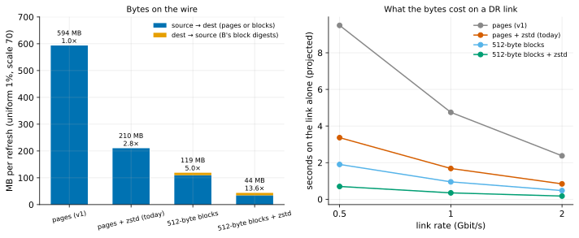

# EXP-54: Do sub-page deltas still pay on top of zstd?

Status: **done October 27, 2026 (one local run over EXP-51's data; all three predictions held). Sub-page deltas plus zstd send 0.21 of what zstd alone sends for scattered updates:** 43.7 MB against 210.3 MB, 13.6× fewer than whole pages, counting B's block digests on the way back. Compressing them took a fifth of zstd's CPU (0.26 s against 1.21). So sub-page deltas are worth building for slow DR links. Pre-registered before any run. Local (the Mac): only bytes and CPU, no network. Lean: one script over existing data, a few minutes. It decides whether sub-page deltas, the largest open lever, are worth building.

## Question

EXP-37 measured two ways to send fewer bytes for scattered updates, each against plain positional pages:
- **sub-page deltas:** only the 512-byte blocks of each page that differ from B's page at that offset, 5.0× fewer bytes including B's block digests;
- **zstd:** 2.8× fewer.

zstd has since shipped and pays below about 4 Gbit/s (EXP-53). Sub-page deltas would mean a protocol change:
- B's block digests travel to the source;
- the source sends a per-page bitmap and the changed blocks;
- the receiver patches blocks in place.

Is that still worth building, once the blocks are compressed too? If sub-page plus zstd sends little less than zstd alone, the answer is no.

## Design

`experiments/bytes/exp54.py`, over EXP-51's data (`scratchpad/exp50-work`):
- **The data:** S is the scale-70 template after EXP-37's uniform update (1% of rows at random), as EXP-47, -52 and -53 sent; B is the template. Same scale and pattern as the VM experiments.
- **The files:** every relation file (base/, global/), with pgdelta's runs: consecutive changed pages, at most 128 per run.
- **Four ways to send each run,** each as one frame:
  - `positional`: the run's pages, as v1 sends them;
  - `positional_zstd`: the same, zstd level 3 per run, as `--compress zstd` sends them;
  - `subpage`: for each page, a 2-byte bitmap of its 16 blocks of 512 bytes, then the blocks that differ from B's page at that offset. A page B lacks goes whole, all 16 bits set;
  - `subpage_zstd`: the same, zstd level 3 per run.
- **The way back:** sub-page needs B's block digests, 8 bytes per block, 128 bytes per page that B has. They are random, so they count uncompressed in both sub-page schemes. Frame headers and other control bytes are the same in every scheme and aren't counted.
- **CPU:** the seconds zstd takes to compress and decompress each scheme are recorded beside the bytes. Computing the block digests isn't measured.
- **The analysis,** committed before the data: `analysis/exp54.py`, figure `exp54-subpage-on-zstd`.

## Predictions

1. **Deciding: sub-page plus zstd sends at most half the bytes of zstd alone,** counting both directions: `subpage_zstd + digests ≤ 0.5 × positional_zstd`.
2. **Sub-page alone matches EXP-37 at this scale:** `positional ÷ (subpage + digests)` is within 15% of EXP-37's 5.0×.
3. **zstd alone matches EXP-37:** `positional ÷ positional_zstd` is within 10% of 2.83×.

## What follows

- **If 1 holds:** sub-page deltas are worth building for DR links. The analysis projects what they save at 0.5, 1 and 2 Gbit/s from bytes alone, labeled as projection, and a design and its own experiment get pre-registered.
- **If 1 fails:** zstd already captures most of what sub-page deltas would. They are set aside, and RESULTS.md says so with the numbers.

## Results (October 27)

One run of `experiments/bytes/exp54.py` over EXP-51's scale-70 data: 72,449 changed pages in 29,106 runs. B had 71,188 of those pages, so the block digests come to 9.1 MB. Data: `docs/experiments/data/exp54-bytes.csv`; raw `results/bytes/exp54/results.json`; analysis and figure `analysis/exp54.py`.

| Scheme (uniform 1%, scale 70) | source → dest | dest → source | total | fewer than pages | zstd CPU, compress + decompress |
|---|---|---|---|---|---|
| pages (v1) | 593.5 MB | none | 593.5 MB | 1.0× | none |
| pages + zstd (today) | 210.3 MB | none | 210.3 MB | 2.82× | 1.21 + 0.42 s |
| 512-byte blocks | 109.8 MB | 9.1 MB | 118.9 MB | 4.99× | none |
| **512-byte blocks + zstd** | **34.6 MB** | 9.1 MB | **43.7 MB** | **13.6×** | 0.26 + 0.10 s |

| # | Prediction | Verdict |
|---|---|---|
| 1 | **Deciding: sub-page + zstd + digests at most 0.5 of zstd alone** | **Held:** 0.208 |
| 2 | Sub-page alone within 15% of EXP-37's 5.0× | **Held:** 4.99× |
| 3 | zstd alone within 10% of EXP-37's 2.83× | **Held:** 2.82× |

## What it means

- **zstd and sub-page deltas remove different redundancy, so they multiply.**
  - zstd squeezes the whole page, mostly the 15 of 16 blocks an update leaves alone.
  - Sub-page deltas drop those blocks.
  - What's left, the changed blocks, still compresses 3.2×.
- **The digests become the largest part of what's left.** B's block digests, 8 bytes for each of a page's 16 blocks, are random, so they don't compress. They're 21% of the total. A design could shrink them: send them only for pages the source already knows differ, or use fewer bytes per block, since the page and file digests verify the result anyway.
- **On the link alone** (a projection: bytes ÷ rate), sub-page plus zstd would take 0.70 s at 0.5 Gbit/s against zstd's 3.37 s, 0.35 s against 1.68 at 1 Gbit/s, and 0.18 s against 0.84 at 2.
  - **What that means for time:** the saving shows where the link dominates. At 0.5 Gbit/s, zstd took 6.8 s in all against v1's 13.1 (EXP-46).
  - **Where it doesn't:** from about 3 Gbit/s up, zstd's time is set by its CPU floor, not the link (EXP-53), so fewer bytes buy nothing there.
- **The costs this doesn't measure:**
  - the receiver hashing B's changed pages in 512-byte blocks;
  - an extra exchange to get those digests to the source, a round trip that the window would have to hide at 60 ms;
  - the receiver writing 512-byte pieces into B's pages in place.

  A design has to price each one, and its own experiment has to measure the whole.

## What follows

Per the registered rule, sub-page deltas are worth building for DR links. That's a protocol change, the largest piece of work left, so it waits for the owner's go-ahead. Its design and experiment would be pre-registered first.
