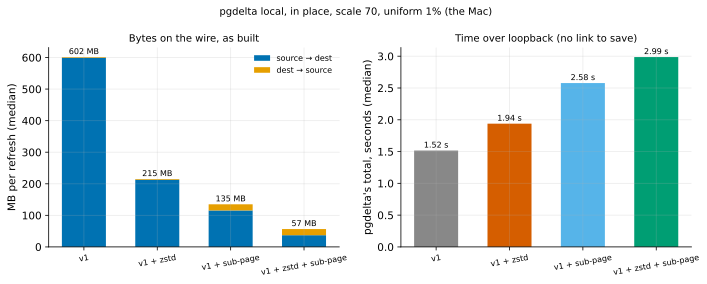
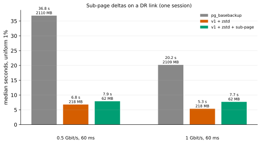

# EXP-56: Do sub-page deltas, as built, deliver EXP-54's bytes and time on a DR link?

Status: **done October 27, 2026. Stage 1 held (every copy byte-identical; bytes as projected); stage 2's deciding prediction failed. On VMs, v1 + zstd + sub-page took 1.16× v1 + zstd's time at 0.5 Gbit/s (7.89 s against 6.79) and 1.44× at 1 Gbit/s, while sending 3.5× fewer bytes.** The diagnosis:
- the sender's block hashing, about 2.2 s on its main thread, is new serial work;
- the receiver computes block digests (0.8 s) before it answers a leaf request, which delays the sender by 0.6–0.9 s;
- the link time saved, 1–2 s, is less than the sum.

By the registered rule `--subpage` stays, opt-in, with these numbers. Pre-registered before any measurement of the build. The build of the design EXP-55 settled, then two stages: a local check (`pgdelta local`, scale 70) and one VM session at 0.5 and 1 Gbit/s. The local stage gates the VM stage.

## Why

EXP-54 found that changed 512-byte blocks plus zstd send 0.21 of zstd's bytes for scattered updates. EXP-55 priced what that costs beyond bytes:
- B's block digests can go up front with the leaf digests, so there's no extra round trip;
- hashing the blocks takes about 1.5 CPU-seconds;
- block writes cost about the same as whole runs.

The owner left the choice of next item open. This one is opt-in, so it changes nothing for anyone who doesn't ask for it, and everything up to the VM run is local.

## The build (opt-in: `--subpage` on `send` and `local`)

**Negotiation.** HELLO carries `subpage_offer: 512`. The receiver accepts (`ACCEPT subpage: 512`) only when it reuses B and builds on B's bytes: in place, or `copy-patch`. Otherwise it leaves `subpage` out of ACCEPT, and the session runs as before. No other session's bytes change.

**B's block digests.** With sub-page accepted, the receiver follows every LEAF_DIGESTS with BLOCK_DIGESTS (new message 12) for the same nodes:
- for each page of B there, the keyed BLAKE2b digest (8 bytes) of each of its 16 blocks of 512 bytes;
- hashed on the receiver's worker processes.

**The sender's frames.** For each page it sends, the sender hashes the bytes it is about to send in the same blocks and compares them with B's. It sends a PAGE_DELTA frame (13; compressed, PAGE_DELTA_ZSTD, 14), with the same head as PAGE_DATA and then, per page:
- a 2-byte bitmap of the blocks that differ, then those blocks;
- bitmap 0xFFFF: the whole page. This is used where B has no full page at that offset, where every block differs, and for a file's short last page;
- bitmap 0: no blocks (the page equals B's).

**The receiver's writes.** It writes the changed blocks into B's page in place, or into O after copying B's bytes ahead (copy-then-patch). It counts each such page as written, so verification re-hashes the whole page and the file digest still has to match S's. A frame that claims more blocks than it carries, a block outside a full page of B, or pages out of order is refused.

## Stage 1: local (decides whether stage 2 runs)

`experiments/bytes/exp56.py`: `pgdelta local --in-place --source-kind datadir --jobs 4` on EXP-51's scale-70 data, with fresh APFS clones of B. Four arms, 3 repeats in a rotated order after a warm-up:
- `zstd`;
- `zstd_subpage`;
- `plain`;
- `subpage`.

After every run, every file pgdelta sends is compared with S's (EXP-51's check), plus EXP-51's negative control.

1. **Correctness (gates everything):** every run completes, and every copy is byte-identical to S.
2. **Bytes match EXP-54/55** within 10%:
   - `zstd_subpage` sends, source to dest, EXP-54's 34.6 MB of compressed blocks plus the page-data frame headers;
   - dest to source, about 17.2 MB of block digests (EXP-55's up-front design).

## Stage 2: one VM session (runs only if stage 1's 1 holds)

EXP-52's pair and command (uniform 1%, hex filler, 60 ms tuned, BBR), at `0.5:60:tuned` and `1:60:tuned`. Methods: `full`, v1 + zstd (`pgdelta_direct_inplace_bbr_z`) and v1 + zstd + sub-page (a new arm, `pgdelta_direct_inplace_bbr_zs`). 2 repeats, order seed 560.

3. **Deciding: at 0.5 Gbit/s, v1 + zstd + sub-page takes at most 0.80 of v1 + zstd's time.**
   - At 0.5 Gbit/s v1 + zstd took 6.8 s (EXP-46), about 3.4 s of it on the link for 210 MB.
   - Sub-page sends about 52 MB in all, about 0.8 s on the link.
   - If its hashing doesn't eat the difference, that projects to about 4.5 s (0.66).
4. At 1 Gbit/s it takes at most 0.95 of v1 + zstd's time. The saving there is about 1.3 s of link time, against hashing that costs about the same on 8 vCPUs.
5. Every run passes pgdelta's own verification, and BBR is in effect on every v1 run.

Rule 11 applies to 3: a ratio within 20% of 0.80 gets a second session on fresh VMs.

## What follows

- **If 1–3 hold:** `--subpage` stays opt-in and its row goes in the README. Advice: use it with `--compress zstd` on slow DR links.
- **If 1 fails:** the build is fixed or withdrawn before anything else.
- **If 3 fails:** the code stays, opt-in, with the measured numbers. The analysis looks first at the extra hashing.

## Stage 1 results (October 27, before stage 2)

`experiments/bytes/exp56.py` over EXP-51's data: a warm-up and 3 repeats of the four arms, in place, `--jobs 4`. Data: `docs/experiments/data/exp56-local.csv`; raw `results/bytes/exp56/runs.jsonl`; analysis and figure `analysis/exp56.py`.

| Median of 3 | source → dest | dest → source | pgdelta's total | sender's block hashing | receiver's |
|---|---|---|---|---|---|
| v1 | 599.3 MB | 2.2 MB | 1.52 s | none | none |
| v1 + zstd | 212.8 MB | 2.2 MB | 1.94 s | none | none |
| v1 + sub-page | 115.5 MB | 19.5 MB | 2.58 s | 0.90 s | 0.42 s |
| **v1 + zstd + sub-page** | **37.1 MB** | 19.5 MB | 2.99 s | 0.88 s | 0.43 s |

| # | Prediction | Verdict |
|---|---|---|
| 1 | **Gate: every run complete; every copy byte-identical to S** | **Held:** 13 of 13 copies identical in all 1,278 files; the control differed in 12 |
| 2 | zstd + sub-page's bytes within 10% of EXP-54/55 | **Held:** page data 37.0 MB against 35.1 expected (1.05); block digests 17.24 MB against 17.16 (1.005) |

**Over loopback, with no link to save, sub-page costs about 1.05 s.** That is mostly the sender hashing the pages it sends in blocks, 0.9 s on its main thread, and the receiver hashing B's, 0.42 s on its workers. On a DR link it has to save more than that.

At 0.5 Gbit/s, zstd's 213 MB take about 3.4 s on the link, and zstd plus sub-page's 37 MB about 0.6 s. With tuned TCP buffers of up to 128 MiB the delta stream fits in the socket buffer, so the sender's hashing should mostly overlap the link. Stage 2 runs as registered: its gate (prediction 1) held.

**The stage 2 arm:** `pgdelta_direct_inplace_bbr_zs` (EXP-52's v1 engine with BBR, `--compress zstd` and `--subpage`), added to the harness with its analysis, `analysis/exp56_vm.py`, before the run.

## Stage 2 results (October 27)

One VM session (us-central1-a, order seed 560). All 12 runs passed, with BBR in effect on 8 of 8 v1 runs. Every sub-page run used it: 70,214 partial pages and 4,128 whole. Data: `docs/experiments/data/exp56-vm-cells.csv`; raw `results/exp04/exp56`; analysis and figure `analysis/exp56_vm.py`.

| Uniform 1%, 60 ms (median of 2) | `pg_basebackup` | v1 + zstd | v1 + zstd + sub-page | sub-page ÷ zstd |
|---|---|---|---|---|
| 0.5 Gbit/s | 36.8 s (2,110 MB) | 6.79 s (218 MB) | 7.89 s (62 MB) | **1.16** |
| 1 Gbit/s | 20.2 s (2,109 MB) | 5.35 s (218 MB) | 7.69 s (62 MB) | **1.44** |

The bytes are source to dest on the wire. The VM's data (the study's hex filler) differs from the Mac's (EXP-37's md5 filler), so 62 MB here stands against stage 1's 37 MB.

| # | Prediction | Verdict |
|---|---|---|
| 3 | **Deciding: at 0.5 Gbit/s, sub-page at most 0.80 of zstd's time** | **Failed:** 1.16 (outside rule 11's 20%, so no second session) |
| 4 | At 1 Gbit/s, at most 0.95 | **Failed:** 1.44 |
| 5 | Every run passes; BBR on every v1 run | **Held** |

## What it means

**pgdelta's own timers, per run:**

| | v1 + zstd | v1 + zstd + sub-page |
|---|---|---|
| sender blocked on the link (`page_send`) | 0.68–2.16 s | **0.0 s** (62 MB fit in the 128 MiB socket buffers) |
| sender's block hashing, on its main thread | none | **2.15–2.23 s** (0.9 s on the Mac) |
| sender waiting for the receiver's digests (`leaf_wait`) | 0.95–1.21 s | **1.63–1.97 s** |
| receiver's block hashing | none | 0.79–0.81 s, before each leaf answer |

- **The bound moved from the link to the CPU.** Sub-page removed the sender's waits on the link entirely, but added about 2.2 s of block hashing on the sender's main thread and 0.6–0.9 s of extra waiting for answers. Its time, about 7.7 s, hardly depends on the link: a floor, as zstd's was before EXP-50.
- **Stage 1 couldn't show this:** over loopback there was no link time to trade against, and the Mac's cores hash 2.4× faster.
- **Where it would pay as built:** the bytes it saves (155 MB) are worth 1.24 s ÷ the rate in Gbit/s. Against about 2.9 s of added work, that projects a break-even near 0.4 Gbit/s; it didn't measure faster at 0.5. That's a projection, not a measurement.
- **What a revision would change,** each its own experiment:
  - hash S's changed pages in blocks on the sender's worker processes instead of its main thread;
  - send BLOCK_DIGESTS without holding up the leaf answer;
  - or use a cheaper per-block digest, since a wrong match only costs a failed verification.

## What was done

`--subpage` stays in the code, opt-in, off by default, as the rule says. The README's row says it was measured slower on these VMs at 0.5 and 1 Gbit/s, and why. The advice stays `--compress zstd` alone.
